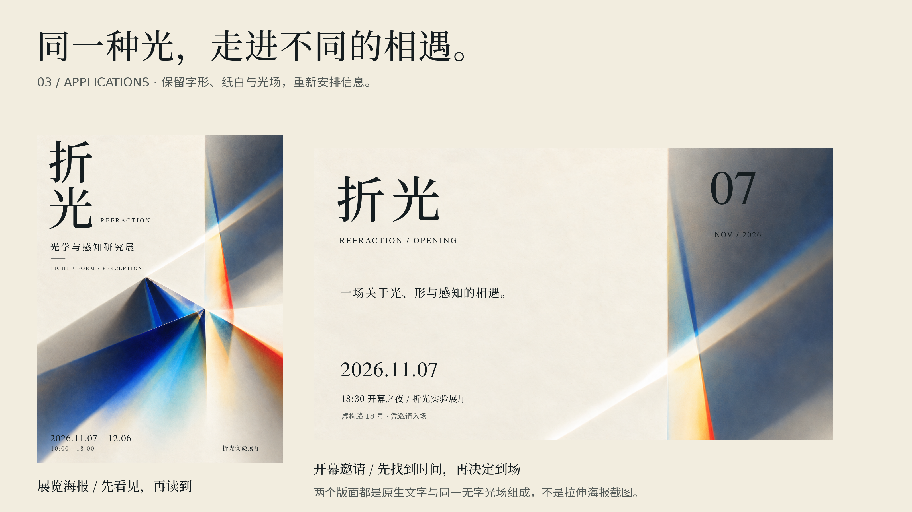

# 设计的语法

## 从艺术秩序到设计系统 · 5.0折光视觉提案与原生重建版

本轮更新折光的完整AI视觉提案、去字素材与原生重建流程。全书236页、109259汉字、187次配图、178张独立图像。完整AI提案见193页，原生海报196页，新旧对照199页；references/v5-artwork-page-index.md记录本版位置，v4-artwork-page-index.md保留上一版定位。

面向非专业兴趣读者的中文设计读本。全书33个正文章、导读与3附录，涵盖真实作品/官方应用、原创分析、原创教学、原创设计及系统导出，以及明确标注的AI提案与素材。历史、当代真实案例与原创实作相互对照，不把某个流派直接等同于狭义软件设计系统。

本轮折光先实际生成整张海报视觉提案，再在保留光场构图的前提下生成去字底图，以纸白、墨黑、蓝青与金红光场、宋体中文和细衬线英文重建原生7板与设计系统。完整AI提案是位图，后续Main保留可编辑文字；两者不宣称逐像素一致。野序与隙间保留4.0版已完成的单枝鸢尾、俯拍咖啡方向与原生工程。折光是光学艺术展，野序是当代摄影画报，隙间是咖啡品牌及电商原型；保存3套系统、3套Canvas、本地字体、主要组件、状态与源脚本。品牌、刊物、活动、商品和金额均为教学虚构。

新增2023—2025年Pepsi、Reddit、Wise、Spotify Mix、Config 2025、Decathlon六组真实品牌项目，20张新增真实应用图与3张原图分析；品牌、数字、广告与包装章同时补入当代对照。第三十一章以折光具体讲解整张AI提案→去字素材→原生重建→系统跨媒介，第三十二章具体细读当代字体、广告、包装、界面、实体与空间应用。

上一版与本版都有实际PDF嵌入审计，逐次核对源图、页码、像素与显示区域；不是只确认文件夹里有图。正式图数、全书页数和字体/链接/图注检查见references/validation.json，原生系统检查见references/creative-lab-validation.json，当前嵌入核对见references/embedded-artwork-current-audit.json。

## 仓库入口

- [分章书稿](chapters/)与[附录](appendices/)：可直接在GitHub阅读，配图使用相对路径。
- [原创创作工坊](examples/creative-lab/README.md)：三套设计系统及可编辑画板，折光为V5蓝金光场版本。
- [V5插图页码](references/v5-artwork-page-index.md)：完整提案193页、原生海报196页、对照199页。
- [图像、来源与验证记录](references/)及[构建脚本](scripts/)：保留图片身份、引用和可复现构建。

全书PDF由下方命令生成；GitHub Actions也会构建并保存可下载的PDF，位于仓库Actions中最近一次成功任务的Artifacts。大体积PDF及重复ZIP不纳入Git；原始配图、字体、画板和源代码均保留。



## 阅读路线

| 部分 | 章节 | 具体学习内容 |
| --- | --- | --- |
| 读前 | 00 | 术语边界、事实与分析的区别、图像身份 |
| 基础 | 01—04 | NASA规范、北斋构图、梵高色彩、齐肖尔德海报，学关系与层级 |
| 历史与材料 | 05—10 | 莫里斯、穆夏、布兰特、里特维尔德、两版Musica Viva、Carlton、中国画谱、Albers |
| 应用 | 11—16 | MIT/Public Theater、Penguin、NPS、606、Eames住宅、Bass等具体设计 |
| 规则实现 | 17—21 | 生成艺术、官方数字系统、Token、组件、治理；有真实图与代码 |
| 跨媒介练习 | 22 | 岸线设计周的五种应用与反例 |
| 图像与身体 | 23—24 | Becher、IBM插画、Vionnet和山本耀司服装 |
| 海报 | 25 | 劳特累克、Gismonda、Nord Express与逐步改稿 |
| 广告 | 26 | JOB、早期可口可乐、Think Small的主张、证据、文案与行动 |
| PPT演示 | 27 | 作者教程、NASA原页、三步改稿及实际八页虚构数据报告 |
| 画报杂志 | 28 | Ver Sacrum、LIFE封面与内页，封面/跨页/广告/八页阅读节奏 |
| 包装 | 29 | 可口可乐与Tetra Pak真实材料，虚构咖啡系列与展开信息关系 |
| 能力检验 | 30 | 带参考推导的练习 |
| 原创工坊 | 31 | 三套实际系统、AI素材、18块可编辑画布与改稿 |
| 当代品牌 | 32 | 六个真实项目、跨媒介细读与迁移练习 |
| 继续学习 | 33 | 观察与学习路线 |
| 附录 | A—C | 词汇、旁读、工作纸 |

主稿在 `chapters/`，每章独立文件，真实图与分析图就近插入，引用链接保留。PDF可点击目录和书签，图与图注不拆页。可按章顺读，也可从海报/PPT/画报等感兴趣的门类开始。

## 如何重建

建议Python 3.12，字体已附带，许可位于 `assets/fonts/`。

```bash
python -m pip install -r requirements.txt
python scripts/restore_native_fonts.py
python scripts/render_figures.py
python scripts/build_examples.py
python scripts/build_book.py
python scripts/check_book.py --render
```

唯一全书PDF为 `build/design-grammar.pdf`。检查报告、逐图物理尺寸、图注页码与全页缩略图在 `build/`；这些可重建成品不入Git。仅修改文字时不用重绘，执行后两条即可。原作图像已附带，不要求联网才能重建阅读版。

新增教学图的源代码按领域保存，修改相应图时再运行；不要在构建PDF的同时重绘输入图片：

```bash
python scripts/history_revision_diagrams.py
python scripts/revision_digital_analysis.py
python scripts/render_revision_applications.py
python scripts/render_revision_root.py
python scripts/render_revision_presentations_magazines.py
python references/revision-posters-ads-draw.py
```

新增PPT八页示例是实际PNG及源绘图代码，没有声称交付可编辑PPTX。复制、数字输入和结构修改可在相应脚本中进行；第二十七章说明如何迁移到常用幻灯片工具。章节中灰条用于解释编辑版面结构的图，图注会明确说明；真正原作与真实文本样张分别标注，不以灰条代替案例分析。

在线阅读站采用 MkDocs Material：首页、33 个正文章、完整配图、中文搜索与图片放大。推送 main 后由 GitHub Pages 工作流构建发布。首次发布须在仓库 Settings → Pages 中将 Source 设为 GitHub Actions。

本地构建与校验：

```bash
python -m pip install -r requirements-site.txt
python scripts/build_site.py
python scripts/check_site.py
python -m http.server 8000 --directory build/site
```

## 原作、分析与素材边界

`references/case-index.md`为实际使用的真实图索引，`references/revision-*-images.json`记录原页面、图像地址、作者、年代与处理方式。馆藏原作、官方界面、机构幻灯片、当代复制品展示图分别在图注说明，不混称成历史初版。实际眼动、人体工学、环境收益和广告效果未因一张图而被宣称证实。

Met公开领域图片遵循其开放记录；其他作品与照片按原权利人归属，不因为本书引用而获得开放再许可。分析标线、局部裁切、灰度与图形概括会明确标为本书处理；不冒充设计师草稿、隐藏网格或真实研究。AI素材不替代真实经典。原创工坊将实际生成素材与可编辑文字、图形、组件混合制作，作为本书原创作品标注，不冒充历史原作或真实商业摄影。

本仓库为 https://github.com/YZYExp/Learn-Design-System 。首提交仅包含零字节README.md，随后导入已完成的V5书稿与创作工程。导入前1.0—5.0的完整历史仍保留在已交付的版本历史.bundle中；当前Git历史从本次空README初始化开始，详见docs/repository-import.md。

## 打开原创创作包

```bash
cd examples/creative-lab
npx --yes tingly-design@0.26.1021 --projects .
```

独立包则进入其中creative-lab即可。各项目README解释具体制作与更新规则。首次克隆先在仓库根目录运行 `python scripts/restore_native_fonts.py` 还原完整宋体；首次取得软件需联网，其他字体图片均已附带，查看与编辑不要求额外AI账号。额外审计：`DC_CHROME=/你的/Chrome路径 python scripts/check_creative_lab.py`。

本轮用户明确要求Tingly Design原生Canvas和Design System，因此.dc.html及组件preview.html是必须保留的可编辑源文件。书籍网站从同一份 Markdown 和实际引用图片构建，原生工程保留在仓库中。原生tokens.css由工具编译；系统快照不等于所有既有内联值实时绑定。提案保留原生Canvas，未冒称PPTX。

`python scripts/collect_creative_lab.py`收集实际原生导出并重建素材联系表；`python scripts/render_creative_gallery.py`制作总览。重绘输入后须重新构建PDF，保证图文同版。


写作包保留全部正文及正文实际引用图片；完整Git历史因单文件容量上限另存为“设计的语法-版本历史.bundle”，未删减任何版本。使用 `git clone 设计的语法-版本历史.bundle design-grammar-history` 可恢复完整历史与当前工作树。为控制重复内容，可再生的检查截图、未被正文引用的旧PNG与系统视图导出不重复纳入；源码、字体、原生检查报告与必要对照仍保存。脚本scripts/package_revision.py加 `--omit-unreferenced-export-pngs --separate-git-history` 可按同一规则重建两个工程包；另用 `git bundle create 设计的语法-版本历史.bundle --all` 导出完整历史，PDF单独交付，不嵌套入包。
