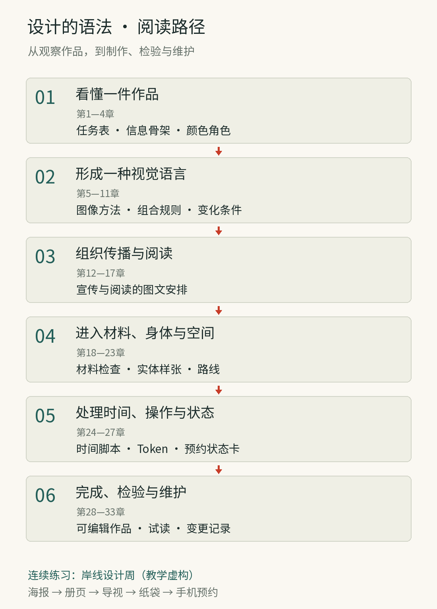

# 导读｜看见作品背后可以传递的规则

这本书面向喜爱绘画、器物、书籍、空间与屏幕设计的非专业读者，介绍描述和分析作品的基本方法：辨认视觉重点，比较系列作品的共同关系，区分可以复用的规则与必须随材料、任务调整的细节。

这里的“设计系统”需要分清语境。当代数字设计系统通常包括视觉基础、组件、任务模式、文档与维护机制。艺术史中的流派、艺术家的构图手法和传统纹样各有其历史与实践范围。本书以“系统性方法”“视觉语法”“工艺规则”等词描述这些方法，比较它们如何组织形式、适应条件和传递经验。

全书沿着一条学习路径推进：先观察一件作品的关系，再理解一种视觉语言如何形成；进入不同媒介，调整规则；最后把经过检验的决定整理出来，交给他人继续使用。艺术、美术与设计占据主体，软件工程在第五篇及维护章节中出现，帮助解释参数、接口、状态与版本。你无需先会编程。

## 六篇的学习顺序

| 篇 | 章节 | 学习任务 |
| --- | --- | --- |
| 看懂一件作品 | 第1—4章 | 从任务、重点、颜色与网格说明设计选择 |
| 形成一种视觉语言 | 第5—11章 | 比较图像、装饰、几何、现代与传统的组织方法 |
| 组织传播与阅读 | 第12—17章 | 让品牌、海报、广告、演示、书籍与画报承担各自的信息任务 |
| 进入材料、身体与空间 | 第18—23章 | 检查工艺、包装、产品、服饰、展陈与导视如何改变规则 |
| 处理时间、操作与状态 | 第24—27章 | 把时间、反馈、Token与组件纳入设计 |
| 完成、检验与维护 | 第28—33章 | 完成作品，比较方法，记录变化，练习修改 |

图导-2｜原创阅读图：每一篇向下一篇交付可继续使用的观察或作品。连续练习“岸线设计周”为教学虚构。

## 跟着一个项目积累判断

“岸线设计周”从第一章开始，逐步积累活动海报、册页、导视、纸袋与手机预约的设计判断。前面的章节先处理局部问题，例如文字的优先级、颜色承担的角色、图像的取景和材料上的限制。到第28章，再把这些记录合成一套跨媒介规则，并检查它们是否支持实际任务。

第29章保留三套完整原创项目：折光、野序与隙间。它们各有独立任务与视觉语言，展示怎样混合AI素材、可编辑文字和图形、Token及组件来制作作品。它们与岸线一起提供多种做法，便于比较设计选择怎样随任务改变。

真实案例放在与问题最接近的章节：第12章的Reddit、第16章的Spotify Mix、第19章的Pepsi、第21章的Decathlon、第23章的Config和第25章的Wise。第30章把六者放在一起比较，帮助决定何时采用共同骨架，何时需要允许变化。历史作品与当代品牌共同提供观察材料，二者的任务和生产条件应分别理解。

## 按兴趣阅读

初次阅读可以按六篇顺读。偏爱平面传播的读者，可在第1—4章后先读第12—17章；喜欢器物与空间的读者可接第18—23章。想亲手制作时，先读观察基础，再看第28章完整练习与第29章原创工坊；第32章提供有参考推导的改稿练习，遇到困难再回查相应专题。

书籍与画报分别安排在第16、17章。前者关注长文、条目、层级与检索，后者关注选题、图片叙事、图注和翻页节奏。数字部分先建立时间与交互的认识，再进入Token和组件；维护放在完成作品之后，便于结合真实修改理解责任与版本。

## 图像怎样使用

原作与相应论述并置，配合局部放大、结构标注或同题对照。作品日期与馆藏依据引用资料；图中标线、阅读路径分析和改稿解释属于本书的教学观察，不能据此推定设计者采用了相同的构图过程。

全书的精确关系图是原创程序绘制的教学示意；它们不冒充历史作品。AI场景插画用于观察材料、媒介与系列感；第29章还把实际生成的原创素材与可编辑文字、图形和组件共同组成作品。生成图不能作为制造性能、尺寸、历史复原或结构安全的证据。真实作品以作者、题名、年代和机构链接供旁读，便于回到原作看细节。正文的设计推演、比较框架与练习，除明确引文外，均为本书的教学组织。

图导-1｜AI教学示意：同一双叶母题进入织物、纸印、釉陶与金属。看共同轮廓，也看边缘、凹凸和反光如何随材料改变。图中的材料效果不等于工艺测试结果。

比较一组作品时，可分别排除颜色和标志的影响，再检查轮廓、比例、文字层级与排列方式是否仍有联系。这样能区分系列中的结构共性与统一署名的作用。
