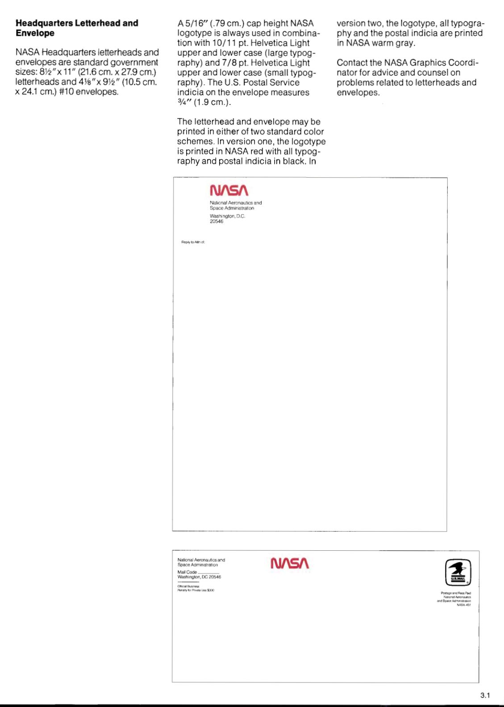
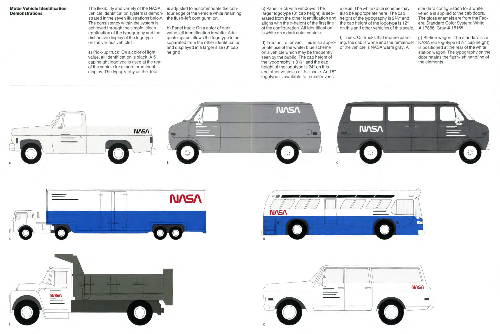
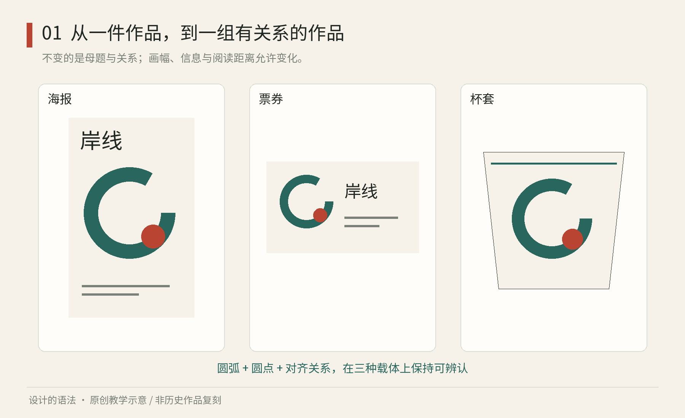

# 第01章｜从“一张好看”到“一组成立”

## 真实案例：NASA把识别规则交给不同的人

NASA公开的《Graphics Standards Manual》1976年1月版，将识别规则落实到信纸、信封和车辆等具体载体。下面两页分别规定总部通信用品的版式和不同车型的标识位置，便于观察同一身份如何适应不同任务。版面与协作关系的解读为本书分析。[NASA，Graphics Standards Manual，1976年1月](https://www.nasa.gov/wp-content/uploads/2015/01/nasa_graphics_manual_nhb_1430-2_jan_1976.pdf)

图1-A｜真实原作：Danne & Blackburn／NASA，《Graphics Standards Manual》，1976年1月版本，PDF第19页。原页包含信纸与信封的规格和例图。来源为NASA公开PDF；标识的展示不表示NASA为本书背书。[原文件](https://www.nasa.gov/wp-content/uploads/2015/01/nasa_graphics_manual_nhb_1430-2_jan_1976.pdf)

信纸上，字标、机构全名和地址共同构成身份区，为正文提供定位起点。信的主体留出大面积空白，用于每次通信中不同长度的内容。原页上的制作说明又将字标高度、字与行距等关系交给执行者。后续人员可直接沿用字标位置、正文起点和间距，将工作集中在通信内容上。

再看信封。它没有把整张信纸缩小，而是重新处理邮寄信息和机构署名。相同的是身份的组合方式，改变的是留给地址、邮资和版面的空间。由此可以得到一个实际判据：如果一套身份系统只能在没有真实内容的展示图上成立，却放不下收件人或长部门名，它仍然没有完成任务。

图1-B｜真实原作：同一手册PDF第52页，Motor Vehicle Identification Demonstrations。此页为原规范的车辆示意，并非现今NASA车队照片。观察白、灰、深色车身上的字标处理及车门、车厢之间的位置差别。[NASA原页](https://www.nasa.gov/wp-content/uploads/2015/01/nasa_graphics_manual_nhb_1430-2_jan_1976.pdf)

车辆页展示了背景和可用表面对识别的影响。车门、窗、车厢和不同底色，把同一个“放上标志”的任务拆成了不同条件。上排的深色车身使用浅色识别，白色车身使用深色识别；中部大型车辆又把图形放到适合远视的位置。这些处理首先回应车身底色、观看距离和安装位置。把标志统一放在距画布左边某个绝对坐标，在这些不同车辆上没有意义。

这套案例包含三个层面：可复制的字标文件、规定组合与位置的规范、让不同部门持续执行规范的组织工作。只下载第一项，不会自动得到后两项。旧手册中的具体尺寸和车辆条件属于当时项目，不能直接当作今天任何品牌的数值标准；处理载体差异的思路仍可用于新项目。

练习：为一家社区图书馆设计借阅通知、装书纸箱标签和送书小车侧面识别。先写每件东西的可用空间、观看距离与必须容纳的文字，再写共用的名称、字标与联系信息。先画最长的机构名版本，再画黑白打印版。检查出现问题的位置，并将原因归入身份文件、组合规则或执行说明，分别修改。

## 一组应用需要共同的识别依据

菜单用了手写字，杯套用了几何线条，招牌是复古衬线体，手机点单页又变成荧光渐变。每一件都可能单独好看，放在一起却让人认不出。缺少的可能是共同的识别依据，以及决定固定项、可变项和修改权限的规则。

本书用虚构的“岸线设计周”继续练习。它要有远处可读的海报、近处细看的小册、引导路线的标牌和手机报名页。四种应用的版式需要分别适配：海报需要远处辨认，册页容纳较多信息，导视需要及时判断，报名页需要可操作。系统的作用是让它们在各自任务上成立，同时共享能被辨认的关系。

本书从目的、材料、组合、适配和维护五个方面检查规则。这是教学框架，不是某个机构的官方定义。把它用于传统器物时，材料可能是木材与榫接；用于海报时，材料可能是文字、图形和纸；用于界面时，还要加入状态、输入与反馈。

现代组织确实会把规则写成可传递文件。NASA 的图形规范规定标识及应用关系，官方品牌中心仍提供规范入口。这种文件将识别工作延伸到多种载体，并向执行者说明使用条件。[NASA，Brand Center](https://www.nasa.gov/nasa-brand-center/)

图1-1｜原创教学图：圆、弧与线组成同一个图形词汇，再进入海报、票券和杯套。观察共同母题与位置关系，注意三种版式没有机械等比缩放。

## 风格、规范、库与系统的分工

“风格”描述外观倾向，例如尖锐或圆润、克制或浓密、平面或立体。“规范”将一部分选择写成要求，例如标志周围的留白。“库”保存可取用的图标、版式或按钮。“系统”还需说明各元素的用途、选用条件、组合方法和例外处理。

一本精美手册可能没有可用素材，一个素材库也可能没有选择方法。反过来，一位手工艺人即使没有正式文档，也可能有稳定的材料判断、比例经验和检查方法。它具有系统性，却与供数百人协作的数字设计系统不同。文档是否充分，应由使用者能否据此工作来判断。

一个可观察的差别是“新任务测试”。把海报模板交给另一个人，让他做一张信息量翻倍、标题变长、没有照片的版本。若新版本的文字溢出或主次混淆，需要补充适配规则；若不同内容始终被排成同一种布局，也需检查限制是否过窄。说明中应区分不可破坏的约束与可随内容调整的部分。

可以把变化分三层。第一层是身份，例如弧形母题与文字语气。第二层是角色，例如红色负责强调、深色负责正文。第三层是适配，例如窄纸上从四列变两列。第一层提供辨认，第二层提供选择依据，第三层处理尺寸、内容和媒介的实际差异。

## 做一次最小的系统实验

取一张纸，画一条弧、一个圆与三条短线。限定只用黑色与一个强调色。先做一张活动海报，写清名称、日期、地点；再做一张手掌大的入场券，只保留必要信息；最后做一条贴在杯上的窄纸带。

先记录三条可验证的规则，例如“弧形总在信息区外缘”“日期始终与地点相邻”“强调色只标一项当前最重要的信息”。再改变两个条件：把活动名加长一倍，把强调色拿掉。若出现文字溢出或识别困难，记录原因并修改相应规则，再重做三种应用。

比较各版后，将规则分为形状约束、信息关系和异常处理三类。若只记录形状，接手者仍需自行决定主次；若缺少适配规则，长标题和窄尺寸就容易迫使他临时补救。

检验这套规则时，再交给另一人制作一件新应用。观察他需要补问哪些条件、在哪些位置自行作了决定，再将缺失的信息补回规则。

本章来源：[NASA Brand Center](https://www.nasa.gov/nasa-brand-center/)。其余框架和实验为本书原创教学组织。
