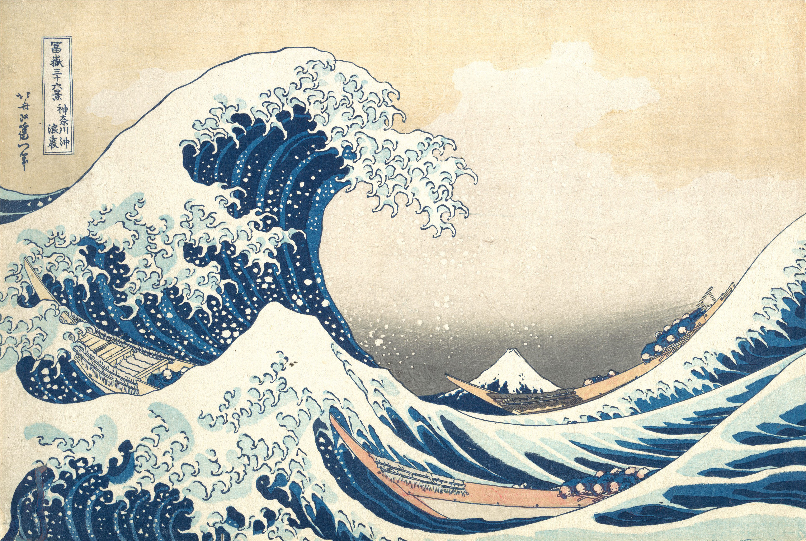
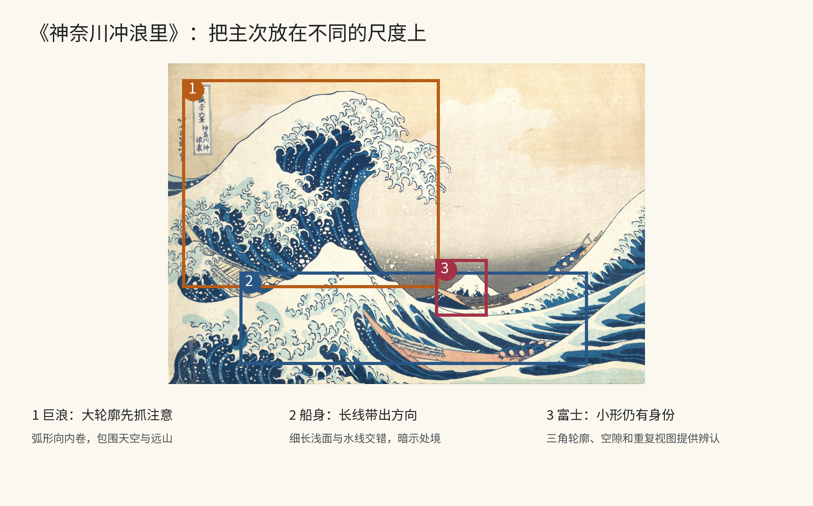
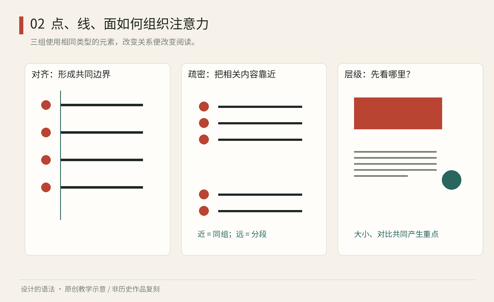

# 第02章｜点线面怎样变成视觉秩序

## 真实案例：北斋怎样让小山对抗巨浪

葛饰北斋《神奈川冲浪里》属于《富岳三十六景》，本书采用Met藏本，馆方年代为约1830—1832年。它是一张多色木版画，不能用“某种数字设计系统”的标签取代其艺术与制作语境。我们借它训练视觉关系的观察，而不把海浪图案直接移成任何项目的装饰。[Met，Under the Wave off Kanagawa](https://www.metmuseum.org/art/collection/search/45434)

图2-A｜真实原作：葛饰北斋，《神奈川冲浪里》，约1830—1832年，多色木版画，Met藏，object ID45434。Met Open Access／Public Domain；图像版本以此藏本为准。[作品记录](https://www.metmuseum.org/art/collection/search/45434)

第一眼很容易被左上方卷起的巨浪抓住。它的面积、深色边缘与尖锐细节共同使它获得视觉重量；波峰朝画面内部弯曲，又围出一块天空。若只说“曲线带来柔和”，就完全错过了这里的力量：曲线也能包围、压迫和建立即将发生的动作。形式词汇必须回到具体位置、方向与尺度才能有用。

再看富士山。它位于远处，尺寸很小，却拥有明确的三角轮廓和周围的空间。前景小浪也出现近似尖峰，远山与近浪之间于是有一种形状呼应。这里的分析来自观看，不是关于作者意图的文献断言。重要的学习点在于：主次不等于大者有意义、小者没有意义。一个小对象可以借轮廓、位置和反复出现的身份维持辨认。

船身则提供另一种方向。几条狭长浅色带嵌在水面里，和波浪的弯曲关系共同引导视线。观察船与人的尺度，再回到巨浪，你会更容易感到情境的紧张；若删除这些对象，只剩一枚漂亮浪花，作品的叙事条件已明显改变。视觉构成中的元素，既有形状关系，也携带题材意义，不能全部当成可随意替换的几何块。

图2-B｜本书原创分析，基于图2-A标注巨浪、船身、富士三处。框线与数字为教学添加，不属于原作；它们指示观察区域，不声称复原北斋的草图或计算过程。[原作来源](https://www.metmuseum.org/art/collection/search/45434)

把这张图转成设计学习，可以提出两个检验。其一，缩小图像：最先保留的应是主要轮廓和明暗块，细小浪花会消失。其二，暂时只描出巨浪、船身和山的外轮廓：若这些关系已经产生张力，说明细节并非唯一支撑。不要据此反过来说细节无关紧要，它们还承担材质与节奏。训练应当先能看见粗结构，再理解精细层。

迁移练习不是再画一张浪。为一场“城市里的小花园”展览画三个缩略构图：一个大面积树冠，一个窄长路径，一处小而清楚的入口牌。固定三个对象，只改变相互尺度与位置。哪一版让人先看树，哪一版让人先找到入口，哪一版产生压迫感？用图中具体位置回答，再选择适合目的的一版。你正在迁移构图能力，而不是移用题材。

## 先说关系，再说感觉

你看见一张海报，觉得它“稳”。这个判断可以分解：标题靠近左上角，正文沿同一条边排列，较重的图形压在右下方，大片空白把两块内容隔开。所谓稳定不必来自左右对称，也可能来自不同大小、距离和密度之间的补偿。

Getty 的形式分析教学把线、形、空间、色彩与肌理作为可讨论的视觉要素，把平衡、强调与运动等作为组织方式。它提供的是观察词汇，不能把每种形式机械译成固定情绪。[Getty，Elements of Art](https://www.getty.edu/education/teachers/building_lessons/formal_analysis.html)；[Getty，Principles of Design](https://www.getty.edu/education/teachers/building_lessons/formal_analysis2.html)

先做一个不需要软件的实验：在白纸上放五个大小相同的黑圆。全部等距排列，产生可预测节奏；将一个移远，空隙会成为分组线索；把其中一个放大，它开始争夺主次。元素没有增加，关系已经改变。视觉设计不是把很多元素装进去，而是控制注意在关系中如何移动。

图2-1｜原创教学图：保持基本元素，改变对齐、疏密与层级。逐一比较哪些东西被看成一组，第一眼停在哪里，哪些空隙承担了分隔作用。

## 形状的性格来自上下文

圆常被形容为柔和，三角常被形容为尖锐，但一枚小圆点也能像警告灯，一排三角也能像轻快的彩旗。形状的感受受方向、尺寸、材质、数量和语境影响。用“圆形等于友善”一类标签，可以启动联想，却不能完成设计判断。

更有用的做法是建立形状之间的亲缘。假设你要为一组展品画插图：把大轮廓统一为圆角矩形，把转折半径限制在两个档位，把内部线条限制在一种粗细。人物、灯具和花盆虽然不同，也会因共享弧度与线重而属于同一组。若一个插图突然使用密集写实阴影，它会改变整组的视觉密度，即使颜色完全一样也显得突兀。

注意“视觉重量”不是物理质量。大面积、强对比、密集纹理、孤立位置都可能使一个对象更显眼。你可以在画面一边放一块大而浅的面，另一边放一枚小而深的圆，比较它们是否形成平衡。这个实验没有统一数值答案，但能使判断落到可调变量上。

留白同样是有形的关系。文字之间的空隙小，表示属于一个词组；段落之间稍大，表示换一个思想；章节之间更大，表示换一个阅读层级。如果所有空隙差不多，读者就要自己推断结构。把空白当剩余面积，通常会让设计既挤又散。

## 让眼睛有路线，也允许它停留

一张活动海报可以设定三级阅读：几米外看名称，一米外看时间与地点，拿近后看介绍与报名方式。然后反过来调整字号、密度和对比。假如所有文字都使用粗体，你增加的不是重要性，而是竞争者；假如每块内容都加边框，你可能把本应连续的信息切碎。

我们为“岸线设计周”做一次推导。主要目的在招募参观者，因此活动名是一级，时间地点是二级，策展文字是三级。先把这三层写在纸上，再给它们不同面积，而不是打开字体菜单碰运气。图形负责建立记忆，不应把日期挤到看不见的角落。将作品缩到邮票大小，仍能识别一级信息，说明最粗的结构有了基础。

观察真实作品时，也能从关系入手。Getty 以 Bernardo Daddi 约1330年的《Madonna, Saint Thomas Aquinas, and Saint Paul》示范对称式平衡。我们可以进一步问：中央与两侧的尺度差，如何参与强调？这是在来源提供的形式分析基础上做自己的观察，而非断言所有中轴构图都只有一种含义。[Getty，Principles of Design，馆藏实例](https://www.getty.edu/education/teachers/building_lessons/formal_analysis2.html)

本章练习：找一张杂志内页，只用三种灰色重画它的文字块、图片块和空白。不要抄内容。看这种“骨架图”是否仍能说明阅读顺序。如果不能，先重新安排块的大小和距离，再谈更换风格。

本章来源：[Getty：视觉要素](https://www.getty.edu/education/teachers/building_lessons/formal_analysis.html)、[Getty：设计原则与馆藏实例](https://www.getty.edu/education/teachers/building_lessons/formal_analysis2.html)。文中的海报推导与练习为原创。
