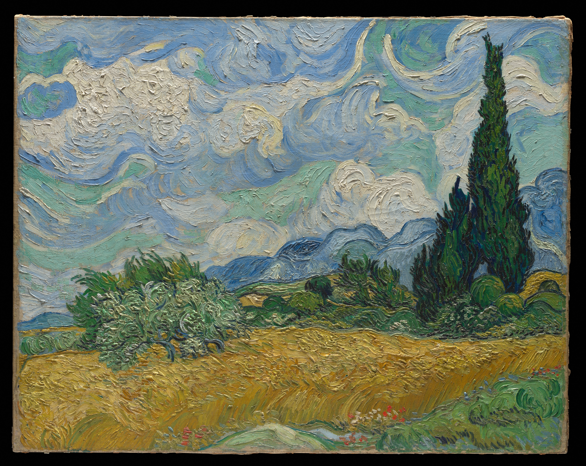
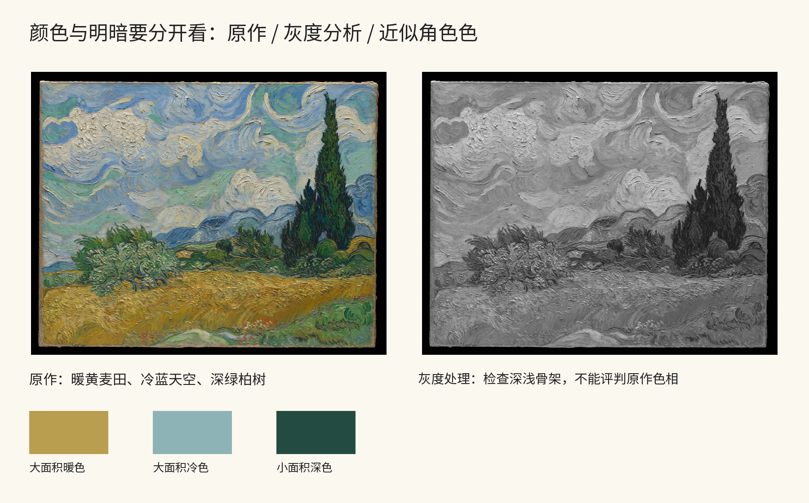
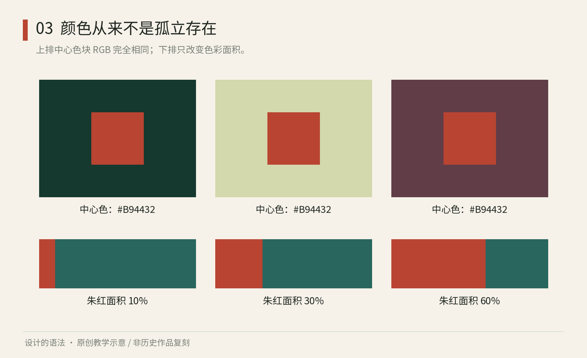

# 第03章｜配色不是色卡：色彩、面积与材料

## 真实案例：梵高的黄色为什么不只是“活泼”

梵高《麦田与柏树》（1889）是Met收藏的一幅油画。下图与后面的灰度处理均使用这个具体藏本；油彩的真实厚度和现场颜色仍需要面对原作，本书图像只支持图内的关系观察。[Met，Wheat Field with Cypresses，1889](https://www.metmuseum.org/art/collection/search/436535)

图3-A｜真实原作：Vincent van Gogh，《Wheat Field with Cypresses》，1889，布面油画，Met藏，object ID436535。Met Open Access／Public Domain。[馆藏记录](https://www.metmuseum.org/art/collection/search/436535)

先看面积。下方麦田形成一大片暖黄与赭色，上方天空形成大面积冷蓝，中间与右侧的绿色承担连接和锚定。若从图片中吸出三个颜色，把它们均匀分成三格，原作的整体感受并不会出现。画中决定关系的还有面积、位置、深浅、笔触和各色内部的变化。色卡保留数值，删掉了组织数值的条件。

再看柏树。它是画面右侧纵向延伸的较深形体，在横向田野与天空中形成一个强支点。试想把同样深的绿色均匀撒到整幅天空里：深色不再集中，原来的竖向锚点会减弱。这说明“用了哪种绿”和“绿集中在哪里”是两种不同的设计决定。前者可被吸管工具获得，后者需要看构图。

天空也不是一块平蓝。旋转的、弯曲的笔触让色彩具有方向与密度，和下方麦田的细碎节奏呼应。因此一张只有相似配色、所有表面都平滑的设计，并没有迁移相同的质感关系。你可以选择只学习冷暖面积，但应清楚自己留下了什么、舍弃了什么，不必把整个视觉经验压成一个调色板名称。

图3-B｜原创教学处理：左侧保留原作数字图，右侧转为灰度，观察深浅骨架；下方三块颜色是本书用于说明面积角色的近似色，不是对梵高颜料的测量。灰度图、色块和标签不属于原作。[图像源](https://www.metmuseum.org/art/collection/search/436535)

灰度处理能帮助我们提出一个更精确的问题：如果暂时拿走色相差别，柏树、天空和麦田还能否形成层级？它不能证明某种配色更好，也不能模拟所有人的视觉，但可以把色相与明暗两项变量暂时分开。你会发现某些相邻区域原先靠冷暖区分，去色后差别减弱；另一些区域仍靠深浅保持边界。

把这个观察用于一张音乐活动海报，可以先设计“大面积暖背景—冷色信息区—小面积深锚点”三种角色，再检查标题与正文的可读性。不要直接把油画颜色用于小字：绘画里细微融合可能有价值，通知里的日期却需要明确。下一次想借名画配色，先画一张面积与位置的草图，再取颜色，再用真实文字检查。这三个步骤各自解决不同问题。

轻量实验：选同一张照片，做两版色块概括。第一版只保留最常见的三种颜色；第二版保留它们的面积关系和主要位置。让别人说哪版更像照片的整体气氛，并指出理由。这个练习训练的是从图像中提取组织关系，不要求认出画家或购买专用软件。

## 同一个颜色，为什么不显得一样

从一张好看的照片吸取五个颜色，往往只能得到一张好看的色卡。真正把它们用于海报时，文字可能不清，重点可能太多，气氛也可能改变。因为照片里的色彩效果，还包含面积比例、周围颜色、光照、纹理与明暗结构。

Josef Albers 的《Interaction of Color》于1963年出版，将比较与观察作为色彩学习的重要方法。它提醒读者研究颜色彼此作用的效果，而不仅记忆色名或孤立色块。本书下图为另行绘制的简化实验，不是原书图版复制。[Josef & Anni Albers Foundation，Interaction of Color](https://www.albersfoundation.org/alberses/teaching/interaction-of-color)

图3-1｜原创教学图：成对的小色块使用相同的 RGB 值，只改变外围背景；另一区比较同一组颜色的面积分配。屏幕与观察环境会影响感受，数值相同不保证感知相同。

先遮住周围背景，只看中央色块；再把遮挡拿开。不要急着回答哪一个更漂亮，先描述它们是否显得更亮、更暗、更冷或更暖。这种比较训练比“某颜色天然代表某情绪”更能帮助你实际使用色彩。

## 先分角色，再决定色值

一个可用的配色方案至少要回答：什么是背景，什么负责长时间阅读，什么负责强调，什么表示状态。色相回答偏红偏绿，明度回答明暗，彩度回答鲜明或灰缓；它们需要结合面积与边界一起判断。两种颜色色相很远，也可能因为明暗接近而使小文字难读。

给“岸线设计周”选暖白、墨黑、朱红、青绿，不等于每件东西四等分上色。可以让暖白承担大面积背景，墨黑承担信息，朱红提示当前入口，青绿承担辅助区分。这里的分配是本书的项目选择，不是适用于所有品牌的比例法则。若把朱红铺满海报，它会从强调变成环境，原来那套主次就要重做。

请区别色板与语义规则。“红色为#B94432”是一条原始值；“强调色用于一个当前主要动作”是使用规则；“错误不可只靠红色表达”则是信息规则。它们属于不同层次。后半部的设计令牌会把这种差别写进软件，但你现在就能在纸上使用。

不要把个人喜好当全部依据。儿童活动、纪念展与预约表格面对不同任务；一个色彩用在大标题上表现鲜明，缩到小图例时可能难分。要分别检查大面积关系、小尺寸识别、灰度层级与文字可读性。通过某一项不代表其余项也通过。

## 颜色一进入材料，就需要重新取样

屏幕发光，纸张反射环境光，织物有纤维方向，釉面有高光。把屏幕上的数值原封不动交给印刷或烧制，不能保证得到同样外观。纸张底色、油墨、印刷过程和观看光源都会参与结果。数字文件应说明色彩空间，实体制作应做实际打样；这比背诵“RGB鲜艳、CMYK暗淡”更有操作价值。

同样不要把材料都归纳为“加点纹理”。一条细线在光滑纸上可能清晰，织入粗线布时可能消失，陶瓷表面的边界可能因工艺而改变。系统要保留的是可识别关系，同时允许线宽、细节与色值为材料修正。导读材料图可作为观察启动，不能替代真实样品。

做一个成本很低的实验：将同一小标志打印在普通纸上，分别放在白墙旁、木桌上、强光下和室内暗处；再把它缩小一半。记录哪些信息先消失。用这一结果决定要增加哪条线的宽度、减去哪层细节，而不是只问颜色是否“高级”。

对于屏幕文字，后续应按实际前景与背景计算对比，并辅以使用测试。WCAG 2.2 的文字对比要求有具体适用条件，不能把某个比值当整个设计的总分。[W3C，Understanding SC 1.4.3: Contrast (Minimum)](https://www.w3.org/WAI/WCAG22/Understanding/contrast-minimum.html)

本章来源：[Albers Foundation：Interaction of Color](https://www.albersfoundation.org/alberses/teaching/interaction-of-color)；[W3C：最低文字对比](https://www.w3.org/WAI/WCAG22/Understanding/contrast-minimum.html)。配色角色、观察实验与媒介适配的组织为原创教学说明。
