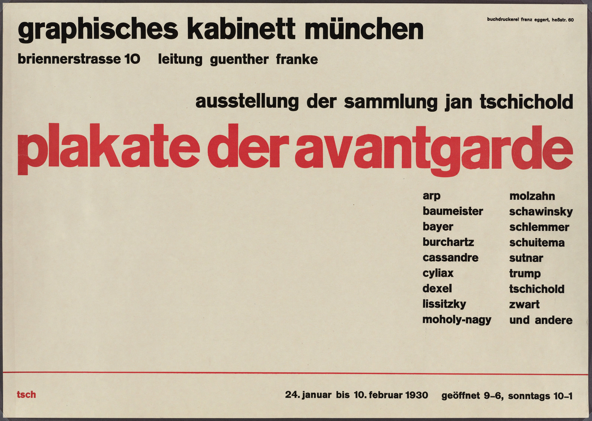
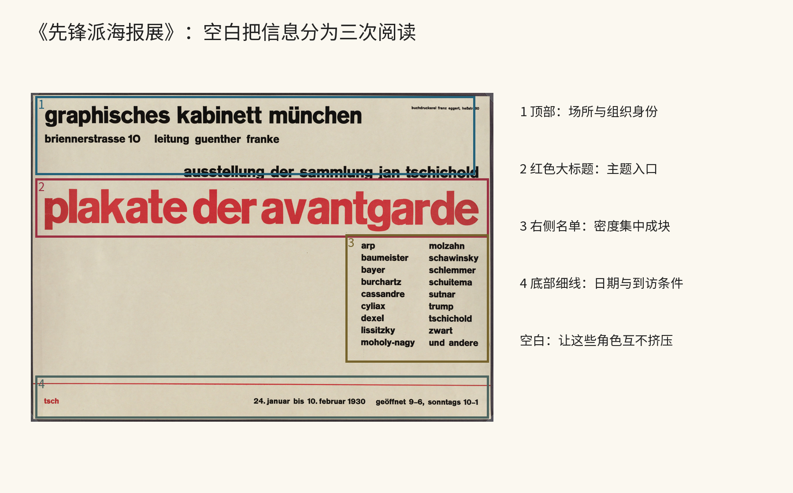
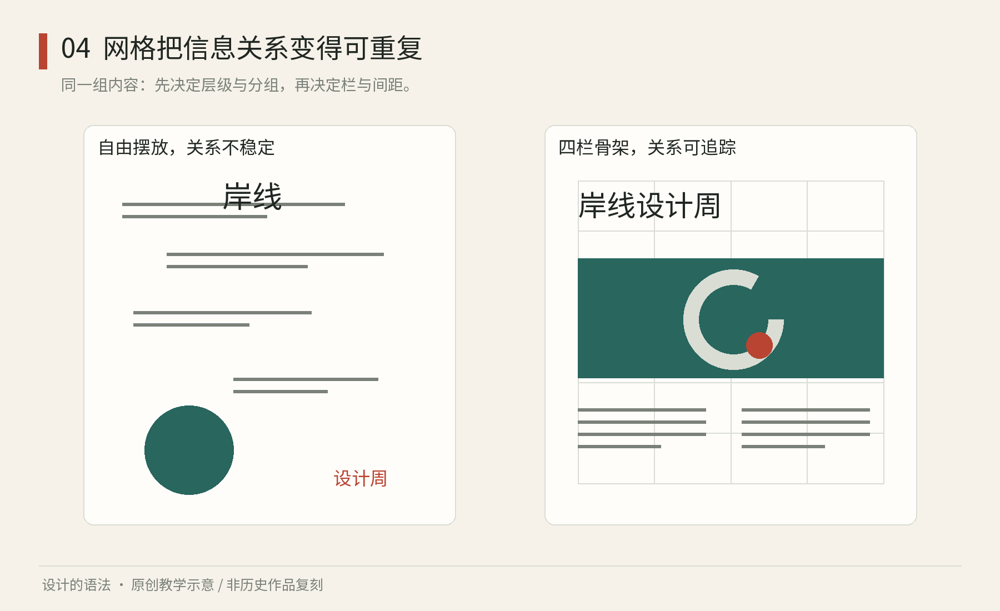

# 第04章｜比例、字体与网格：给变化一副骨架

## 真实案例：齐肖尔德让空白成为信息结构

Jan Tschichold 为慕尼黑展览设计的《Plakate der Avantgarde》（1930）可在MoMA藏品记录中核对。这里分析这张实际海报，而不在其上套一个未经证明的“黄金比例图”。[MoMA，Plakate der Avantgarde，1930](https://www.moma.org/collection/works/7292)

图4-A｜真实原作：Jan Tschichold，《Plakate der Avantgarde》，1930，慕尼黑展览海报，MoMA藏。图像为馆方公开展示版；版权按原权利人归属，不纳入本书原创图许可。[作品页](https://www.moma.org/collection/works/7292)

先用目光从上向下走一次。顶部场所名称和地址提供身份；红色大标题横向展开，成为最强的主题入口；参与者名单集中在右侧；底部细线把日期和开放信息另成一组。四种角色没有各自套四个边框，却依靠位置、字号、颜色和空隙获得区分。留白在这里承担分区工作，并不是把内容排完后剩下的纸面。

最值得仔细看的，是右侧密集名单与左侧大片空场之间的关系。若把名单“为了平衡”移到中间，分散成均匀四列，原有密度对比会变弱；若放大所有名字去填满空白，主题与参加者的主次又会改变。这些都不是数学上不允许，而是不同选择产生了不同结果。学习网格时，要能说明自己维护的是哪种信息角色。

再看大标题。它依靠红色与明显增大的尺寸获得优势，不需要加渐变、阴影或复杂边框。这个例子并不证明文字海报永远应该克制，而是说明当主次已经由结构建立，附加效果不一定提供更多信息。如果你增加一层装饰，最好能指出它增加了什么任务价值或表达，而非把“更丰富”当作充分理由。

图4-B｜本书原创位置标注，保留原作并标记机构、主题、名单、到访条件四区。边框是观察工具，未声称恢复设计者真实网格或创作意图。[原作](https://www.moma.org/collection/works/7292)

现在做一张内容更困难的展览通知：标题十二字，名单十人，地点两行，日期与开放时间各一项。先把这五种内容写成真实文字，再画主次草图。第一版让每块居中并等距，第二版让主题与到访条件独立，第三版根据名单长度调整区块宽度。比较时问三个具体问题：先看见什么，在哪里找到时间，最长的一行是否挤压了其他角色。

不要将这个案例误学成“左对齐就是好设计”。海报中的文本本来就在不同位置形成关系，关键是使视线与信息职责一致。你也不需要声称用了与原作相同的栏数；没有测量与资料时，可以说“我从它学习将密度集中、将阅读角色分区”，这个陈述已经具体、可用且诚实。

## 网格真正解决的是反复做决定

排一次海报，你可以靠眼睛挪到满意；排一百页书，若每一页都从零开始，标题位置、图注宽度和边距会不断漂移。网格把部分决定提前：边界在哪里，分几列，列间留多少空，哪些位置能对齐。它减少重复决策，也让例外更容易被看见。

网格不等于可见的方格线。四列可以合成两个宽栏，一张图可以跨三列，标题也可以故意越出一条线。重要的是这些变化是否保留了读者可利用的关系。把所有内容都塞进等大的格子，只完成了分装，还没有处理主次。

图4-1｜原创教学图：同一信息内容的自由散置与四列组织。右侧辅助线是教学层，不是最后成品必须印出的线。比较标题、日期与说明的相邻关系。

先从纸张外边缘退回一圈边距，建立一个内容区；把内容区分四列；把日期与地点放在同一组，再把介绍放在它们下方。你已经能得到比“每段独立居中”更稳定的信息骨架。然后检查是否真需要四列：只有两块内容时，两列可能更直接。

## 比例提供候选，不负责证明美

黄金分割、根号矩形、等分模块，都可以作为建立关系的方法，但没有一种比例能自动保证作品好。一个精确遵守某比例、却让中文标题被迫断在奇怪位置的封面，仍是阅读问题。设计中的比例要接受内容、视距、材料与任务的检验。

以一张竖版海报为例，可以先将主要图形约占上半部分，再将下半部分用于信息。这只是一种起点。若活动标题特别长，图形需要退让；若海报贴在远处、日期最重要，日期就应获得更多面积。比例的价值在于让你有意识地改变关系，而不是事后在作品上寻找神秘线条。

纹样也有另一种网格：圆、正方形与多边形能提供重复与连接的骨架。大都会博物馆的几何设计教材提供了从构形到图案的活动。可学习的是“母题怎样从构造与重复中产生”，而不是把不同地区、年代的装饰都归成同一个万能图案系统。[The Metropolitan Museum of Art，Islamic Art and Geometric Design，2004](https://resources.metmuseum.org/resources/metpublications/pdf/Islamic_Art_and_Geometric_Design_Activities_for_Learning.pdf)

## 字体不是最后选的一件衣服

文字本身就是形。中文方块字的密度，拉丁文字的长短轮廓，数字与标点的位置，都会改变版面。一个字库有多少重量、是否含所需字符、在小字号是否清楚，常常比它的展示样张更重要。标题用字与长文用字可以不同，但差别应有角色，不能每个小标题换一种新字体。

为四级文字做一次纸上分工：一级是书名或展名，二级是章节或栏目，三级是正文，四级是图注。先用同一字体，通过字号、行距和留白建立区分；确有需要再增加字体。这样能看清层级是否靠结构成立，还是只靠字体差异勉强分开。

中文排版要额外检查行首行尾标点、长英文、数字单位、孤行与专名断行。一个在短英文中成立的按钮宽度，未必放得下中文或较长译文。系统不应把某一个样本长度写成永恒尺寸。所谓“一致”，可以是相同的内边距规则，而不是永远相同的外框宽度。

练习：用同一份活动信息排三种尺寸，A4、明信片与手机窄屏。先保持字号层级关系，再适配列数与间距。哪种关系能保留，哪种必须变？把答案写成两列：固定的是主次和相邻关系，变化的是列数、换行与图片裁切。这张记录比只保存三个成品更接近可传递的设计方法。

本章来源：[大都会博物馆：几何设计教学材料](https://resources.metmuseum.org/resources/metpublications/pdf/Islamic_Art_and_Geometric_Design_Activities_for_Learning.pdf)。网格、排版与跨尺寸实验为原创教学推演；具体中文排版实现另见第十二章。
