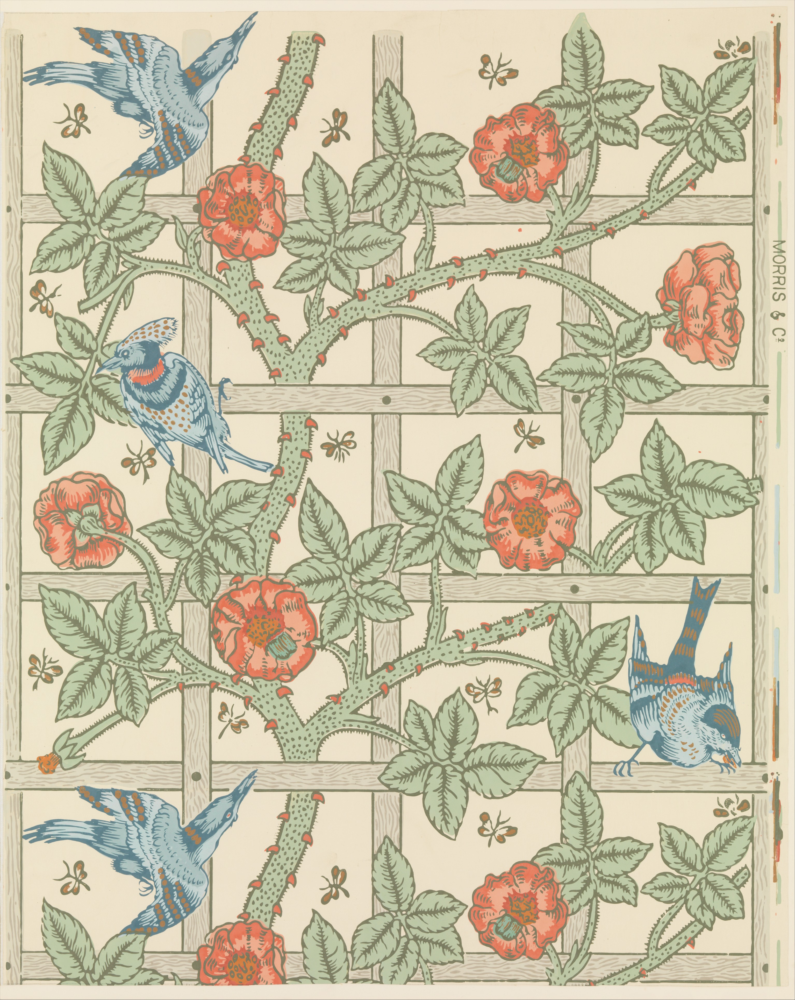
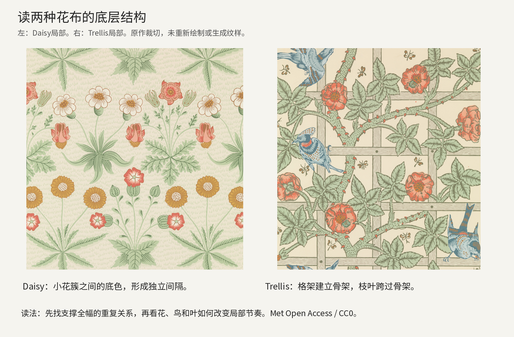
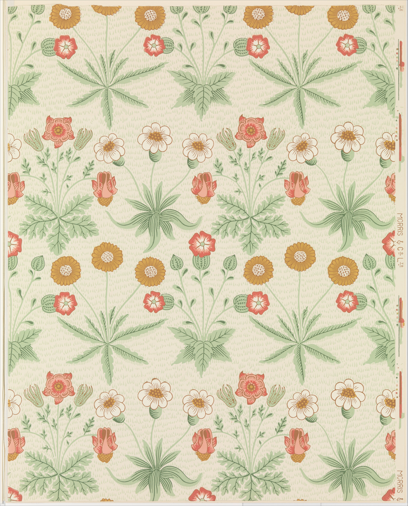
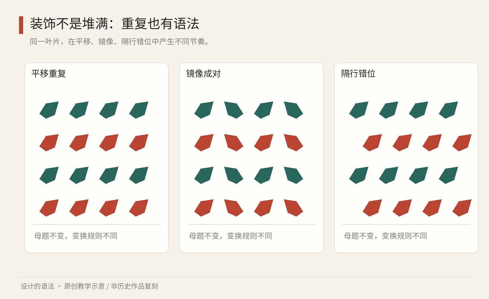

# 第05章｜纹样与装饰：繁复之中，谁在维持秩序

看一块印花布，最先吸引你的是花鸟，决定它能铺满整间屋子的却是更不显眼的东西：花枝怎样在边缘接回，深浅区域如何交替，放大以后还有没有节奏。装饰设计的系统性，常常藏在“这一小块怎样变成一大片”之中。花朵的形状、重复方式与应用尺度，共同决定了表面的观看效果。

## 两件真实作品中的重复骨架与视觉中心

真实作品05B｜威廉·莫里斯设计、菲利普·韦布设计鸟形，《Trellis》（格架），Met藏品标注1864年；Morris & Company制造、Jeffrey & Co.印制，版印壁纸，藏品号23.163.4h。Met Open Access / Public Domain（CC0）。[The Met，William Morris / Philip Webb，Trellis，1864](https://www.metmuseum.org/art/collection/search/384020)

先把目光放在图的中部：水平与竖直的灰色格架，把花枝背后的空间分出明确节拍；玫瑰枝沿格架生长，却不被关在每一个格子里。右上和左下的鸟又把你的视线带离整齐的直线。这里可以读出两套关系：格架使重复容易察觉，植物与鸟使每个局部不至于像算术表。这是本书对构图的分析。馆方记载设计构思始于1862年，1864年上市；设计构思、上市与具体纸张的印制时间需分别记录。[The Met，William Morris / Philip Webb，Trellis，1864](https://www.metmuseum.org/art/collection/search/384020)

叶片跨过横杆形成遮挡，建立了前后层次；花朵落在格子边缘，又使局部重心偏离正中央。画面保留了人造支撑与植物蔓延之间的差异。若学习时只抄花朵，会丢失支撑整幅的骨架；若只抄格架，就会丢失跨边界的生命感。分析时可将这些关系分为三种职责：格架规定重复节拍，枝蔓连接相邻区域，花鸟形成局部识别点和停顿。

再与本章后文展示的《Daisy》比较。《Daisy》的小簇之间保留更明确的底色间隔，眼睛较容易逐簇观看；《Trellis》的格架与枝蔓则建立更连贯的场。两者组织空白的方法不同。想做一张容纳大段文字的邀请卡，较疏的花簇可能更容易让出阅读区；想做连续墙面，连贯的格架可能带来更强的铺展。以上为本书的应用推演。

分析图05C｜《Daisy》与《Trellis》实际馆藏图的局部裁切并列，原图均为Met CC0。裁切不是最小重复单元的测量，也不宣称左右边界可直接无缝相接。

真实作品05D｜阿尔丰斯·穆夏《Job》，1898年，LOC Prints and Photographs Division，编号95504874，彩色广告海报。此处使用LOC的1898年版本，不能套用1896年另一版《JOB》的构图。[Library of Congress，Alphonse Mucha，Job，1898](https://www.loc.gov/item/95504874/) 图像保留作者与馆藏归属；本书研究分析引图，不将公开可访问解释成开放许可。

海报上方，大字母与矩形边框先给出边界，但女人的头部、头发和飘动线条很快占据视觉中心。黑色头发在浅色皮肤和服装旁形成大块对比；发丝不是均匀填满纸面，而是在身体两侧转折，既描出轮廓，也把人物与装饰连接起来。读者不一定先逐字阅读，但广告名并未消失，它通过尺寸、位置及重复的字母图案持续存在。大字母既传递广告名称，也参与画面分区，和正文独立成块的排法承担不同职责。

下半部衣褶的大弧线，与上半部头发的曲线形成呼应，背景中的小图案则提供更细的节奏。若把所有线都画成同样粗、同样黑，人物和装饰会争夺同一注意力；原图中轮廓、色块和细节的尺度不同，让身体仍能从繁密背景中辨认。人物、字形和装饰在这里共同建立中心，与莫里斯的满版壁纸承担不同任务：壁纸要跨单元铺展，海报要在一个有限画面里建立中心。

迁移练习：为一场花卉展做三版书签。第一版让所有图形均匀散落，文字放在任意空处；第二版保留散落元素，却先给展名一条连续的纯净区域；第三版用一条枝蔓连接两端，只让花朵在三处停顿。不要照搬两件原作的花鸟或人物。比较三版在缩到实际书签大小后，哪一版仍能找到展名，哪一版的局部装饰已糊成灰。修改应写成可观察的动作，例如“减少标题后方细线”“让连接枝避开日期”，不要只写“更有艺术感”。

## 先分清三种不同的设计追求

工艺美术运动、新艺术与装饰艺术都可能出现花卉，不能靠“有花纹”归为一类。维多利亚与阿尔伯特博物馆记载，威廉·莫里斯长期研究纺织工艺；他设计、由 Morris & Co. 制作的《草莓小偷》织物发表于1883年。这里值得注意的是，图案开发与生产方法相互牵引，而不是先画一幅花鸟画，再随意印在布上。[V&A，William Morris textiles；含《Strawberry Thief》，1883年](https://www.vam.ac.uk/articles/willam-morris-textiles)

真实作品05A｜威廉·莫里斯《雏菊》（Daisy），1864年，Morris & Company制造，Jeffrey & Co.印制，版印壁纸。纽约大都会艺术博物馆藏，藏品号23.163.4b，object ID 384017；馆方标注Public Domain，图像依Met Open Access（CC0）使用。[The Metropolitan Museum of Art，William Morris，Daisy，1864](https://www.metmuseum.org/art/collection/search/384017) 看花叶之间的间隔：图案的节奏由图形与底色共同形成，不必等到满版密铺才产生装饰秩序。

新艺术的自然形态常被转化为延伸的曲线、卷须和有机轮廓。它在19世纪90年代至第一次世界大战前发展于多个地区，也进入海报、玻璃、金属和建筑。装饰艺术则可以用更明确的几何、阶梯、放射与材质对比组织视觉；但“新艺术全是曲线、装饰艺术全是直线”只是一条初步辨认线索，并非可靠定义。[V&A，Art Nouveau](https://www.vam.ac.uk/collections/art-nouveau)[V&A，Art Deco](https://www.vam.ac.uk/collections/art-deco)

| 观察问题 | 工艺美术的一条学习线索 | 新艺术的一条学习线索 | 装饰艺术的一条学习线索 |
|---|---|---|---|
| 植物怎样进入作品 | 植物被织入可持续铺展的节奏 | 生长方向延伸为轮廓与空间 | 植物也可被几何化、程式化 |
| 组织关注点 | 工艺、材料与整体环境 | 曲线连续性及跨媒介协调 | 几何秩序、材质及鲜明轮廓 |
| 容易发生的误读 | 古典花布就是工艺美术 | 任何卷曲线都是新艺术 | 金色加黑色就是装饰艺术 |

这张表提供初步观察线索。具体作品仍需结合作者、地区、年代和用途判断，再分析其工艺、轮廓与重复方式。

## 从一个叶片推导一片连续纹样

下面是原创设计练习。先画一个向右倾斜的叶片，保留叶柄作为方向线索。把它放进一个正方形单元，分别尝试三种操作：等距平移；隔行错开半个单元；每隔一个单元镜像。三种操作会改变分组与方向。第一种容易形成整齐的竖列；第二种能弱化直通的接缝；第三种可能形成对称的花束。选择时可比较接缝、分组和观看距离是否适合预定用途。

图05｜原创程序教学图：相同叶片在平移、隔行错位和镜像规则下产生不同节奏。图中单元是教学构造，不是《草莓小偷》的复制或历史复原。

连续铺展前，要检查单元相对边：从右边离开的线，必须从左边对应位置进入；上、下同理。只在单元中间看起来漂亮，不能保证重复后没有断枝。把单元排成至少三乘三，再退后一步看整体。若出现意外的水平条带，不要马上添加细节，先调整大面积深色区域的位置。这些条带往往由重复后的深色聚集造成，增加局部细节并不能消除。

接着改变尺度。用于书签的图案，可以依靠细线；用于远处观看的窗帘，细线可能合并成灰雾。把设计缩到最终尺寸预览，再做一张只有黑白的版本。前者检查细节是否消失，后者检查整体节奏是否成立。这里的“系统”包括单元、变换、接边、密度与应用尺寸，不只是一份花纹图库。

## 把纹样接到真实物件上

假设你为一家植物展设计海报、门票和布袋。若把同一张满版纹样机械缩放到所有载体，门票上的花叶可能小得无法辨识，海报的日期也可能陷入花海。更有效的方法，是规定三个等级：完整纹样用于布袋；稀疏纹样作为海报边缘；单个叶片作为门票识别符号。它们共享叶片的曲率、色彩和方向，密度却因任务而改变。

还要建立文字的保护区域。可以规定日期与地点周围至少保留一个叶片宽度的空白，或让文字落在明确的纯色块中。这样的分工让纹样与文字各自保有清楚的区域。若图案需要靠降低整张图的透明度才能让字看清，通常说明文字与纹样尚未完成分工。

工艺会进一步改写规则。单色丝网印刷要求你处理轮廓与留白，不能依靠屏幕上细腻的透明渐变；织物上的细茎也可能因材料和观看距离变得不稳定。应先向制作方确认最细线宽、可用颜色和套印容差，再确定图案细节。图案细节应据此调整，使视觉方案与实际制作能力一致。

观察练习：选家里的一块床单或一张包装纸，先找最小重复单元，再画出你认为的边界。若很难找到，试着只看深色部分。记录图案在近看、远看和触摸时可辨认的细节，并说明适用的载体与距离。

再看一个容易忽视的变量：底色比例。把同一叶片分别放在密集与疏松的单元中，深色面积会改变整片表面的重量感。若你想让布袋与海报共享身份，可以维持叶形而调整底色比例，不一定要把它们做成相同密度。测试时遮住单个叶片，观察剩下的空隙是否也形成有节奏的形状。这些负形的连续性也会影响整体节奏。

还可以为系列设置边界版本。连续纹样适合铺满，边框纹样则要处理转角与收尾。先设计直线段，再画90度转角，最后处理短边放不下完整单元时的情况。若只能靠任意拉长花叶来凑长度，系列还不够完整。可以允许使用半单元、纯色端头或规定的裁切区。规则写得越具体，后续应用越不依赖原设计者现场补救。

本章来源：

- [O1] V&A，William Morris textiles；含《Strawberry Thief》，1883年：[馆方文章](https://www.vam.ac.uk/articles/willam-morris-textiles)。
- [O2] V&A，Art Nouveau：[馆方专题](https://www.vam.ac.uk/collections/art-nouveau)。
- [O3] V&A，Art Deco：[馆方专题](https://www.vam.ac.uk/collections/art-deco)。

- [O4] The Metropolitan Museum of Art，William Morris，Daisy，1864：[真实作品与开放图像来源](https://www.metmuseum.org/art/collection/search/384017)。

- [O5] The Met，William Morris / Philip Webb，Trellis，1864：[作品、作者分工与生产说明](https://www.metmuseum.org/art/collection/search/384020)。
- [O6] Library of Congress，Alphonse Mucha，Job，1898：[具体版本与原图记录](https://www.loc.gov/item/95504874/)。
