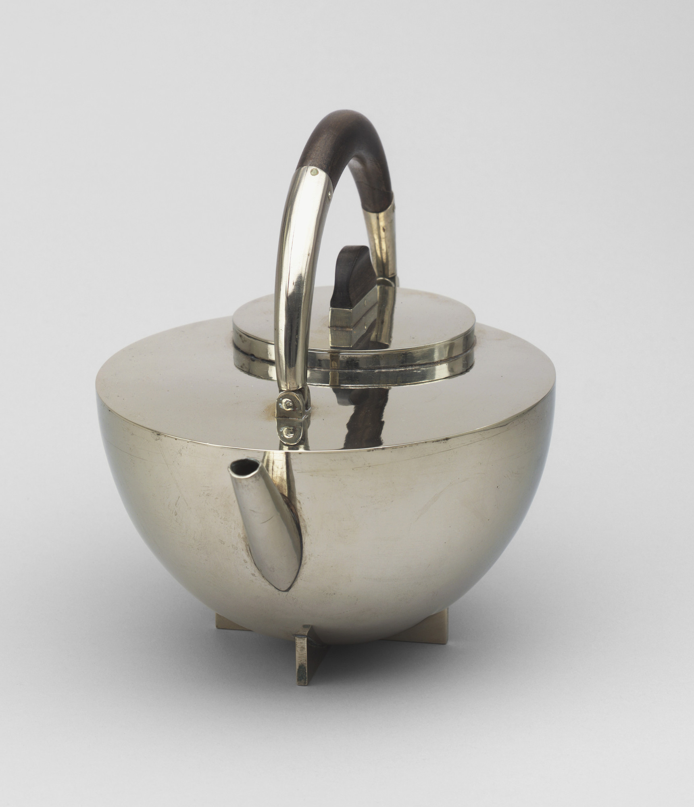
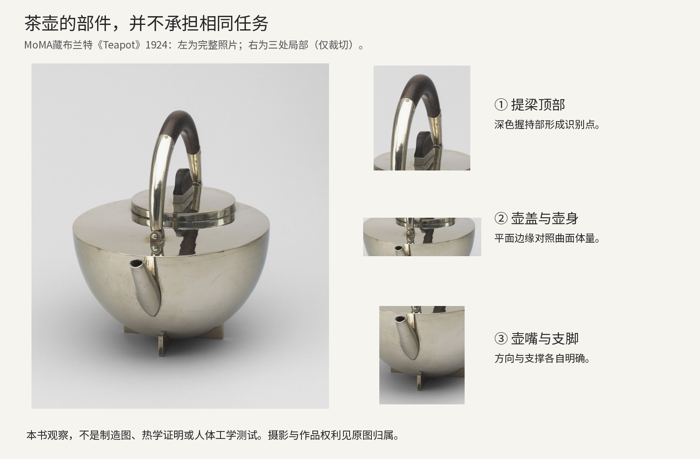
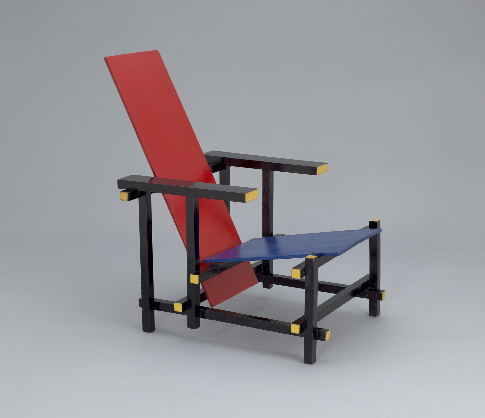
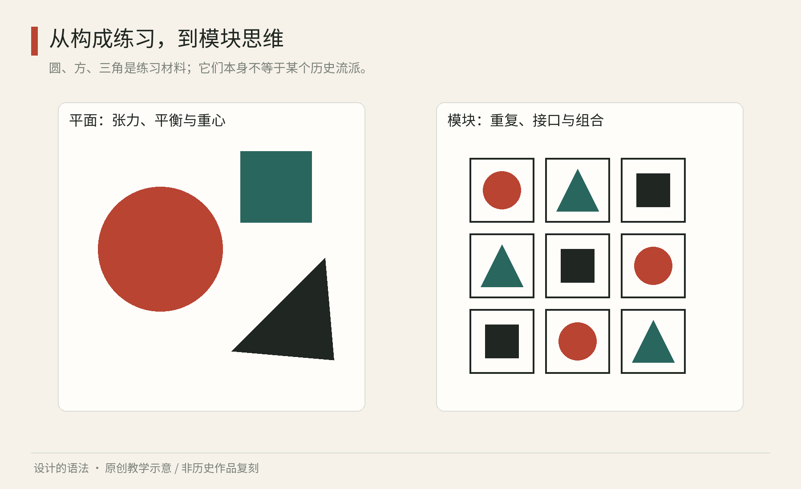

# 第07章｜包豪斯与风格派：几何形，怎样成为设计方法

从重复单元进入几何形，关注点转向少量形状怎样分工。岸线练习可保留同样的活动信息，只用弧、圆和直线做一轮构图，比较形状数量减少以后，身份与信息层级是否仍然清楚。

红、黄、蓝，圆、方、三角，是许多人对现代设计教育的第一印象。它们确实便于观察比例和关系，却无法单独说明包豪斯，也不能代替风格派的历史。给咖啡店海报加几个原色几何形，只借用了容易辨认的外观。本章从几何形的组织入手，再比较它们进入器物、工艺与空间后需要回应的条件。

## 先读实物：一把茶壶与一把椅子的几何职责

真实作品07A｜玛丽安娜·布兰特《Teapot》，1924年，镍银与乌木，包豪斯金属工坊，MoMA，186.1958.1a-c。[MoMA，Marianne Brandt，Teapot，1924](https://www.moma.org/collection/works/2438) 馆方公开图，仅随本书研究分析引用；保留作品与摄影的相关权利，不声明开放许可。本图是带顶部提梁的茶壶，不是常见侧面D形把手的小型浓茶浸泡器。

先从照片上端看起。深色握持部让提梁顶部成为很强的识别点，两条金属支撑线把它接到壶身两侧。接着向下看，壶盖的水平圆边截住视线，光滑的曲面壶身向底部收拢，短小支脚把整体抬离台面。照片中的反光会改变局部明暗，不能把每一片高光都当成真实棱线。分析金属物时，可先追踪轮廓和部件连接，再解读表面明暗，以区分实体结构与摄影光照。

壶嘴向观看者略偏一侧伸出，它使一个近似居中的体量拥有明确朝向。提梁、壶盖、壶嘴与支脚没有被处理成同一种形状，因为它们承担不同职责：提与握、开启、倒水、放置。这些少量而有区别的形体，使日常器具的各部分更容易辨认。MoMA的材料说明与原型背景是机构事实；这里关于观看顺序、轮廓和职责的判断，是本书对该照片的分析。[MoMA，Marianne Brandt，Teapot，1924](https://www.moma.org/collection/works/2438)

继续比较部件的作用：若拿掉深色握持部，剩下的镍银提梁会更难从反光中迅速辨认；若把所有支脚扩大成很重的块，器物的轻巧感可能改变；若把壶嘴完全藏进壶身轮廓，方向线索会减弱。这种单一变量的比较，是分析照片的练习，用于辨认各部件对轮廓、方向和轻重感的贡献。

分析图07B｜左为完整照片，右为顶部握持部、壶盖与壶身、壶嘴与支脚的实际局部裁切。标签与编排为本书原创；图像权利沿用MoMA原图。本图不是制造图，不能据此断言隔热性能、重心或量产成本。

从这些部件关系可以推导一种设计步骤：分解使用任务，为各项任务分配形体与材料，再协调各部分的整体关系。若你为办公室设计笔筒、收纳盘和桌灯，不必把它们都做成茶壶式半球；可以共享“一个主要容纳体量＋清楚的操作部件＋少量材质对比”的思路。每件物品仍需通过实际使用验证，照片里看起来协调只是起点。原型与量产之间还要解决成形、连接和一致性，不能把几何轮廓看成已经完成这些工作的证明。

真实作品07C｜赫里特·里特维尔德《Red Blue Chair》，1918—1923年，彩绘木材，MoMA，487.1953；©2026 ARS / Beeldrecht。[MoMA，Gerrit Rietveld，Red Blue Chair，1918—1923](https://www.moma.org/collection/works/4044/) 仅研究引图，不声明开放许可。

这张照片中，红色靠背与蓝色座面先被看成两个平面，黑色木条则形成穿插的骨架，黄色端面把木条末端点亮。平面与线性构件各司其职，颜色加强了这种阅读。特别看扶手前端与支腿：木条没有在视觉上融成一个厚实外壳，端部的延伸使构件身份仍然清楚。把颜色暂时忽略，再看一次，你仍能读到座面、靠背与支撑之间的关系；说明配色强化结构，却不是结构的全部。MoMA对其1918年设计、约1923年应用熟悉配色的说明，恰好支持将结构与色彩分开讨论。[MoMA，Gerrit Rietveld，Red Blue Chair，1918—1923](https://www.moma.org/collection/works/4044/)

改稿练习：画一个由板与杆组成的纸板展示架，先只用黑白；标出“承托”“连接”“识别”三种职责。若某根杆纯为装饰，就不要假装它承担支撑。第二版只用一种强调色标出用户需要操作的位置；第三版检查颜色移除后，功能线索是否仍然成立。比较三版中承托、连接与操作线索的变化，记录颜色强化了哪些关系。

## 两条相邻而不同的道路

包豪斯是1919年至1933年间存在的一所学校[German Historical Institute，The Global Reach of the Bauhaus School (1919–1933)](https://germanhistorydocs.org/en/weimar-germany-1918-1933/the-global-reach-of-the-bauhaus-school-1919-1933)；风格派则与荷兰《De Stijl》杂志及相关艺术家、设计者的实践相联系。两者之间有交流与相互影响，但不能合并为同一个组织。包豪斯的学习方法值得从课程和工坊去理解：材料、形式与制作实践共同参与设计，而非只教授一套固定外观。[Bauhaus-Archiv，Bauhaus Lab Online](https://www.bauhaus.de/en/join-in/formats/bauhaus-lab-online/)[MoMA，The Electro-Library，De Stijl专题](https://www.moma.org/slideshows/43/798)

MoMA将前述布兰特茶壶记为她进入包豪斯金属工坊不久的学生作品。研究它的使用与制造，还需了解容积、握持部与热源的距离、壶嘴的出水表现和金属成形方式。这些条件需要实物或制作资料支持，仅凭几何轮廓无法判断成本、舒适性和量产条件。[MoMA，Marianne Brandt，Teapot，1924](https://www.moma.org/collection/works/2438)

另一件是赫里特·里特维尔德的《红蓝椅》。MoMA将作品标为1918—1923年，并说明椅子最初设计于1918年，熟悉的原色加黑色方案约在1923年应用。将这两个阶段分开，便于比较木条、平面和连接的关系，以及后加配色对部件辨认的影响。[MoMA，Gerrit Rietveld，Red Blue Chair，1918—1923](https://www.moma.org/collection/works/4044/)

## 用限制训练关系感

下面是本书原创练习，不是任何历史课程的原样复刻。准备固定尺寸的一组圆、方形和三角形，在同一张纸上做三版构图。第一版只允许水平和垂直摆放；第二版增加一条斜线；第三版允许图形互相遮挡。每次只改变一条规则，其他尺寸、颜色和数量保持不变。

图07｜原创程序教学图：用同一组圆、方形和三角形比较构成关系与模块组合；不把任一面板标成包豪斯或风格派的标准答案。

第一版容易把注意力导向边界、间隔和轴线。第二版会使斜线产生明显方向，原先稳定的平衡可能改变。第三版则出现前后关系：一个圆被遮住后，观者仍可能把它理解为完整形状。先记录边界、方向和遮挡关系的差异。若说不清，可以把所有图形换成同一种灰，排除颜色的干扰。

再给这些形状画上相同大小的外框，放进三乘三的模块中。每格只放一个图形，观察原来依靠大小、方向建立的张力，怎样变成位置和重复形成的节奏。模块是组织元素的手段，不意味着内部图形必须拥有完全相同的视觉重量；圆形与方形占用同样边界时，也需要实际比较。图06右侧演示的正是这种从自由构成到模块关系的转变。

第二轮开始引入功能。把构图变成一张活动海报，只加入活动名、日期、地点。要求观者三秒内找到日期。若几何形抢走全部注意力，就把它们压缩成一块主视觉，给文字独立区域。构成练习转入传达任务后，需要增加信息查找的检验；富有张力的抽象构图未必适合承载复杂文字。

第三轮引入材料。用硬纸板折一个手机支架，先只允许一张纸、两条折线、不用胶。纸的厚度、折痕和支撑角度会把你从自由摆图带进结构思考。若支架滑倒，需检查底部接触、支撑角度和重心，再调整折线或比例。材料实验由此为纸面的几何关系增加了实际约束。

## 为形式分配稳定职责

为一个小展览制作海报、导览册和桌面牌时，你可以选择原色与几何形，也可以选择低饱和色。每种形式都需要有明确用途：原色负责区分三个展区，矩形承载说明，圆形只标记互动环节。这样，形式承担稳定职责；若临时加第四个展区，不必重新发明所有规则。

但形式职责也不能变成僵硬的符号教条。同一组应用中，红色若同时表示互动和关闭，就可能造成辨认冲突；同样，也不能宣称三角形天生代表行动、蓝色天生代表理性。几何和色彩的意义需要在具体作品、文化与使用经验中建立。著名艺术家的配对实验，可以作为历史材料研究，不能当作跨文化通用心理定律。

朴素轮廓并不意味着制造简单，连接、表面处理与公差都可能增加难度。练习时可暂时去掉原色，只通过材料实验、比例和操作位置建立联系，再检查这组作品是否仍能形成共同特征。

小练习：拍下家中一个由几何体组合的日用品，画出三张分析小图，分别只保留轮廓、接合、握持位置。三张图中哪一张最能解释它为何好用或难用？比较各图能解释的使用条件，避免仅凭外观给器物归类。

还可以用固定元素数量的练习比较构图。第一轮一直只用五个形状，第二轮允许增加到十个，比较你是在解决关系，还是不断用新元素掩盖旧问题。若五个形状时重心就不稳，多加五个往往只会让问题复杂。先学会删、移、缩放，再增加词汇，是一种适合初学者的练习顺序；这一顺序只用于本章的构图训练。

你也可以对比两类统一。一类让每件东西都长得相似，例如圆形杯垫、圆形海报和圆形桌牌；另一类让不同物件遵守相同的比例与信息职责。后者通常更能应对真实任务，因为桌牌需要站立、海报需要远看、杯垫需要接触器物。共享比例和信息职责时，仍需分别满足站立、远视和接触器物的条件。

本章来源：

- [B1] Bauhaus-Archiv，Bauhaus Lab Online：[基础课程实践介绍](https://www.bauhaus.de/en/join-in/formats/bauhaus-lab-online/)。
- [B2] MoMA，The Electro-Library，De Stijl专题：[杂志与交流资料](https://www.moma.org/slideshows/43/798)。
- [B3] MoMA，Marianne Brandt，Teapot，1924：[藏品页](https://www.moma.org/collection/works/2438)。
- [B4] MoMA，Gerrit Rietveld，Red Blue Chair，1918—1923：[藏品页](https://www.moma.org/collection/works/4044/)。

- [B5] German Historical Institute，The Global Reach of the Bauhaus School (1919–1933)：[学校沿革](https://germanhistorydocs.org/en/weimar-germany-1918-1933/the-global-reach-of-the-bauhaus-school-1919-1933)。
