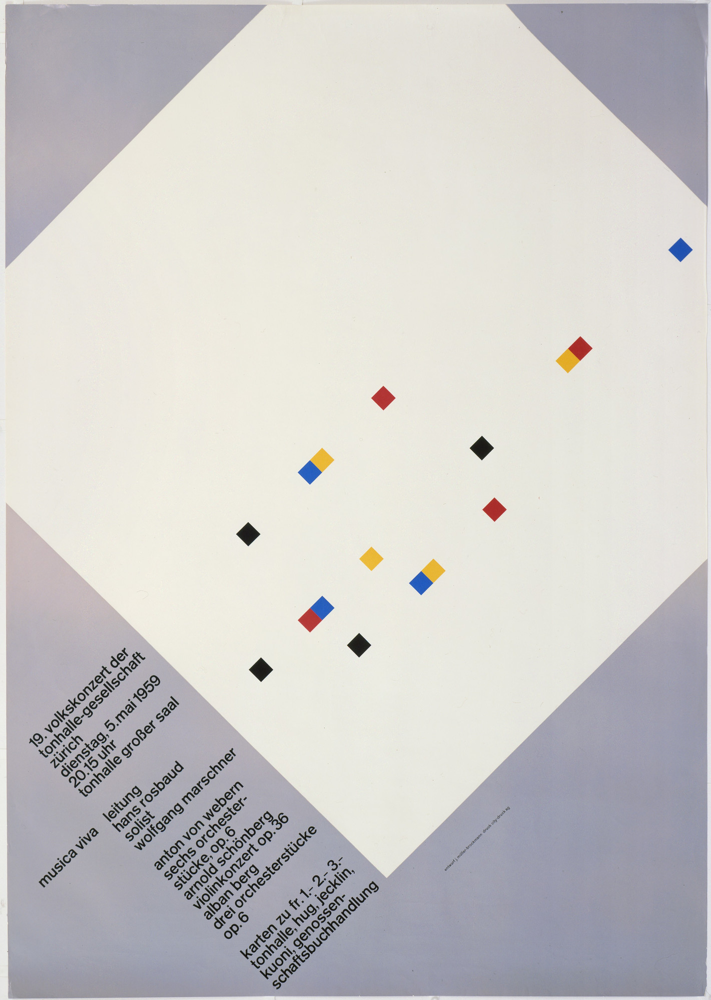
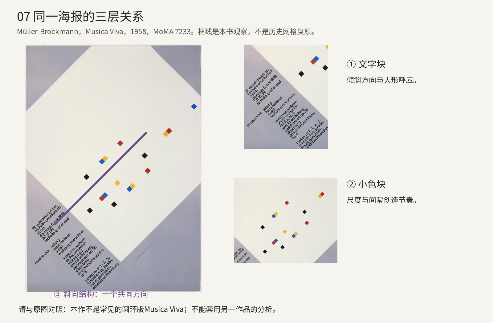
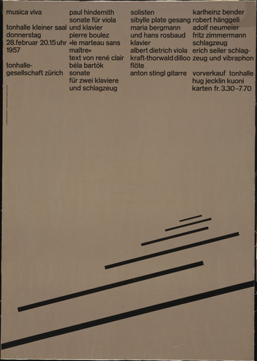
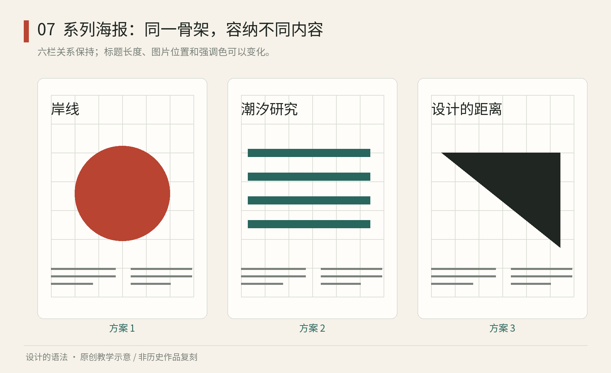

# 第07章｜瑞士现代平面：网格不是笼子，而是一种分工

如果一张海报没有装饰边框，文字靠左，图片和段落对得很齐，你可能会说它“很瑞士”。这种辨认有一点帮助，却容易把方法缩成表面特征。现代平面设计中值得借用的系统性，是让不同信息以稳定关系出现：标题不必每次重新决定位置，说明不必依赖设计师临时挪动，新增内容也能进入已有秩序。

本章以瑞士现代平面的一条实践传统为入口，不把全部现代主义归入一种样式，也不假定清晰只能由无衬线字和左对齐实现。

## 读一张具体海报：斜向秩序并不等于随意倾斜

真实作品07A｜约瑟夫·米勒-布罗克曼《Musica Viva》，1958年，油毡版与凸版印刷，City-Druck AG印制，MoMA，491.1987。[MoMA，Josef Müller-Brockmann，Musica Viva，1958](https://www.moma.org/collection/works/7233) 馆方公开图，权利归相应权利人；仅随本书研究分析引用，不声明开放许可。请注意这是大白菱形、小彩色菱形与左下倾斜文字的版本，不能拿另一张同名圆环海报的网格解释它。

先看整幅的最大关系：紫灰色边缘围住一个几乎撑出画面的白色斜方形。大形的边界没有全部露出，观者却容易把它读成连续的整体；被画框裁切的部分，使这张平面纸产生继续延伸的感觉。文字集中在左下，沿着同一个斜向组织。小菱形散落在白色区域中，它们的尺度远小于大形，却保持与整体相近的方向。这不是“每个元素都斜着放”的随机结果，而是不同尺度的元素共享一条明显方向。

再从左下文字开始看。几个紧凑的小字组之间保留间隔，与上方大面积白区形成密度对比。远看时，大形先建立印象；近看时，文字组提供节目相关信息。小色块处在这两种观看之间：它们既不像正文那样需要逐字解读，也不是独占整张海报的插画。红、黄、蓝与黑的少量亮点，把眼睛从一个位置引到另一个位置。这里关于观看路径的描述是本书的分析，不是对观众眼动的测量；不同人也可能先注意到某个色块。

这张图最值得学习的，是“方向”可以成为共享规则。大形的边、文字行和小菱形并非相同对象，却通过方向取得关联。同时，密度与尺度并不平均：文字拥在一角，画面允许大片空白，色块也没有均匀排成表格。若模仿者为了整齐，把小菱形平均分到每个区域，可能反而消除原作的节奏；若把全部文字散落到各处，读者又会失去可集中检索的区域。秩序没有要求每个位置都被填满。

分析图07B｜全图上叠加本书的方向观察线，右侧裁切实际文字块和小色块区域。线条不是历史网格复原；没有测量依据，不推定精确栏数与比例。引用图像权利沿用MoMA原图。[MoMA，Josef Müller-Brockmann，Musica Viva，1958](https://www.moma.org/collection/works/7233)

也要看清这张海报没有证明什么。它不能证明所有音乐都适合抽象几何，不能证明倾斜文字总比水平文字好读，也不能证明每个细节都来自某个数列。本书能从图中辨认出重复的方向与尺度差别，至于设计者的完整推导过程，仍需草稿或可靠文献。把形式关系读得具体，与为作品编造一个“数学秘密”，是两件事。

<!-- figure-height: 100 -->

真实作品07C｜约瑟夫·米勒-布罗克曼《Musica Viva》，1957年，照相平版，Bollman AG印制，MoMA，58.1960。[MoMA，Josef Müller-Brockmann，Musica Viva，1957，58.1960](https://www.moma.org/collection/works/4885) 使用馆方公开小图，保留完整画面；仅研究引图，不声明开放许可。图像纸面色调受作品状态与摄影影响，不能当作原设计的标准色值。

与1958年版本并排看，首先发现文字的处境完全不同：1957年的信息沿上方形成数个竖向组，文字行基本保持水平；斜向线条则从下部向远处收束，长短和粗细一起变化。文字并没有跟着斜线旋转。它把“查找节目内容”和“感受方向与节奏”分配给不同区域，让两种观看同时成立。1958年版本则把文字也纳入斜向关系，主视觉与信息获得更强的方向呼应。这个比较直接反驳一种常见模仿：只要学瑞士风格，就让全部文字对齐同一条斜线。真实作品显示，同一设计者也会选择不同的关系。

再看1957年下部，最长的线被画框截断，较短的线向上方聚集，线间大片空白并不等宽。它们容易使我们联想到运动、远近或逐渐减弱的节奏，但本书不把这些联想写成设计者的唯一寓意。把小线条全部改成同样长度，会失去什么？把它们平均排开，又会变成什么？你可以用纸条试排来回答，而不是背诵一个风格形容词。两张海报的共同价值，不是一组固定坐标，而是对信息密度、尺度、方向的有意识安排。

如何把它迁移成今天能用的练习？为一场室内乐演出设计两张A4通知，必须包含日期、时间、地点和购票方法。第一版只设一个斜向主视觉，全部功能信息水平放置在底部；第二版让标题也沿斜向，但保留功能信息的水平基线。每版使用完全相同的字数和字号下限。请一位读者五秒内指出日期，另一位在正常阅读距离找出购票方法，再比较。若第二版情绪更强，却显著妨碍查找，就只让标题或扉页承担斜向表达，而让实际参加条件保留稳定区域。

改稿时不要说“我觉得乱”。先标出冲突位置：是日期被切成两段，还是文字被主图挤到边缘？是视觉方向过多，还是字组之间距离太接近？每轮只改一种关系，再看效果。你最终学到的应是一套定位问题的方法，而不是会做一张紫灰色的仿作。

## 先分信息，再画网格

设想你要做一张社区音乐会海报。材料有活动名、演奏者、曲目、日期、地点、票价、主办方，外加一段介绍。若直接把这些东西逐个拖进页面，就很容易依靠不断调整字号来救场。先把它们分为四类：吸引注意的信息、决定是否参加的信息、说明内容的信息、证明或补充的信息。分类不是美术工作之前的杂事，它直接决定视觉层级。

约瑟夫·米勒-布罗克曼的《Musica Viva》1958年海报，可在MoMA藏品页查看。看原作时，先只问两件事：抽象图形怎样产生节奏；文字如何作为一组信息存在。不要凭缩略图就断定其使用了几栏或某个精确数学比例；若没有测量与文献，所谓“隐藏网格”只能是分析假设。[MoMA，Josef Müller-Brockmann，Musica Viva，1958](https://www.moma.org/collection/works/7233)

下面给出一个原创可复用版式。纸面宽度为180个单位，两侧各留15，内部可用150。把内部划成6栏，栏间留6，共5个间隔，则每栏宽为20。这样得到的不是神秘比例，而是一份明确可计算的安排：6×20＋5×6＝150。活动名可占4栏，日期区占2栏；曲目占3栏，介绍占3栏。真正有用的是这些占位与内容角色的对应。

图07｜原创程序教学图：以相同六栏骨架组织三张不同内容的海报，比较稳定对齐与内容变化；并非对《Musica Viva》的网格复原。

## 让节奏可变，让关系稳定

网格至少包含三种不同关系。栏控制横向分组；基线或行距控制纵向节奏；页边距界定内容与外部空间。只画竖线，却让标题、图片和说明在纵向随意漂移，并不会自动得到清楚的阅读路径。反过来，一张页面也不必让每条边都对齐。可以保留一处大幅偏移作为主视觉，但要知道它从哪套关系中偏离。

继续音乐会例子。先选正文14单位、行距21，标题42单位、行距约46，这些只是本练习的起点。把日期、时间、地点放进同一个视觉区域，减少观者寻找参加条件的成本。若介绍过长，优先编辑内容、调整区块高度或改用另一页，不要把正文缩到无人愿读。网格是帮助内容组织的，不能成为把所有内容硬塞进去的借口。

再做一张节目单，用相同的字体角色、栏间距和日期格式，但允许主标题变小、正文变多。海报负责远处识别，节目单负责近处阅读，二者不该复制同一布局。它们仍能构成一个家族，因为信息关系一致：作品名先于作者，时间始终使用同一格式，补充说明始终次一级。

可以用“遮住照片测试”检查系统。如果移除照片，页面仍能依靠字号、位置与间隔说明信息次序，层级大致成立。再做“换长名字测试”：把四字活动名替换成十六字，把一位演奏者换成六位。若整个布局立即坍塌，系统只适合最顺利的样稿。应预先允许标题换行、列表扩展或使用备用版型。

## 清晰与中立之间，仍有选择

现代主义平面常被描述为客观或中立。实际设计仍在选择：哪条信息更大，哪种语言优先，谁的名字出现，谁只能进入小字。无衬线字、网格和克制颜色不会取消这些判断。因此学习这种方法，既要欣赏其组织能力，也要看见它对信息的取舍。

一个常见误区，是为了“现代”把所有文字压成同一种字号。结果表面整洁，阅读却缺少入口。另一个误区，是将所有空白平均分配。版式需要的不是空白总量多，而是空白的位置能分组：日期与地点应靠近，下一场活动应与上一场拉开。组内近、组间远的关系，通常比多加一条分隔线更直接。

实际练习：找一张你觉得信息混乱的通知，先不换字体、不换颜色，只进行三次编辑。删去一次不必要的重复；把参加条件集中成一组；给标题与正文建立明显间距。比较修改前后找到时间、地点所需的动作。若只改变结构就显著改善，便说明组织本身已经在发挥设计作用。

把这套方法迁移到数字产品时，记住纸张和屏幕的差别。固定六栏可以是印刷方案；手机应允许区块堆叠、文字重排。共享的可以是层级、间距关系和内容优先级，不必是每一个像素的位置。软件中的布局规则，正可继承这种“关系稳定、具体排布可变”的思路。

建立系列时，还应区分“固定坐标”和“固定关系”。若主标题总在离顶边30毫米处，这是坐标规则；若标题与说明间隔始终为正文行距的两倍，这是关系规则。固定纸张里两者都可能好用，换到横版屏幕后，坐标往往需要重设，关系却可能延续。记录时不妨同时写出意图：标题需要成为首个入口，而不是只留下一个没有解释的数值。

这里还有一个实际制作问题：网格可以精确，视觉对齐却未必只靠数值。圆形标记与方形图片区即使数学中心相同，观看时也可能觉得重量不同。先用规则保证整体一致，再在少数地方做可解释的光学校正；记录这些例外，避免每一张都靠感觉重来。系统允许判断，关键是让判断能够被下一位使用者理解。

本章来源：

- [G1] MoMA，Josef Müller-Brockmann，Musica Viva，1958：[藏品页](https://www.moma.org/collection/works/7233)。本章数学网格、测试与练习均为原创教学安排，不据此推断原作的精确构图参数。

- [G2] MoMA，Josef Müller-Brockmann，Musica Viva，1957，58.1960：[与1958年版本对读](https://www.moma.org/collection/works/4885)。
