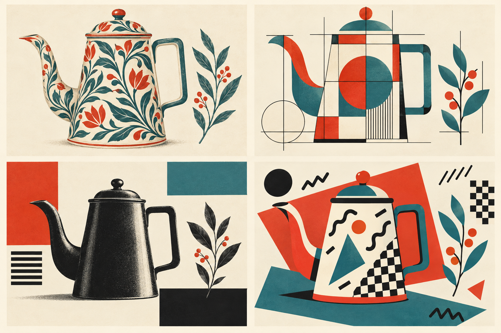
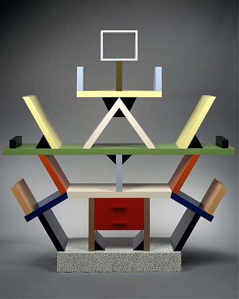
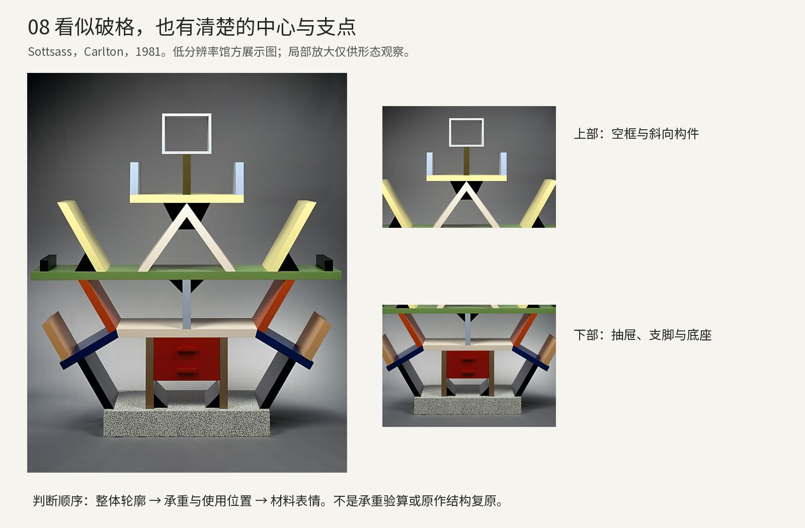
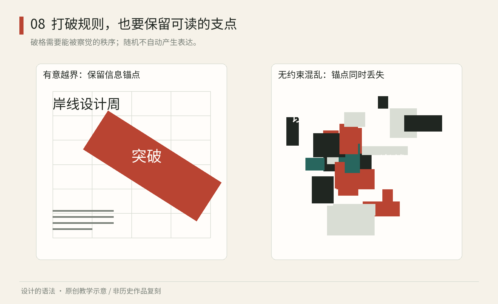

# 第08章｜后现代与解构：打破规则，为什么也需要规则

一张文字倾斜、图形越界的海报，可能非常有力量，也可能只是难读。两者的差别，不在于是否遵守传统版式，而在于偏离有没有目的，作品是否还保留足够的线索，让人理解它在表达什么。学习后现代设计最有用的入口，是辨认“被有意改变的关系”，而不是收集越乱越好的装饰。

本章分别讨论后现代、孟菲斯及解构性平面中的一些方法，观察它们对既有秩序的改变和新关系的建立。这些名称涵盖的实践不同，不能互换使用。

图8-2｜AI生成教学示意：同一咖啡壶与叶枝，在植物纹样、几何构成、网格编排与孟菲斯式组合中呈现不同关系。它比较形式策略，不是历史原作，也不是判定流派归属的标准样本。

## 深读Carlton：构件、色彩与空间尺度

<!-- figure-height: 100 -->

真实作品08A｜埃托雷·索特萨斯《Carlton》隔架，1981年，Memphis Milano制造，木材与塑料饰面，Met，1997.460.1a-d；约194.9×189.9×40厘米。©Estate of Ettore Sottsass。[The Metropolitan Museum of Art，Ettore Sottsass，Carlton Room Divider，1981](https://www.metmuseum.org/art/collection/search/486989) 此处为馆方低分辨率展示图，保留权利说明，仅研究引图，不声明开放许可。

从照片最上部看，孤立的空方框不像普通书柜顶部的封闭背板，它更像一个悬在空间里的符号。往下，浅蓝的短竖件与黄色横件构成一个清楚的小组，中央竖条把它接到下方；再往下，白色斜件与更大的横板形成近似张开的姿态。下半部则出现红色抽屉、向外斜出的构件和斑点底座。你可以先把这些读成一个拟人轮廓，再意识到它仍包含放书、抽屉和分隔空间的实际位置。拟人读法是本书观察，不是唯一正确的命名。

这件作品的“奇怪”来自多种熟悉经验的冲突。常见书架以水平层板和竖向支撑组织储物空间，Carlton向外伸出的斜板则容易引起肢体联想；塑料饰面常与廉价或日常表面联系，它在这里却与复杂制作和高端设计对象并置。Met的说明明确指出，它组合了隔断、书架和抽屉柜，也指出表面看似任意的结构中存在真实与隐含的等边三角形体系。这些是馆方的事实与解释；本书据图进一步讨论视线与材料表情，不能把分析照片冒充承重验算。[The Metropolitan Museum of Art，Ettore Sottsass，Carlton Room Divider，1981](https://www.metmuseum.org/art/collection/search/486989)

颜色同时参与了构件的分组。绿色、黄色和蓝色横向构件在不同高度形成停顿，白色和黑色斜件把上下连接起来，红色抽屉则像一个更实的重心。色彩的意义并非固定的“红等于激情”，而来自它出现在什么面积、什么位置，以及旁边有什么。若把抽屉换成同背景一样的灰，照片里下部的中心可能减弱；若给每根细杆都使用同样强烈的颜色，上部的小结构也可能与下部争夺注意。这种单一变量的比较，有助于辨认各色在中心、连接和分组中的作用。

分析图08B｜完整馆方展示图与上下部实际裁切；原图分辨率有限，放大只供关系观察。标签为本书原创，作品版权沿用原说明，不把低清细节解释为精确接头工艺。[The Metropolitan Museum of Art，Ettore Sottsass，Carlton Room Divider，1981](https://www.metmuseum.org/art/collection/search/486989)

还必须把照片放回物体尺寸。它接近两米高，也接近两米宽，不能当成桌上一件小摆设来理解。照片的正面压平了深度，但实际隔架会挡住、框住和透出后方空间；使用者走动时，不同板件的遮挡关系也会变化。本章只使用一张正面视图，因而能谈轮廓与正面分组，不能断言从每个角度看都会形成同一种拟人形象。若要继续分析空间分隔和使用体验，还需补充侧视图、环境照片或实物观察。

迁移练习：为一本“城市夜游”小册做封面，允许有戏剧性，但内文仍要可读。第一版故意把五种颜色、三种纹样、四个倾斜方向同时放进封面；第二版保留相同素材，却规定大标题只占一个稳定区域、最亮颜色只出现两处、最密纹样只承担背景。把两版缩成手机缩略图，再恢复到印刷大小。记下哪一版仍有明确中心，哪一版只是素材彼此抵消。练习的重点是比较素材、中心与密度之间的关系。

如果还想制作一个实物，可用纸板做一件不承重的桌面展示模型。先画出它要放什么，再探索斜向与空框的表达；不要为了“像Carlton”做无法稳定站立的结构。模型是帮助比较形态的，最终承重与安全需要适合材料和用途的设计验证。形态比较与结构验证需分别进行，前者不能代替后者。

## 从实物分析转入版式实验

Met同时指出，《Carlton》使用纤维板和塑料饰面，面向高端市场。材料与市场定位的关系，可与前述构件、色彩和复合用途一同讨论。[The Metropolitan Museum of Art，Ettore Sottsass，Carlton Room Divider，1981](https://www.metmuseum.org/art/collection/search/486989)

上述材料与市场定位的反差，扩展了对家具价值的讨论：塑料饰面可以参与高端设计，隔架也可以具有接近雕塑的表现。借鉴时应同时分析色彩、支撑、物件放置和文化联想，避免只提取彩色几何与波点。

为了理解“有意越界”，先建立一套简明基准：标题水平、正文靠左、图片不压文字、时间与地点集中。然后只改变一个关系，例如让标题越过图片边界，但保留正文与参加条件的稳定位置。这样，标题承担意外感，功能信息仍可读取。若所有元素同时旋转、重叠、变色，观者就很难找到对照，也难以辨认信息主次。

图08｜原创程序教学图：同一组信息在“保留锚点的偏离”和“同时改变多种关系”中的对照。它解释教学原则，不代表所有后现代或解构作品的外观。

## 把破坏设计成一种可重复操作

以下是原创的海报系列推导。假设主题是“夜间城市声音”，需要四张海报。先定下不变项：日期区始终在底部、主标题始终只用一种字体、主图只用黑白、强调色只有一种。再规定可变项：标题可沿主图的一条边移动，部分字形可以被图像遮挡，但每张最多遮挡两个字的局部；标题完整文本另在信息区出现一次。

这组约束为四张海报提供共同的识别与阅读方式，同时保留标题移动的变化。限制遮挡量，是为了让实验有边界；补充完整文本，是为了让信息不被表现手段吞没。这里的数值只属于本练习，不是艺术法则。你可以修改它们，但要能说清修改后得到什么、失去什么。

测试时，把作品分别交给两位没参与设计的人。一位只看五秒，说出主题；另一位找到日期与地点。若两人都无法找到参加条件，需要重新检查海报的任务。以报名为目的时，应提高功能信息的可查找性；以艺术表达为主时，则可保留更多歧义。

文字的非线性也可以被设计。主线内容保持顺序，旁注沿边缘展开；读者可先快速掌握核心，再探索细节。反之，若一篇需要准确理解的说明被切碎、打乱并大量重叠，阅读成本很可能超过收益。形式实验不必承担每一种任务。把它用于封面或章节扉页，将操作步骤留给清楚的版式，也可以是一套成熟安排。

## 自由仍然需要尺度

偏移需要能够解释其效果。将某个元素移回常规位置，比较表达是否发生明确变化；若变化很小，可考虑删去这项处理。检验系列规则时，则让另一位设计者仅凭说明制作新作品，观察其是否保留共同的识别线索。

另一种误区，是以“反功能”为名忽略制造与安全。隔架可以质疑家具的传统形象，却仍要面对承重；文字可以探索歧义，紧急出口标识却需要迅速识别。可接受的歧义取决于作品所处环境，以及使用者需要据此作出的行动。

观察练习：找一张你喜欢的实验海报，画两层分析。第一层只标稳定关系，例如同一字重、重复颜色、固定边界；第二层标偏离，例如错位、倾斜、遮挡。若只看见偏离，再找一遍稳定层。很多令人印象深刻的作品，正是靠少数稳定关系，容纳大幅变化。

将这种理解带到数字产品中，可以得到有价值的分工：活动宣传页允许更强烈的个性，支付、报名和错误提示则保留明确的操作方式。系统可据此分别规定宣传内容与操作内容的表达范围。

也可以用一项“还原测试”训练辨认。把实验海报另存一版，去掉叠印、旋转和裁切，只留下最基本的文字与图像。比较两版：原版增加的是速度感、情绪、阅读路径，还是仅增加了寻找信息的难度？记录每一种处理带来的变化，再决定保留范围；暂时无法区分作用时，可逐项移除后比较。

这种分析并不要求所有艺术作品都能被解释成清单。它只是设计学习中的一种工具，让你区分个人偏好与可传达的判断。你完全可以喜欢一张难读的海报，同时承认它不适合承载医院预约说明；也可以欣赏一件夸张家具，同时不把它当作小卧室最方便的储物方案。

本章来源：

- [P1] The Metropolitan Museum of Art，Ettore Sottsass，Carlton Room Divider，1981：[馆方藏品与结构说明](https://www.metmuseum.org/art/collection/search/486989)。
- [P2] Design Museum，Ettore Sottsass：[设计者资料与作品背景](https://designmuseum.org/designers/ettore-sottsass)。本章海报系列、测试与“稳定层／偏离层”均为原创教学方法。
