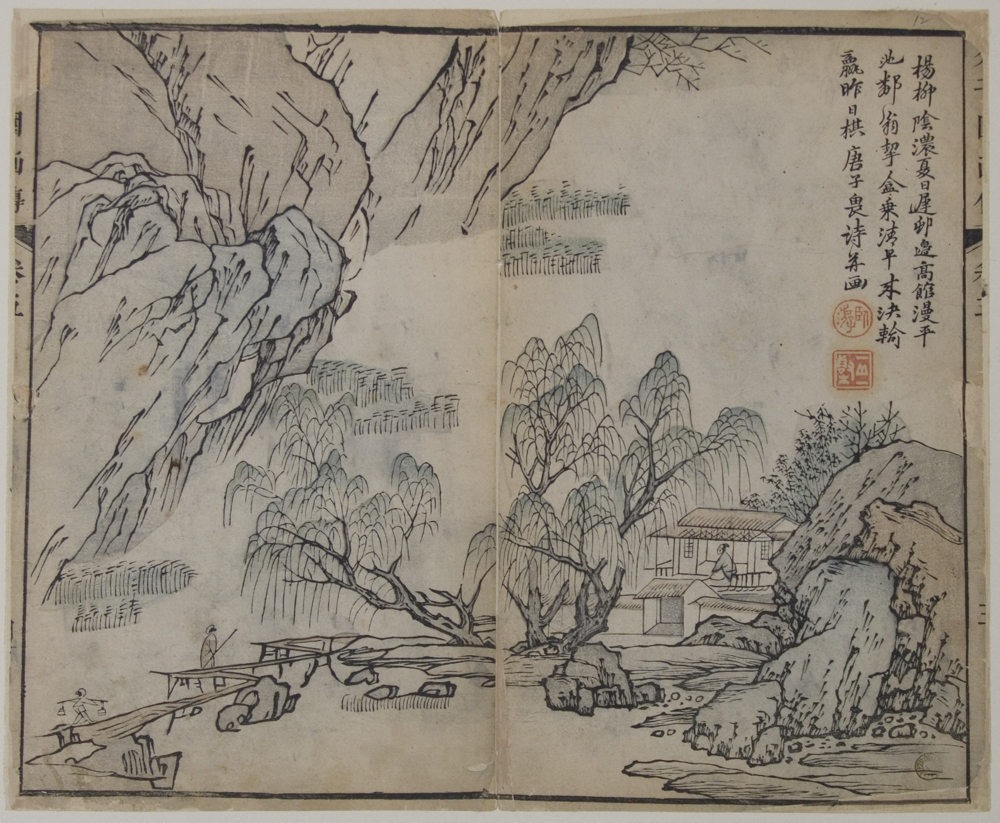
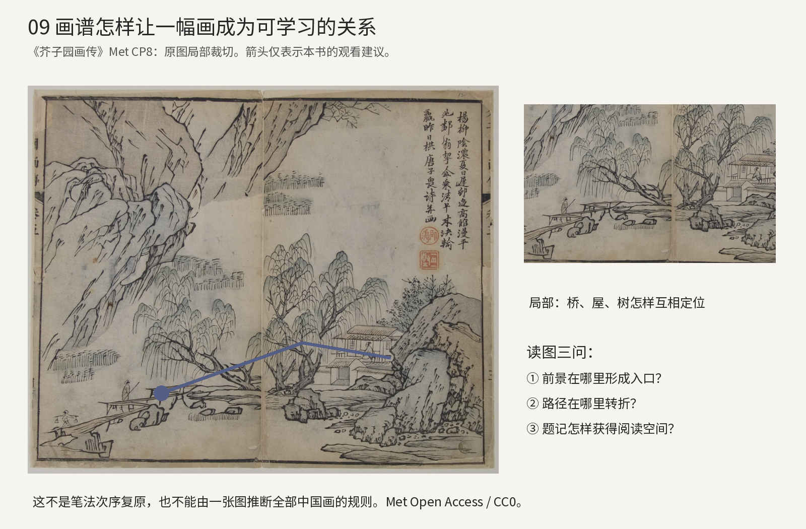
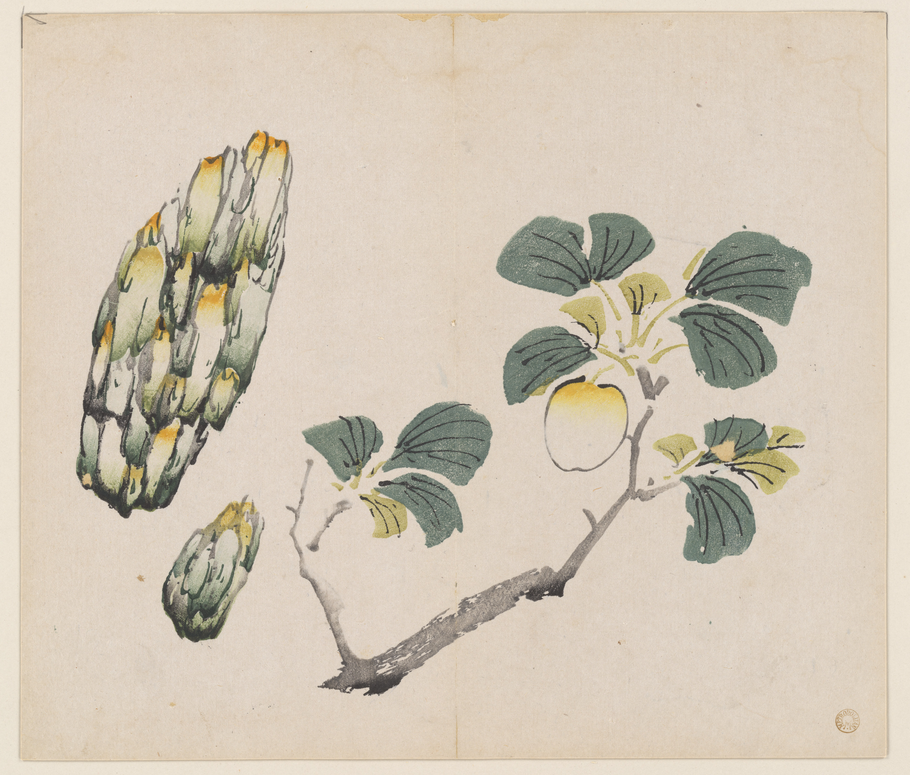
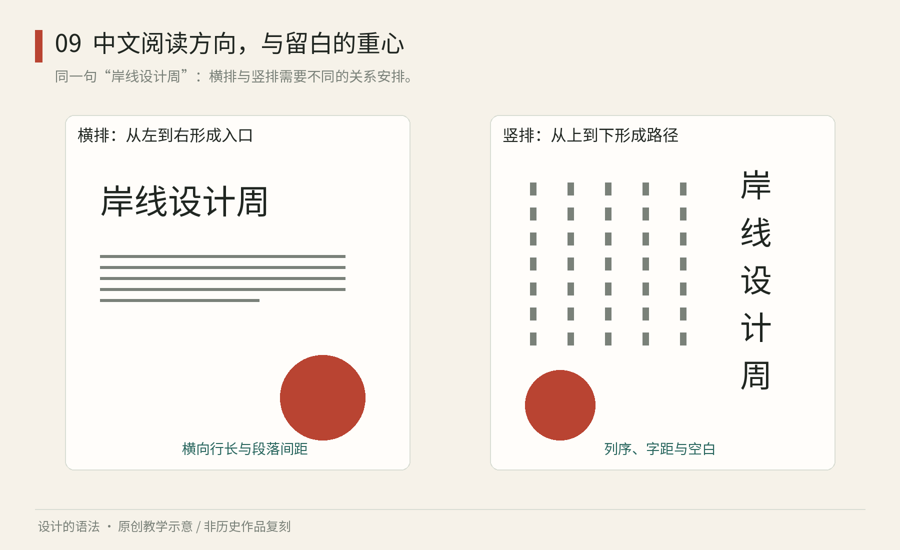
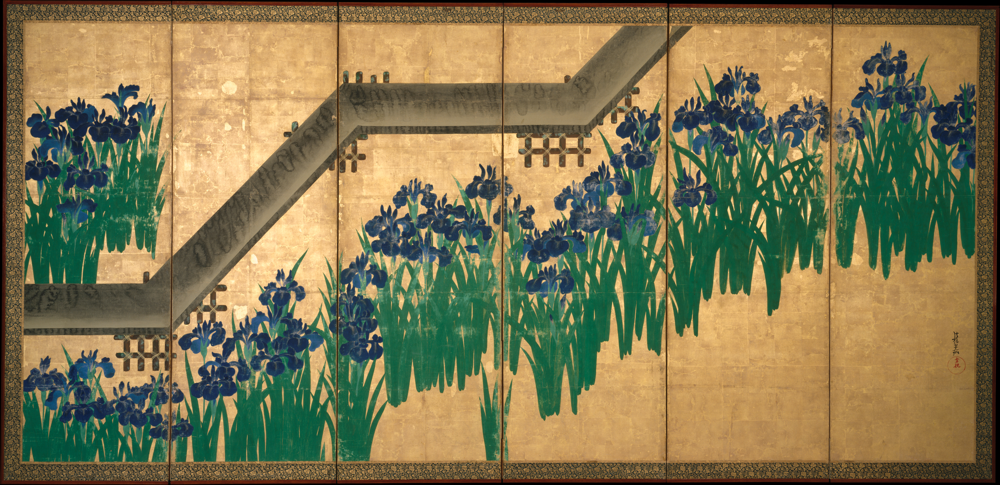
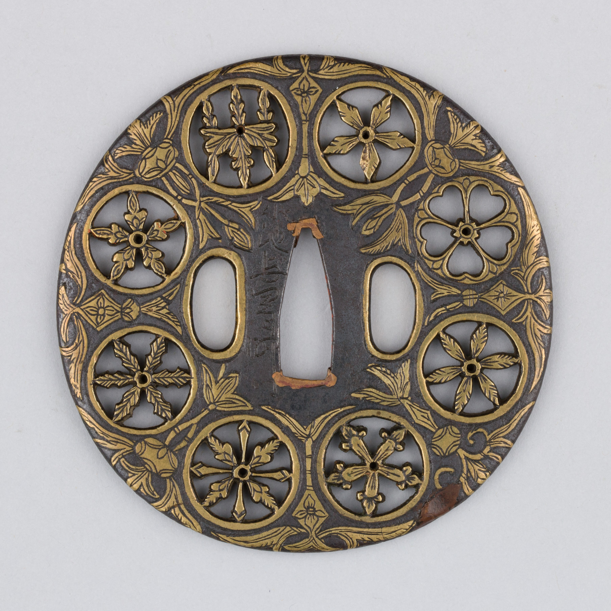

# 第09章｜东亚视觉秩序：从文字、画面与载体中读规则

“东方感”是一个方便却粗糙的词。水墨、红印、竖排、金地、家纹，分别来自不同媒介与历史实践，把它们放在同一张海报上，并不会自动得到深厚的设计。更好的学习方法，是每次追踪一种具体关系：文字怎样形成阅读方向，空白怎样连接形体，图案怎样在不同尺寸上维持识别。

东亚不是一套统一风格。本章选择中文排版、日本屏风与家纹相关器物作为三个入口，学习可观察的组织方法，并明确它们的边界。

## 中国画谱的学习系统：从一幅画，读到一组可传授的关系

真实作品09C｜王槩绘图，《芥子园画传》一页，馆方标注初版1679年，木版水墨设色，Met，CP8，object ID 63201。Met Open Access / Public Domain（CC0）。[The Met，Wang Gai，Page from the Mustard Seed Garden Manual of Painting，CP8，初版1679年](https://www.metmuseum.org/art/collection/search/63201) 这里展示一个馆藏书页，不以初版年代推定所有后世版本的印制时间。

先从画面下部的小桥和水边看起。近处对象较容易辨认，把目光引向中部的房屋、树群，再转向上部大树与山石。题记在右上获得一块相对完整的阅读区域，没有与树干最密的部分挤在一起。小桥、水岸、房屋和山树分别构成局部入口、空间连接与观看停顿。本书据这一页提出观察路径，并不把它说成所有观者唯一的视线路线。

画谱页保留了可供学习的具体关系。树的分枝并不是向每个方向平均伸展；山石并不是装饰贴纸；小屋也不是随便加在空处的标识。这些对象共同建立近远、遮挡和尺度。将小屋、石头与树单独收进素材库时，还需记录它们在场景中的组合方式。画谱作为学习资源的作用，恰在于把局部类型与完整构图联系起来。

Met对《芥子园画传》的说明记载：1679年初版以多卷组织技法、树木、山石、人物与名家作品的再现，王槩参与绘图。馆方把它放在供学习者接触绘画训练的历史中讨论。[The Met，Wang Gai，Page from the Mustard Seed Garden Manual of Painting，CP8，初版1679年](https://www.metmuseum.org/art/collection/search/63201) 由此可借鉴的教学方法，是同时讲解元素的画法与组织方式。这是本书的当代应用解释，与软件设计系统中的治理、版本和接口属于不同范围。

再看本页画与字的分工。题记不像海报大标题那样抢先出现，主要风景也不被统一切成一个方正图片区；图文在同一张纸上相互让位。若把它机械改成“左文右图”的模板，版面可能更规整，却会改变原有疏密。用于现代讲解页时，应先确定主要观看对象的位置，再安排字号清楚的说明文字，分别检查二者的可读性。

分析图09D｜原页上增加本书观察方向线，并裁切实际桥、屋与树的关系。线条不表示历史笔法次序；图像来源为Met CP8，CC0。[The Met，Wang Gai，Page from the Mustard Seed Garden Manual of Painting，CP8，初版1679年](https://www.metmuseum.org/art/collection/search/63201)

真实作品09E｜胡正言等绘图、辑印，《十竹斋书画谱》一页，馆方标注初版1633年，纸本木版水墨设色，Met，CP75，object ID 63403；Met Open Access / Public Domain（CC0）。[The Met，Hu Zhengyan and others，Page from the Ten Bamboo Studio Manual，CP75，初版1633年](https://www.metmuseum.org/art/collection/search/63403)

换到这一页，主体明显更少：果实或植物形态与带叶枝条分居画面，纸地把它们分开，也让细小的色调和轮廓更容易被看见。此处不把植物认成某个未经核对的物种，也不由照片推断全部印刷过程。比较两页的知识组织，《芥子园》页让多类对象形成一个场景，《十竹斋》页则更像让你近看少量形态与色阶。两页分别侧重多对象的场景关系和少量形态的细节比较。

实际改稿练习：选三种你能亲眼观察的叶子，用手机拍照，给每一种做一页讲解。第一版把三片叶子等大排列，加三段相同长度的文字；第二版保留相同材料，却让最能解释差别的一片成为大图，其余两片做局部比较；第三版再加一张三种叶子在同一枝条关系中的原创示意。请读者逐版指出可辨认的叶形差别，再检查大图、场景和局部图是否提供了对应证据。这几种图像承担不同的教学任务，尺寸和编排应随之调整。

家纹、屏风、画谱和中文排版，分别处理身份、空间、教学和文字。比较它们时，应先明确媒介与用途，再讨论水墨、印章或金地等形式在其中的具体作用。

## 中文排版：秩序首先属于语言

中文标题常能排成紧凑的方形，但这不意味着正文应该把每个汉字平均塞满方格。标点位置、行首行尾禁则、中西文混排、横排与直排的差别，都影响阅读。W3C《中文排版需求》整理的是中文书写系统的排版需求；本书检索的版本为2026年10月7日的Group Note Draft，它是需求与实现讨论资料，不是一本规定所有中文作品外观的审美手册。[W3C，Requirements for Chinese Text Layout，Group Note Draft，2026-10-07](https://www.w3.org/TR/clreq/)

把“秋日植物展：观察城市中的叶片”做成一张海报。第一步只决定阅读方向：横排可以让标题、日期和介绍依次展开；直排则需要重新安排列序、标点和数字，不能把横排文本整体旋转90度就结束。第二步决定信息的职责：主标题可以有较大的字间变化，日期与地点应尽量保持熟悉格式。第三步检查实际断行，特别是括号与句读的位置。

图09｜原创程序教学图：以“岸线设计周”示例比较横排、直排和空白位置；图中是当代教学版式，不冒充某个时代的书籍或书法格式。

这一练习可以直接迁移到软件界面。若一个按钮只按英文短词设计，换成中文、长地名或包含括号的说明后可能挤压。应让文字内容参与组件规则：允许多大长度，何时换行，图标与文字是否一起居中，缩放后还剩多少空间。这些文字长度、换行和对齐条件，是文化适配中需要落实的阅读问题。

## 空白：看它把什么连起来

尾形光琳《八桥图》屏风，大都会艺术博物馆的年代标注为1709年以后。画面将竖向的鸢尾与斜向桥梁组织在成对屏风上，并联系《伊势物语》中的八桥情节。金地在这一作品中参与分隔、连接与节奏。以下分析限于该屏风的具体关系，不代表所有日本艺术的留白方式。[The Metropolitan Museum of Art，Ogata Kōrin，Irises at Yatsuhashi (Eight Bridges)，1709年以后](https://www.metmuseum.org/art/collection/search/39664)

真实作品09A｜尾形光琳《八桥图》（Irises at Yatsuhashi），1709年以后，成对六扇屏风，纸本水墨、设色与金箔。纽约大都会艺术博物馆藏，藏品号53.7.1、53.7.2，object ID 39664；图示为馆方提供的一扇屏风图像，并非两扇全景。Public Domain，Met Open Access（CC0）。[The Metropolitan Museum of Art，Ogata Kōrin，Irises at Yatsuhashi (Eight Bridges)，1709年以后](https://www.metmuseum.org/art/collection/search/39664) 观察桥梁方向与鸢尾群组，勿把金地简单理解为没有内容的空处。

可用一个原创实验理解空白。画三组草叶，第一版把间隔平均分配；第二版让两组靠近，第三组远离；第三版让一组贴近画框，另两组在内部形成呼应。你没有增加任何草叶，画面却会出现不同的分组与张力。间隔的位置和大小改变了草叶之间的联系。

迁移到书籍设计时，需要按页面任务分配密度。一张章节扉页可以只放标题与一小幅图，让读者停顿；一页工具说明则需要容纳可操作步骤。若为了“禅意”把字号变得很小、信息拆到许多页，形式标签反而妨碍学习。留白面积需随阅读节奏调整，难以用一个固定比例覆盖所有页面。

## 家纹与识别：简化不等于随意删减

日本家纹可以帮助我们观察轮廓、对称与负形，但其历史使用与现代商标不同。大都会艺术博物馆收藏一件小池和泉守直政相关的《家纹散唐草文鐔》，标为16世纪末至17世纪初。馆方说明其家纹采用透雕并以黄铜镶嵌突出，装在刀刃与握柄之间；也指出同一名号下的作品差异与工坊延续有关。看它时既要辨认图案，也要看到金属加工、位置和使用环境。[The Metropolitan Museum of Art，Koike Izumi no Kami Naomasa，家纹散唐草文鐔，16世纪末至17世纪初](https://www.metmuseum.org/art/collection/search/30091)

真实作品09B｜小池和泉守直政相关《家纹散唐草文鐔》，16世纪末至17世纪初，铁、黄铜、铜。纽约大都会艺术博物馆藏，藏品号36.120.92，object ID 30091；正面图。Public Domain，Met Open Access（CC0）。[The Metropolitan Museum of Art，Koike Izumi no Kami Naomasa，家纹散唐草文鐔，16世纪末至17世纪初](https://www.metmuseum.org/art/collection/search/30091) 留意家纹、透空和中央安装区域如何共同占据器物表面；它不是现代商标样张。

试做一个完全原创的植物识别符号，不复制真实家纹。先用五个叶瓣围绕中心排列，只用黑白。把它缩到指甲大小，再做反白版。若叶瓣之间的空隙闭合，优先扩大空隙，而不是增加描边。接着制作第二个符号，只改变叶瓣数量；再做第三个，只改变叶端形状。记录小尺寸下仍可辨认的差别，再据此选择系列符号的变化范围。

把这些符号当成真实家族或宗教标记使用之前，需要进一步核对含义与语境。学习形式方法，并不等于获得所有文化符号的任意解释权。对新项目而言，最好明确区分“研究历史纹样”和“原创识别符号”，记录设计来源，不用一句“东方传统”掩盖具体借鉴。

章末观察：找一页中文书、一件日式图案物件和一张当代海报，分别写下“文字方向”“空白的作用”“重复单元”。记录时注明相应位置和用途，使比较能落实到具体作品。

跨媒介比较还需记录载体对观看方式的影响。屏风不是一张平摊的图片：折角会改变图像的连续与可见范围；书页也不只是海报缩小，它有装订边、翻页顺序和阅读距离。把屏风作品移到手机上，可以研究其形体关系，却不能声称已经完整体验了原来的空间效果。数字再现帮助观察，也会隐去一些条件。

因此做文化参考板时，可以为每个条目写三行：它是什么、来自哪里、我实际借鉴哪条关系。例如“日本江户时期屏风；参考Met藏品；借鉴斜向连接与成组植物之间的疏密”，就比“东方、禅意、高级”更能指导下一步。具体描述还会暴露误用：若你实际只取金色与红印，就不要把整个方案说成对某种传统的深入继承。

本章来源：

- [E1] W3C，Requirements for Chinese Text Layout，Group Note Draft，2026-10-07：[文档](https://www.w3.org/TR/clreq/)。
- [E2] The Metropolitan Museum of Art，Ogata Kōrin，Irises at Yatsuhashi (Eight Bridges)，1709年以后：[藏品页](https://www.metmuseum.org/art/collection/search/39664)。
- [E3] The Metropolitan Museum of Art，Koike Izumi no Kami Naomasa，家纹散唐草文鐔，16世纪末至17世纪初：[藏品页](https://www.metmuseum.org/art/collection/search/30091)。

- [E4] The Met，Wang Gai，Page from the Mustard Seed Garden Manual of Painting，CP8，初版1679年：[藏品与出版组织](https://www.metmuseum.org/art/collection/search/63201)。
- [E5] The Met，Hu Zhengyan and others，Page from the Ten Bamboo Studio Manual，CP75，初版1633年：[藏品与工艺背景](https://www.metmuseum.org/art/collection/search/63403)。
