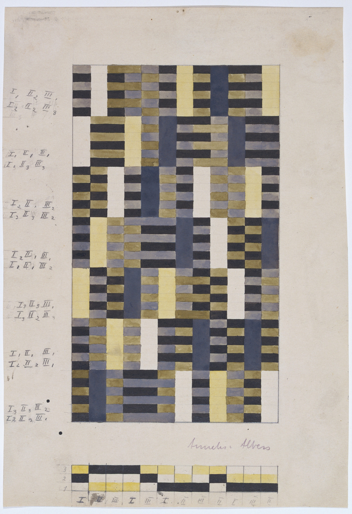
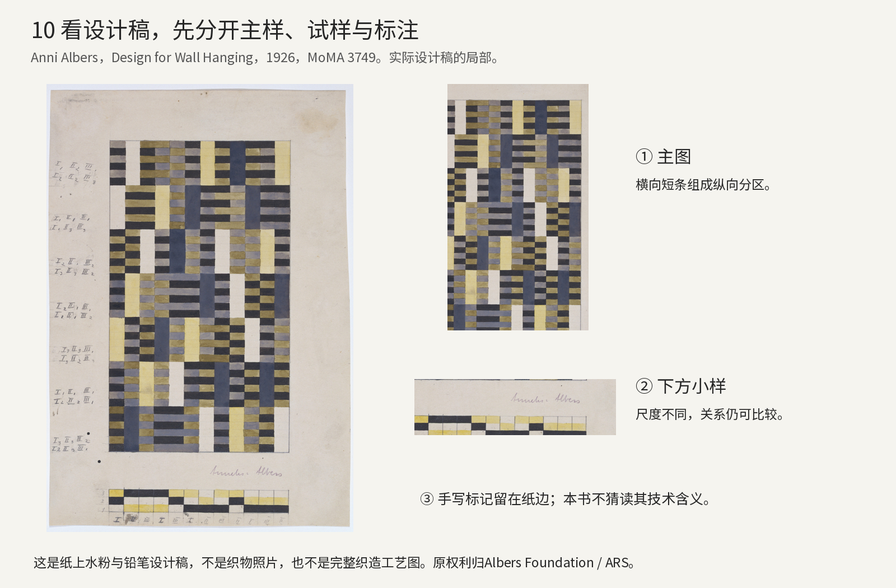
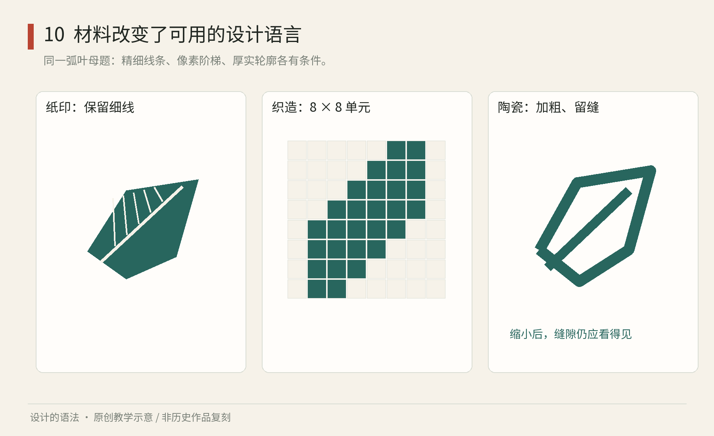

# 第10章｜工艺与材料：设计系统为什么不能只存在于屏幕

屏幕上的同一条曲线，可以无限缩放，看起来始终顺滑。它一旦进入布料、纸张、陶瓷和金属，就遇到不同条件：线会不会断，颜色能否稳定重现，图案转到曲面后是否变形，重复生产能容忍多少差异。材料不是设计结束时才选择的皮肤，它从一开始就在参与规则。

工艺中的系统性，体现在一套可以反复执行、检查和调整的关系中。它有时写成图样，有时依赖工序和熟练经验；不能因为没有现代规范文档，就说它没有秩序，也不能把所有传统工艺直接改名为当代软件意义上的设计系统。

## 深读一张阿尔伯斯设计稿：纸上的格子，怎样指向材料

真实作品10A｜安妮·阿尔伯斯《Design for Wall Hanging》，1926年，纸本水粉与铅笔，34.9×23.8厘米，MoMA，399.1951。©2026 Josef and Anni Albers Foundation / ARS。[MoMA，Anni Albers，Design for Wall Hanging，1926](https://www.moma.org/collection/works/3749) 馆方公开图，随本书研究分析引用，不声明开放许可。这是设计稿照片，不是壁挂织物照片。

请先看纸面本身：中间是密集的矩形设计区，左侧留有手写标记，下方另有一条较小的色样或构成研究。主图区与周围纸地的差别，让我们看到它不是一张已经裁到最终边缘的宣传图，而是一张保留工作痕迹的设计稿。文字与小样的具体技术含义，需要相应档案才能确认，本书不猜读模糊手写内容；但我们仍能观察它们在过程中的不同角色：一个区域展示整体，一个区域容纳备注，一个区域让较小尺度的关系接受比较。

再进入主图。最先出现的可能是几条纵向分区，但它们由大量横向短条拼接出来。浅色长条在若干位置贯穿或中断，把深色区域切开；蓝灰、暗色与黄调色块并未平均铺满，而是在不同区段形成有长有短的节拍。这使画面同时保有纵向延续和横向起伏。若只说“几何抽象”，我们还没有理解它；更具体的描述是，局部短条怎样通过连续、错位和中断，组成跨越局部的大方向。

这张稿有一个很适合学习的张力：整体看起来有规律，局部却不是同一块图案机械复制。你可以用纸遮住一半，只看剩下部分，仍会感觉到它与整体相连；但若把剩下的一半直接复制粘贴，得到的节奏可能更单调。这里的判断来自对本张图的观察，不是宣称阿尔伯斯完全不用重复。学习者应先标出图中确实重复的尺度与方向，再标出改变长度、颜色或间隔的地方，避免用“自由变化”掩盖自己的观察不足。

分析图10B｜原稿全图、主图区与下方小样的实际裁切。标签为本书原创；纸边手写标记不作未经证实的释读。图像权利沿用Albers Foundation / ARS。[MoMA，Anni Albers，Design for Wall Hanging，1926](https://www.moma.org/collection/works/3749)

从纸面到织物，中间还缺什么？至少缺具体纤维、组织、密度、设备、边缘与成品尺寸等条件。格子状外观不能自动说明经纬如何交织。MoMA的媒介记录明确它是纸上水粉与铅笔；因此我们可以讨论色块与构成，却不能把它当成可直接送上织机的完整技术文档。[MoMA，Anni Albers，Design for Wall Hanging，1926](https://www.moma.org/collection/works/3749) 这一点对今天也重要：一张高精度界面效果图，仍可能缺少加载、错误与键盘操作；一张壁挂设计稿，仍可能需要材料与工艺的补充。完成了视觉表达，未必完成了实现信息。

现在做一组真实的改稿。准备两种颜色的纸条，剪成同一宽度，用十条横条和十条竖条交替穿插成小片，这是最简单的纸编练习。第一版只研究结构，不追求图案；第二版保持穿插规则，只改变纸条颜色次序；第三版保持颜色次序，改变两条相邻纸条的宽度。把三版拍在同一光线下，比对颜色节奏、整体软硬与边缘整齐程度。它只是纸编，不把结果当成真正织物的性能，但能让你亲手体会“视觉次序”和“制作结构”并非同一变量。

接着给三版各写一张交接卡：材料尺寸、条数、颜色顺序、起始压挑关系、最后怎样固定。把卡片交给另一人，先不展示成品，看他能否做出相同结构。若需要你不停口头补充，记录还没有完成。修改卡片时，补上缺失的关系，而不是只多拍一张漂亮成品照。设计系统的文档价值，正是在别人需要行动时，帮助他做对下一步。记录还应允许定位错误：若成品第三行开始与样品不同，读者应能回到第三行的穿插说明，而不是重看全部过程。给纸条编号、拍下起始状态，并记录最后固定位置，能让另一位制作者发现差异发生在哪一步。这些小信息，比增加一段审美宣言更能改善交接。

## 图样与实物不是同一件作品

安妮·阿尔伯斯1926年的《壁挂设计》是MoMA收藏的设计图；而馆藏另一件《壁挂》标注原设计为1927年、实物于1964年在作者指导下织成，材料为棉与丝。这两个记录提醒我们区分设计年代、制作年代，以及图样与成品。看到一张“1927年作品”的图像，不应自动推断眼前实物就是当年制造。[MoMA，Anni Albers，Design for Wall Hanging，1926](https://www.moma.org/collection/works/3749)[MoMA，Anni Albers，Wall Hanging，1927年设计、1964年在作者指导下织成](https://www.moma.org/collection/works/3032)

看织物时，可分三层：图案层说明哪里出现哪些颜色；结构层说明经纬怎样交织；材料层说明纤维、粗细和表面状态。相同图案换一种组织，不一定得到同样的软硬、透光或耐用表现。一幅彩色格子画也不能直接当成完整织造图。真实制作还需要具体组织、密度、设备与边缘处理等信息。

莫里斯《草莓小偷》的制作也显示图案与工序的联系。V&A的纺织专题和藏品展示讨论他对染印方法的实验。这里可学习的是：若目标效果依赖特定工艺，就必须在规则里记录它，不能只保存一张最终彩色图片。[V&A，William Morris textiles](https://www.vam.ac.uk/articles/willam-morris-textiles)

## 同一个母题，三种材料版本

做一个原创小练习：把弧形叶片用于纸质门票、织物挂旗和陶瓷杯。先画一个清楚的母题，只保留叶尖、叶脉与总体方向。接着分别制作三个版本，而不是把同一张文件直接发送给三个工厂。

图10｜原创程序教学图：以同一弧叶母题演示纸面细线、八乘八网格近似和较粗轮廓三种转译。八乘八仅用于说明分辨率，不是实际织造组织图；陶瓷版本不是烧制效果预测。

纸张版本先检查最终印刷尺寸。若叶脉太细，先放大间隔或减少叶脉数量。织物教学版本只允许八乘八个方格：曲线被离散化，细节必须取舍。保留总体倾斜与叶尖，比勉强塞进所有叶脉更容易维持识别。陶瓷版本则先考虑可用装饰区域：杯柄附近是否中断，母题在弧面上是否需要调整宽度，装饰是否涉及杯口等使用位置。这些问题需要制作方确认，不应从平面示意图直接推断可生产。

你会得到三张看起来并不完全相同的图，却能说明它们为什么属于同一家族。稳定项可以是叶片方向、比例范围、两种主要颜色；可变项可以是线宽、细节数量和重复间距。系统由稳定关系维护身份，由材料版本完成适配。

## 把工艺要求写成能够交接的规则

一份可用的制作说明至少需要回答：最终尺寸是多少；使用哪种材料与工艺；哪些边界不可改变；允许出现什么差异；样品怎样验收。对印刷品，颜色需要通过与实际纸张及工艺相关的打样确认；屏幕上的RGB数值不能保证纸面颜色完全一致。对手工制作，也要区分可接受的自然差异与影响识别、装配或使用的错误。

以下是本书原创的验收示例，而非行业统一标准。一个叶片布袋系列，可先约定三项：远看能认出同一叶片；提手附近不截断关键识别形；每批颜色以确认过的实物样为比较基准。至于允许多少色差、多少位置偏移，应由设计者与制作方根据用途、预算和工艺能力约定，不能拿书中的示意数字代替。

为减少返工，先做风险最高的样品，而不是先做最好看的宣传图。若最大风险在细线印不出，优先试印线宽梯度；若在图案跨接缝，优先做接缝样；若在颜色，优先做实际材料色样。一次只改变一个变量，记录文件版本与材料条件。这样，失败也会成为下一轮能够使用的信息。

常见误区是把手工差异全部称作“独一无二”，或把工业生产全部理解为机械一致。两者都过于简单。手工可以拥有严格的结构要求，工业产品也可能包含纹理变化。设计系统应说清哪些差异具有价值、哪些差异会损害用途，而不是提前消灭一切变化。

最后做一项低成本观察：挑选两张不同纸的印刷品，把它们放在同一光线下，比较深色区域、细字边缘与表面反光。再触摸纸张。你会发现观看效果并非只由文件决定。能把材料条件带进设计判断，就开始跨过“只会在画板里设计”的门槛。

样品档案也值得设计。为每份样品记录日期、文件版本、材料名称、制作工序与观察结果，并拍摄同一光线下的照片。把失败样保留一小块，下一次就能直接比较，而不是凭记忆争论“是不是上次更深”。照片不能替代实物，但能帮助追踪过程。若制作方更换纸张或设备，原来的确认也需要重新判断适用范围。

对初学者而言，一个很有效的练习是制作“能力边界样张”：在一张纸上排不同粗细的线、不同大小的文字、实色块与细小反白。用准备采用的工艺制作一次，圈出开始丢失细节的地方，再反推设计允许的下限。设计规则由试验得到，而非从另一家工厂的经验机械复制。它能把抽象的“注意工艺”变成实际可用的限制。

本章来源：

- [C1] MoMA，Anni Albers，Design for Wall Hanging，1926：[设计图藏品页](https://www.moma.org/collection/works/3749)。
- [C2] MoMA，Anni Albers，Wall Hanging，1927年设计、1964年在作者指导下织成：[实物藏品页](https://www.moma.org/collection/works/3032)。
- [C3] V&A，William Morris textiles：[染印与织物资料](https://www.vam.ac.uk/articles/willam-morris-textiles)；V&A East Storehouse，Printing on fabric：[制作展示](https://lookup.vam.ac.uk/east-storehouse/storagedisplays/USE2174/)。本章母题转译、交接表述和验收安排为原创教学示例。
