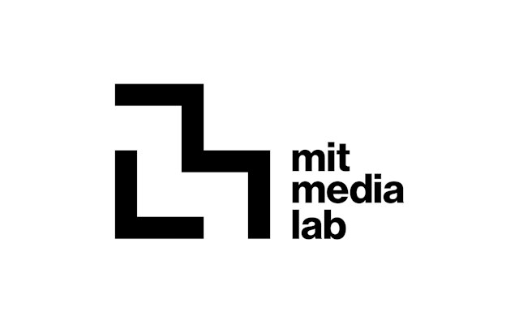
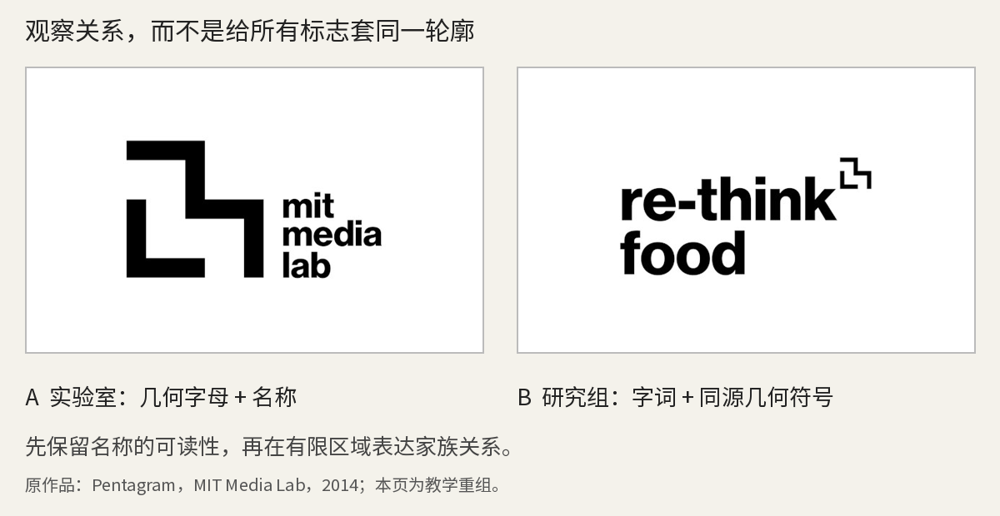
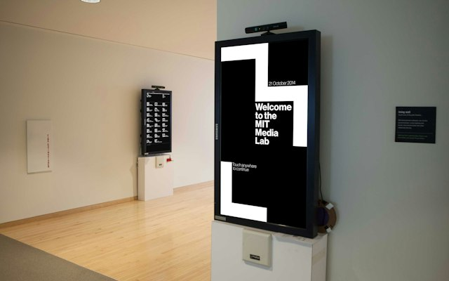
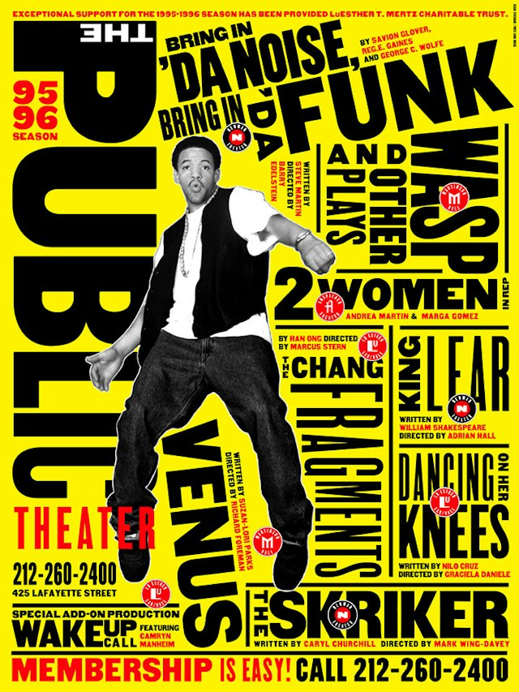
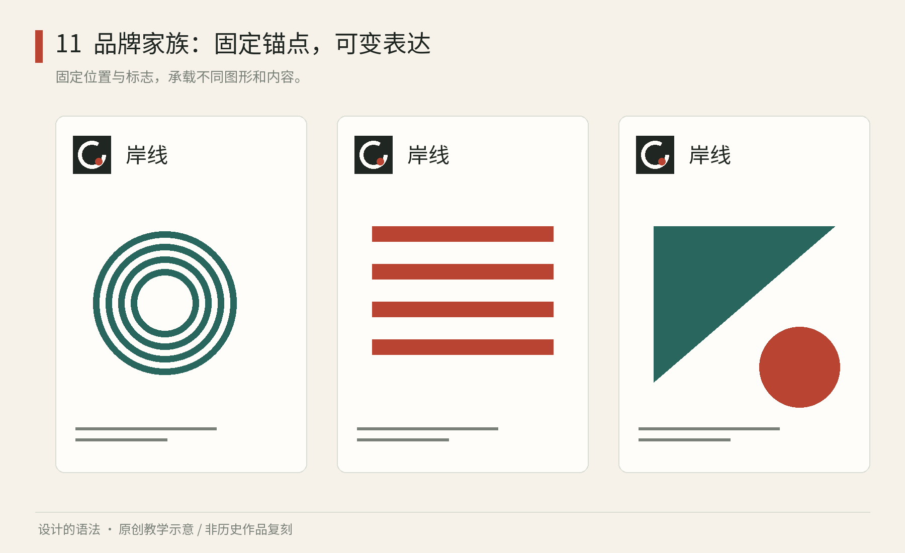

# 第11章｜品牌识别：让变化仍然属于同一个人

## 真作细读：MIT 的字母，Public Theater 的声音

图11-3｜真实作品。Pentagram／Michael Bierut团队，MIT Media Lab视觉识别，2014；图由[设计方项目页](https://www.pentagram.com/work/mit-media-lab/story)提供。此处保留字标与周围留白，便于观察符号与名称的比例。

左侧粗黑折线与右下方三行名称承担不同的识别任务：图形供快速认形，文字供首次阅读。纯几何字母对熟悉组织的人可能已经足够，新来者却未必能辨认。保留名称，陌生读者便不必先破解图形。

折线的内部空白同样参与字母结构：横竖笔段构成相近厚度，转弯处没有为了装饰而改变笔性。外缘的台阶和内部的开口一同建立识别。若只沿外轮廓描一圈，忽略内部白形，缩小以后就可能变成难分辨的黑块。缩小时，必须同时保留黑色笔段和白色开口。

图11-4｜真实作品的教学重组。左为实验室主标志，右为“re-think food”应用；原设计Pentagram，2014。素材取自[同一项目页](https://www.pentagram.com/work/mit-media-lab/story)，重组与文字分析由本书添加，不是设计方原版规范页。

右侧应用采用了不同的信息主次：大字负责说出研究主题，小型几何符号退到侧上方。它没有把食品研究画成刀叉，也没有与主标志一模一样。可以迁移的方法是先确定组织关系，再选择哪一部分用于表达关系；不能因为学校有几十个团队，就给每个名字都配一个同样抢眼的大徽章。信息主次与家族相似性是两个需要分别处理的问题。

图11-5｜真实现场。MIT Media Lab标识应用，Pentagram，2014；[来源](https://www.pentagram.com/work/mit-media-lab/story)。照片中的环境、观看角度与标牌一起构成实际阅读条件。

现场照片把前面的判断带到另一尺度。白形与黑面板形成明显反差，面板又处于走廊转角附近，读者首先必须发现“这里有信息”。若把主标志的细节当装饰纹样铺满整个面板，远处的轮廓会更复杂，名称却不一定更容易找到。识别应在不同距离逐级展开，而不是在所有距离同时交代全部内容。

图11-6｜真实海报。Paula Scher／Pentagram，The Public Theater，画面标示1995—1996演出季；[设计方项目页](https://www.pentagram.com/work/the-public-theater/story)。具体单幅制作月份未标，摄影与图像权利依原页面归属，未声明开放许可。

与 MIT 的几何秩序相比，Public 海报用黄色底、黑色粗字、倾斜的演员与方向不断变化的短语形成街头招贴的密度。先读巨大的 PUBLIC，再被人物与节目词带向其他区域，最底部的细小事务信息仍有相对稳定的位置。它用字的大小、宽窄与方向制造声音，而不是仅靠换一种漂亮字体。

这里有明确取舍：复杂层叠适合宣告剧场的活力，却要求观众愿意停留。如果把同样密度搬到第一次来访者的路线牌上，名字与箭头会相互争夺。一个实际改稿练习是：保留黄色、一个超大词与一个斜向人物，但把日期地点单独收进底部横带；再画第二版，把所有信息都倾斜。比较哪版既有声音，又能让陌生人找到演出时间。这项练习着重比较强烈的视觉性格与事务信息的可读性。以上读图判断是本书的视觉分析。

## 看见标志以外的东西

遮住一家店的标志，可以检验包装、菜单、海报和店员胸牌之间还剩下多少共同线索。单一颜色在黑白印刷或换材质后容易失效；字体、信息排列、摄影距离、材料触感和语言节奏若能彼此呼应，身份便有了多种表达途径。

“品牌”包含人们对组织的经验与判断，设计无法单独控制它；“视觉识别”是可设计的表达部分；“标志”则是集中表达身份的符号。一家餐厅可以拥有漂亮的标志，却让菜单难读、过敏原信息难找，体验仍会损害品牌。反过来，一个很简单的字标，也可能因长期稳定的使用而清楚有力。

传统企业识别常把标志比例、标准色、字体与禁用方式写进手册。头像、动态图像、狭长屏幕与互动装置要求同一身份适应不同尺寸和行为。有些项目因此把固定图形扩展为“规则固定、结果可变”的身份系统。这里的动态既可能指动画，也可能指一组静态变体，二者不能混为一谈。

前面的两组真实作品说明，身份可以通过安静的几何关系，也可以通过密集的文字声音建立。下面把这些观察转成一个可亲自尝试的小项目。

*图11｜原创程序教学图：固定标志与一组可变图形共同建立身份；变化发生在约定的范围里。图形是虚构案例，不是 MIT 标志复刻。*

## 把个性改写成生成规则

假设我们为虚构的社区文化空间“折页”设计身份。委托人说，希望“亲切、活跃、认真”。这些形容词可能被理解为不同的字体、图像和布局，需要进一步转成可观察的选择。

“亲切”可以由接近日常语言的标题、足够大的正文与接近日常观看距离的摄影表达。“活跃”可以让一个折角模块沿四个方向组合，而不是每张海报都增加新花样。“认真”可以落实为地点、日期、价格和预约方式始终占据稳定的信息区。三种要求并不自动相容：过度活跃会破坏查找效率，所以活动图形可以变化，关键事务信息应更稳定。

先建立一份小型规则：标志只有横式和紧凑式两种；正文用一种易读字体；每张版面只设一个主要视觉；折角只作转向或框定，不模拟真实折纸；主题可以换色，但文字对比与信息顺序必须验证。再规定一个例外：当艺术家作品已经非常复杂时，折角退到页边，避免识别图形遮挡作品或与之争夺注意力。

这份规则没有指定每一张海报怎么画，却缩小了任意发挥的范围。其中，图形组合与内容可以更新，名称和信息角色保持稳定。“所有海报都必须使用同一模板”会把文化活动之间本应存在的差异压平；“每次随意发挥，只要放标志”又会使识别不断重置。

| 固定部分 | 可以变化 | 为什么这样分配 |
| --- | --- | --- |
| 名称与标志基本结构 | 主题图像、活动名称 | 让组织身份与活动内容共存 |
| 日期地点的阅读顺序 | 版面比例与内容长度 | 降低反复查找的成本 |
| 字体角色与对比要求 | 强调色与模块组合 | 允许表达变化，守住可读性 |
| 核心图形的构成逻辑 | 合理的新媒介适配 | 让扩展仍有证据可循 |

## 在困难场景里检验身份

先画最美的海报往往会误判系统是否成立。更有用的检验是同时拿出三个极端：只有组织名称的头像、标题很长的活动通知、必须黑白打印的收据。如果识别只能在大幅彩色海报上成立，它还没有适应真实传播。

对于长标题，首先调整标题区的行数与图片占比，不应把字无限缩小。对于黑白打印，要让层级由字号、字重、位置共同承担。对于小头像，要减少细节；小尺寸版本与大版本不必逐点相同，但应保留最有识别力的关系。这些调整依据相同的识别和阅读要求，具体形式则随媒介变化。

也要检查系统的使用者。给专业设计师的一页网格说明，可能无法帮助活动志愿者。后者更需要三种常见任务的示例、可以替换的位置和错误示范。规范应让下一位使用者做出合格结果。可编辑文件、字体获取说明和明确的联系人，都能直接支持这项工作。

练习：选择你熟悉的一家书店、咖啡馆或文化机构，收集三种触点，遮住标志，记录仍然共同存在的三个关系。随后把其中一个触点改成黑白。如果身份完全消失，尝试补充一种不依赖颜色的线索。不要立即重画标志，先判断问题出在何处。

本章的生成规则与测试方式是原创教学方法。阅读真实案例时，还应留意机构的规模与使用条件：大学实验室需要表达研究组关系，社区空间更关心活动信息与协作便利，同样漂亮的几何系统不一定适合二者。

替换测试还能帮助辨认身份的核心。把强调色换成另一种颜色，如果字体角色、图形逻辑和信息关系依然稳定，这个身份就拥有多条线索；如果一换色就完全陌生，说明色彩承担了过多责任。这并不表示单色识别不好，而是设计者需要知道它在哪些媒介最脆弱。

对于“折页”，我们可以把规则写得更具体：活动名永远位于信息区上方，日期使用一致的日期格式；折角图形只能放在标题区边缘，不能穿过正文；艺术家作品必须保留足够完整的观看区域；每张海报允许一种主题色。然后拿一场讲座、一场儿童活动与一场摄影展试做。如果儿童活动需要更活泼，不应首先换成完全不同的字体，可以先改变图形密度、主题图像与文案语气。

模板提供起点，规范解释选择理由和可调整的范围。只有模板时，新任务可能超出既有版式；只有抽象规范时，使用者又缺少实际起点。两者应相互支持：常见任务有模板，边界情况有原则，新增任务有明确的决定方式。

身份系统还需要管理时间。名称更改、组织新增部门、媒介尺寸变化，都可能迫使规则修订。小项目不必建立复杂流程，但至少要让人知道哪个版本有效，旧文件是否还能用。否则不同使用者会从不同硬盘里找出“最新版”，文件版本与责任不清会使外观逐渐分歧。

共享构成逻辑的活动物料，仍然可以有明显差异。一个音乐节可以让不同场次拥有不同图像，只稳定名称、层级与生成关系；一家需要迅速辨认产品类别的商店，则可能更需要清楚固定的分类带。观察身份时，应先明确识别对象、观看者和留给辨认的时间。

本章来源：Pentagram，[MIT Media Lab](https://www.pentagram.com/news/mit-media-lab)，2014；用于核对项目、时间与共同网格策略。原案例图片请到设计方页面观看。

## 当代对照：Reddit把对话变成可以延展的形状

MIT Media Lab让不同研究组共享构成逻辑；2023年的Reddit则从对话气泡、社区名称与投票行为中提取身份。下图的织章把社区名保留为内容，橙红容器与尾部建立共同关系。社区保留各自内容，共享的容器形态则维持识别关系。第三十二章继续看它的角色、字形与实体应用，来源为[Pentagram项目档案](https://www.pentagram.com/work/reddit)。

图11-N｜真实当代应用：Reddit 2023识别更新中的社区织章展示。© Reddit及相关创作者；本书从照片观察形态关系，不将观察冒充官方尺寸规范。 [原始出处](https://www.pentagram.com/work/reddit)。
