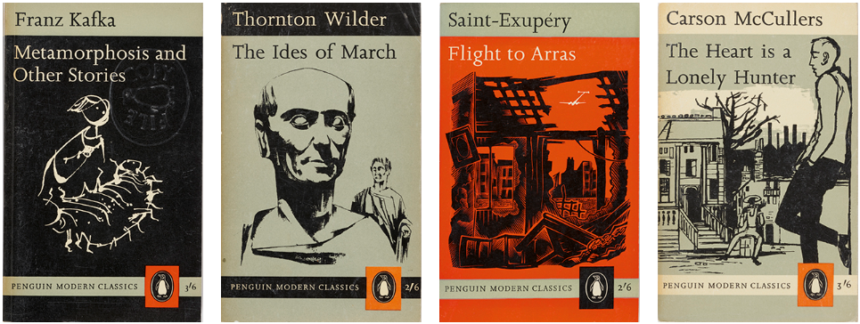
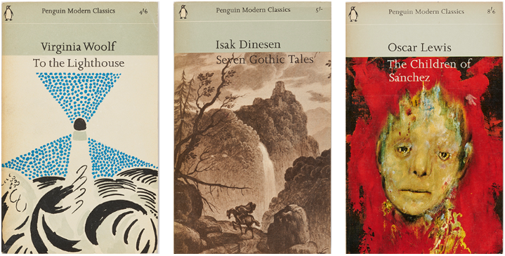
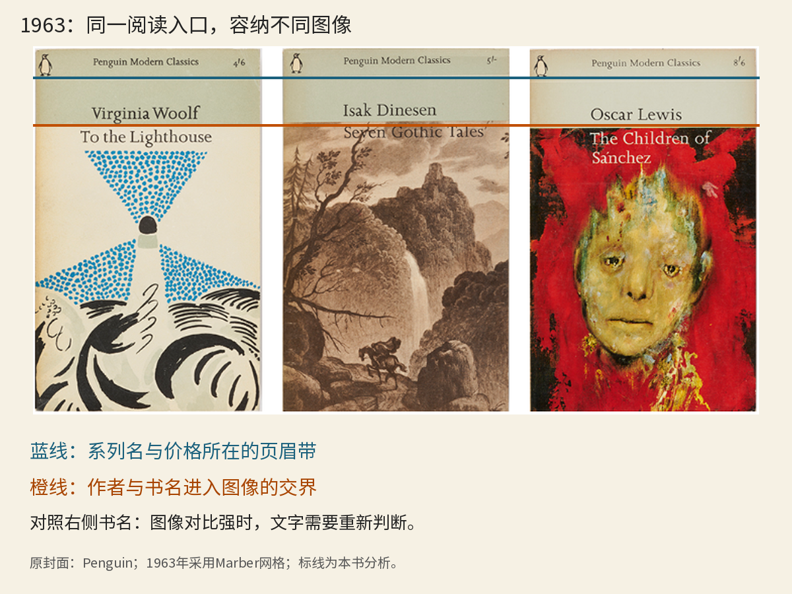
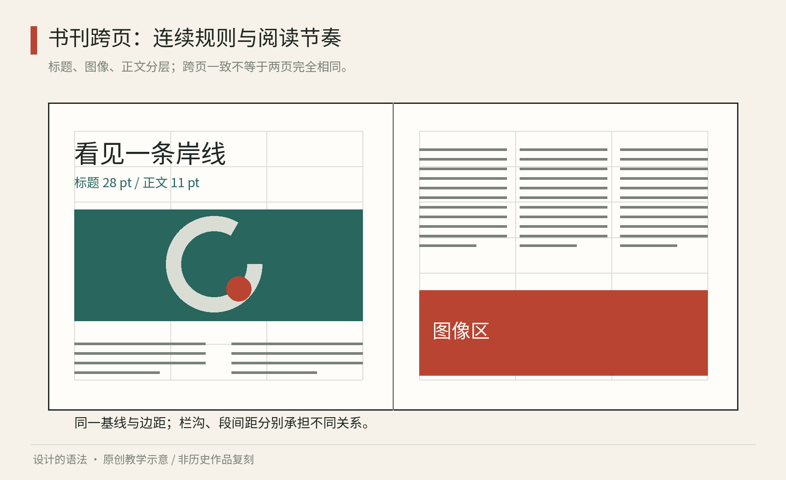

# 第12章｜书籍与编辑设计：为阅读安排节奏

## 真作细读：Penguin 封面如何让不同图像一起上书架

图12-2｜真实封面组。Hans Schmoller，Penguin Modern Classics最初设计体系，1961；[Penguin官方设计史](https://www.penguin.co.uk/discover/articles/penguin-modern-classics-design)提供图像与设计归属。原封面的单幅图像作者未由此组图逐一确认，不在这里猜填。

图12-3｜真实封面组。Germano Facetti艺术指导下采用Romek Marber网格的Penguin Modern Classics封面，1963年阶段；[来源](https://www.penguin.co.uk/discover/articles/penguin-modern-classics-design)。本图展示实际应用，并非网格原图。

1961组的底边提供了共同的识别线索：橙色小标志与浅色横带反复出现，大片黑白或少色图像处于中间。再看1963组，系列名与价格进入上缘，作者与书名集中在上部，图像向下占据更连续的空间。两组都建立系列关系，但分配“先认丛书、再认作者、再看图像”的方式不同。

以1963组左侧《到灯塔去》为例，蓝色点阵在上半部汇成尖角，黑色曲线和灯塔在下面形成另一种运动。标题区的灰绿比图像安静，于是书名不会和整个画面的图形节奏完全混成一层。中间《七个哥特故事》的风景图较细密，作者名仍在相近高度，使三本题材不同的书拥有共同的查找入口。

图12-4｜原封面上的教学标线。原作归属同图12-3；蓝线和橙线、中文说明为本书添加。标线描述这组三幅的可见关系，不把观察线冒充设计师原始尺寸规范。[原图出处](https://www.penguin.co.uk/discover/articles/penguin-modern-classics-design)。

橙线附近显示了同一网格下的局部调整：右侧《桑切斯的孩子们》书名进入红色与黄色的人像区域，使用浅色字；左侧则用深色字置于较淡区域。相同网格仍需配合局部对比调整：版式共用查找入口，文字颜色则随背景变化，以便读清。

标题与图像相接，给了插画更多面积，也使文字可读性更依赖图像选择与裁切。如果随便换一张高对比照片，眼睛、树枝或衣服边缘刚好穿过书名，系列模板还在，单本封面却失败了。因此编辑系统必须给出图片选择与移动的余地，不能只交一个把图片铺进底框的自动模板。

可以据此做一次具体改稿。用一张自己的树木照片做练习封面，固定上部系列名、作者和书名的角色。第一版让最复杂的树叶穿过书名；第二版移动照片，让书名落在天空或低细节区域；第三版保留复杂照片，但给文字单独背景带。比较三版：第二版保留图像连续性，第三版牺牲一部分图像面积换来更稳定的识读。选择取决于系列的图像差异、阅读要求与生产速度。

这也适用于电子书缩略图和社交平台的系列封面。把三张图缩到拇指大小，检查还能否区分作者、书名与主图。若只有丛书名清楚而每一本都分不出来，系统的识别任务只完成了一半。以上构图和改稿判断为本书读图分析；真实历史与设计归属以上述出版社记录为准。

## 封面识别与正文阅读

在书架上认出一个系列，与在书中读完一个复杂解释，依赖不同的设计工作。前者需要远距离识别和系列关系；后者需要文字层级、行文组织、图片与说明的接续。编辑设计把这两种尺度连接起来：既安排每一页，也安排页与页、章与章之间的节奏。

Penguin 的[设计史回顾](https://www.penguin.co.uk/discover/articles/penguin-modern-classics-design)展示了这套封面跨年代的变化。系列身份既容纳不同书目，也会随艺术指导和出版要求调整，不能把某一阶段的版式视为永久模板。

封面系统建立系列识别，正文系统组织具体阅读任务。一页图鉴可能需要先认形，再查标签；一个教程需要沿步骤行动；一篇论述需要连续阅读。内容的使用方式应先于一栏、两栏、跨页图或旁注的选择。把所有书都排成漂亮杂志，会使需要连续推理的内容不断断裂。

*图12｜原创程序教学图：书刊跨页借助网格组织标题、图片与正文。灰条代表文字占位，图形用于观察不同阅读角色的层级，不是实际文章排版。*

## 从内容结构推导版式

假设要做一本24页的“街边树木观察册”，读者边走边看，书中每种树需要辨认图、叶片细节、季节变化与容易混淆的对象。此时，首先确定稳定的查找区：树名与主要辨认线索放在每个条目的相同位置，方便翻页比较。其次，把需要一起看的信息靠近：叶片图与对应说明相邻，不要分到跨页两端。

接着安排节奏。每四种树之后插入一次对照页，把相近叶形并列，让读者从单个对象的记忆转向差异判断。导读则可以用更大的街景帮助建立观察情境。固定条目页与变化的过渡页并存，读者既知道去哪找，又不会陷入机械重复。

网格应记录这些内容关系。若正文反复溢出，需要先检查原因，再决定是否调整字号。可能是文案重复，可能是图太多，也可能是条目结构需要分成基本信息和延伸阅读。编辑与设计应共同决定，不能把“排不下”全部推给排版软件。

| 阅读任务 | 优先保留的关系 | 常见失败 |
| --- | --- | --- |
| 连续理解 | 稳定行长、段落层级 | 每段都加框，切碎论述 |
| 比较识别 | 同尺度、同方向、就近标签 | 两张图视角不同，难以比较 |
| 沿步骤操作 | 编号、前后状态、动作连续 | 只给完成图，省略关键动作 |
| 快速查找 | 固定字段、可辨标题 | 用装饰性标题替代信息名称 |

## 中文排版是系统中的具体责任

中文读物不能只套用英文模板。汉字通常以方形字面形成密集节奏，标点与中西文混排又会打断这种节奏。行首不宜出现的标点、行末开括号、数字与单位的关系，都应在实际版面中检查。W3C 的[《中文排版需求》](https://www.w3.org/TR/clreq/)整理了相关问题；它是持续发展的需求文档，不是可以替代编辑判断的单一审美法则。

给兴趣读本设定正文时，可以先印出一小页进行比较：同样的文字，用两种字号和行距，观察是否容易跳行，图注是否被误认成正文，长网址是否打坏段落。不要把“字小才高级”当作规则，也不要用极宽行距掩盖过长的行。读者拿在手里与在显示器上看，感受可能完全不同。

一种可行的层级只需要少量角色：章名告诉读者位置，节标题说明问题，正文承担解释，图注限定图片含义，资料注给出核对路径。每种角色至少在两项属性上有区别，例如图注更小并采用不同色阶，而不是只把正文变成浅灰。图注颜色过浅时，即使与正文区分开，也会损失可读性。

页码、目录、索引与书签也是正文系统的一部分。纸书需要让翻页后的读者重新定位，PDF需要可以跳转的目录；独立章节又必须保留自己的来源。内容从长书拆成单章时，如果全部引文只剩一个看不懂的编号，原来的设计规则就没有适应新的阅读入口。

## 安排小册子的连续阅读

美国国家公园管理局的 Unigrid 出版体系自1977年启动，把版式与生产方式共同纳入规划。机构自己的[历史说明](https://www.nps.gov/subjects/hfc/a-brief-history-of-the-unigrid.htm)特别强调它超出单张模板的范围。编辑系统因此还应包括折叠、印刷、制作与多方协作。

做一本练习小册子时，先用普通纸折成八页，写上每页的任务，再开始美化。把最重要的对照放在可以同时看见的跨页；避免把说明与对应图片排在纸张正反两面。最后连续翻阅，看有没有三四页全是密集文字，或每一页都用大标题重复宣告重要。需要细读的对照页与引导翻页的过渡页，应有不同的信息密度。

练习：把一篇熟悉的短文拆成“导入、解释、对照、练习”四个单元，为它们各画一个小缩略版式。只用黑笔和矩形，不选字体与颜色。若缩略图仍然看不出各单元的阅读用途，先修改结构。确认阅读结构以后，再用字体与色彩强化各单元的区别。

在同一个跨页里，图片之间也有句法。两张图同宽并列，会暗示可以比较；一张大图配数张小图，会暗示整体与细节；连续等宽图片配编号，会暗示时间顺序。若实际关系并非如此，版式就会制造误读。比如把两种树的叶片放在不同倍率下，读者可能把图像大小误认成物种差异。因此比较图必须交代尺度，或明确说明图像并非按比例绘制。

图注需要说明观察重点，并区分事实与示意，避免重复标题。例如“树叶比较”没有提供方向；“注意左侧叶缘锯齿与右侧全缘；图中尺寸经过调整，不能据此比较叶片大小”则限定了读图方式。这样的图注能防止读者把排版尺寸误当成实物尺寸。引用也应靠近相关论点，不能让读者翻到书末才知道眼前的图从哪里来。

在编辑系统中还要区分内容删减与视觉压缩。一本册子超出页数，如果只是不断减小字号，读者付出的代价会越来越高。更好的顺序通常是检查重复解释，合并不必要的字段，决定哪些材料属于旁读，再重新安排跨页。设计者与作者应共同决定材料的取舍，再选择适合保留内容的版式。

可以用边界内容检验系统：加入最长的树名、最密集的一页说明和最宽的一张图片。若只有平均长度内容排得好看，系统仍缺少边界处理。为这些情况写下备用规则，例如标题允许增加一行、旁注移到下一单元、横图跨栏，但不让图注与图片分离。稳定规则的意义正是在内容不平均时，仍能保证基本阅读质量。

本章来源：Penguin，[Designing Penguin Modern Classics](https://www.penguin.co.uk/discover/articles/penguin-modern-classics-design)；W3C，[《中文排版需求》](https://www.w3.org/TR/clreq/)；NPS，[A Brief History of the Unigrid](https://www.nps.gov/subjects/hfc/a-brief-history-of-the-unigrid.htm)。树木小册子及练习为原创教学案例。
