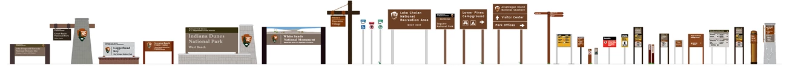
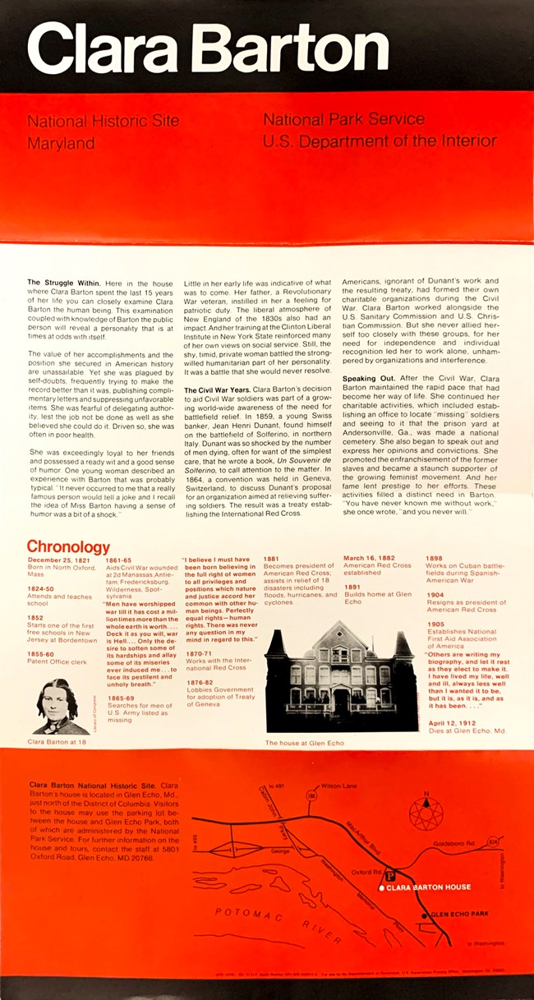
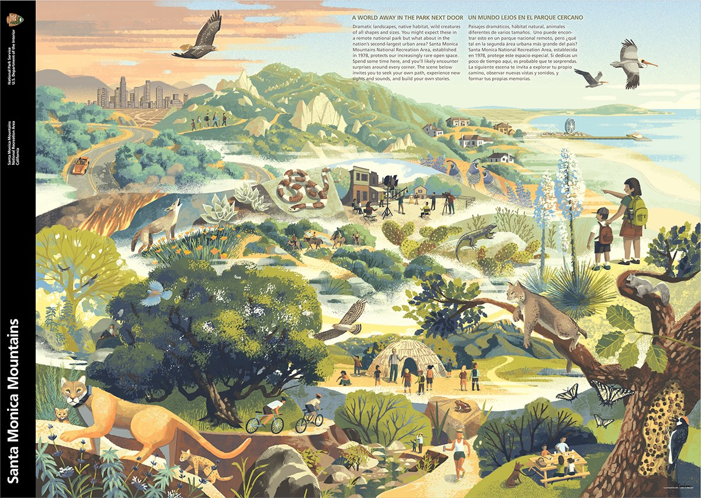
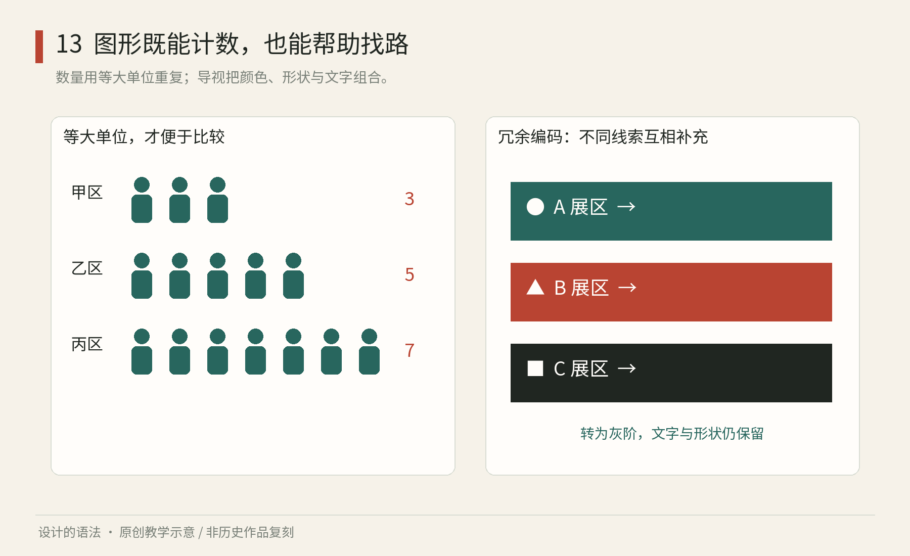

# 第13章｜信息与导视：让陌生人完成一次判断

## 真作细读：国家公园标识为什么不能都长成同一块牌

图13-2｜真实设计实例集合。美国国家公园管理局Harpers Ferry Center发布的标识样例；具体单件设计者与制作年份未逐项标明。图是机构展示图，不是本书设计稿，也不是实测尺寸表。[来源与功能分类](https://www.nps.gov/subjects/hfc/signs.htm)，页面更新于2024年。

先看外形与高度差别，不要在这张细长图上勉强读每一个小字。左侧的入口与识别类标识较大，序列中又出现方向牌、立杆与较小的设施提示。这意味着共同身份不要求每块牌具有相同尺寸。人在车中经过、在步道上行走、站在入口拍照，对信息量与发现距离的要求并不相同。图中的差异首先来自任务，而不是设计团队忘了统一。

用一个具体问题检验它：游客从公路转入公园，需要确认地点；已经下车的游客，需要找到步道；抵达岔口的人，需要选择方向。把入口长牌复制成所有岔口牌，名称会过大，方向不一定突出；把步道细杆放到公路入口，又可能太晚才被发现。设计系统真正要重复的是“哪类任务用哪类信息”，而不是某个好看的矩形比例。

图13-3｜真实出版应用。Clara Barton National Historic Site折页，NPS Unigrid出版体系；体系由Massimo Vignelli及相关团队于1977年建立，此遗址1978年推出首批应用，本图版本具体印次未标。[NPS历史说明与原图](https://www.nps.gov/subjects/hfc/a-brief-history-of-the-unigrid.htm)。

看折页的顶端黑带：白色地名先建立定位，红色区域随后承接身份与管理信息。继续向下，文字分栏，照片与地图承担另一层阅读。它不是把标识牌缩小印在纸上，而是保留识别关系，增加适合手持近读的内容。正因为纸张可以停留，原本不适合公路标识的文字密度，在折页里才有位置。

再把视线移到下部地图。这里的线条与地名不是装饰，它们必须协助真实行动。如果说明文字漂亮，地图却没有让人确定目的地与道路的关系，出版系统仍未完成任务。纸上的信息系统因此需要两种测试：一是阅读路径是否清楚，二是拿着它是否能作决定；视觉统一不能替代其中任何一项。

图13-4｜真实折页图像。NPS，Santa Monica Mountains图文页面；图中插画具体作者与此版年份未在来源页说明，不推定为Vignelli绘制。[原页面](https://www.nps.gov/subjects/hfc/a-brief-history-of-the-unigrid.htm)。

这张图又说明，机构识别不要求所有内容都用同一种图像技法。与Clara Barton页相比，山脉折页用了充满植物、动物与人的场景插画，让观众发现景观中的多种活动。黑色识别带提供共同入口，插画负责地方内容。共同框架与具体题材相互补充，不能反过来把丰富内容都改成标准图标来追求整齐。

实际改稿练习：给一张公园海报塞入完整历史、交通路线与三条游览建议，再分别改成入口牌和手持折页。入口牌只保留人当场需要确认与行动的信息，折页再恢复深入内容。最后请一个没来过的人指出“我在哪里、往哪走、到了怎么确认”。若答案仍然藏在视觉装饰后面，继续调整名称、方向和位置。以上是本书针对所见实例的任务分析，不把机构样例当作当地建设规范。

## 清楚不是少放几个字

设想第一次走进一座博物馆，你想找临时展厅。入口有总平面图，岔路有箭头，展厅门口有名称，看完后又能找到出口。这些标牌并不相同，却共同组成一次连续判断。导视系统的基本单位因此不是“一块漂亮的牌子”，而是“人在一个位置，需要作出什么决定”。

信息图表也有相似任务：让读者发现某种关系。图表用位置、长度、数量等视觉变量解释数据；导视把名称、方向与真实空间连接；图标则用简化图形指代对象或动作。三者可以协作，却不能互相替代。一个优美的洗手间图标无法修复错误的箭头，一张精细地图也无法弥补关键转角缺失的提示。

Isotype 是理解信息转译的历史入口。它从1920年代维也纳的相关实践发展而来，涉及 Otto Neurath、Marie Neurath 等人的合作。其贡献不只在“画小人”，还包括将复杂资料转化为可理解的图文关系。雷丁大学的[档案介绍](https://www.reading.ac.uk/typography/collections-and-archives)和[相关研究项目](https://research.reading.ac.uk/picturingscience/)可帮助避免把团队工作缩减成一个人的图标风格。

*图13｜原创程序教学图：左侧以3、5、7个同尺寸单位及数字表达数量；右侧用颜色、形状、字母、名称与箭头共同区分区域。各数据与区域均为虚构教学设定。*

## 从一条路线开始，而不是从图标库开始

为虚构的小型展馆设计导视，可以先画出“入口—寄存—主展厅—洗手间—出口”的任务路线。标出每个会产生犹豫的位置，再写清那里需要回答的问题。入口需要知道全馆有哪些区域；走廊岔口需要知道往哪走；到达展厅时需要确认“我到了”；离开时需要清楚返回路径。

于是信息逐级展开。总图不必把每个房间的长段介绍放进去；岔口牌只给此处能采取行动的方向；门牌侧重目的地确认。若一块牌子需要六个互相交叉的箭头，可能不是字体不够好，而是信息层级与放置位置出了问题。先拆分决策，再讨论样式。

给房间命名也属于设计。地图写“探索厅”，门口写“第二展室”，票上写“B厅”，即使三处都采用同一字体，陌生人也无法建立对应。系统首先需要稳定的名称，再需要统一的视觉表现。涉及多语言时，译名、缩写与换行规则也应共同管理。

图标族可以共享相近的视重、转角与留白，但不必把所有对象都强塞进同样的几何轮廓。自行车和电梯的结构不同，应保留影响辨认的差别。把一组图标缩到真实尺寸，再让不熟悉项目的人说出含义，比在大屏幕上比较几何整齐更有效。对于容易误读的图标，文字说明往往比继续抽象更可靠。

## 编码关系，同时守住公平阅读

信息图中的“更大”必须明确指什么。用同尺寸单位重复来表达数量，能使读者直接比较个数；把人物图标等比放大，面积会以另一种速度变化，容易夸张差异。若数值不整齐，单位图也会变得难读，条形图或直接数字可能更合适。图形的选择要服从问题，不能因为历史案例漂亮，就把所有数据变成小人。

颜色适合辅助分组，但应同时保留文字、位置、形状或线型。红绿两条路线若只靠色相区分，在黑白复印或部分色觉条件下会失去差异。W3C 对网页内容的[颜色使用说明](https://www.w3.org/WAI/WCAG22/Understanding/use-of-color)要求不要仅靠颜色传达相关信息。这不能直接替代实体标识法规，但揭示了可迁移的设计原则：让信息拥有不止一种可见线索。

| 场景 | 容易遗漏的使用条件 | 可以验证的改进 |
| --- | --- | --- |
| 导览地图 | 读者不知道自己的位置 | 明确标“您在此”，核对图面朝向 |
| 岔口指示 | 人边走边看，停留很短 | 优先显示方向与目的地 |
| 数量图表 | 图形面积与数值关系不明 | 标单位、数值与比较基准 |
| 图标按钮 | 含义依赖设计者的隐喻 | 配可见名称，做理解测试 |

实体环境还要考虑视距、照明、反光、遮挡、安装位置与不同身体条件。这里没有一个适合所有建筑的字号公式。美国国家公园管理局把[标识规范与规划协助](https://www.nps.gov/subjects/hfc/signs.htm)作为持续工作，提醒我们导视需要维护，而非交付图纸后就永久正确。

## 用错误路线检查系统

最容易漏掉的是“人走错以后怎么办”。只测试理想路线，会让设计师高估系统。让一个第一次来的朋友从侧门进入，途中改变一次目的地，或从洗手间返回主展厅，观察是否出现回头、反复找牌、依赖询问工作人员的情况。这些行为比“喜不喜欢这个设计”更直接地暴露问题。

一次轻量练习：选一条你很熟悉的校园或商场路线，列出三个关键判断点。分别画一块信息牌，每块只回答该位置最重要的问题。再把颜色全部去掉，检查路线名称和方向是否仍然成立。最后站在实际位置想象：牌子会不会被打开的门遮住？人是否必须越过岔路才看见它？

本章示例是一般视觉信息练习，不是消防疏散或建筑合规方案。涉及此类真实项目，应使用适用的当地规范与专业设计。对兴趣读者而言，最值得带走的观察方法是：沿着人的任务走一遍，寻找信息在哪一步中断，而不只评论标牌是否统一。

地图还存在“地理准确”与“任务清楚”的取舍。展示建筑实际形状有助于理解位置，简化路线则有助于迅速找到方向。若过度简化使两个相邻入口看起来等距，读者可能错误估计步行距离；若保留所有细节，关键路线又会被淹没。应明确地图的用途，并为被简化的关系提供必要提示。示意图可以不按比例，但不能一边隐藏比例，一边暗示精确距离。

信息图也需要同样诚实。比较三个展馆的参观人数时，应写清统计时段是否一致，临时闭馆是否影响数据，以及图表展示的是人数还是增长率。这些并非图形软件的工作，却直接决定视觉结论能否成立。设计系统应把单位、标题、来源与更新日期纳入常用字段，而不是只管理色板与线宽。

对于导视，可以为每个判断点建立一张小卡：位置、到达方向、目标、当下必须知道的信息、下一处确认信息。这种记录方式使设计者能够检查连续性。如果岔口说“临时展厅向右”，右转后却没有任何确认，读者仍会犹豫。多放一块牌并不一定有效，有时把原牌移到转弯前更合适。

维护同样是一部分。展厅临时关闭时，纸质通知若覆盖了原箭头，却没说明替代路线，系统会在变化时失效。事先准备关闭、改道与新增区域的表达方式，可以减少临时拼贴。这里的统一不是为了外观整齐，而是让紧急变化也保留稳定的名称、方向与确认关系。

本章来源：University of Reading，[Collections and archives](https://www.reading.ac.uk/typography/collections-and-archives)、[Picturing Science](https://research.reading.ac.uk/picturingscience/)；W3C WAI，[Use of Color](https://www.w3.org/WAI/WCAG22/Understanding/use-of-color)；NPS，[Signs](https://www.nps.gov/subjects/hfc/signs.htm)。路径测试与虚构展馆为原创教学案例。
