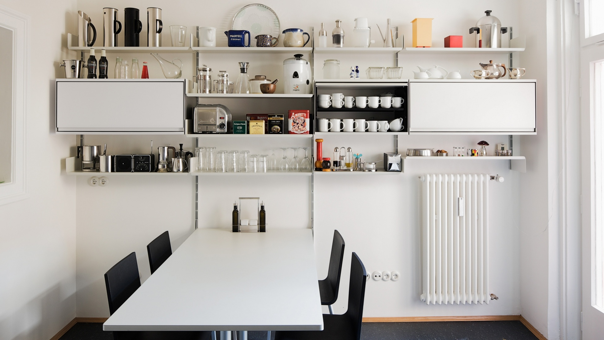
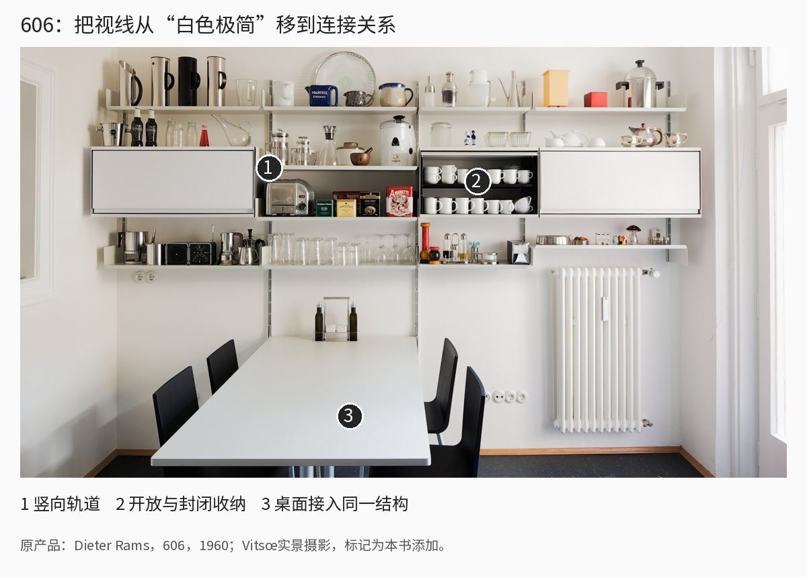
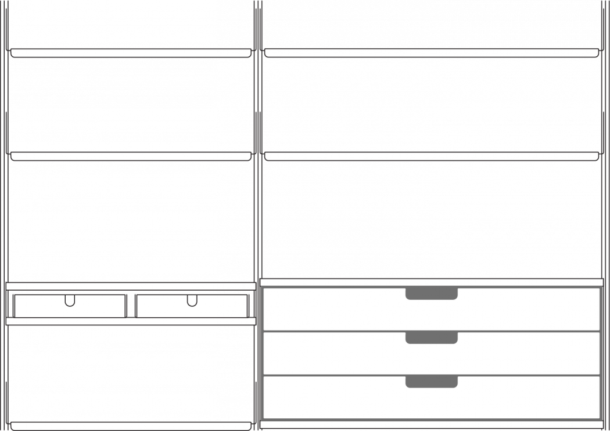
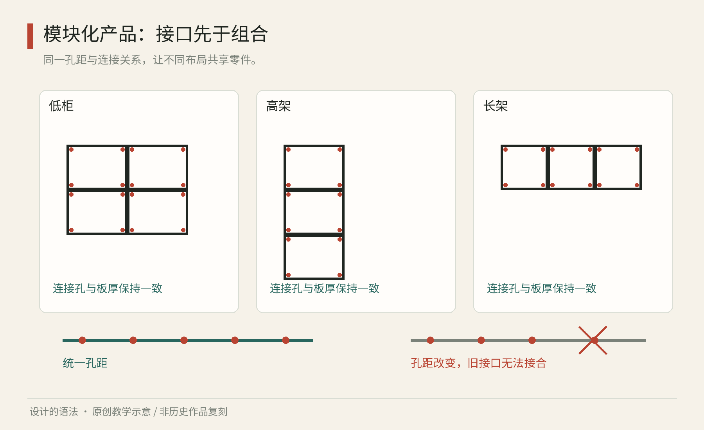

# 第14章｜器物与工业产品：外形之外还有接口

## 真作细读：606厨房里的空白也是功能

图14-2｜真实产品与使用场景。Dieter Rams，606 Universal Shelving System，1960年起；本图为Vitsœ官方展示的后续厨房配置，摄影者及拍摄年份页面未注明。[产品与原图来源](https://www.vitsoe.com/gb/606)。不是1960年历史照片。

先看右下方散热器周围没有被柜体填满的区域。若把“模块化”理解为尽量填满墙面，这里会被视为空缺；但真实空间里，暖气、插座、桌面、活动身体都提出自己的要求。开放区域让这些条件能够存在。一个配置是否完整，不取决于墙上有没有空格，而取决于活动能否顺利发生。

再从最上方的长横线往下看，搁板高度并不平均。高水壶、咖啡器具、玻璃杯与较矮的物品占据不同高度；中间柜体有封闭面，也有露出杯子的开口。相同颜色使结构不抢走物件的注意，竖向轨道与各部件的连接则使它们能够组合。分析配置时，需要将配色与兼容关系分别记录。

图14-3｜真实产品照片上的教学标记。1竖向轨道；2开放与封闭收纳相邻；3桌面进入同一配置。原产品Dieter Rams／Vitsœ，1960年起；摄影来源同图14-2，数字与解释由本书添加。标记只帮助找位置，不给承载或安装保证。

轨道与每层横板的交接处显示了接口的作用：一条细长构件在多个高度重复承担连接，而不是每个箱体都各自拥有一套四脚框架。这样做让组合有更强的延续性，也把责任集中在接口与安装条件上。照片能显示各部件的结构角色，墙体适用性与安装条件仍需另查产品说明。

桌面还改变了构件与身体的关系。它从墙边向房间伸出，方向与上方搁板垂直，于是同一系统不只有平行堆叠，还与身体坐下、伸手和交谈的方向建立关系。如果为了“统一”让所有平面都贴墙，实际活动反而会受限制。不同朝向的构件由此支持收纳、书写和交谈等活动。

图14-4｜制造商发布的真实产品说明图。Vitsœ 606窄、宽两种开间；官方页将它们标为65与90厘米。本书保留产品图，不将其误作独立绘制的工程图。[来源](https://www.vitsoe.com/gb/606)。

把这张说明图与厨房照片放在一起，才看得清“部件范围”和“实际配置”的区别。说明图给出可选宽度，实景展示它们如何遇到具体物品与房间。如果只看实景，容易以为那面墙的方案是唯一标准；如果只看部件图，又可能低估环境条件。分析产品系统时，需要对照整体配置、部件范围与连接方式。

一个实际反例是给练习纸盒系列统一外宽，却忘记盖子需要覆盖侧壁厚度，结果外观漂亮但盒盖互换失败。改稿时不要先改变颜色，应先记录内尺寸、外尺寸与接触面，区分“看起来同宽”和“能互相配合”。再用同一规则做三个尺寸，主动交换部件。以上空间、层级与改稿判断是本书原创观察，不将官方产品展示直接等同于全生命周期评价。

## 适应变化的部件与接口

收纳家具除了单件外形，还要适应房间变化、物品增加和部件损坏。连接、尺寸、材料和更换方式决定了哪些部件能继续搭配，哪些必须替换。

Dieter Rams 为 Vitsœ 设计的606通用搁架系统始于1960年。制造商展示了由部件组合、适应不同空间的思路，参看[官方产品介绍](https://www.vitsoe.com/gb/606)。分析606时，可以重点观察固定的连接逻辑如何容纳不同配置，而不只记录白色和轻巧轮廓等外观特征。

另一个参照是 Charles 与 Ray Eames 于1950年设计的 Eames Storage Unit。MoMA 的[馆藏记录](https://www.moma.org/collection/works/3585)列出了设计者、年代与所用材料。观察这类产品时，可先分开辨认“承重结构”“围护面板”与“使用功能”，再逐项记录它们的连接关系和可替换范围。

*图14｜原创程序教学图：左侧用同一竖向接口组合搁板、箱体与桌面；右侧展示孔距改变后部件无法直接互换。图为原理示意，不含真实产品尺寸、承载或装配建议。*

## 把外观问题变成约束问题

为虚构的桌面收纳系列设计三个物件：笔筒、文件托盘和小抽屉。若只让它们都采用圆角与浅色木材，得到的是视觉家族；若希望彼此叠放，还必须统一接触面、定位方式与重心条件。两种目标不同，不能用相似外观冒充结构兼容。

先写使用动作：人单手取笔、双手搬文件、拉开抽屉。然后写空间条件：桌面深度有限，插线不能被遮住，常用物品应容易拿到。再选一个基础尺寸作为练习模数，让托盘宽度与两个笔筒的占地建立关系。此时若追求所有尺寸都是整数倍，可能浪费材料；若只按材料板幅确定尺寸，又可能不方便使用。设计是在这些约束之间做有理由的取舍。

接口尤其重要。它包括接触位置、方向、防错方式以及可接受的变化范围。模块化并不意味着任意两个部件都能拼在一起，而是明确哪些组合被支持。某个部件能够放上去，却会遮挡抽屉或改变重心，也不能称为合格组合。产品系统需要说明允许、限制与不允许的配置。

颜色与表面处理也受到制造方式影响。同一色号在金属烤漆、塑料与木材上可能有不同观感。追求“完全同色”有时会投入很高成本，却仍无法消除不同反射。另一种办法是明确让材料形成层级：结构统一深色，接触部位保留木材，功能面板允许变化。这里的相容并非所有表面都一样，而是材料角色清楚。

## 美感、身体与维护共同决定形态

产品的尺度和操作方式需要在实际动作中检查。把手的开口是否允许手指进入，控制件是否能被理解，操作时是否需要不自然的姿态，都属于设计。人体工学也不是给“平均人”定一个尺寸就结束；衣物、惯用手、力量、动作范围与使用频率都会改变要求。兴趣练习可以用纸板检查动作关系，但不能据此宣称完成了安全验证。

维修是另一个观察入口。一个封闭外壳可以显得完整，却可能让电池或磨损件难以更换；显露的紧固件可以便于拆卸，也可能增加清洁与视觉负担。评估维护条件时，应查明易损件能否单独更换、拆卸后能否可靠复原，以及厂家是否提供所需信息。

| 设计选择 | 可能的收益 | 需要承担的代价 |
| --- | --- | --- |
| 统一模块尺寸 | 易组合、易管理部件 | 部分空间被浪费 |
| 隐藏连接件 | 表面连续、视觉安静 | 检查与维修可能更难 |
| 减少材料种类 | 采购与分离可能更简单 | 未必满足不同部位需求 |
| 支持多种配置 | 适应变化 | 验证与说明更复杂 |

模块数量应与实际重组需求匹配。如果用户从来不会重组，复杂接口可能只增加成本；若频繁移动，接口的耐久与错误装配风险就比组合数量更重要。

## 从一个抽屉学会看系统

练习时找一件普通家具，不必拆开。记录可见的结构、表面和操作部位，画出一次使用动作。然后设想只改变一个条件：物品变重、使用者坐着操作，或其中一个部件损坏。指出原设计哪一条关系开始失效。根据这项记录，进一步检查相关尺寸、受力、材料和维护条件。

再用纸制作三个不承重的小盒子，让它们使用同一种盖合规则。做完后互换盒盖，检查“看起来一样”是否意味着“真的兼容”。纸张厚度、折痕与公差都会造成差异。盒盖互换能检验接口描述是否足够准确，也能显出材料厚度与制作误差的影响。

回到606等真实案例时，可以观察连接处和可替换部件，分析家具随使用需求调整的方式。不要仅凭官方陈述推断某件产品的全部生命周期表现；资料说明设计意图，具体效果仍与使用、维护和供应条件有关。

视觉家族与机械兼容还可以继续拆开。有些产品共享按钮、圆角和材质，是为了让用户一眼理解它们来自同一系列；另一些共享电池、安装轨道或附件接口，是为了减少重复部件。前者属于识别与操作语言，后者涉及实际结构。把这两个层面分别写清，才能判断应该统一到哪里，哪些差异应当保留。

以小抽屉为例，如果笔筒与托盘追求视觉一致，统一侧面转角可能就够了；如果希望叠放，就需要检查底面与顶面的接触、限位和取物动作。抽屉被拉出时，人的手会向前施力，整体受力状态与静态摆放不同。教学图可以解释这种关系，却不能凭漂亮示意图提供承载保证。真正制造需要材料、尺寸、连接与试验之间的一致证据。

系统也会遇到版本变化。假设新部件更换了连接孔距，外观几乎不变，旧用户却无法继续扩展。此时至少要明确标示兼容范围，并提供过渡方法，不能只用同一个系列名称制造延续的印象。产品的长期兼容需要持续维护接口范围，这一点可与软件接口的版本演进对照。

从消费者角度观察时，可以问四个具体问题：附件是否有明确的兼容名单；最易磨损处是否可以替换；日常清洁是否要特殊工具；搬家以后是否还能调整布局。根据使用频率和维护条件比较这些项目，才能判断一种外形是否也适合自己的需求。

本章来源：Vitsœ，[606 Universal Shelving System](https://www.vitsoe.com/gb/606)，Dieter Rams，1960；MoMA，[Eames Storage Unit](https://www.moma.org/collection/works/3585)，Charles Eames、Ray Eames，1950。桌面收纳、纸盒与接口分析为原创教学示例。
