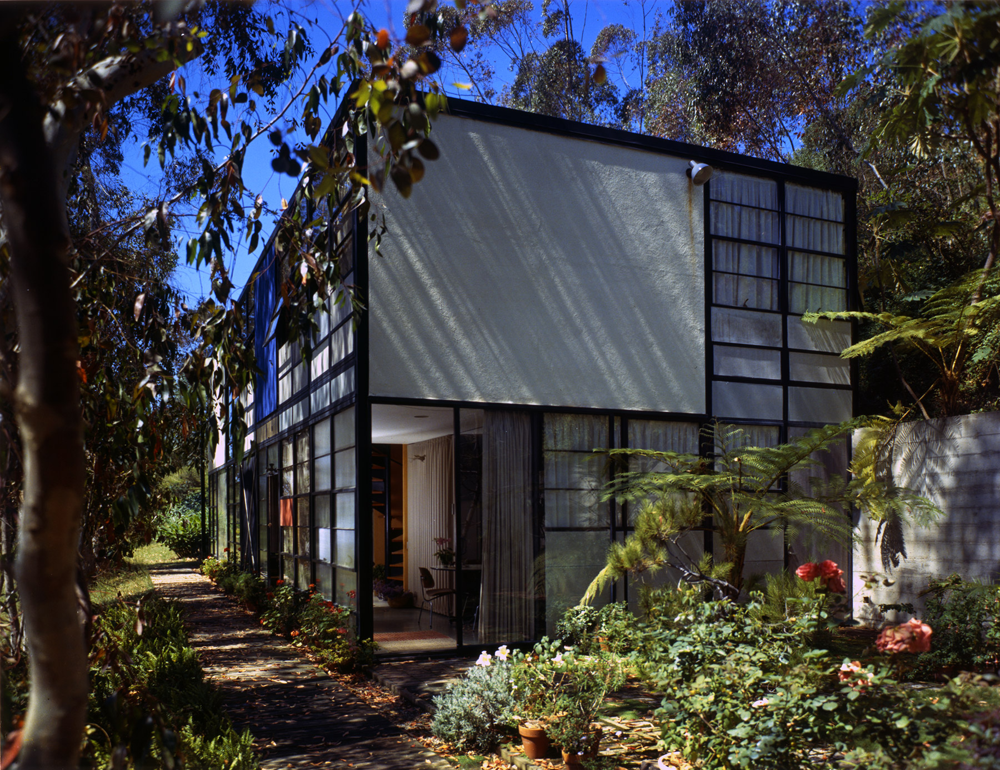
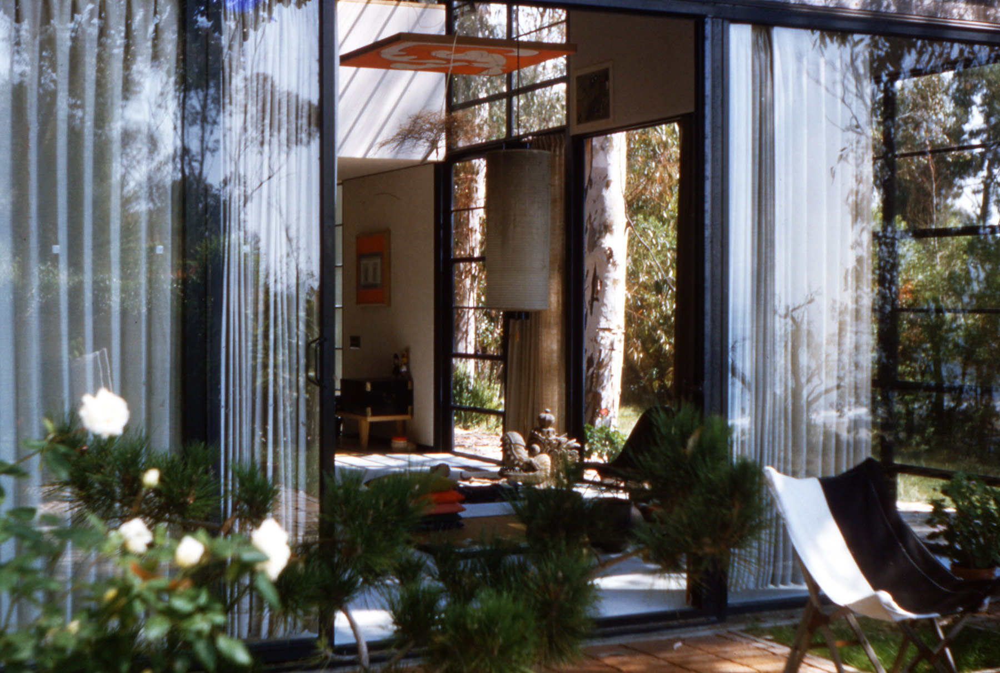
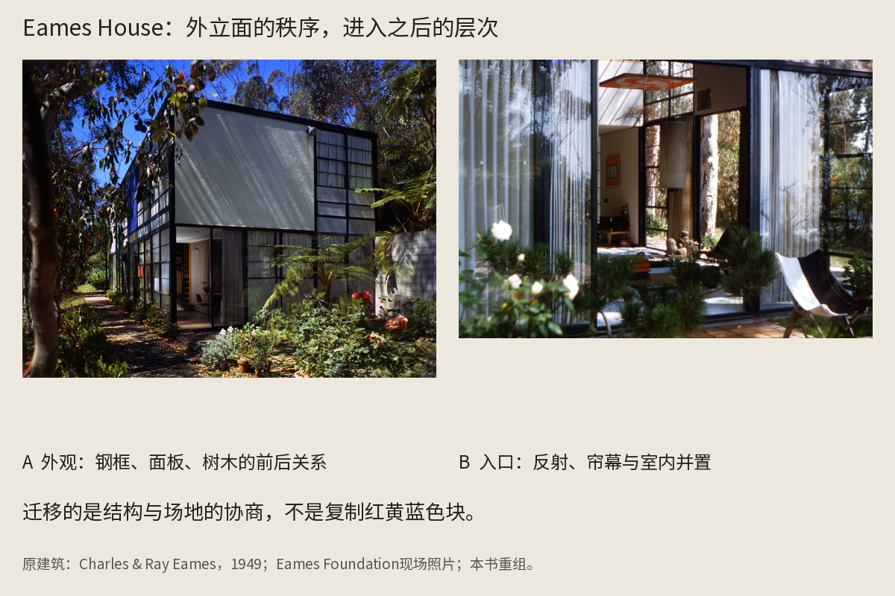
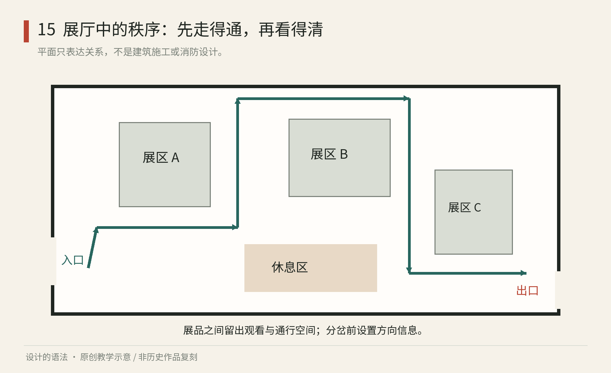
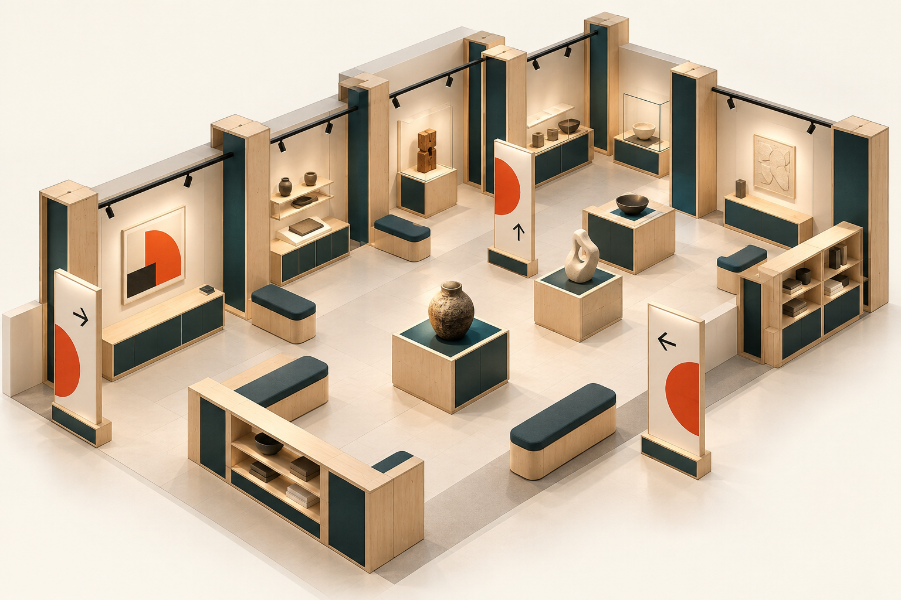

# 第15章｜空间与展陈：身体走进规则之中

## 真作细读：Eames House 怎样避免变成一张色块海报

图15-2｜真实建筑现场。Charles与Ray Eames，Eames House／Case Study House No.8，1949年完成；照片由[Eames Foundation历史页](https://eamesfoundation.org/eames-house/history/)发布，具体拍摄年份与摄影者未标。不是本书历史复原图。

先看画面前景的树，而不是先数外立面的彩色矩形。枝叶与树干在建筑前形成一层不规则的过滤，光影又落在平整面板上。建筑的直线没有抹去场地的曲线，二者存在前后关系。把这张照片只裁成正面几何格子，会丢掉空间设计中的一个核心事实：建筑被放在一个已有生命、光线和尺度的地方。

接着看立面：大的浅色面板与旁侧较细密的玻璃分格并置，黑色框架让两者可以被读成同一构造语言。不同区域的密度有差异，并非每格都等量分配颜色。一个大面需要安静，另一个区域允许穿透、反射与室内活动显露；这比“使用网格”更具体，因为它说明网格如何容纳不同的边界性质。

图15-3｜真实建筑入口现场。建筑归属同图15-2；由[Eames Foundation](https://eamesfoundation.org/eames-house/history/)发布。摄影者与拍摄年份未在该页逐图标明；本图不用于推断不可见的完整平面。

入口图让外观中的秩序变得不那么抽象。先看两侧近乎垂直的细线：玻璃边框、帘褶与反射相互叠加；再看门内深处的物件，尺度与颜色比立面丰富。外部的清楚框架没有要求内部每件物品都服从同一种黑白几何外观。结构组织活动，却给生活留下了增加、移动和积累的空间。

图15-4｜真实照片的教学重组。左为外观，右为入口；原建筑Charles与Ray Eames，1949，原照片来自Eames Foundation。两幅比例按版面重排，不据此比较真实尺度。[原图出处](https://eamesfoundation.org/eames-house/history/)。

由此可以提出一个可迁移的问题：你的设计规则约束的是结构，还是要同时控制所有生活物件？如果为一个阅览空间设计固定书架，却要求书脊全是同色，照片会很整齐，实际阅读需求却被反过来服从摄影。Eames House的两张图提示另一种可能：使承载物件的结构有条理，让物件自身保持差异。这里没有把杂乱浪漫化，而是把组织的责任放在更合适的层级。

官方历史记录提供了短而重要的背景：方案在保留草地与树木的考虑下调整，现成构件也被重新组织。这说明模数不是只能先于场地的固定命令。准确理解这个案例，不是把彩色玻璃框架随意搬到任何城市，而是学习在标准部件与具体条件冲突时重新分配，而非直接牺牲场地。

做一次改稿：画一间只有六件物品的阅读角，先用等距网格摆满所有墙面，接着加入真实的窗、门扇开启范围与一棵不能移动的植物。第二版至少删掉一个原计划模块，并写出删去的理由。如果删除让采光、通行或观看关系变好，系统就没有失败；它通过让步开始服务真实环境。把每个空位都填满，反而可能只是图面上的完整。

以上是从可见照片出发的空间分析；照片无法告诉我们所有构造、维护与身体条件，不能据此复制真实建筑。对学习而言，先练习看见框架、边界、场地与生活物件之间的关系，比记住一组现代主义色块更有用。

## 网格不会替人走路

平面图上的两个区域可以只相隔一条线，身体从这里走到那里，却要经历转身、停步、视线变化和声音变化。空间设计中的系统性，要把几何、构造、用途与感受连接起来。它既包括可以重复的墙板、开口与家具，也包括不应被模块压平的场地条件。

Charles 与 Ray Eames 的住宅兼工作室于1949年完成，是理解这一点的真实案例。Eames Foundation 的[历史记录](https://eamesfoundation.org/eames-house/history/)说明，他们在设计演变中重新考虑草地与树木，利用现成构件调整方案。学习重点不只是彩色面板，而是同一批构件如何服从变化后的场地判断。

在展览空间中，建筑本身又会影响展示方式。Frank Lloyd Wright 设计的纽约古根海姆美术馆于1959年开放，其连续坡道对观展形成鲜明影响。基金会的[建筑介绍](https://franklloydwright.org/site/solomon-r-guggenheim-museum/)提供了理解入口。这个案例可以用来思考空间秩序与展览需求之间的关系，不能简单得出“连续路线总比独立展厅好”的结论。

*图15｜原创程序教学图：虚构展馆的入口、展区、休息与出口组成连续路线；线条说明信息与停留的组织，不代表建筑施工图、无障碍或消防合规方案。*

图15-2｜AI生成教学示意：展陈、家具与标牌共享模块和材料语言。它用于观察整体关系，不作为准确尺寸、动线、安全疏散或可制造性依据；精确关系见本章程序平面图。

## 从人的活动推导空间结构

假设要在一个长方形房间里办“纸与印刷”的小展览。内容有历史介绍、纸张触摸样本、放大图片和一个手工体验台。如果平均把墙面切成四份，虽然整齐，却没有回应人的活动：触摸样本会聚集人，长文需要安静停留，体验台需要操作与等待空间。

先按活动而非按展品数量分组。入口提供短导言和全局提示，避免观众一进门就被长文堵住；触摸台放在能靠近、能退开的区域；放大图面给远看与近看两个距离；体验台与安静阅读保持一定分隔。随后用模块化展板组织这些区域，而不是先购入一批相同板子再强行塞内容。

再问视线如何引导。站在入口，能否看见一个值得走近的对象？从展区转到体验区，是否知道下一步还有内容？出口是否与入口形成混淆？动线不是一条画在地上的箭头，而是可见目标、空间开口和信息共同构成的邀请。

单线叙事适合有明确先后关系的内容，可以减少遗漏，但可能限制自由浏览；开放分区允许观众按兴趣选择，却需要更多定位提示。若展览既有主线又有自由样本区，可以让主线简短连续，把深读区设置在侧边。重要的是允许人停留，而不把所有停留都变成对后面人的阻挡。

## 尺度、光和材料怎样共同工作

在画图软件里把展板放大一倍，只需拖动边角；在真实空间里，增加的高度可能改变视线与压迫感。尺度必须与观看距离、停留时间和身体姿态一起判断。一个坐着细读的标签，与从走廊远看的一行标题，需要不同处理。数字上的相同比例，并不保证感受相同。

光不仅决定明暗，还决定反光、注意力和材料的表情。光滑覆膜在某些角度会反射灯具，让黑字看不见；粗糙纸面看起来温和，却可能在低照度下损失细节。应拿真实样片到现场观察，而不只在渲染图中选材料。涉及馆藏保护时，照明还受到作品材料与保管要求约束，不能为了戏剧性随意加亮。

声音与触觉也会改变视觉秩序。体验台上不断翻动纸张的声音，可能使旁边的影片旁白难以听清。墙面上看似轻巧的悬挂样本，如果拿取方式不明确，观众会犹豫能不能碰。空间系统需要解释允许的动作，例如明确标注“可触摸”，并使操作与维护方式匹配。

| 共同规则 | 可以带来的收益 | 需要验证的边界 |
| --- | --- | --- |
| 同一展板模数 | 易运输、替换、重新布置 | 是否损失必要的展品尺度 |
| 统一标签位置 | 观众容易寻找说明 | 大小不同的作品是否仍适用 |
| 连续主线 | 叙事顺序明确 | 聚集时是否阻碍通行 |
| 同一照明语言 | 气氛连贯 | 材料反光与保护需求是否冲突 |

模块的价值通常在重复搭建时显现，但模块化也会把成本转移到连接件、仓储、运输和装配培训。一次性小展与多年巡展的最佳选择可能不同。用“可重复使用”形容一套展架，不等于已经证明它的整体环境收益。

## 用纸模型发现平面图看不见的事

制作一个简易纸模型，把墙面、入口和四个主要活动区立起来。用手机镜头降到接近模型中的人眼高度，观察第一眼看见什么、哪里完全看不见。你不需要精密模型，也能发现“图上很通透，实际被展板挡住”的问题。

随后找一个同伴，给他一个任务：“先看总览，再找能摸的纸，最后去体验台。”不要解释路线，观察他如何选择。若他走错，不急着增加箭头，先判断是目标不可见、名称不稳定，还是空间真的把他导向了别处。导视往往能补充空间，却不应永远替空间布局收拾后果。

日常观察也可以这样进行。下次进入书店或展览，先留意你在哪儿停下，再看那个位置由什么造成：光、物件、开口、声音，还是别人的聚集？当你能描述这些关系，就不再只能说“这里有氛围”，而能理解氛围如何被组织。

展陈还需要区分“内容顺序”与“空间顺序”。一本书的第一节、第二节可以严格相接，观众却可能从侧面进入，也可能跳过某段。重要信息应在单独进入时仍有基本解释，深层关系则由主线连接。这样既承认真实浏览行为，又不必让每块展板重复完整导言。

做“纸与印刷”展时，可以给每个区域设一个一句话问题：纸如何形成？印刷怎样把图像重复出来？不同纸面怎样改变阅读？观众先通过问题理解区域，再决定是否深读。若只标“第一单元”“第二单元”，秩序对策展团队很清楚，对第一次来的观众却几乎没有意义。命名因此同时承担叙事与定位。

空间中的重复也会制造疲劳。十面完全相同的展板让人容易预测下一面，适合快速扫读，却可能弱化某个关键对象。可以让结构模数保持稳定，在重要节点改变观看方式：从墙面阅读转为桌面观察，从远看转为细节放大。变化由内容需要触发，才不会变成每个角落都想成为主角的布景。

离开展览以后，系统还可能继续存在于手册、纪念品与线上页面中。同一问题结构可以迁移，空间里的文字长度却不能原样搬到手机。先保留内容层级和对象关系，再为媒介重新分配位置，这比机械复制展板更有意义。空间系统与平面系统的连接点，往往是共同的问题与名称，而不是相同的长方形。

本章来源：Eames Foundation，[History & Legacy](https://eamesfoundation.org/eames-house/history/)，Eames House，1949；Frank Lloyd Wright Foundation，[Solomon R. Guggenheim Museum](https://franklloydwright.org/site/solomon-r-guggenheim-museum/)，1959。纸与印刷展览、路线分析及模型练习为原创教学案例。
