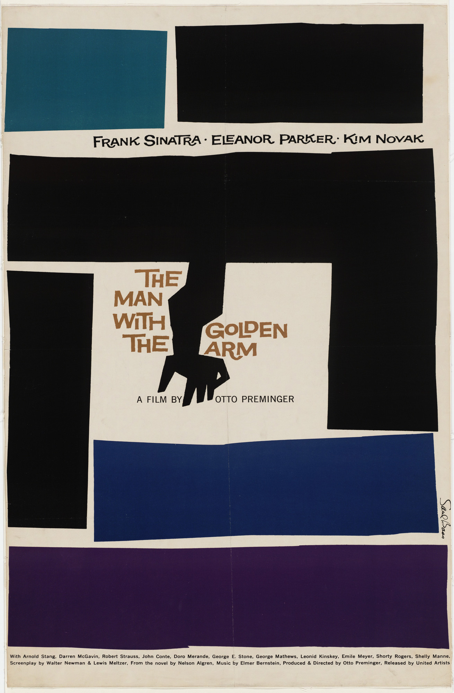
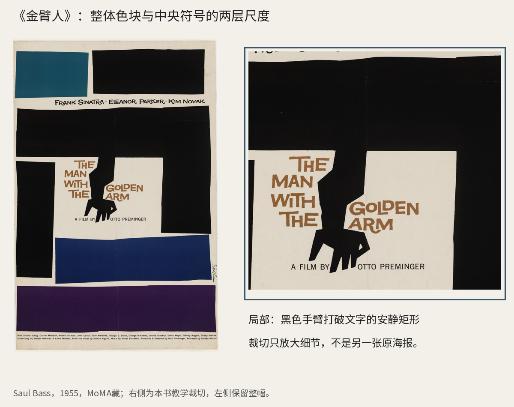
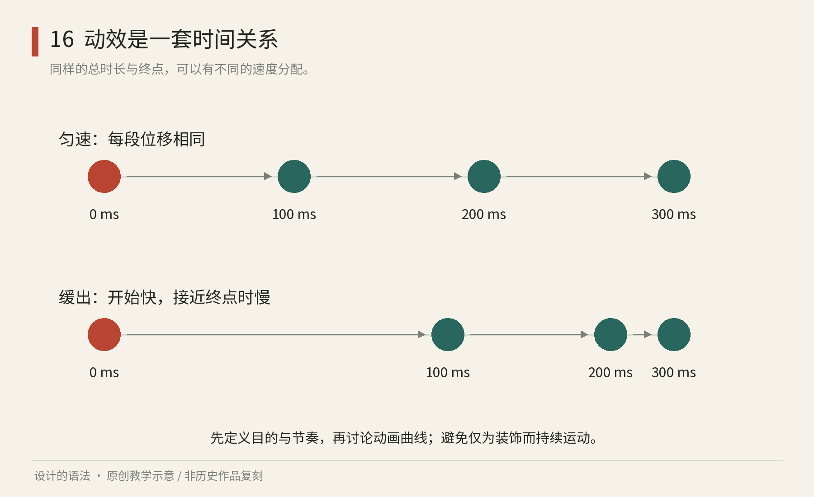

# 第16章｜动效、影视与游戏：为时间制定视觉规则

## 真作细读：《金臂人》的海报怎样把一个符号放大成一部电影

图16-2｜真实电影海报。Saul Bass，Poster for the film The Man with the Golden Arm，1955，石版印刷，MoMA藏；[馆藏记录与原图](https://www.moma.org/collection/works/5665)。此处展示静态海报，不能用它代替实际片头帧。

先观察海报的大色块：黑色与蓝紫色带围绕浅色中心，边缘保留不完全平滑的切口与细窄缝隙。它们像被手工剪切、移开的平面，而不是软件里精确等分的表格。这里的粗糙有边界：面积较大的黑块控制整体节奏，细微不规则让节奏产生紧张，并没有把所有关系都随机化。

第二眼看中央浅色区域，弯折手臂与电影名靠在一起。手臂是一个几乎可以独立认出的黑色符号，却并不写实地解释整段情节；它把注意力压缩到一个身体片段。标题没有占满整张纸，让图像与留白共同建立记忆。这种做法更接近为故事挑一个可反复出现的视觉母题，而非把所有主角与情节线索拼在一幅广告里。

图16-3｜真实海报的局部分析。左保留整幅，右放大中央文字与手臂；原作Saul Bass，1955，MoMA藏。裁切与中文说明由本书制作，右图不是另一张历史版本。[原作](https://www.moma.org/collection/works/5665)。

把局部放大以后，再回头看整幅，会发现符号并不需要填满画面才能成为记忆中心。周边色块构成较大的节奏，中央较小的黑形则提供辨认线索，两种尺度共同工作。若只把手臂放大到整张纸，它可能更直接，却会失去当前这种“从边缘收束到中心”的观看路径。放大改变了元素之间的比例，也会改变观看路径。

这张静态海报可用于讨论跨媒介母题，但不能据此还原片头运动。MoMA的[唱片封套记录](https://www.moma.org/collection/works/185648)说明海报、封套与片头之间的关联。以下采用原创转译练习，观察同一图形关系进入时间后的变化。

例如为自己的虚构影片选择“撕开的纸”作为母题。第一版把整张海报像幻灯片一样滑入，只是移动了静态作品；第二版让两块纸先分开，露出标题，最后出现一小段不规则边缘。第二版把图形之间原有的关系变成事件顺序，让分离、显露和停留参与叙事。这个练习借鉴跨媒介的思路，不复刻Bass的片头。

实际反例是把所有字都分别弹跳、旋转、发光。单个动作也许醒目，整体却没有一个事件比另一个更重要，母题被零碎表演拆散了。改稿可以只保留一次主动作，让标题与符号共享一个进入原因，并在结尾停住供阅读。改稿时，应检查每次动作是否推进了标题显露或符号辨认。

再把方法迁移到游戏：角色的关键形状既要能在静帧中被认出，也要在准备、行动和恢复之间保持可辨。镜头切换、特效遮挡与快速移动会改变观看条件，所以海报上成功的复杂纹理未必适合角色远景。跨媒介应用需要分别检查可延续的母题和必须重做的细节。以上构图、局部与练习分析是本书原创，不宣称复原历史制作过程。

## 时间分配与视觉身份

静态图形规定某一刻看见什么，动效还要规定它从哪里来、怎样变化、何时停止。一个圆从画面外滑入，可以像被轻轻推来的纸片，也可以像有重量的球。起点与终点相同，时间分配不同，观众感受到的性质就会变化。

动效系统不只是给每个物件添加同一种动画。它需要区分行为角色：主要内容的进入、次要信息的反馈、场景之间的转移，各自承担不同任务。影视片头更侧重建立作品情绪与叙事期待；界面动效更强调因果与状态；游戏动画还需要让玩家及时判断行动。它们共享时间、形状与注意力的语言，但评价目标不能互换。

Saul Bass 为1955年电影《金臂人》建立的视觉传播，是跨媒介的历史参照。MoMA 的[唱片封套记录](https://www.moma.org/collection/works/185648)把关键形象与海报、片头联系起来；其[海报馆藏页](https://www.moma.org/collection/works/5665)可观看静态作品。比较这些材料时，应观察母题在各媒介中的职责，再判断锯齿形状与粗糙字体是否适合新的作品。

*图16｜原创程序教学图：上排为等时等位移的匀速；下排在0、100、200、300毫秒四个采样时刻逐步接近终点，相邻位移减少，表示这一段动作的平均速度下降。数值是教学设定，不是通用动效规范。*

## 先写动作目的，再选曲线

为虚构展览设计一个标题出现的短片段。目标是让观众先看见标题，再注意日期。若标题、日期、背景图形同时跳动，它们会互相抢注意；若标题先落定，日期随后出现，层级就由时间承担。此时不需要让所有元素都动，只需要让先后关系清楚。

把一次动作分成起始状态、变化过程与结束状态。标题可以从略低的位置进入，同时由透明变为可见；日期稍后淡入。若动作在接近终点时逐渐放慢，就形成一种常见的缓出感。这种放慢来自相同时间间隔内位移的减少，单纯延长总时长不一定产生相同节奏。图16用四帧展示了这种关系。

随后检查它是否讲清因果。一个面板从用户刚刚点击的卡片附近展开，会暗示二者有关；若它突然从相反方向飞来，则可能制造不必要的联系。影视中可以有意利用陌生与跳跃，工具界面则常需要优先解释发生了什么。规则应服务作品任务，不能把“更有动感”当作独立目标。

建立小型动效说明时，可以只用四项：什么触发动作，什么对象变化，怎样变化，动作结束后处于什么状态。“自然、丝滑、有弹性”等形容词还需要具体的动作说明。弹性可以表达活泼，也可能让严肃的确认动作显得不稳定；某些对象可以有回弹，文字阅读区则通常需要尽快稳定。

## 游戏美术系统把艺术选择接到技术约束

在游戏中，画面首先要允许行动。敌人与背景若拥有相同的明度、轮廓和细节密度，即使每张静态截图都精致，移动时仍可能难以辨认。游戏美术系统会将角色形状、材质、光照、特效和动画共同组织，确保玩家可以在有限时间里判断。

Valve 于2007年公开的[《Team Fortress 2 中的插画式渲染》讲义](https://cdn.cloudflare.steamstatic.com/apps/valve/2007/NPAR07_IllustrativeRenderingInTeamFortress2_Slides.pdf)展示了艺术与实时渲染如何互相支持，其中强调轮廓与形体沟通。它是理解技术服务风格的具体资料，不能简化为“加一个卡通滤镜”。

例如，设计一个虚构的远程角色与近战角色，可以先只画黑色剪影，让二者在体型重心、主要道具与姿态上有区别。再选择材质与颜色，最后增加不破坏识别的细节。动作也要支持身份：远程角色抬起工具的准备姿态，与近战角色身体重心前移的准备姿态，应让人看懂即将发生的行动。

| 系统部分 | 艺术问题 | 实现时要保留的关系 |
| --- | --- | --- |
| 角色形状 | 谁显得沉稳、敏捷或危险 | 远距离轮廓仍然可辨 |
| 材质与光照 | 世界的质感是否一致 | 重要对象不被背景吞没 |
| 动作节奏 | 力量与性格怎样呈现 | 准备、行动、恢复可被理解 |
| 特效 | 哪个事件值得注意 | 不遮挡关键目标与路径 |

二维逐帧、骨骼动画、三维模型、着色器与实时引擎提供不同的实现方法。美术规范需要说明各工具都必须保留的轮廓、层级和动作线索。

## 把一段动作停下来，再重新观看

动效很容易被连续播放的流畅感掩盖问题。先静音观看，判断画面是否仍能表达主要顺序；再在中间帧暂停，检查元素是否短暂重叠成错误含义；最后缩小观看，确认重要信息不会只在大屏幕上成立。对于界面，还需要考虑减少动态的替代呈现，避免必须依靠复杂运动才能理解状态。

轻量练习：用四张纸画一张卡片进入画面的四个时刻。第一版让相邻位置距离相同，第二版让距离逐渐缩小。不必制作视频，也能比较匀速与减速的差异。然后只改变出现顺序，让标题先出现或日期先出现，写下哪一种更符合阅读目的。

本章没有给出一套所有场景通用的毫秒表。电影、游戏与工具界面的注意力条件不同，读者应先学会描述变化，再通过观看与使用测试确定参数。检查结果应能落实为具体记录：它在哪里太急，什么信息来得太晚，哪次运动建立了错误的因果关系。

动效规则还应规定静止阶段。如果所有信息持续循环，观众就找不到稳定的阅读窗口。给一段标题动效安排足够的静止阶段，让名称与日期可以读完，常常比继续增加转场更重要。停顿与运动共同组成节奏，正如版面留白与图形共同组成构图。

对于游戏角色，可以进一步区分识别时间与表演时间。角色站立时允许细看服装与材质，战斗中却需要几乎立即分辨角色类别和行动方向。于是细节不能只以近景截图为尺度，要在真实视距、移动速度与背景复杂度下检查。一个轮廓漂亮的角色，如果关键道具总被身体挡住，仍可能难以辨认。

特效也需要等级。虚构游戏里，普通移动、命中反馈与危险范围若都使用高亮闪光，重要信息反而没有优势。可以让普通动作主要依靠轮廓变化，命中反馈短暂强调，危险范围用稳定边界加明确图形。颜色可以协助区分，但不应承担全部意义。降低普通动作的视觉强度，可以为危险提示保留更明显的层级。

做动效文档时，最好同时保留小样与文字规则。视频能让人感受节奏，文字能解释触发与例外。若只留视频，后来者可能复制表面速度，却不知道为何这个物件先出现；若只写参数，又很难判断质感。规则与样例互相校正，才使跨工具、跨实现方式的协作有据可依。

本章来源：MoMA，[Album cover for The Man with the Golden Arm](https://www.moma.org/collection/works/185648)、[Poster for the film](https://www.moma.org/collection/works/5665)，Saul Bass，1955；Valve，[Illustrative Rendering in Team Fortress 2, slides](https://cdn.cloudflare.steamstatic.com/apps/valve/2007/NPAR07_IllustrativeRenderingInTeamFortress2_Slides.pdf)，2007。片段、角色与时间参数为原创教学设定。
