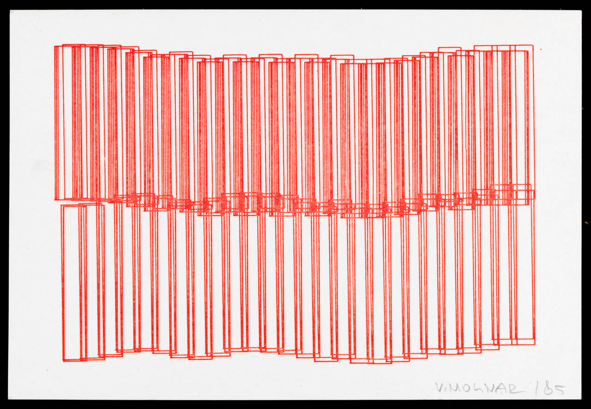
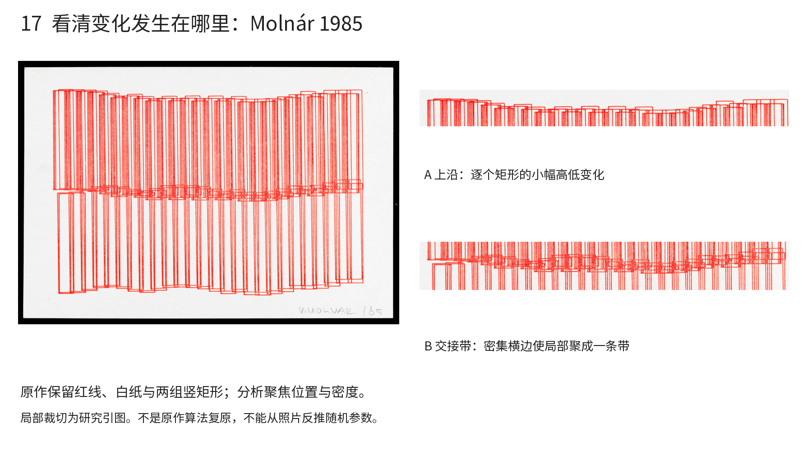
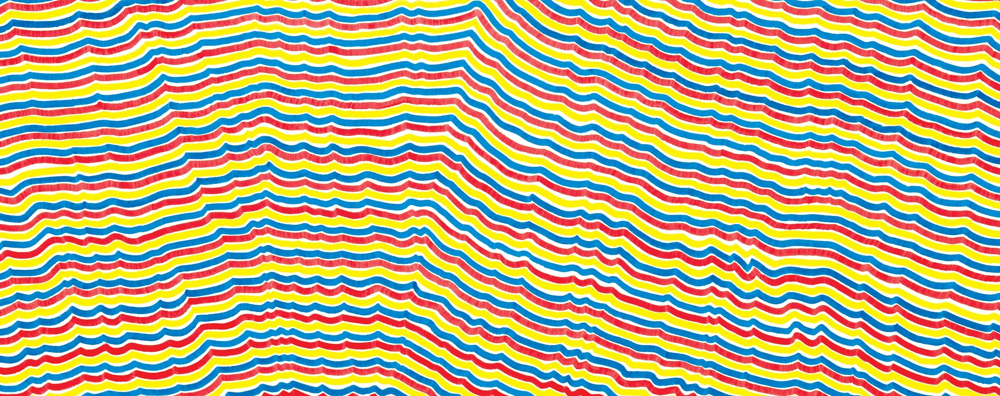
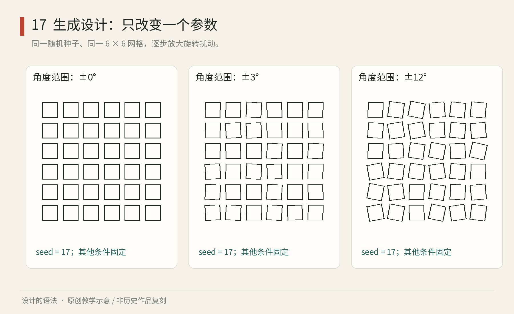

# 第17章｜生成的秩序：设计规则，而不只设计一张图

一排方框整齐站着，你很快便看清它们。把其中几个轻轻转动，画面开始有了犹豫、呼吸和事件。继续增加扰动，每个方框都向不同方向倾斜，刚才那种“秩序正在松动”的感觉反而消失了：没有可辨认的秩序，就很难感到它被打破。本章讨论的生成设计，是先明确能够反复执行的规则，再观察这些规则产生的图像。这里的“生成”不特指生成式人工智能。

## 先读两件真实作品：位置变化与执行差异

<!-- figure-height: 105 -->


图17-2｜Vera Molnár，《Untitled (Imaginer, Construire)》，1985，计算机生成绘画的石版印刷，V&A，E.999-2008。© Victoria and Albert Museum, London。书内研究引图，保留原作红线与白纸。[原作与馆藏信息](https://www.vam.ac.uk/exhibitions/degrees-of-disruption-vera-molnar-and-generative-art)

先用手遮住作品的下半部，只看上方：基本单位是细长的竖矩形，左右相互叠合。请沿顶边从左看到右，你会遇到小幅升降，而不是一条用直尺划出的齐边；这些变化没有让矩形身份消失。再放开下半部，观察两排在中央接近和交叠的地方。许多短横边聚成较厚的横向带，与你首先感受到的竖线方向产生牵引。画面仅用一种醒目的红，却出现了“竖向排列—中央聚集—上下分开”的层次。

这里有一个可以迁移的构图方法：改变局部位置时，整体节奏与局部密度会一起改变。它不要求换颜色、增加新图形或添加阴影。比如给一组诗集设计封面，可以保持书名文字区不动，用同一种线框母题的聚散表达不同册的节奏。你要先检查聚集是否侵入标题，而不是把原作的一切视觉效果照搬过去。

下面的放大图分别显示上沿与交接带。请比较A区的白缝与B区的红线密度：白缝决定单元是否还可逐个辨认，密度决定观众何时开始把局部看作一个面。照片不足以证明原始程序如何定义参数，所以本书只分析看得见的关系，不给它杜撰随机幅度。



图17-3｜本书对同一原作的局部读图板。A为上沿、B为中央交接；原作未重新着色，局部裁切供研究比较。版权归属同图17-2。

<!-- figure-height: 80 -->


图17-4｜Sol LeWitt，《Wall Drawing 797》，1995，MASS MoCA安装视图。图片来自MASS MoCA；作品与摄影权利保留，页面未给出单独摄影署名。[馆方作品页](https://massmoca.org/event/walldrawing797/)

这件壁画请从一条颜色鲜明的波线开始追踪，不要先扫视全部颜色。相邻线维持接近却不重合，局部小波动在重复后形成了连续的地形感；从远处看像有坡度的色带，近看仍能辨认每次执行。馆方说明的核心，是后一位执行者在不触碰前一条线的条件下模仿它。这里的变化来源包含人眼和手的判断，与为每条线独立抽取随机数不同。

做一个可验证的重设计：三个人各用一色画线，第一人画一条缓慢起伏的线，第二人按约定间隔模仿，第三人继续。第二轮把间隔减半，其余条件保持。并排看哪轮更早形成“色面”、哪轮仍像独立线。记录执行顺序和用时。你会学到重复不仅增加数量，也会放大局部误差、改变整体纹理；这比只会说“算法艺术很有秩序”更接近实际设计能力。


## 从作品到指令：两种不同的作者工作

艺术家 Vera Molnár 在1990年发表的自述中，解释自己如何用简单几何形、组合规则和微小变化建立图像系列，借助并置作比较；她也明确指出，计算机的产出新颖，并不保证艺术质量。[资料：Molnár，《Inconceivable Images》，1990](https://digitalartmuseum.org/molnar/biog3.html)。这提供了一条很实用的学习路径：不要把程序的工作理解为“无限吐图”，而把它当成排列可比较视觉实验的工具。

Sol LeWitt 的《Wall Drawing 797》（1995）则展示了另一种规则：依照 MASS MoCA 的作品说明，执行者要在不接触前一条线的前提下，接着模仿它。人的手和局部判断成为变化的来源。[资料：MASS MoCA，Wall Drawing 797](https://massmoca.org/event/walldrawing797/)。它不是计算机随机数的替代品；指令、协作和执行差异本身就可以成为作品的内容。

两例值得分开理解。Molnár 提醒我们比较细微差别；LeWitt 让我们注意“谁执行、怎样解释”也进入了作品。下文的方格练习是本书原创教学实验，不是两位艺术家的作品复刻，也不声称遵从其完整方法。

如果你设计一张海报，主要决定可能是这个圆放在哪里；如果你设计一个生成规则，决定变成：圆可以放在哪里、哪些地方不能放、怎样产生变化、怎样选出有效结果。前者并未变得低级，后者也未自动更先进。一次性构图需要敏锐判断；面对一整季、一百张票面或多种屏幕尺寸时，规则才有机会节省重复劳动。

## 一个可重复的小实验

准备一张纸，画六行六列等大的方框，保持边长、中心位置、线宽和背景不变。第一张不旋转；第二张把各方框旋转少量角度；第三张增大角度。暂时不要同时改颜色和大小，否则很难知道效果究竟来自哪一个变化。



图17　原创程序教学图。三幅保留同样的六行六列中心位置与方框大小，只依次改变旋转扰动幅度；随机序列保持一致。此图解释受控变化，不是历史作品临摹。

伪码可以写成下面这样。`seed` 是随机序列的起点标记；使用同一算法与同一种子，才有条件重复生成同一序列，并不是一个跨所有软件都通用的图像密码。

```text
设置随机种子为 17
对每个固定的格子中心：
    读取下一个 -1 到 1 之间的随机数 r
    旋转角 = r × 最大扰动角
    在该中心绘制同样大小的空心方框
```

将最大扰动角依次设为0、3、12度。要点是每次从同一种子重新开始，而不是接着上一次的随机序列运行。这样，第二幅与第三幅的同一个方框才会朝相同方向、按比例增大旋转。手绘时可以先写下36个正负数，三幅重复使用这张数表。

接着问三个可以回答的问题：你在哪张里最容易发现偏离？哪张保留了最清楚的整体结构？哪张适合表现你想要的情绪？答案可以因观看距离和用途而变。这比笼统评价“更有设计感”更有学习价值，因为它把好恶连接到可观察的条件。

## 参数、约束与筛选，各做什么

参数是允许调整的量，例如间距、角度和线宽。约束是不能越过的边界，例如文字不能被形状遮挡、相邻模块不能碰撞。种子控制某次变化的实现；筛选标准决定哪些实现值得留下。它们不是同一件事。

例如，给音乐节做一组票面，可以让弧线密度表示日期，而把姓名、座位和检票码放在固定的清晰区。此时“密度可以变化”属于参数，“检票区不得被覆盖”属于约束，“21号种子”记录某张票的生成条件，“远看能识别系列、近看能快速检票”才是评价标准。若只留下种子而不记录字体、规则版本和输出尺寸，半年后仍可能无法准确重建。

程序设计也需要处理边界。随机颜色可能碰巧让文字难辨，随机位置可能产生令人误读的相邻关系。与其先生成一万张再靠运气挑，不如先规定：前景与背景的可读组合有哪些、图案最接近文字能到哪里、最稀和最密的结果是否都成立。这是在定义一个可用的变化空间。

艺术创作当然可以故意难读、碰撞或失衡。区别在于，作者是否知道自己牺牲了什么，并且是否与作品目标一致。把艺术实验直接移到车站导视，可能把有意义的表达变成找路障碍。规则的价值取决于任务，而不是“算法”二字。

## 让程序支持观察，而不是替代判断

选择工具之前，先做九张小草图：三档疏密乘三档扰动。只要纸笔就能开始。想保留矢量路径、用于海报与印刷，可用能输出 SVG 的脚本或矢量工具；想连续交互调整、观察时间变化，可用绘图编程环境；想研究实体模块，则先用纸片、积木或激光切割前的纸样。这里选择的是表达方式，不是给工具排地位。

初学者常把变化数量当作丰富程度。然而连续百张近似结果可能只有一个视觉想法。更有用的作品档案会并排留下：规则、少量代表性结果、失败结果、筛选理由。比如记录“角度大于某值后，方框相撞使列的节奏消失”，比存下一个“最终版3”更能帮助下一次工作。

最后做一次交换实验：把你的指令交给另一人，不给他看成图。如果结果接近却不完全相同，找出差异来自尺寸说明、执行顺序、词语解释还是手工偏差。需要批量生产的部分，应补清说明；希望保留个人解释的部分，可以明确写成开放条件。你由此学到的，是设计一套允许别人继续工作的规则。


还可以把随机与其他变化来源分开比较。等差变化会让每一列比前一列多旋转一点，形成连续梯度；周期变化让旋转按固定节奏往复，形成波动；随机变化则让局部结果难以预测。这三种都能生成系列，但观看体验不同。想表现时间推进，可以先试梯度；想表现循环，可以先试周期；想表现受扰动的秩序，再试受控随机。选择变化机制，本身已经是一项设计判断。

同时要留意输出的物理尺度。屏幕上精细的线群，缩到票券上可能粘成灰块；同一线条放大到墙面，手工制作误差又会显现。参数最好带单位或明确相对关系，例如线宽是纸面毫米还是画面宽度的比例。先用一张小样确认线与空白仍能分辨，再追求批量。系统的重复性应包括制作后的结果，而不是只包括电脑里一模一样的文件。

如果你只想开始，不必学完编程。用36张纸片、一个量角器和事先写好的数表就能完成实验。纸片让旋转、位移和叠压成为可直接触摸的变量。等你能说清“我希望改变什么、其余保持什么”以后，代码才真正成为加速器；在这之前，更多自动化通常只会让比较更难。

本章资料：Vera Molnár，《Inconceivable Images》，1990，Digital Art Museum；MASS MoCA，《Wall Drawing 797》，作品1995年。链接见正文。其余实验、参数和判断方法为本书原创教学设计。
