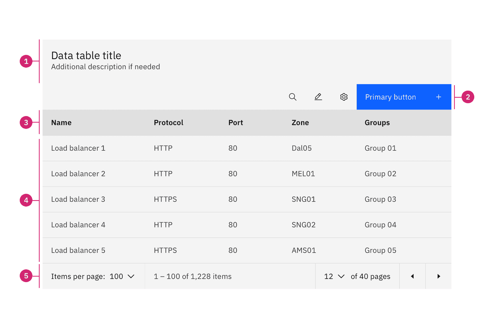
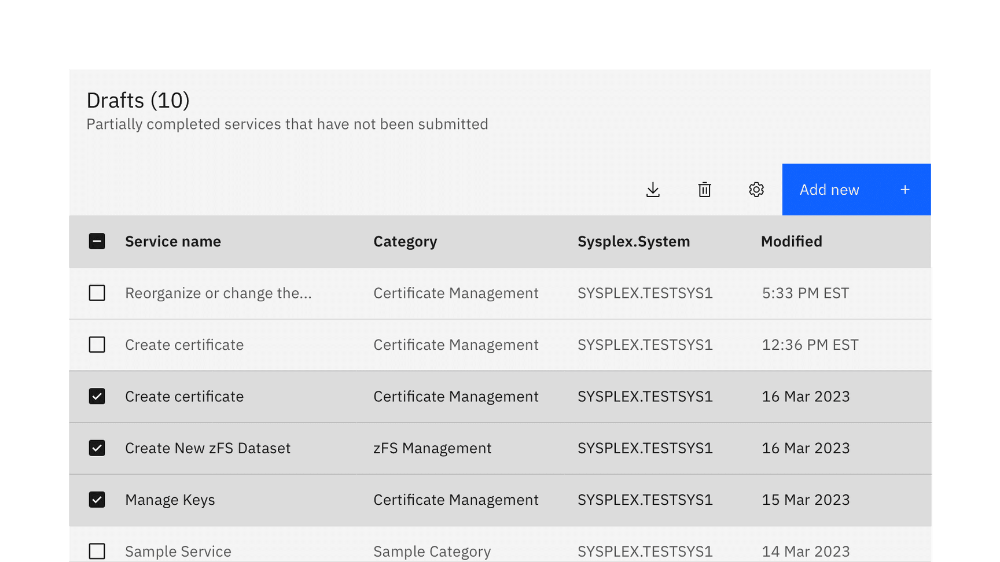
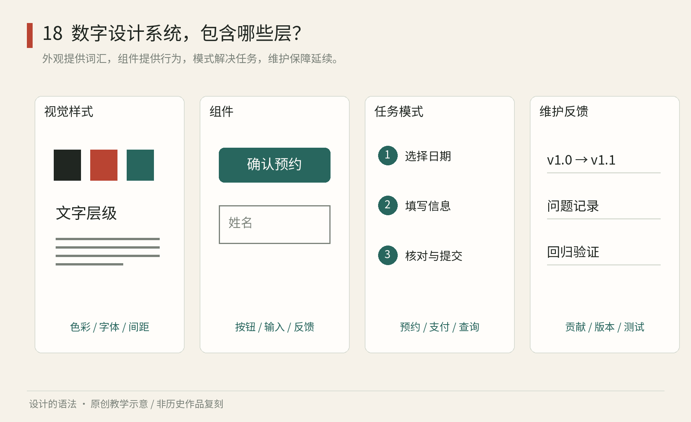

# 第18章｜来到屏幕：现代数字设计系统解决什么

一家美术馆有漂亮的海报、统一的门票和精致的网页。你到手机上预约，却发现“下一步”有时是蓝色链接，有时是黑色方块；填错日期后只出现一个红圈，不知道怎样改。这说明视觉亲缘已经建立，操作规则却仍然松散。来到屏幕，设计系统除了回答“看起来像谁”，还要回答“用户如何行动、系统如何回应、不同人能否完成任务”。

## 真正看一张表：Carbon把视觉资源花在哪里

<!-- figure-height: 110 -->

图18-2｜IBM Carbon，Data Table官方解剖图，读取于2026年10月。© IBM，研究引图；代码的开源许可不自动视为此图的CC许可。[官方说明](https://www.carbondesignsystem.com/building-blocks/core/components/data-table/guidelines)

这张表没有用一张漂亮照片介绍自己。请顺着官方标号看五个区域：1标题与描述，2工具栏，3列标题，4数据区，5分页。最强的蓝色放在右上行动按钮，数据区保持大面积浅色。这使“对整张表做什么”与“逐行读取什么”在空间上分开。黑色正文和偏灰的表头仍有层次，细分隔线让眼睛沿水平方向跟随同一记录，不需要给每个单元格画完整方框。

现在只比较前三列。名称文本统一左对齐，较短的协议与端口沿列组织；列宽没有机械平均分。若把名称压到端口的宽度，许多名称会换行，行高随之膨胀；若把每列都拉得很宽，跨行比较又要来回移动视线。表格的几何不是独立的装饰，实际文字长度正在参与布局。

图中工具栏提供少量图标与一个强行动。小图标没有都套上实心蓝底，因而不会同主按钮竞争；标题与工具栏又共享同一整体宽度，让人知道操作属于下方数据。这不是“蓝色代表所有重要信息”的规则，而是当前任务对视觉注意力的分配。把一列异常端口也全部涂蓝，反而会冲淡主要行动的含义。

图18-3｜IBM Carbon，Data Table多选示例。© IBM，研究引图。与图18-2同源，注意选中行和复选框所承担的状态作用。 [图像与作品来源](https://www.carbondesignsystem.com/building-blocks/core/components/data-table/guidelines)

第二张图加入复选框，几行被选中。此时同一行的底色变化帮助横向追踪，复选框提供一个可指认的离散状态。它们同时存在，使选择不只依靠背景色。比较未选行与已选行，可以看出状态改变并未重排字段；使用者的阅读记忆仍然可用。

做一个30分钟练习：把六本书的书名、作者、年份与借阅状态填入一张表。先写下两个任务：“找到一本书”“把三本书加入归还清单”。第一版只支持查询，第二版添加选择与批量行动。分别决定搜索、复选框与主按钮放哪里，并写出新增部件的理由。若两个任务实际用不到排序，就不必因为官方图上有图标而照单全收。

最后把同样信息做成一张面向路人的书展海报。你会发现海报可以只突出一本书与活动时间，表格则需要让多条记录可比较。学会这一区别，才知道组件系统与视觉传播系统可以共享字体和色彩，却不能共享全部信息布局。下文的三个系统比较，应带着这个具体任务继续阅读。

## 样式、组件、模式：不要混成一个文件夹

样式规定颜色、文字、间距与形状等基础关系；组件是可重复使用的界面部件，例如按钮、输入框和对话框；模式则组织这些部件来解决一类任务，例如预约、确认信息、处理失败。一个按钮画得准确，并不代表预约流程已经设计好。

GOV.UK Design System 将样式、组件与模式分别组织；它对模式的说明强调特定用户任务与页面类型，而组件可以参与不同情境。[资料：GOV.UK，Styles / Components / Patterns](https://design-system.service.gov.uk/)。这一组织可作为观察工具，不必把它当成唯一合法的分类学。

图18　原创教学图。基础样式支持组件，组件进入任务模式，使用反馈推动维护；各层的责任不同。图中的层次是本书的学习整理，不是三个品牌共同采用的官方架构。

再往外看，设计系统还需要使用说明、实现代码、内容规则和维护责任。组件库可以只是一组可以调用的代码；设计系统则要让别人知道什么时候该用、什么时候不适用、出了问题怎样改。文件夹里有一百个按钮截图，最多证明资源不少，不能证明系统成熟。

可以用同一件事来检验这些层次：读者预约星期六的展览。基础样式让信息容易读；日期选择组件让他输入日期；预约模式解释剩余名额、确认、取消与失败；维护机制则收集真实使用中的困难。每一层都可能成功，也都可能单独失败。

## 三个官方系统，三种观察入口

Google 的 Material Design 把自身描述为可适配的指南、组件与工具系统；其基础部分覆盖布局、交互和可访问性等内容。[资料：Google，Material Design Foundations](https://m3.material.io/foundations/)。阅读它，可以观察表达性视觉如何与交互结构共同工作。不要只抄它的圆角和色块，而跳过状态、层次与布局条件。

IBM 的 Carbon 以企业产品与数字体验为重要应用背景，官网提供基础规范与组件等资源。[资料：IBM，About Carbon](https://www.carbondesignsystem.com/getting-started/about-carbon)。阅读它，适合追问密集信息怎样保持秩序、产品团队怎样复用决策。不过，“企业”不是必须严肃灰暗的同义词；真正该观察的是任务负担和信息关系。

GOV.UK 的系统服务于政府服务的一致体验，汇集跨服务团队的研究、设计与开发成果。[资料：Government Digital Service，GOV.UK Design System](https://design-system.service.gov.uk/)。它提示我们把清楚的语言、表单流程和公共服务任务放在视觉表现之前。这不是说公共服务没有审美，而是说审美要帮助人在重要、偶尔令人紧张的事情上正确行动。

下面是本书的比较方法，不是官方系统的优劣排名：

| 观察对象 | 可以带着的问题 | 不能仅凭什么判断 |
| --- | --- | --- |
| Material | 表达性与操作层次怎样共存？ | 圆角大小、鲜艳程度 |
| Carbon | 重复任务与密集信息怎样组织？ | 看起来是否“商务” |
| GOV.UK | 文字、表单与错误恢复怎样支持办事？ | 装饰是否够丰富 |

系统不断更新，本章不把某个组件数量或一张截图当作永远有效的结论。真正值得带走的是阅读方式：先读适用目标，再读规则，再用一个真实任务检验它。

## 同一预约任务，为什么不能只换皮肤

假设你拿到三个现成按钮，再把颜色换成美术馆的朱红。此时最容易误以为“完成了品牌化”。但读者真正遇到的，还有几个问题：不知道周一闭馆；选满额日期后没有解释；提交时网络中断；成功页没有说明入场凭证；屏幕放大后日期被截断。

这些问题不会因为换了颜色而消失。应先画一条具体任务路径：了解开放条件，选日期与场次，填写必要信息，确认，收到结果，找到修改或取消方法。再给每一步列出正常、空、错误与等待状态。你会发现有些界面甚至应该删除：如果只有一个展馆，就不必要求用户先选择展馆。

这是设计系统与产品设计的分工：系统提供经过整理的通用方法；具体产品仍要决定问哪些问题、先后顺序为何、哪些信息没有必要。没有任何组件库能替你理解业务。相反，使用者若发现同一种困难在多个产品反复出现，就应考虑把解决方法贡献回系统。

## 用一个“小而完整”的系统入门

给自己的小项目准备十个颜色和八种字号，往往比准备一条完整路径容易。但更有效的第一版可以很小：一组可读的文字层级、几种语义颜色、一套输入与按钮、一种错误处理方式、一页使用说明，再加一条从开始到完成的任务路径。

“完整”指责任没有明显空洞，不指数量庞大。例如，只有一个输入框，也应清楚标注用途；只有一个确认按钮，也应说明提交中发生什么；只有一个错误，也应告诉用户如何恢复。使用现有系统时，同样先找到它对应这些责任的说明。

做一个不必写代码的练习：找两个提供相近预约服务的网站，分别截图开始页、填写页和失败状态；没有自然遇到错误时，不故意攻击网站，也不提交虚假预约，可以仅观察公开帮助与表单提示。把差异分为视觉、组件、任务和维护信息四类。你通常会发现，最影响体验的差异未必出现在最显眼的封面。

最后记住一条界限：数字系统的可访问性不能只凭截图审核。键盘顺序、屏幕阅读器获得的名称、放大后的重排等，需要在可操作的实现中检验。视觉设计师不必独自掌握全部工程细节，但必须知道自己的成图在哪些地方还没有提供答案。

视觉系统与服务系统还有一个经常被忽视的连接：内容语气。相同的圆角和颜色，如果一处说“请求执行异常”，另一处说“没成功，再来呗”，仍会让人感觉来自不同组织。系统可以约定用具体、尊重人的语言说明发生了什么、影响是什么、下一步怎样做。语气不必处处相同：庆祝预约成功与解释付款失败，本来就应有不同情绪，但都要让信息可信。

选择借用哪个系统时，可以列出自己的约束：团队擅长什么、用户最常做什么、需要哪些设备、是否已有品牌、谁维护代码。接着用一条真实任务试做，再判断缺口。不要先为所有组件重新上色，也不要一次混合三个系统的部件，因为它们的文字尺度、状态与布局假设可能不同。一旦混用，就需要自己承担协调这些差异的工作。

还可以把“沿用”分成不同程度。你可以只学习文档如何解释适用条件，也可以采用基础规则与部件实现，或者在它的扩展机制内调整品牌。每种方式节省的劳动不同，后续责任也不同。读一个系统，最终应让你更会提问自己的问题，而不是更快把所有作品变成同一张模板。

本章资料：Google，Material Design Foundations；IBM，About Carbon；GDS，GOV.UK Design System 首页及分类说明。链接见正文，核对于2026年10月。比较问题和预约示例为本书原创分析。

## 当代对照：Wise怎样把品牌浓度带入产品

2023年Wise更新了鲜绿、粗壮标题与多样图像。官方总览同时展示卡片、人物、符号与手机，但不要求每屏把这些都铺满。界面需要余额、字段、金额与行动的层级；广告可以放大字形与纹理。品牌系统决定可用的语汇，交互系统还需决定状态、错误、焦点与操作结果。第三十二章用真实户外与手机场景继续比较。[Wise官方发布](https://wise.com/gb/blog/a-brand-for-everywhere-wise-unveils-bold-new-look)。

图18-N｜真实当代品牌总览：Wise于2023年发布的视觉更新文章配图。© Wise及相关创作者。属于视觉材料，未作为完整交互、键盘或可访问性测试的证据。 [原始出处](https://wise.com/gb/blog/a-brand-for-everywhere-wise-unveils-bold-new-look)。
