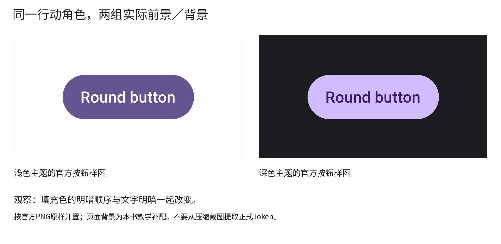
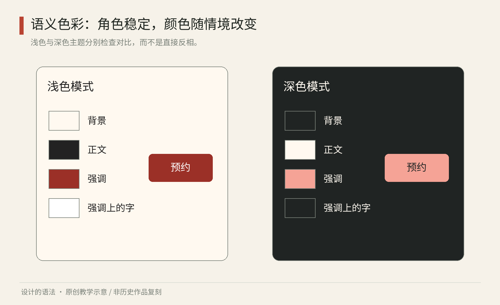
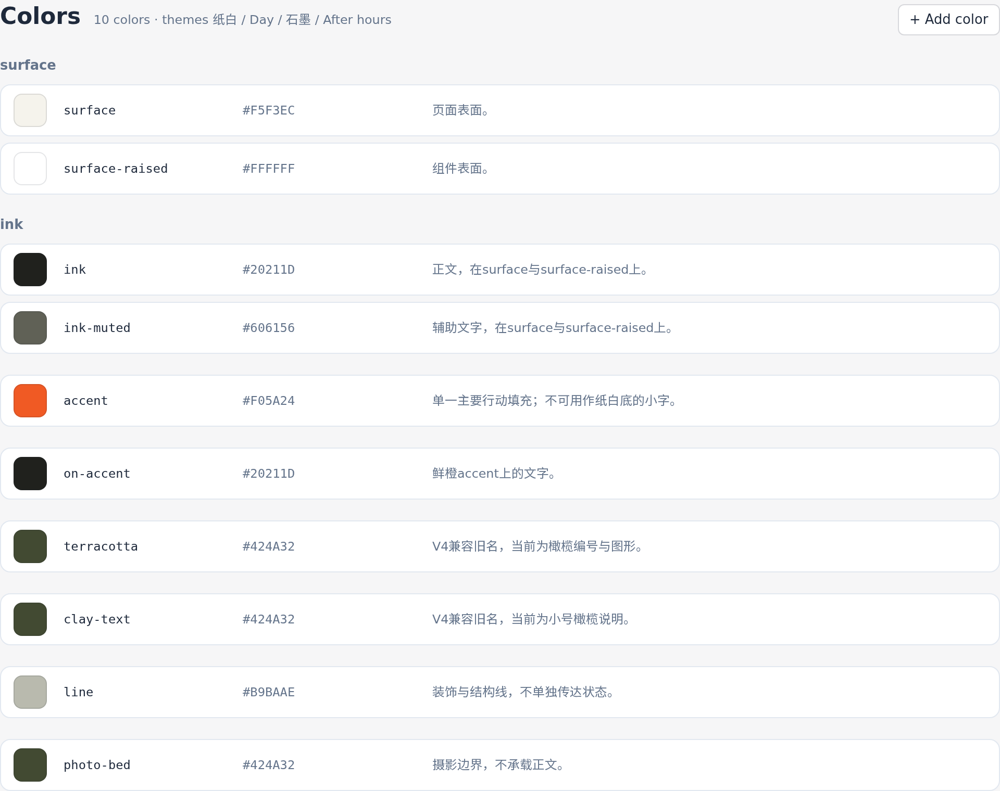

# 第19章｜把设计决定命名：从色票到语义 Token

你为一场展览定下朱红色。一个月后，它已出现在海报标题、网页按钮、错误提示和售罄标签上。策展人想让新展览改用青绿，工程师全局替换了朱红，结果连“付款失败”也变成青绿。问题在于同一颜色承担了不同含义，却没有被分别命名。

Token 可理解为“被命名、可复用的设计决定”。这里保留英文，是为了避免把它误解成登录令牌或模型计算的词元。它不只记录颜色，也可以记录间距、字体、线宽与运动时长。通过命名，文件和代码就能区分品牌强调色与危险提示，允许两者分别修改。

## 从官方按钮样图读“成对改变”

<!-- figure-width: 90 -->


图19-2a｜Google Material Components Android，浅色主题filled button官方PNG原图。© Google／Material Components项目；研究引图。[CommonButton文档](https://github.com/material-components/material-components-android/blob/master/docs/components/CommonButton.md)

<!-- figure-width: 90 -->


图19-2b｜同一官方文档的深色主题filled button原图，保留原始473×192像素，按较小尺寸呈现。权利与来源同上。 [图像与作品来源](https://github.com/material-components/material-components-android/blob/master/docs/components/CommonButton.md)



图19-2｜Google Material Components Android官方文档的浅色、深色filled button样图，本书并置并加标签；外围页面底色为教学补配。按钮图保留原色，© Google／Material Components项目，研究引图。[CommonButton官方文档](https://github.com/material-components/material-components-android/blob/master/docs/components/CommonButton.md)

请先看左侧按钮：较暗的紫色填充上是明亮文字。再看右侧，同样写着“Round button”，填充变浅，文字变暗，外部页面也变暗。重要变化发生在“哪个角色用亮、哪个角色用暗”的关系上。如果只把外部白底换成黑底，却保持原按钮的暗紫色，按钮与页面之间的层次就可能减弱；如果只把按钮填充提亮而保留白字，按钮内部的字又可能不够清楚。

这张图可用两张遮纸来读。先遮住文字，只看按钮与页面的明暗；再遮住周围页面，只看文字对按钮填充。两次观察分别对应两种配对，对紫色色相的偏好则不能代替这两项配对检查。角色命名使团队可以同时维护这两种关系：行动背景用什么，行动上的文字用什么。

再比较两侧轮廓，圆角与文字内容让它们继续像同一种部件。切换主题时，不必把所有变量一起改变；稳定的形状帮助用户识别，改变的色彩处理新背景条件。反过来，若新主题连字体、轮廓、间距都重新定义，用户就很难知道到底是主题换了，还是按钮类型换了。

具体练习：画一张节目预约卡，选择一个主要按钮和一个次要文字链接。做浅、深两版，每版写出四个角色：页面底、正文、主要行动底、行动字。先用黑白完成，让层次成立，再加入你选择的色相。不要从本图压缩像素采样当成正式Token；正式实现应使用所采用版本的官方资源或你自己核验的数值。

将两个版本缩小到手机里的实际阅读尺寸，检查文字而非只看色块；然后把品牌色从紫改成橙，保留角色关系，重新测试配对。若橙色过亮导致白字弱，就要改行动字或选另一档橙，而不是宣称品牌色不可改变。下文的JSON示例演示怎样保存这项决定；它不是从这张官方图中测出的令牌表。


## 原始值、角色、部件：三层名字的区别

三层名称分别记录不同决定：原始值确定红色的具体数值，语义角色说明颜色的用途，部件应用指定某个按钮采用的角色。先分清这些职责，再建立相应的命名结构。

Material 的颜色角色用成对关系组织前景与背景，例如主要色及其上方内容所用的颜色。[资料：Google，Color Roles](https://m3.material.io/m3/pages/color-roles?s=m3)。本章据此强调一个普遍的设计问题：背景色不能独立决定，放在它上面的字与图标必须一起考虑。以下命名方案为本书教学示例，并非 Material 的官方令牌表。

| 层次 | 示例名字 | 回答的问题 |
| --- | --- | --- |
| 原始值 | `palette.vermilion.700` | 选择了哪一档朱红？ |
| 语义角色 | `color.action.primary` | 哪种颜色表示主要行动？ |
| 部件应用 | `button.primary.background` | 主要按钮背景用哪个角色？ |

不一定每个小项目都要三层齐备。只做一次海报，用标明用途的色票就可能足够；跨网页、票券和电子屏反复更新时，语义层的价值才明显。命名应围绕需要独立修改或复用的决定，避免为没有管理需求的细节增加层级。

## 一组可以读懂的数值

下面是本书示例的普通 JSON 映射，目的是演示角色与模式的关系，不宣称符合任何专门的 Token 交换规范。`surface` 表示页面或卡片的基础表面，`text` 是其上的正文，`action` 是主要行动背景，`onAction` 是其上的字。

```json
{
  "light": {
    "surface": "#FFF9F0",
    "text": "#222222",
    "action": "#9B3027",
    "onAction": "#FFFFFF"
  },
  "dark": {
    "surface": "#202423",
    "text": "#FFF9F0",
    "action": "#F5A396",
    "onAction": "#202423"
  }
}
```

这些教学配对可以用于试作，仍需在实际页面中检查。放到渐变、照片、透明叠层或禁用状态上，实际配对可能已改变。品牌朱红也可以继续用于装饰图案，但不能因此自动获得承担正文或警告的资格。

在网页里，相同决定可以落实为 CSS 变量。部件不必知道这是一种红，还是未来的一种青绿；它只需使用正确角色。

```css
:root {
  --surface: #fff9f0;
  --text: #222222;
  --action: #9b3027;
  --on-action: #ffffff;
}
[data-theme="dark"] {
  --surface: #202423;
  --text: #fff9f0;
  --action: #f5a396;
  --on-action: #202423;
}
```

代码负责传递已定义的角色。设计时需要先区分主要行动与危险提示，明确深色模式中应保留的意义；自动同步无法补足这些定义。



图19　原创教学图。浅色与深色模式保留表面、正文、主要行动、行动上文字四个角色；改变的是实现颜色，不是用途。样图不能替代实际页面的对比度与交互检查。

## 深色模式的角色配对

把每个颜色反相，通常会连图像、品牌标志、阴影和提示层级一起改变。更合理的起点是列出角色，再为另一模式重新配置。浅色表面上的暗边框，到了深色表面可能需要亮边界；浅色模式里醒目的大色块，在黑暗环境可能过于刺眼。需要保持的是可读与层级，而不是数值对称。

WCAG 2.2 的文字最低对比度准则对普通文字通常要求至少4.5∶1，大号文字通常为3∶1，另有装饰等例外；大号的判断也有具体字号与字重条件。[资料：W3C，Understanding SC 1.4.3](https://www.w3.org/WAI/WCAG22/Understanding/contrast-minimum.html)。这是数字界面的明确检验条件，不宜被粗略扩展成所有印刷、空间和艺术作品的同一标准。

设计时要检查“成对使用”，例如正文对表面、按钮字对按钮底、提示字对提示底。仅检查色票彼此的差异没有意义，因为用户看到的是实际组合。对比度合格也不代表阅读必然舒服：字形过细、长段全大写、行距紧、反光环境都可能造成困难。

同样不能只用颜色区分状态。红色错误之外要有可理解的文字；选中项目可以同时改变边界或符号；图表的系列可以结合线型、标签和位置。颜色承担快速提示，其他线索提供冗余。多种线索并用，使信息在颜色难以分辨时仍能被理解。

## 给自己的设计系统做一次命名整理

把一张已有作品中的所有颜色列出来，不要先删减。逐一问：这是装饰、背景、正文、链接、主要行动还是错误？如果一个色值承担数种意义，先为这些意义分别命名，即使它们暂时指向同一值，以后也可以独立调整。

再挑一个变化进行推演：品牌改色、夜间使用、黑白打印，任选其一。检查哪些角色要改、哪些不能跟着改。例如黑白印刷不再依赖红绿区别，但可以保留标题层次、实线虚线和明确文字。这是将“品牌相同”翻译成跨媒介可行的关系，而不是强求 RGB 数值在所有材料上看起来一样。

最后写一句角色说明：“主要行动色用于当前任务的优先行动，不用于所有链接，也不替代危险提示。”这条说明给出了适用范围，使用者可以据此决定某个元素是否该采用主要行动色。


名称还应减少对偶然位置的依赖。`left-panel-red`把左侧、面板和红色一次写进名字；当布局换到右侧、配色改成青绿时，这个名字就成了误导。若真正含义是“当前选中区域”，用这个含义组织名字更有机会长期成立。不过语义也不能无限抽象：把所有强调、警告、链接统称“重要色”，仍会失去区分。合适的命名粒度，来自你实际需要独立改变哪些决定。

数值同步也不是设计同步的全部。印刷需要考虑油墨与纸张，屏幕需要考虑发光与显示环境；同一字体在不同系统中可能有不同字形或度量。可以让它们共享“正文”“标题”“强调”等角色，同时在各媒介使用适合的实现。相同数值在不同媒介上未必产生相同的阅读效果。更值得记录的是目标与验证条件，例如“在普通阅读距离清楚区分正文与注释”。

建立清单时，给每个重要角色补三项信息：用途、一组允许的配对、一种禁止的误用。例如“错误文字”要与“错误表面”配对，可附图标与明确说明；禁止仅以红色边框表达错误。这样，同步文件之外还有判断依据。这些说明可减少仅凭色彩偏好选用角色的情况。

Token 的优势在修改发生时最明显，也因此需要留存修改理由。今天把主要行动色加深，是为了小号白字更清楚；明天恢复旧色时，就不能只根据个人口味忽略这段历史。把数值与理由一同保存，后续改色时才能复查原来的可读性要求。


试着把一组色票交给没有看过作品的人，只给名字与用途说明，请他给按钮、说明文字与错误消息配色。若他多次选错，不应立即归咎于理解能力；先检查名字是否冲突，说明是否缺少上下文。试用结果可用于修订名称和用途说明。


## 原生实现：把角色命名做成系统

隙间的设计系统实际保存在原生Token文件里，下面是Tingly Design的颜色视图。surface、ink、accent与on-accent分别承担表面、正文、主要行动和行动上的文字。纸白、石墨、橄榄与少量鲜橙按角色分工；小号提示与大色块不能只因同属一色就交换用途。当前版本保留terracotta、clay-text旧名以兼容组件，usage中说明它们已经改为橄榄角色。这是应记录的迁移债务；长期维护宜用别名与弃用说明逐步转向语义命名，不能让旧名字悄悄误导后来的人。第三十一章将同一套关系带到广告、包装和订阅画布，并说明主题与安装快照怎样更新。



图19-C｜本书原创系统的实际原生颜色视图，显示日间值；系统另有夜间主题。源文件与组件随工程交付，不是引用他人系统的截图。


本章资料：Google，Material Design，Color Roles；W3C，Understanding Success Criterion 1.4.3。链接见正文，核对于2026年10月。数值、代码及命名层次为原创教学示例。
