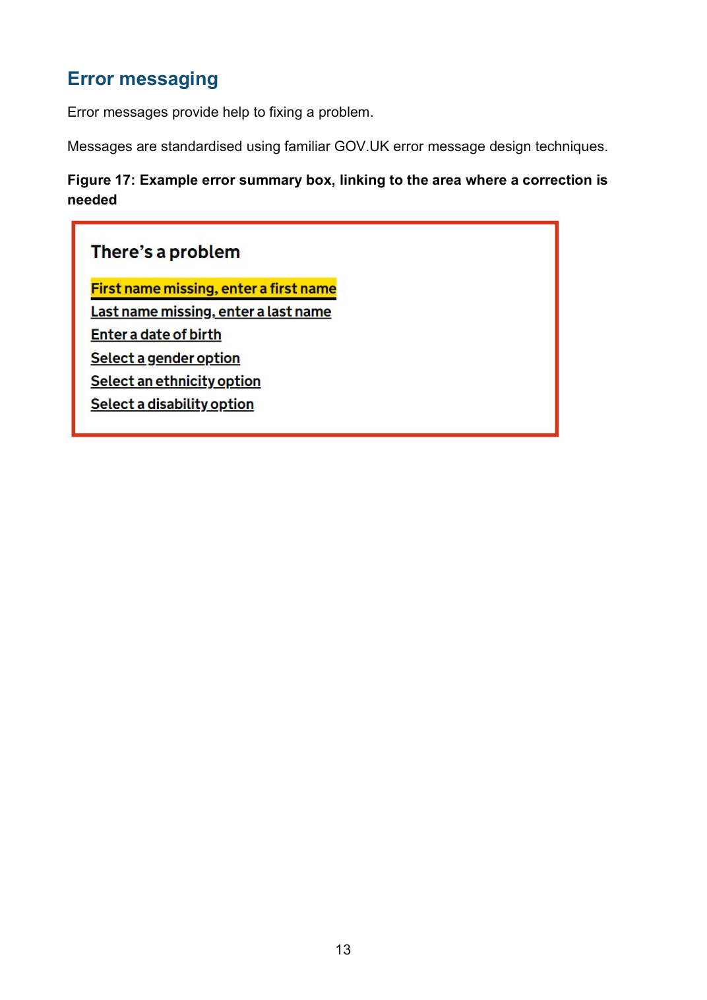
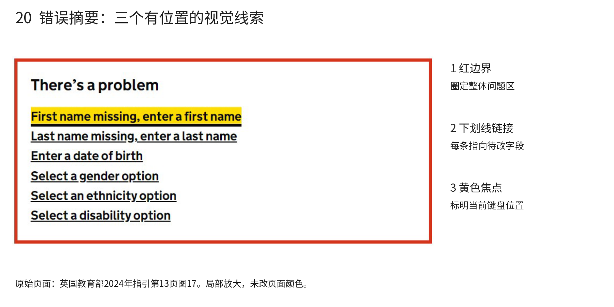
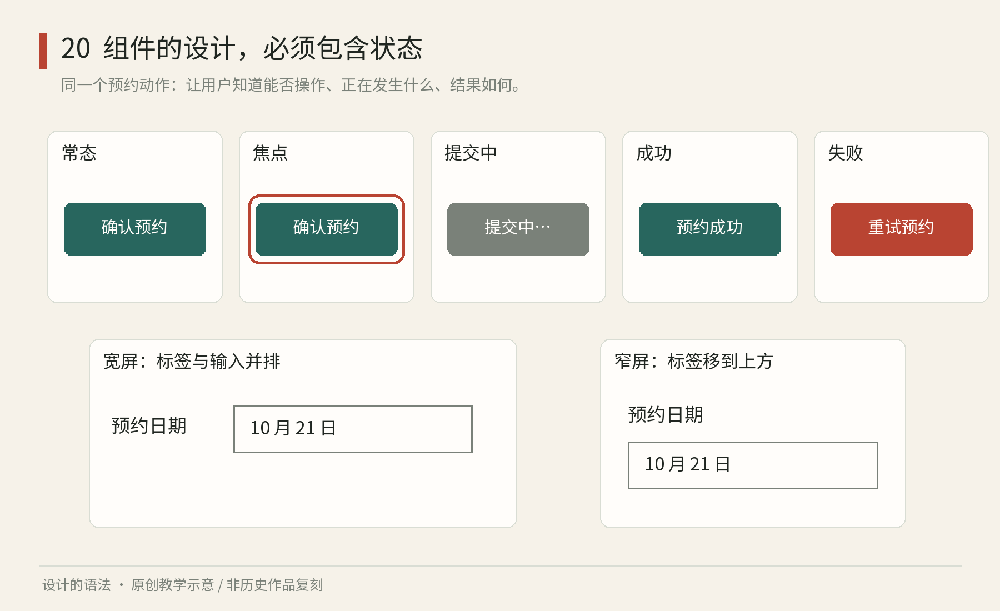

# 第20章｜组件有生命：状态、内容与变化中的一致性

静态画稿上的预约按钮很完美：尺寸合适、朱红柔和、文字居中。但读者按下以后呢？网络慢时要不要继续按？满额后怎样解释？用键盘时有没有清楚的焦点？标题变成一整句德文后，按钮会不会把字挤出去？一个部件只有在这些变化中仍然成立，才能称得上可复用。

## 一个真正的错误画面：GOV.UK如何让人回到任务

<!-- figure-height: 140 -->

图20-2｜英国教育部《FE Workforce Staff Record: Recommended Methods of Submission》，2024年9月，第13页图17。© Crown copyright 2024；该PDF第22页声明OGL v3.0，第三方例外从其声明。保留页面上下文，供研究阅读。[原PDF](https://assets.publishing.service.gov.uk/media/66e447b50d913026165c3e9b/Recommended_method_of_submission_guidance.pdf)

这页官方指引展示了使用GOV.UK错误消息方法的实际界面图。先看红色边界：它圈定的是整个问题摘要区，而不是每个字都变成红色。摘要标题用较粗黑字说明当前发生了问题；下面每一条都用下划线标示链接。因此，即使读者不依靠红色，也能辨认标题、问题清单与可行动的文字。

第一条“缺少名，请输入名”有黄色背景。这是截图中对当前链接的焦点突出，不是把它评为比其他错误更严重。请把两种含义分开：红边界标记区域的错误性质，黄色标记当前操作位置。若设计时把所有错误链接都涂黄，焦点就失去了区分作用。状态必须用在相应时刻，才会传达意义。

图20-3｜同一PDF图17局部放大，按红边界、链接、焦点分解。原页面未重新配色；本书旁注为读图分析。版权归属同图20-2。

接着看每条句子：它们指向能修正的内容，包括姓名、出生日期与几个选择项。清单不是一串内部错误码，也不只说“输入无效”。用词直接告诉人要补什么。这里的视觉结构与语言结构协作：每条都占一个可追踪位置，链接帮助返回相应字段。若仅把清单换成“发生了6个错误”，虽然更短，却让读者必须重新查找这6处。

这一截图仍不能证明完整操作。截图中看不到链接目标、辅助技术读到的名称、提交后焦点是否移动，因此需对照官方组件说明，并在真实实现里检查。我们能直接从图中分析的是信息的分组、视觉层级和当前焦点；不能把静态图的清晰等同于整个流程已通过验证。

做一次重设计：为一个只有姓名、日期、场次的预约表单写三条错误。第一版只在页首写“提交失败”；第二版按本图的组织方式列出可操作错误，并在字段附近写同样说明。让另一人根据纸面状态指出下一步该改哪里，记录寻找路径。随后在代码原型中接上链接与焦点，再检查是否真正到达相应输入。纸上的改善与实现的改善要分别记录。

最后把页面里的红边界暂时换成黑线，保留文字、下划线与结构。观察哪些意义还在，哪些提示减弱。这不是建议正式页面都改成黑白，而是在检验系统是否把全部解释责任压给颜色。下文的按钮状态学习，也应采用同样方法：每个状态都要有读者可理解的证据。

## 从形状到约定

组件不仅是一组线条，也是一组对用户的约定。看起来可以按的东西应能执行相应操作；输入框应让人知道要填什么；关闭对话框后，用户应能继续原来的任务。外观、含义与行为需要共同设计。

W3C 的 WAI-ARIA 按钮模式把按钮用于触发行动，与主要用于导航的链接区别开来，并说明按钮的键盘激活方式与可访问名称等要求。[资料：W3C，APG Button Pattern](https://www.w3.org/WAI/ARIA/apg/patterns/button/)。读者不必背下属性名，先领会一个原则即可：圆角或下划线不能独自决定部件是什么，功能与操作约定才是关键。

在网页实现中，能用原生按钮时，应先考虑原生按钮；把一块看起来像按钮的普通区域加上鼠标点击，仍可能遗漏键盘和辅助技术所需的行为。这就是设计与工程接壤的地方：图稿说明意图，代码需要兑现意图，而测试验证别人是否真正能使用。

可以给组件写一张“身份卡”，包含用途、内容、允许变化、状态、交互和不适用情形。例如预约按钮用于提交当前预约请求；文字说明具体行动；允许随文字变宽；提交中防止重复请求；失败后允许重试；不用于表示已经售罄的静态信息。身份卡比孤立的一排颜色版本更接近系统。

## 一个预约按钮，至少面对哪些事

从最短的路径开始。常态显示“确认预约”；键盘焦点到达时，有清楚且不依赖细微色差的边界；提交中显示“正在提交”并提供适当反馈；成功后展示“预约成功”与后续信息；失败时说明问题和恢复方法。成功与失败往往应成为按钮之外的结果区域，不能把所有责任塞进按钮本体。

图20　原创教学图。常态、焦点、提交中、成功与失败分属同一任务的不同时刻；右侧显示内容在窄屏下重新排列。成功和失败区域用于说明结果，不意味着实际组件必须只靠按钮变形完成反馈。

这里很容易犯两个错误。第一，把失败设计成“变红三秒后消失”，让读者来不及理解。第二，无限显示旋转图标，使读者无法判断是否仍在工作。真实实现还需规定等待过久后的提示、重复提交的防护及重试后数据是否保留。这些时间与数据问题，不能靠多画几种颜色解决。

有些团队把“不可用”统一做成灰色按钮。然而完全不能触发的按钮，如果又没有说明原因，会让人困惑。预约已满、日期未选、账户权限不足，虽然都暂时不能继续，却需要不同解释。先设计原因与恢复路径，再决定是否适合不可用状态。

状态还包括空内容和异常内容。没有预约记录时，页面可以解释记录将在何时出现，并提供合适入口；没有搜索结果时，可以说明当前条件及调整方法。空白不是视觉留白的替代品：设计上的留白有组织作用，任务里的空白却可能被理解成加载失败。

## 响应与本地化：保留关系，允许形状改变

把桌面页面整体缩小到手机里，所有东西都变小，不叫良好的响应设计。真正需要保持的是优先级：展名、日期和主要行动仍然清楚；次要介绍可以调整顺序；原来的两列可以变一列；图像裁切应保留相关内容。

做一个具体推导。桌面卡片左边是图像，右边是两行标题、日期与按钮。窄屏时，若继续维持两列，标题可能挤成五行，按钮又很窄；可以改成图在上、内容在下，让信息自然延长。此时卡片高度增加，但阅读顺序和可操作性更好。系统应允许内容决定高度，而不是坚持每张卡片永远一模一样。

本地化也不仅是翻译。中文四字按钮换成较长短语，可能需要增加宽度或换行；日期格式、姓名顺序、数字与单位都可能改变。遇到从右向左阅读的语言，布局与方向图标也要按含义检查，而不是把整张画面机械翻转。照片、标志和一些约定图形不一定适合镜像。

因此，组件文档需要给“最长合理内容”留位置。只拿“标题”“姓名”“提交”这种最短占位词测试，会把问题推迟到真实内容进入以后。用一个长展名、没有图片的展览、一位较长姓名的观众和一条明确的错误说明，往往能更快揭露结构弱点。

## 从部件走向模式

表单有输入框、按钮和提示，看似已经齐备。可一旦用户连续填错三个地方，仍需要整体组织：先让他知道哪里有问题，再让他容易回到对应位置。GOV.UK 的错误摘要组件在页面顶部汇总错误，并与字段附近的错误说明配合使用。[资料：GDS，Error Summary](https://design-system.service.gov.uk/components/error-summary/)。它展示的是多个部件共同支持恢复，而非单独美化某个输入框。

练习时可以画六张小卡片，不用制作高保真界面：初始、填写后、提交中、成功、错误、窄屏。每张只写用户此刻需要知道的一句话和能够做的一个主要行动。再把必要部件补进去。若你发现某张有三个同等强烈的行动，先重新判断优先级，再调整颜色。

最后找另一人，仅让他口述“我现在知道什么、下一步能做什么”。不要提示按钮位置，也不解释你的创意。若他误读了状态，记录具体原因：名称不清、反馈太弱、信息顺序不对，还是流程本身缺一步。这样，组件的一致性就从像素一致推进到理解一致。

组件的变化还应有边界。一个卡片部件如果允许任意角标、五种按钮位置、无限图片比例和十几种标题层级，使用者面对它仍得重新设计。你可以把常见情况做成少量明确选项，把真正不同的任务拆开。比如“节目条目”负责查阅，“预约确认卡”负责确认，二者共享字体与间距，但不必被塞进同一个万能卡片。

另一方面，过度拆分也会让系统难用。两个按钮只是字不同，通常不需要两个独立组件；两个输入框只是宽度不同，可以先考虑同一结构下的适用配置。判断依据是责任是否改变，而不是截图是否完全相同。把责任写成一句话，再检查不同用法能否共用这句话，往往比争论命名更快。

还要为内容更新留下余量。展览延期、讲师更换、场次满额都可能发生，界面应能承载这些变化。不要只验证最理想的初始数据，而要检查“已取消且可改约”“同一节目有多个场次”“名称很长但没有图片”等合理情形。系统越能处理真实内容，就越少需要临时隐藏信息来维持好看的截图。

当你整理第一版组件时，为每个部件同时保存一张反例：过长文字、缺少标签、信息互相冲突或状态没有说明。反例能指出规则保护了什么，避免使用者只学到成图的表面。一个准确的“为什么不能这样用”，有时比新增一种漂亮变体更能减少误用。

本章资料：W3C，ARIA Authoring Practices Guide，Button Pattern；GDS，GOV.UK Design System，Error Summary。链接见正文。预约状态、响应推导与练习为本书原创教学设计。
