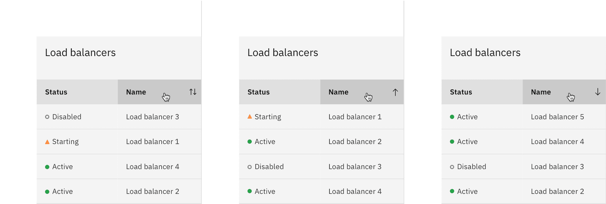
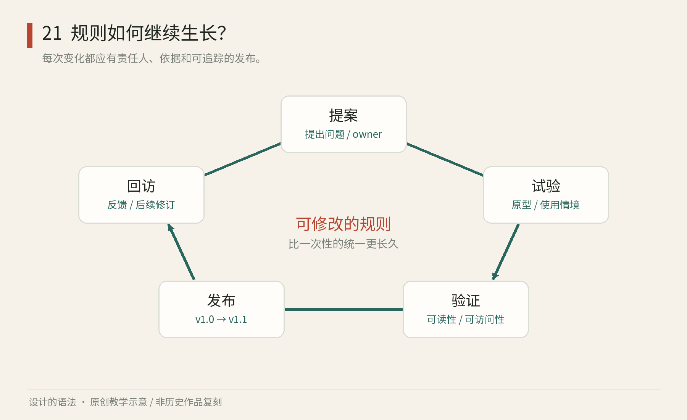

# 第21章｜让系统继续工作：贡献、版本与判断责任

设计手册发布以后，工作并没有结束。新展览需要长标题，旧图标在小尺寸看不清，供应商换纸导致色彩变化，工程师发现日期组件无法处理某种输入。若每个人私下修补，很快便有许多相似而不相容的版本。若任何变化都必须等总设计师批准，系统又会成为堵点。治理讨论的，是怎样让改变有理由、有去处，也有回访。

## 看得见的维护问题：排序以后还剩下什么承诺

<!-- figure-height: 90 -->

图21-2｜IBM Carbon，Data Table排序图板，读取于2026年10月。© IBM，研究引图。三幅保留相同字段和行式，比较标题处的排序线索与记录顺序。[官方图板所在页](https://www.carbondesignsystem.com/building-blocks/core/components/data-table/guidelines)

请按左、中、右看这三张紧凑表格。相同的列标题下，记录顺序改变；列标题旁的小箭头让用户有机会知道当前按什么排序。表的身份仍然稳定，变化发生在任务状态，而不是整张表突然换一种画法。这个很小的视觉变化，却需要设计系统承诺许多事：箭头指哪种顺序、再次激活会怎样、当前排序如何向辅助技术表达、翻页后顺序是否保留。

现在设想团队要把“可排序列”从鼠标悬停时才提示，改成始终显示。页面可能只是多了几枚图标，但信息密集表格会增加视觉噪声，已有用户也可能把新图标误认成当前排序状态。设计变更说明不能只写“增强可发现性”；应标出改了哪些状态，为什么相信增加的可发现性值得这个代价，并列出实际需检查的任务。

本书建议拿图中的同一数据做一个小型回归样本：默认顺序、升序、降序各一份；加入重复名称、空值和较长名称各一例。这些例子不替代工程测试，却能暴露设计说明是否遗漏边界。相同名称在排序后是否保持可预测顺序？空值放哪里？列标题很长时，箭头会不会被挤到下一行？这些问题有些属于产品数据，有些属于通用部件，维护者需要明确分工。

若只保存一张“最终排序表”截图，后续成员无法知道哪种状态被删掉了。更有用的发布物包含：改变前后的小图、触发变化的操作、应保留的字段关系、需要更新的实现与文档。图板由此成为协作中的测试证据，而不只是营销图片。

练习：给一个六条记录的借书表补一份变更说明。原版不能排序，新版允许按书名排序。请写给设计师、工程师和内容维护者各一句行动要求。再把新版名称改为“按归还日期排序”，检查你刚写的要求是否仍成立。你会发现复用的是说明结构，具体语义仍需逐项确认。

同一方法也能用于印刷：把导视字号放大后，应检查长地名、箭头、安装边界和旧标牌替换；把插画线宽加粗后，应检查细节是否粘连、已有场景是否还成立。治理的学习价值，就在于把“改得更好”拆成别人可以观察、执行和回查的改变。

## 先收集真实困难，再决定增加什么

GOV.UK 的贡献标准要求新组件或模式能证明有用，并且不是简单重复已有内容；发布前还要考虑可用、一致与适应不同服务的能力。[资料：GDS，Contribution Criteria](https://design-system.service.gov.uk/community/contribution-criteria/)。可以把它转化为日常工作的三个问题：这是反复出现的困难吗？已有规则为何解决不了？新方法是否只是把一个项目的特殊偏好推广给所有人？

以下是本书建议的轻量流程，适合小型视觉团队，也能扩展到数字产品。提案先说明问题和证据；试验只进入少量实际场景；验证检查可用、制作与兼容；发布给出版本、使用说明和迁移方法；回访记录新问题。负责此事的人可以很少，但不能没有明确责任。

图21　原创教学图。提案、试验、验证、发布、回访形成循环；每次改变记录责任人与版本。它是一套可采用的教学流程，不是强制的行业标准。

例如，展馆志愿者连续发现读者把“工作坊”误认成“展厅”。设计师不能只说“换个更漂亮的图标”。需要比较现场照片、告示位置、文字大小与读者口述：问题也许来自词语，也许来自箭头与房间编号关系。若只增加新图标，可能把真正的问题藏起来。

实用的提案可以只有一页：发生了什么、谁受影响、在哪些条件下出现、尝试了什么、建议改哪条规则、由谁验证。这样争论便有了共同对象，而不是两个人轮流表达品味。

## 版本记录的是承诺，不只是日期

一份规范至少应让使用者知道：它是现行版还是旧版，哪些部分已验证，谁负责回答问题。对正在试验的内容，可以明确标记适用范围，不必为了显得权威而假装一切成熟。美国联邦的 USWDS 以组件生命周期说明新组件进入系统及适用信心的变化，提供了可参考的公开实践。[资料：USWDS，Component Lifecycle](https://designsystem.digital.gov/components/lifecycle/)。

视觉资产的版本可以采用简单的编号与变更说明。第一次改正错字，与改变所有导视编号的含义，影响完全不同。前者通常可以就地更新；后者需要替换计划、现场核对和旧材料处理。记录中应说明使用者要做什么，而不仅写“优化视觉体验”。

代码包常采用语义化版本。SemVer 2.0.0 以公开接口的兼容性区分主要、次要与修订版本的变化。[资料：Semantic Versioning 2.0.0](https://semver.org/lang/zh-CN/spec/v2.0.0.html)。不要把这个规则不加解释地套到所有艺术项目；但它提醒设计师，版本大小应与使用者受到的影响联系起来，而不只是与自己花了多少时间有关。

具体到视觉系统，一个字号变化可能没有改任何代码接口，却让十种语言的按钮溢出；一个图标轮廓变化可能不影响布局，却改变人们对功能的理解。因此数字版本之外，仍要写清视觉与行为影响。形式上兼容，不保证体验上没有变化。

## 怎样验证：让证据对应问题

图像比较可以发现边距意外变化，不能证明读者理解了内容；对比度检查能发现一部分配对问题，不能证明完整流程可访问。W3C 的评估概览明确说明，没有单一工具可以独自判断网站是否符合可访问性标准。[资料：W3C WAI，Evaluating Web Accessibility Overview](https://www.w3.org/WAI/test-evaluate/)。

因此，测试不应只是一个勾选框。先写清问题，再选择方法：想知道导视远处能否读，用实际距离和现场光线试；想知道画册翻阅是否顺畅，拿装订或折页样本试；想知道组件在键盘下是否成立，用可操作实现试；想知道文字是否令人误解，让读者复述任务与结果。模拟可以筛掉明显错误，但与真实使用仍有差距。

观察时也要区分失败来源。一位读者找不到入口，可能因为字小、命名含糊、地图方向错误，也可能因为告示被花盆遮住。系统设计无法控制所有现场条件，但可以记录安装规则、最小净空和巡检方法，让视觉规范与使用环境连接起来。

修订以后，用相同任务、相似条件再看一次。假如换字后读者依然迷路，就不能把“已更新字体”写成问题解决。设计反馈闭环的核心，是检查原先困难有没有减少，而非证明团队确实忙过。

## AI 可以提案，谁来承担判断

生成工具适合帮助扩展草图、模拟材料或提出配色候选。规则明确时，也可帮助找出未命名的颜色、缺失的状态说明、重复而冲突的用法。但输出仍需要与真实条件核对。生成一张漂亮的车站照片，不能证明标牌尺寸、安装安全或现场可读；生成一个界面，也不能证明它具备正确的操作语义。

可以把 AI 的角色写得具体一些：“依据已经批准的弧线母题提出六种海报构图；日期、场地、票务信息作为人工核对层；不得把生成图当成真实历史作品。”比一句“使用 AI 提升效率”更容易执行。规则中还应保留素材出处、授权与生成记录，防止来源在多轮编辑后丢失。

做一张自己的维护卡：当前规则、已知例外、下次验证条件、责任人、日期、变更理由。即使你独自创作，也可以把“未来的自己”当作接手者。半年后重新打开项目，知道哪些决定有依据、哪些只是临时尝试，便已经获得了系统的实际收益。

例外也需要被看见。一个大型场馆可能允许纪念展采用独特的标题字，但继续遵守导视编号与无障碍要求；一个数字产品可能允许宣传页使用更丰富的图像，却仍沿用表单与错误处理。这样的局部自由能让系统适应真实工作。危险的是例外被悄悄复制成新常规，最后没有人知道究竟遵循哪一套。

可以给例外写明范围、原因和期限：只用于某次宣传、为了与指定艺术家合作、活动结束后复盘。若类似例外连续出现，便值得检查基础规则是否过窄；若仅一次出现，就不必急着把它升格为全局选项。治理的工作并非消灭所有差异，而是让差异具有可理解的出处。

也不必靠“组件采用率最高”证明系统成功。团队可能使用了所有规定部件，用户依然无法完成任务；也可能只采用少量规则，却显著减少了错印和返工。适合小项目的指标可以很朴素：改一次日期要找多少文件、几种媒介还存在旧名称、读者在什么地方停住、修订后是否改善。让度量回答原来的问题，比追求一个漂亮数字更可靠。

给变更说明做个最短模板：“原先怎样；现在怎样；为什么改；谁需行动；怎样检查。”例如改区域名称时，应列出纸面告示、预约页与志愿者手册，而不是只更新源文件。发布不是把文件放出去的那一刻，而是接手者有能力正确使用新决定。

本章资料：GDS，Contribution Criteria；USWDS，Component Lifecycle；Semantic Versioning 2.0.0；W3C WAI，Evaluating Web Accessibility Overview。链接见正文，核对于2026年10月。维护卡、流程及AI分工为本书原创建议。
