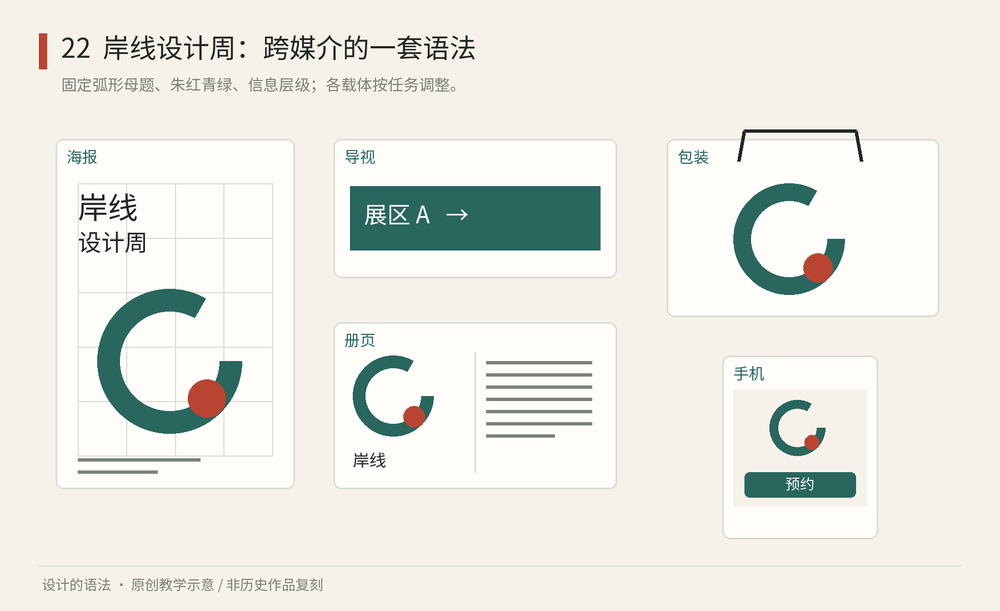
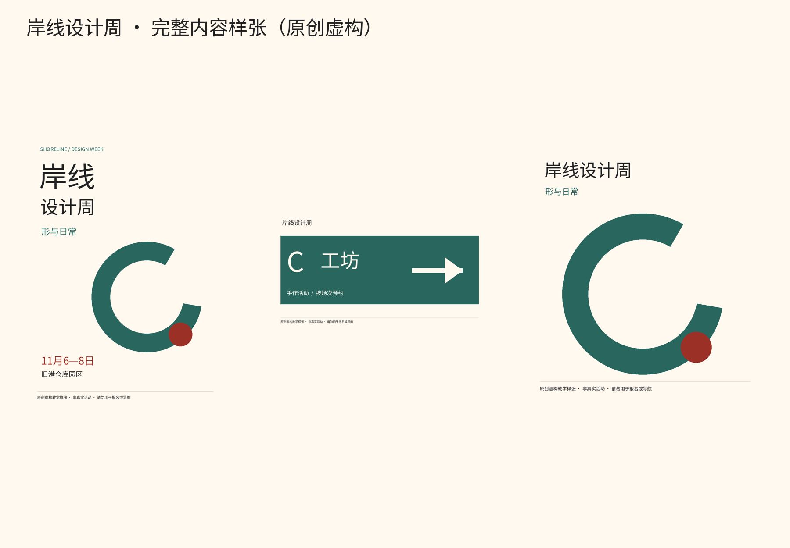
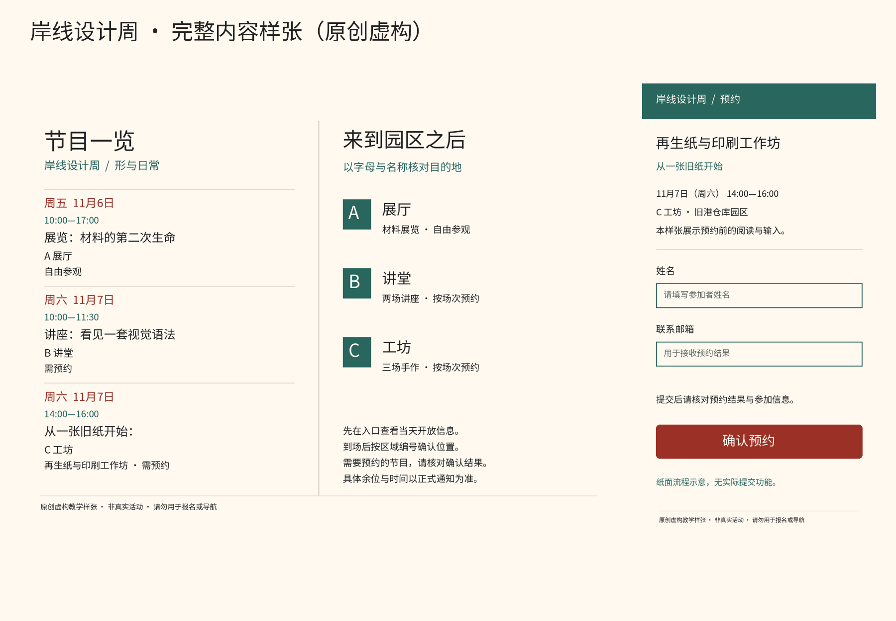

# 第22章｜完整练习：为“岸线设计周”建立一套系统

这一章把前面的观察转成一次可以动手完成的工作。岸线设计周是本书虚构的三日活动：包含一场展览、两场讲座和三场手作工作坊，场地分布在同一园区。你要做的不是一张最漂亮的海报，而是一家人看得出彼此关联、实际用途又各自成立的作品：海报、册页、导视、纸袋与手机预约页。

以下名称、内容、规则与测试记录均为原创教学示例，不对应真实活动，也不声称已经做过实地用户研究。读者可以用纸笔完成第一轮；熟悉软件后再移入矢量、排版与界面工具。

## 第一步：把任务写成能检查的条件

先写一句目标：让第一次来的观众容易识别活动、找到地点，并完成参与所需的行动。“清新、现代、有艺术气息”可以是情绪方向，却不足以判断导视是否成功。把任务进一步拆开：海报需要让人知道活动、日期和地点；册页需要查节目；导视需要在决策点指路；纸袋承载识别；手机页需要解释场次、名额和预约结果。

准备真实长度的示例内容：活动名“岸线设计周”；主题“形与日常”；日期“11月6—8日”（虚构日期，不代表公开活动）；地点“旧港仓库园区”；三个区域为“A 展厅”“B 讲堂”“C 工坊”。加上一条较长节目名“从一张旧纸开始：再生纸与印刷工作坊”，用来测试系统是否只适合短标题。

写出三项优先级：行动信息比装饰更重要；区域名称与编号跨媒介一致；有限制作预算下，允许单色复制。它们将在发生冲突时帮助你决定。若大弧线挡住日期，不是讨论哪个更有艺术感，而是优先把日期恢复清楚。

接着列出限制。纸上版本先采用常见尺寸：A3海报、A4对折册页、A4导视样张、普通纸袋贴纸。手机页先用一张窄竖纸模拟。所有尺寸只是练习起点；实际制作应按印厂、安装距离与设备情况重新确认。不要因为本章用了某个毫米数，就把它当成环境导视规范。

## 第二步：建立少量规则，并说明为什么

将岸线理解为两种介面相遇的边界。选一个简单弧线作为母题：它可以裁切、重复与改变尺度，但不随意加成海浪插画。基础色是暖白、墨黑，朱红用于活动强调，青绿用于区域辅助；区域识别同时保留A、B、C字母与名称，不依赖颜色。

建立四列网格。每个版面内部先画出边距，再把可用宽度分为四列，列与列之间留同等空隙。标题可占四列，图像可占两列或四列，辅助信息可占一列或两列。四列不是美感公式，而是一个便于在大小版面之间拆分重组的教学单位。折页的中缝另留安全空间，不能把连续网格直接当成装订容差。

设三层文字：活动名最醒目；日期、区域、节目名为第二层；解释与详情为第三层。对同一媒介，三层要能通过大小、字重、位置形成区别；跨媒介不强求字号数值相同。海报的第一层需要远观，册页的第三层需要持续阅读，使用条件不同。

| 保持的关系 | 允许改变的实现 | 为什么 |
| --- | --- | --- |
| 弧线母题与清楚文字区 | 弧线尺度、裁切与方向 | 有识别，也有变化 |
| 三层信息优先级 | 不同媒介的实际字号 | 观看距离不同 |
| A/B/C区域命名 | 横排、竖排与换行 | 让空间信息能迁移 |
| 主要行动有明确动词 | 按钮宽度、排版位置 | 内容可能变长 |
| 深浅背景成对选字色 | 不同模式的颜色数值 | 保持可读性 |

现在画五种弧线构图缩略图，再选两种继续。选择理由要具体：一种给长标题留出了完整区域；一种在纸袋侧面被折叠后仍能辨认。把只适合正方形画布的第三种留下作为失败记录。它不是白画，而是在告诉你系统边界。

图22　原创教学图。海报、册页、导视、包装与手机共享弧线、色彩角色和四列关系，分别调整信息量与比例。这是虚构活动的教学系统，不是实际活动成品或可直接施工的图纸。

## 第三步：依次完成五个用途

先做海报。把活动名放在上方清楚区，日期与地点放在容易一起读的位置，弧线进入中下部。不要在所有文字背后铺纹理；先保证最简版本成立，再试图案。站远一些，能否在不读小字的情况下辨认活动名、日期和地点？如果弧线首先被记住，活动信息却找不到，调整主次而不是继续加说明。

再做册页。A4对折形成四个阅读面：封面识别、内页节目、另一内页园区与参与说明、封底联系与必要补充。把节目按日或区域组织，择一作为主顺序，不要两种分组反复交替。每条节目保持名称、时间、区域、是否预约的顺序。长节目名允许两行，不能只为等高而缩成难读小字。地图附近重复A/B/C完整区域名，让读者不必来回找图例。

第三做导视。只放当前位置需要的方向、目标区域及必要确认信息。A展厅的完整节目单不必堆在入口箭头旁；它适合放在到达后的信息板。画一个大箭头、一个区域编号与名称，再加入小型活动识别。用同学或家人站在你预想的阅读距离上试读。若标牌放在转弯之后，文字再大也可能错过决策点，这时应改位置。

第四做纸袋。保留活动名和弧线即可，不必复制海报全部内容。把贴纸先折到真实纸袋上，看看提手孔、折边和底部是否切断关键信息。若预算只有黑白打印，改用墨色轮廓和空白关系，保留母题与层级；不要把朱红与青绿直接转成几乎相同的灰，导致原本区别消失。包装的系统性体现在选择什么保留，也体现在敢于删去什么。

最后做手机预约页。先写内容顺序：活动与场次、时间地点、余位或满额、必要输入、确认、结果与修改方法。桌面册页里的多列节目到手机里可改为连续条目。主要按钮用“确认预约”，不只写“确定”。再画提交中、失败与成功三张状态卡。成功卡应说明预约了哪场、何时何地参加，而不只是出现一个大勾。

这五种作品可以使用不同工具：矢量工具处理母题与海报，排版工具处理册页，界面工具处理手机流程，简单代码承接语义颜色与组件。文件之间传递的应是规则和已核对的内容；不要期待把同一张海报自动缩放五次，就能替代五种设计工作。

图22-2｜原创可复现样张：同一弧形与色彩角色进入海报、导视和纸袋图形。海报保留日期地点，导视只保留当前区域与方向，纸袋省去不必要的活动细节。均为虚构练习，不是实际安装或报名材料。

图22-3｜原创可复现样张：册页按日查节目，手机页按单一工作坊组织输入。完整尺寸PNG及配色文件在 `examples/`；运行 `python scripts/build_examples.py` 可重绘。图中为虚构节选节目表，手机无提交功能；其他交互状态需结合第二十章继续设计。

## 第四步：制造反例，验证后修订

做三张故意失败的版本。第一张把日期也铺进弧线纹样，检验信息是否被图案吞没；第二张导视只用朱红、青绿、墨黑区分区域而不写字母，检验失去颜色线索时能否找路；第三张手机卡片强制固定高度，检验长节目名是否溢出。反例要只改少量变量，才能说明是哪条规则在发挥作用。

然后做一次小型试读。让两三位没有参与设计的人分别完成：找出周六活动日期和地点；在节目里找到长名称工作坊及其区域；根据导视选择通往C工坊的方向；在纸面手机流程上说出预约失败后如何继续。这只是发现问题的低成本练习，样本很小，不应宣称具有普遍统计结论。

记录“在哪里停住、读成什么、怎样操作”，不要只问喜不喜欢。你可以使用下表作为记录格式；其中的现象与修订为假设示例，实际练习应换成自己的观察。

| 假设观察到的困难 | 可能原因 | 下一次只先改什么 |
| --- | --- | --- |
| 找到活动名，却找不到日期 | 日期与装饰混合 | 给日期完整文字区 |
| 把B讲堂当成C工坊 | 名称不完整、色差不足 | 补齐编号与区域名 |
| 长节目名被截断 | 固定高度优先于内容 | 允许条目增高 |
| 失败后以为已预约成功 | 反馈文字模糊 | 明确失败与重试入口 |

把修订写成新规则，而不是只修一张图：“所有活动日期使用清楚的独立文字区”“区域出现时同时写编号与名称”“节目条目允许随内容增高”。这时，一次观察开始产生可复用的知识。若新规则在其他媒介造成冲突，说明适用范围，例如日期独立区主要用于宣传与查询场景，不必把它强加给不含日期的纸袋。

完成包里应保留：一页规则、五种应用、三张反例、原始内容、试读记录与修订说明。你可以把它命名为0.1练习版，并注明还未经过真实制作和现场验证。设计系统的第一轮不必庞大，但应该能解释：为什么这些作品属于同一家，为什么它们又必须有所不同，以及下一次如何有依据地改变。

本章为原创完整教学案例。关于数字文字对比度、交互语义和测试边界的事实依据，见第19章的[W3C对比度说明](https://www.w3.org/WAI/WCAG22/Understanding/contrast-minimum.html)、第20章的[按钮模式](https://www.w3.org/WAI/ARIA/apg/patterns/button/)及第21章的[评估概览](https://www.w3.org/WAI/test-evaluate/)。这些数字资源不替代印刷打样、现场导视试读与实际制作要求。

## 继续进入实际创作

岸线练习帮助理解规则与反例。第三十一章把这种思路做成三套原生项目：折光海报与提案、野序封面与跨页、隙间广告包装与电商，包含实际生图素材、Tingly Design可编辑画布与自建设计系统，可以从看懂继续走到修改。
