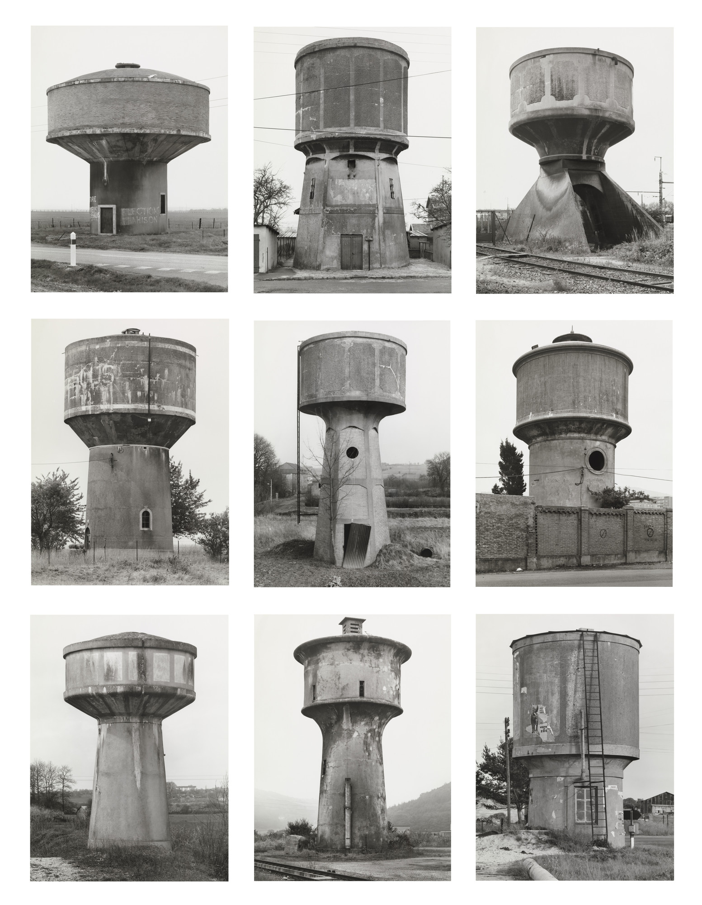
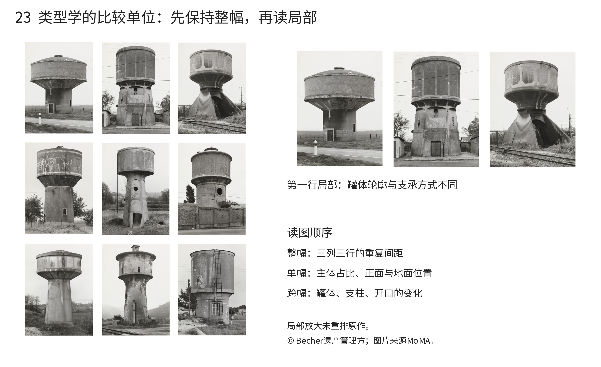
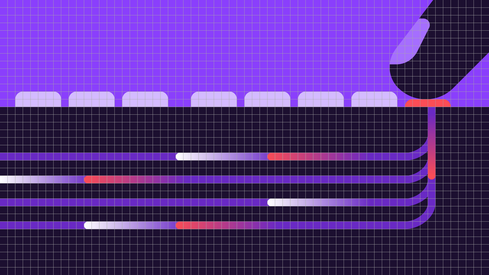

# 第23章｜插画与摄影：怎样让差异被看见

一组照片可以被相同滤镜“染成一套”，却仍然难以比较；一组插画可以不用同一个题材，却让人认出共同的语言。本章从两类真实材料出发：Becher夫妇的九幅水塔摄影，以及IBM的平面插画与其网格图。我们逐项检查主体占比、轮廓、负空间和细节怎样被控制，再把这些决定用在自己的拍摄和绘画中。

## 九座水塔：同一个问题，九个不同答案

<!-- figure-height: 145 -->

图23-2｜Bernd Becher、Hilla Becher，《Water Towers》，1988，银盐照片，MoMA，藏品号254.1996.a-i。© 2026 Estate of Bernd Becher and Hilla Becher。馆藏原图研究引用，不声明为CC。[MoMA原作页](https://www.moma.org/collection/works/49624)

请先把整幅缩到一臂远：三列三行，塔身在每个单元里占相近的主要位置，照片间留出清楚的白缝，明暗以黑白为共同条件。你的眼睛因此很容易在“这是同类东西”和“每座塔又不相同”之间来回。这里的留白并非九次独立的装裱剩余，而是组织比较的间隔；如果删去白缝，让不同天空直接相接，单幅边界就不再这样明确。

再看第一行的左、中、右。左边的罐体横向展开，支承较粗；中间罐体较高，下面露出较细的支架；右边罐体下方的承托形态又不相同。你可以先只比较罐体，再比较支承，最后看开口和地面环境。分三遍看，比试图一次理解每座建筑的全部结构容易得多。这套读图顺序是本书的观察练习，不是馆方对每座塔的工程鉴定。

MoMA的作品说明将它们作为按功能组织的类型学，并指出正面呈现和较均匀的背景有助比较。这里学习的，不是“工业建筑配黑白就高级”，而是拍摄条件怎样降低无关差异的声音。[馆方说明](https://www.moma.org/collection/works/49624)。真实照片仍有树木、墙、天空明暗等差异；摄影协议并没有把世界变成实验室，而是在具体条件下尽量让建筑形态成为主角。

图23-3｜本书对同一作品的全幅／局部读图板，未重排九幅原作。局部用于辨认罐体、支承和主体占比。原图权利同图23-2。

现在做一个有意义的反问：如果其中一张改为仰拍、晴天、高反差，画面也许更戏剧化，却会突然吸引过多注意。观众看到的区别可能首先来自拍法，而不是水塔。这不是说仰拍不能好看，而是它改变了系列在回答的问题。你可以用这种异常作为转折，但应知道它让比较从对象转向了观看位置。

可直接迁移的方法是先写“我希望别人比较什么”。如果拍六只杯子，答案是杯口、把手和比例，就先固定相机高度、拍摄方向与背景；如果拍同一个房间的一天，答案是光线变化，就固定机位、允许时间改变。设计系统由问题产生，固定项与变化项必须相互配合。

## IBM平面插画：亲缘关系藏在几何和间隙里

<!-- figure-height: 90 -->

图23-4｜IBM Design Language，Flat Style官方示例1，读取于2026年10月。© IBM，研究引图。保留其紫、深紫与红色原配色。[官方图板与规范](https://www.ibm.com/design/language/illustration/flat-style/design/)

先看这张图的上半部：一排浅紫色圆角小块站在深色水平界面上，右上方有一个斜向进入的大形状。它们没有画出很多真实表面细节，但水平重复与斜向动作已经形成事件。再看下方，几条平行路径在右侧以相近的圆弧转向；红色、白色和紫色段沿路径出现，成为节奏节点。图像依靠轮廓、色块与路径关系组织，而不依赖木纹、反光或丰富阴影来说明每件东西。

请用手遮住红色短段，观察整个画面是否变得更静；再遮住右上大形状，观察斜向力是否减弱。这两次遮挡分别检验强调色与方向变化的作用。同样的紫色可以铺背景，也可以进入路径，但它们与深色块的边界关系不同，因此承担了不同视觉任务。不能简单归结为“IBM插画就是紫色”。

图23-5｜IBM，Flat Style同一示例的网格图，© IBM。它与图23-4展示同一构图，供直接对照；网格为官方说明的一部分，不是本书事后猜测出的原图算法。[同源官方页](https://www.ibm.com/design/language/illustration/flat-style/design/)

网格图让一个重要关系显现出来：平行路径之间的空隙、路径宽度与转弯不是互不相关的自由曲线，交界位置受共同尺度组织。官网为这个平面插画方法给出8px基础网格及最小形状、间隙的说明；这是IBM该风格的具体约定，不是所有插画的通用定律。学习时可把它理解为“让细节密度与轮廓语言有共同下限”。

你能从这两张图学到一个很具体的操作：先画大形状、决定空隙，再加需要的局部变化。若一开始到处画细线，最后才统一线宽，可能已经让结构陷入不相容的细节层级。几何基础并不意味着不能画人物或有机形，关键在于有机变化进入哪里，以及它与已有构图是否发生清楚的联系。

假设要画一张“修理台灯”的说明插画。可以先限定三类形状：灯罩用圆弧，支臂用矩形，人手用简化曲线；只让要操作的螺丝位置获得强调色。你借用了减少细节、控制空隙与突出行动的方法，没有必要把它重新染成IBM的紫色，也没有必要复制这张图的路径构图。

## 把“风格指南”写成可画的动作

一份能使用的插画说明，应让另一位画者知道怎样开始。与其写“现代、友好、富有科技感”，可以写：“主体先用三到五个大块面概括；内部细节仅保留与动作相关的部分；形状相接时，要么明确重叠，要么留出可辨认空隙；强调色只提示本图的关键工具。”这些规则仍需样本验证，但至少可以执行、比较和修改。

先选一简单一复杂两个任务：一把剪刀与两人共同修椅子。简单样本验证曲线、颜色与细节下限；复杂样本验证遮挡、接触和人物动作。若规则只能让剪刀好看，两人场景却充满含糊连接，就应改进规则或明确另一类绘法，不能只把复杂场景交给运气。

人物与物体接触是常见检验点。手到底握住哪一处、工具朝哪个方向、椅脚落在哪里，应能从图里找到证据。一个“成套滤镜”无法修复这些关系。用生成式工具做草图时同样要检查这一层；来源、输入、选图理由与修订记录要与图片一起保存。

摄影指南也应如此具体。“自然光”太宽泛，可以改成“窗口在主体左前侧、背景不出现其他器物、主体长边约占画面三分之二”。这不是永远正确的构图，而是一份让同组图片可比较的起点。遇到透明物或高反光物时，也应记录哪个条件需要另做调整。

## 一次有结果的练习：六张图，一条被打破的规则

选六件同类日常物品，用手机拍摄。第一轮规定三件事：固定高度、统一背景、让主体占比接近。不要急着换滤镜；先并排检查这些条件是否真的做到了。挑三张记录你能直接比较的差异，例如杯口曲率、把手连接和底部宽度。

第二轮只重拍其中一件，改变一个条件：向上仰拍，或把光改到正后方。让另一人找出异常，并问他异常首先改变了对物体什么的判断。记录“觉得不同”是不够的，尽量说清是变高、变大、变薄、材质变亮，还是只是背景更醒目。这样的语言会让你之后的图片选择更准确。

插画练习可以借用同样步骤：画三个不同器物，保留相近的细节层级与空隙；第四张故意把细节画得极密。把四张缩到实际使用大小，看哪张先变成难辨的纹理。接着只删去第四张的一半细节，不改颜色，检验问题是否改善。

最后交付一页图像协议：固定什么、允许什么变化、怎样判断、已知例外是什么；附上两张正确样本和一张有解释的反例。你由此建立的是可以继续使用和验证的图像语言。Becher的摄影与IBM的插画有不同目标，但它们共同教会我们：在一组作品里，保持某些条件安静，才有空间听清真正需要表达的变化。

本章来源：MoMA，Bernd and Hilla Becher，《Water Towers》，1988；IBM Design Language，Flat Style官方示例与网格。链接见对应图注。逐图位置分析、遮挡实验与日常物品练习为本书原创教学分析。图像版权与下载记录另见`references/revision-digital-images.json`。
