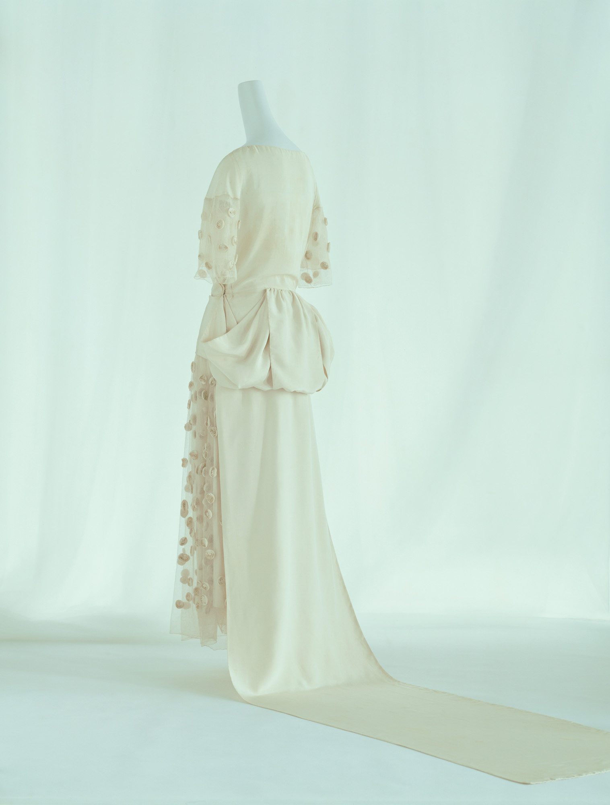
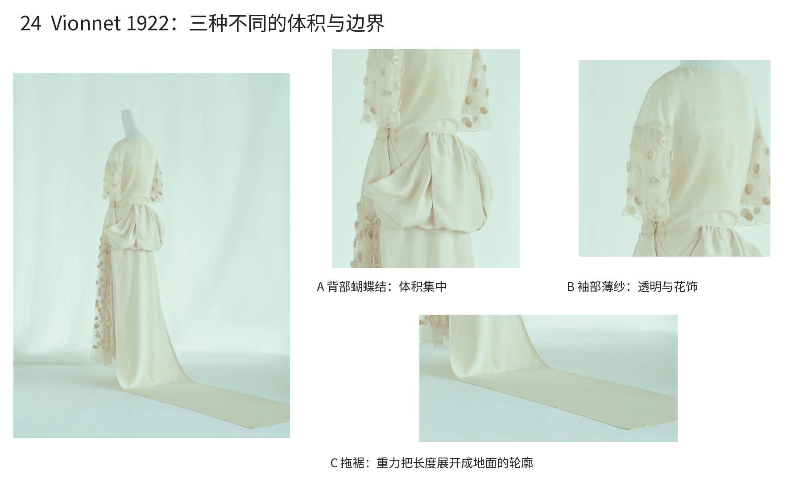
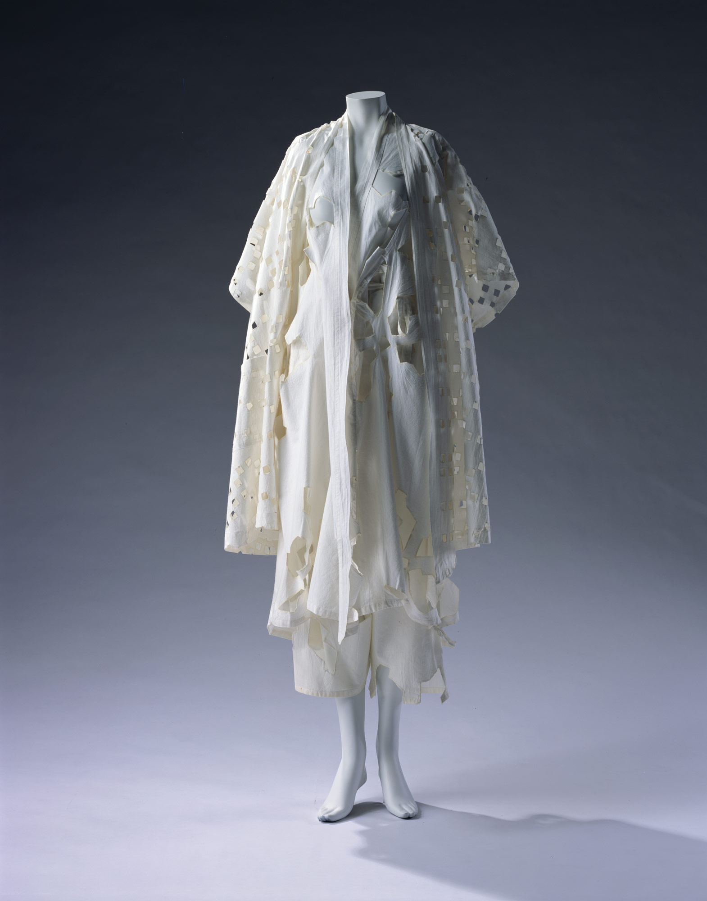

# 第24章｜服装与配饰：布料、身体和空隙的系统

为什么同样是白色长衣，有的显得庄重而平静，有的像被穿着和时间重新塑造？只看颜色无法回答。服装的设计规则会进入裁片、接缝、垂坠、开口和动作。本章并置两件KCI馆藏：Vionnet的1922年婚礼服，与山本耀司1983年春夏的上衣、连衣裙与长裤组合。两者均以浅色和较宽松形态出现，差异却十分具体，适合学习怎样把“喜欢一种气质”拆成可观察的决定。

## Vionnet婚礼服：平静的大面，集中的体积

<!-- figure-height: 145 -->

图24-2｜Madeleine Vionnet，《Wedding Dress》，1922，白色丝织物与薄纱，KCI，AC7007 91-15-3A。© The Kyoto Costume Institute，photo by Richard Haughton。研究引图，保留摄影原色。[KCI原作页](https://www.kci.or.jp/en/archives/digital_archives/1920s/KCI_313)

先看肩部到背部的大面：没有靠密集装饰把每一处填满，身体轮廓也没有被强烈收腰重新划出。视线因此沿光滑的浅色面往下滑，到了背部蝴蝶结处才遇到一团明显凸出的体积。接着往下，裙身转为长而连续的垂向区域，最后在地面展开为拖裾。整件衣服的节奏，可以读成“安静—集中—延长”，而不是每个部位同样精彩。

KCI说明其裁片以矩形组织，并将后部蝴蝶结与和服腰带的效果联系起来。这个具体馆藏依据，帮助我们避免把设计者所有作品都简化成“斜裁”。Vionnet以斜裁实践著名，但本件的学习重点是矩形组织、宽松轮廓与局部体积之间的关系。[馆藏说明](https://www.kci.or.jp/en/archives/digital_archives/1920s/KCI_313)

再看袖子和一侧装饰。薄纱透出模特架与后方空间，花朵形装饰提供较小的重复单位；它们和主体丝织物的大面形成质感差别。若把全件都做成同样密度的透明花饰，背部体积和长拖裾就不一定仍然这样醒目。材料和细节的分配，正在支持主次关系。

图24-3｜本书局部读图板：A背部蝴蝶结，B袖部薄纱，C地面拖裾。裁切用于研究，不是纸样复原；原图版权同图24-2。

请把视线停在拖裾接触地面的地方：上半段是垂落的曲线，到地面后转为水平展开。重力与支撑面参与了轮廓。平铺服装效果图往往会忽略这一转换，因此“设计一条长裙”至少需要同时想象站立、行走、坐下和收纳，不能只选一个最美的展示角度。

可以从本件借用的操作，是把体积集中到一个区域，并让其他区域支持它。给一件日常外套设计背部褶量时，先画没有装饰的整体，再试把同样的多余布量放在肩、腰、下摆三个位置，比较哪一种改变了你想改变的轮廓。这里借的是构思方法，不是要求复制婚礼服的样式，也不能从一张馆藏照片推断所有缝份与内部结构。

## 山本耀司1983：空隙也能成为表面语言

<!-- figure-height: 145 -->

图24-4｜Yohji Yamamoto，Jacket, Dress, Pants，1983年春夏，白色平纹棉布、镂空，KCI，AC775593-15B,E及AC898493-42-8。© The Kyoto Costume Institute，photo by Takashi Hatakeyama。研究引图。[KCI原作页](https://www.kci.or.jp/en/archives/digital_archives/1980s/KCI_260)

这件组合请从外轮廓开始：肩与袖向外展开，身体正面存在数条长的垂向边缘，下方又露出不同长度的层次。整体没有靠一条紧贴身体的连续边界解释身形，衣服与身体之间的空间成为形态的一部分。它与前一件同样没有强烈收腰，却通过开襟、层叠与不齐的边缘形成另一种节奏。

再看镂空。右侧袖片和外层有一组较小、接近格状的空洞，正面与下部则有较大、轮廓更不规则的开口。暗背景穿过孔洞，成为图案里最深的颜色；没有额外印上深色纹样，材料的缺席已经画出了形状。KCI明确将这种镂空与精心处理的孔边、直线裁剪及宽大衣形联系起来。读图时应把事实依据与自己的观感分开：我们能看见孔、边与层次，是否耐穿和怎样缝制仍需实物与制作资料。

比较小孔与大孔，会发现重复并不等于完全复制。小孔较密时形成局部纹理，大孔较疏时成为较强的空白事件。若把全件的孔都放大，布面连续性与层叠的辨认方式都会改变；若把孔全部取消，白色层次仍在，但表面里让背景穿入的节奏便消失了。这个关系可以用于其他设计：纸艺、灯罩和包装开窗也会把“缺少一块材料”变成视觉语言，但每种材料有自己的结构限制。

请把图24-2与图24-4并排。第一件的明显体积集中在背部，第二件的变化散布在多条垂边与多种开口；第一件用相对完整的大面衬托装饰，第二件让大面不断被孔洞与层叠中断。你现在已经能用体积位置、连续性与空隙密度比较它们，无须只说“一个优雅、一个先锋”。

这种分析也保留了选择空间。你可能偏爱完整的大面，也可能偏爱被打断的表面；关键是知道在一次具体设计里，要让哪一种关系帮助你表达什么。把“先锋”当作随意破洞的许可证，会遗漏原作对边缘、尺度和整体轮廓的组织。

## 从轮廓到纸样：三种层面不要混淆

廓形是远处看见的整体外轮廓；版型组织布片怎样围绕身体成立；纹样处理表面。三者会相互影响，却不能互相替代。同一轮廓可以有不同裁片，同样裁片换成挺布或软布也可能呈现很不同的体积。效果图证明的是一种视觉意图，不自动证明穿着后的结果。

看Vionnet局部时，我们讨论材料垂落与地面轮廓；看山本耀司时，讨论空洞、边与层叠。若要继续制作，需要新增问题：布纹方向怎样安排、开口如何收边、重量由何处承担、抬手时哪里受拉、清洗后怎样变化。这些问题不是创意的敌人，它们将视觉选择变成能持续工作的物件。

纸上可以先做一个小实验。剪三个同样大小的纸矩形，分别通过折叠、局部聚拢、开孔改变形态，不使用人体尺寸。固定材料、外框和操作次数，把三件摆在相同光线下拍照。观察褶皱在哪形成、开孔是否切断结构、边缘朝哪个方向张开。纸不能准确模拟布，但能帮助你在动手前理解“一个位置改变会牵动其他位置”。

当转向布料时，应先做小样和试身，不从馆藏照片直接估算身体纸样。尤其是装饰物重量、与皮肤接触、走动时遮挡与拉力，静态照片提供不了完整答案。学习设计的一部分，是能明确指出下一阶段需要什么证据。

## 做一组三件，检验规则能否迁移

这次练习不再要求所有物件使用同一种色板。选一件自己的旧衬衫、一只布袋和一张纸上围裙轮廓，只做可逆的纸片模拟。你可以选择两套方向之一：A将体积集中到一处，其余保持连续大面；B保留宽松外形，让不同尺度的开口形成节奏。不要同时把两套所有特征堆上去。

先为三件分别写任务。衬衫涉及身体动作，布袋涉及提拿与折叠，围裙涉及口袋与前方活动。再写同一个保留关系，例如“所有变化集中在上三分之一”，或“小孔密区与大面交替”。同一个关系进入三件物品时，具体位置与数量应该允许调整。

把纸片暂时固定在旧衣和袋上，拍正面、侧面与折叠后三张。不要剪穿实际衣物，也不用购入新面料。标记哪处变形符合预期，哪处在动作或折叠后失去作用；再画一个修订版，只移动一处体积或改变一组空隙。这样的修改有明确可比较条件，比连续画十张互不相同的“灵感图”更能积累能力。

配饰可以作为第四个检验：把同一关系带到一枚纸制胸针。若用A方向，可能只留下一个隆起的轮廓；若用B方向，小孔太细就会难辨，需要减少数量并增大开口。这里没有把衣服图案机械缩小，保留的是视觉关系，重新设计的是尺度与结构。

完成时放在一起看三个问题：远处是否仍能识别轮廓主次；近处是否有清楚的材料和边界关系；使用后是否保留最关键特征。再写三项必须打样才能确认的事项。服装系统的学习价值，不是掌握一种固定的“高级感”，而是能把身体、材料和表达放进同一套可检查的决定中。

本章来源：KCI，Madeleine Vionnet，《Wedding Dress》，1922；KCI，Yohji Yamamoto，Jacket, Dress, Pants，1983春夏。链接见各图注。图像版权保留；局部分析、跨作品比较与纸片练习为本书原创教学。照片不是可直接裁布的尺寸纸样。
