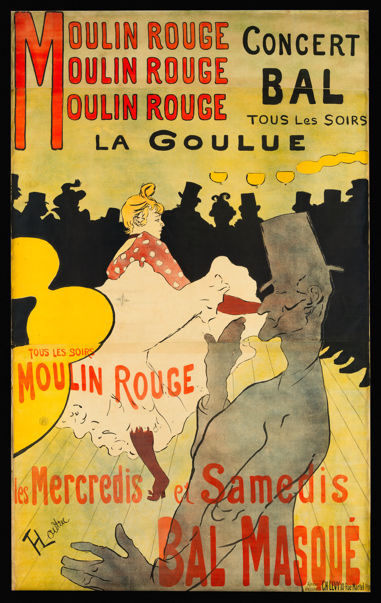
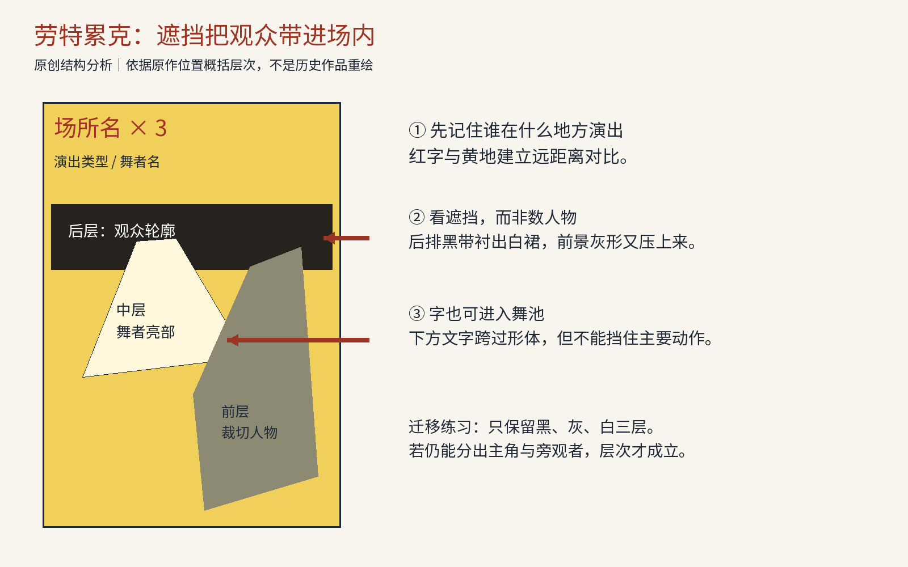
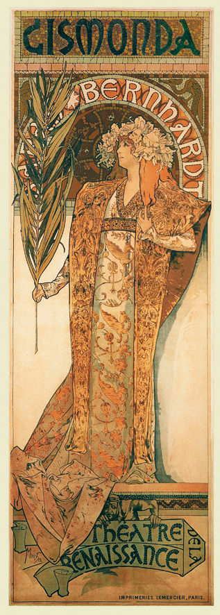
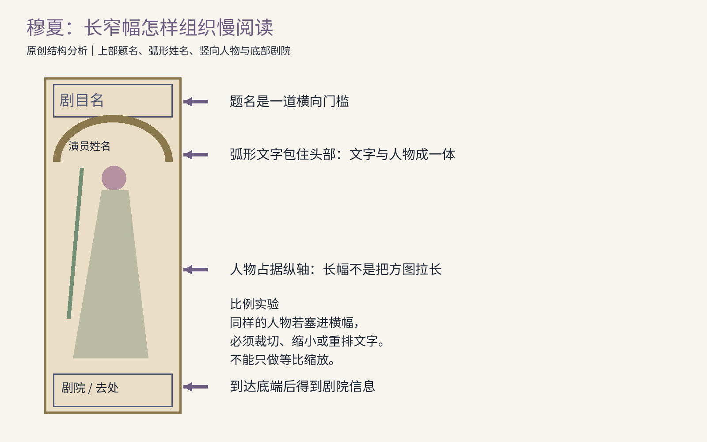
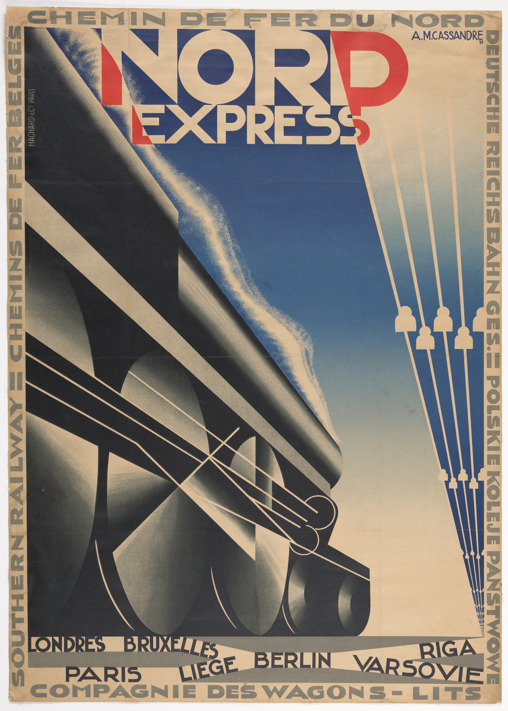
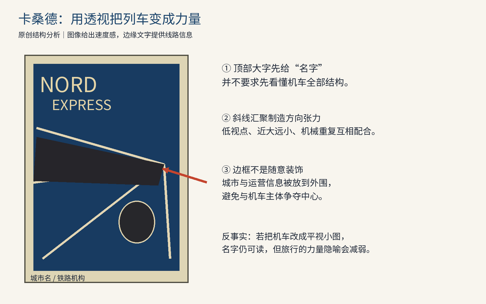
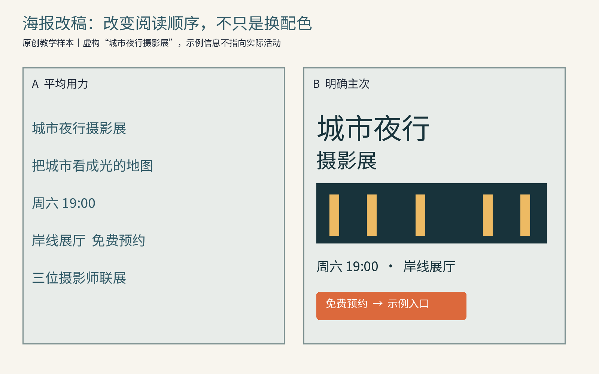
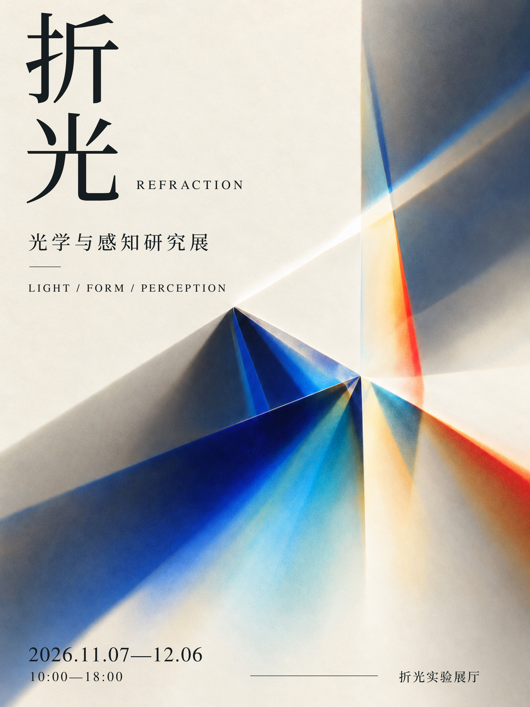

# 第25章 海报、画报与招贴：在公共视野里建立秩序

在美术馆里，人可以走近一件作品，停留十分钟；在街上，一张海报必须先争取被看见。这个差别会改变画面的每一部分：名字多大、人物是否裁切、背景是否复杂、文字能否进入图像，以及观看者怎样知道下一步去哪里。海报设计因而不是把一幅画加上标题，而是在时间、距离、印刷和传播目的之间分配注意力。

本章用三张真实经典作品练习一种读图方法：先辨认画面实际做了什么，再讨论它为什么可能有效。作品年代、媒介和馆藏依据来源；关于视线路径、空间组织与改稿的解释为本书原创分析。这里描述的是可以验证的视觉线索，不声称所有观看者都会依同一顺序移动眼睛。

## 25.1 先分清对象：尺寸、内容与目的不在同一层

“海报”主要描述一种适合展示和传播的平面载体；“招贴”强调张贴这种使用方式，中文语境中二者常有重叠。“画报”可以指以图像为主的报刊，也可在较宽泛用法里指供张挂的印刷图像。若讨论的是《良友》一类出版物，便必须分析封面、内页、期次和编辑结构，不能仅把它当作放大的海报。商业广告则按目的分类：它试图改变对商品、品牌或服务的认识与选择，既可能出现在海报上，也可能占据杂志一页。

| 对象 | 优先解决的问题 | 不应混淆的事 |
| --- | --- | --- |
| 展览或演出海报 | 谁、什么活动、何时何地 | 艺术气氛不能替代活动信息 |
| 商业招贴 | 让某个主张被记住并接近行动 | 看起来有冲击力，不等于主张可信 |
| 以图为主的画报刊物 | 多期内容与图文阅读关系 | 单张封面不能代表整份出版物 |
| 宣传画 | 为特定组织、理念或公共行为服务 | 动员力量需要与伦理代价一起分析 |

不要从“海报就是要一秒看懂”开始。不同触点允许不同阅读：车站远墙需要大轮廓，候车区可容纳细节，剧院橱窗可能面对已经知道演员姓名的人，手机里的活动卡又需要进入报名页面。本书采用三层检查法：远看先能辨认主张或主体；中距离得到名字和类别；走近后得到时间、地点或解释。三层并不一定从上到下排列，却不能互相抵消。

## 25.2 劳特累克：把观看者放进舞池

图25-1｜亨利·德·图卢兹-劳特累克，《Moulin Rouge: La Goulue》，1891，彩色石版画。图像来自大都会艺术博物馆，馆藏记录333990、原图DP-42747-001；Met将该图标为Public Domain。保留原作印刷状态。[原作与馆藏记录](https://www.metmuseum.org/art/collection/search/333990)

先看上方而不是人物。左上巨大红色M与其右侧反复出现的“Moulin Rouge”，让场所名形成一个重音序列。右侧“Concert”“Bal”等黑字提供活动类别，下面的舞者姓名把场所与具体吸引力接起来。这不是一张人物肖像附带几行说明：场所、演出与明星已经在上部组成了一套信息关系。Met记录确认作品创作于1891年；阿尔比的图卢兹-劳特累克博物馆另记述，此张海报由红磨坊经理Zidler委托，用于新演出季宣传。[Met](https://www.metmuseum.org/art/collection/search/333990)；[劳特累克博物馆](https://www.musee-toulouse-lautrec.com/en/collections/masterpieces/Moulin-Rouge-poster/)

再看画面中间横贯的黑带。它由观众的帽子、头部和肩部组成，却没有逐人交代面孔。若逐个画清表情，画面会拥有许多竞争的观看入口；这里将人群压成连续深色形，既提供了“这是热闹的公共场所”的背景，又给中央舞者的浅色裙子让出对比。裙子的大块亮色因此可以先作为形状被发现，再被识别为人物动作。我们学到的不是“把背景涂黑”，而是把次要对象整合成能够衬托主角的视觉整体。

右下的灰色前景人物更加关键。他的身体被边缘裁切，靠近观看者的一部分明显大于远处舞者；灰形又遮住了后面的亮地。于是海报不只是展示一个舞台，而像把读者安排在另一个观众身后，从人群之间向内观看。前景、中景、后景的关系由遮挡和明暗建立，不依赖复杂的建筑透视。你可以拿一张纸把右侧灰形遮起来：画面仍然有舞者，却会少一种“人就在我眼前”的身体距离。

下部红字跨入人物与地面区域，令文字也参与舞池的节奏。这里并没有把全部文案关进独立的白色信息框。字与图像相互穿插，仍尽量避开舞者最关键的轮廓。它允许局部拥挤，代价是部分小字和复杂叠置不适合极小缩略图。将整张原作缩到手机通知图标那么大，舞者亮形与红字可能还在，具体安排已经难读。经典作品不是无条件适配所有媒介的万能模板。

这张海报对受众还有一个假设：场所和舞者的名字有传播价值，夜生活的片段本身足够令人向往。今天给陌生社区组织一场摄影展，照搬人群剪影和夸张裁切，不能自动产生同样吸引力。你应先确定活动最值得记住的是参与者、作品，还是体验；然后再选择谁成为主角。把没有知名度的姓名放得特别大，却不给活动类型，便可能保留了表面布局而丢失沟通功能。

图25-2｜原创结构分析。黑带概括后排观众，亮形概括舞者，灰形概括前景。只说明层次与信息分工，不复刻原作人物画法，也不作为眼动实验结果。

## 25.3 穆夏：让装饰成为建筑，而不是花边

图25-3｜阿尔丰斯·穆夏，《Gismonda》，1894，为莎拉·伯恩哈特演出设计的彩色石版画。题名和年代依据Mucha Foundation；图像采用Mucha Museum商店公开的当代复制品展示图（317×886），用于观察原设计，不是经本书鉴定的十九世纪印件，也不将数字图标为开放许可。请勿把1894年的设计时间与1895年1月4日新演出开幕时间混为一谈。[Mucha Foundation作品记录](https://www.muchafoundation.org/en/gallery/browse-works/object_type/posters/object/21/)；[所用复制品图像来源](https://store.mucha.cz/en/gismonda)

这一张要从比例开始。它的长窄幅使人物成为竖向的主体，题名在顶端，演员姓名弯成弧形，剧院名压在底端。文字不像悬浮字幕，而像围绕人物搭起的建筑：顶部标示入口，拱形限定头部区域，底座提供落脚点。若只提取柔和颜色、花卉和卷曲字体，便会忽略这张作品最有组织力的部分：所有装饰都依附在一个纵向次序上。

基金会将原作记为1894年，并说明它宣传的是1895年1月4日开幕的新演出；人物服饰取自剧中最后一幕的场景。记住这些事实便足够，接下来的教学主要由画面本身展开，不必把传奇式的“临时接单成名”故事当作设计方法。[作品说明](https://www.muchafoundation.org/en/gallery/browse-works/object_type/posters/object/21/)

看看人物头部附近：姓名弧线、头饰、掌枝和衣服纹样相互靠近，却没有都争夺同等尺寸。脸部的细腻轮廓与四周较密的装饰形成节奏差异，较空的面部区域反而容易被看见。这里的“留白”不一定是大片白纸，也可以是同一图像中细节密度较低的地方。读者可以用手遮去底部衣纹，只看头肩：人物身份的舞台化表达仍然成立；再遮去脸部，装饰还漂亮，却失去大部分情感指向。

人物大体站在中轴附近，但画面并不因此呆板。手持的长枝与衣服的下垂线条提供较细的斜向活动，衣摆向边缘展开又打破了硬直的柱形。稳定与变化分工明确：大轮廓稳定，局部线条流动。它启发我们，为一个系列确定固定外框与题名字位后，人物姿态、枝叶和衣褶仍有充足变化空间。系列化不必要求每张图里每根线都一样。

再比较它与上一张海报的观看情绪。劳特累克通过近处遮挡和舞蹈亮形营造现场片段；穆夏则让人物像被安排在一个浅龛中，保留较完整的身体形象，形成庄重、缓慢的观看。两者都是演出宣传，却对“值得来看”的理由提出了不同答案：一个偏向活动气氛，一个偏向明星的舞台形象。这种比较比给二者分别贴上风格标签更有学习价值。

代价也在结构里。长窄幅不容易直接转成横幅广告；主体与装饰的关系如此紧密，裁掉顶部可能破坏题名入口，裁掉底部可能丢失剧院信息。正确转译需要重新建立一个媒介的阅读顺序。例如改成横向网页横幅时，可保留头肩局部，把剧目名移到相邻独立栏，再把时间地点组织为第三层。不能只把原图拉宽，也不能假设人物在所有裁切中都仍代表同一个意思。对读者而言，最有效的练习是给原作画出一个正方形裁切框，逐项记下哪些功能因此消失，然后重新排一次文字。

图25-4｜原创结构图。标示题名、姓名弧、人物纵轴与剧院信息的分工。它分析位置关系；没有声称拱形或花饰具有跨文化通用的固定意义。

## 25.4 卡桑德：一台机车怎样变成旅行的承诺

图25-5｜A. M. Cassandre，《Nord Express》，1927，石版画，MoMA藏，作品号65.1943.22。来源页标注©2026 Mouron AM.Cassandre；本书作为设计评论的研究图引用，未将其标为开放许可。[MoMA原作记录](https://www.moma.org/collection/works/105963/)

《Nord Express》可先读成两件事：一是顶部巨大而坚实的名称，二是斜向切入的机车。名称中的字母不是轻巧说明，而与机车近似地拥有体量。字与机器没有采用同一种形状，却共同表达一种坚决、明确的视觉性格。先读到名字的人会往下看机器，先被机器吸引的人也很容易回到顶端确认这是什么线路；两个入口互相支持。

画面主体不是一台在风景中横向经过的完整火车。它以靠近机车的低视点和强烈缩短处理来强调体积，轮部、车身边缘、细线与杆线互相叠加，把物体推向一个很不日常的观看角度。深蓝与黑色的大块面建立机械的重量，浅色线条又将黑块分成可辨认的结构。把它临摹成只有黑轮廓的剪影，会丢掉不少金属与空间感；把它改成细节均匀的机械说明图，也会丢掉主要方向。

观察那些斜线时，不要只说“很有速度”。具体问题是：哪些线指向相近区域，哪些线与之交叉，哪些重复零件制造近大远小？我们并不需要为这张海报计算一个唯一、精确的透视灭点；海报可以对真实机械做概括甚至夸张。教学上更有用的是承认它用不同线组建立方向压力。下方的圆轮与长斜车身也形成形状对比，令方向与重量同时可见。

外缘与底部的小字给出了另一种信息密度。城市、铁路与服务名称沿画面边界组织，使中心保留给大机器和线路名。边框因而承担了内容，不只是漂亮的边线。在近距离阅读中，它把“令人向往的现代交通”接到具体的线路网络；在远距离观看中，它又退成边缘纹理。这个双重角色解释了为什么某些密集文字可以存在，而不一定令主体杂乱。关键在于把密度放在适当位置，并让它与主要信息有明显级差。[作者、年代、媒介和尺寸据MoMA](https://www.moma.org/collection/works/105963/)

这件作品仍需按传播目的来读。它没有详细解释票价、换乘、延误和乘车条件，而把旅行首先表现成一种技术力量与现代生活经验。因此它适合作为引发兴趣的形象传播，却不能代替今天实际订票的界面。若读者把这套表现移植到火车站紧急疏散标识，强烈透视与装饰字会干扰快速识别；同一项铁路服务在不同触点上应有不同图像策略。

做一次反事实检查：把机车改成小小的平视全景，保留顶部名字与外框小字。你仍有一张完整的铁路海报，却可能失去原作的体量压迫。再把所有外框小字加粗放大，机器会与线路信息争夺视线。两次变化分别告诉我们，海报不是某个单独元素的成功，而是体量、字级、方向和信息位置共同构成的系统。可迁移的规则是“确定一个表达承诺的主视觉，把说明信息置于可接近而不争夺的位置”，不是“交通广告都要画斜着的机器”。

图25-6｜原创分析图。概括斜线方向、大字与边缘信息；为教学简化，不是机车工程图或严格透视测绘。

## 25.5 从看懂到改稿：让一张新海报有可检查的理由

现在做一张虚构的“城市夜行摄影展”海报。必要信息是展览名、活动类别、周六19:00、岸线展厅、免费预约。先不要找字体，也不要问哪种风格高级。写下一句话：让路过者知道这是一场以城市夜景为主题的摄影展，并能找到预约方式。它会成为删减和重排的判断标准。

第一步，把五项信息分成主张、识别、行动三个任务。主张是“城市夜行”，识别是“摄影展”，行动包括时间、地点与预约。第二步，用黑白画三个小草图，只允许一个最大重音；不要让全部文字都同样大。第三步，挑选能说明摄影主题的具体图像。在本书的原创样本中，夜色窗口被概括成明暗块；它只是教学图，不冒充真实参展作品。第四步，加入一个强调色，让它承担预约入口或日期之一，避免同时高亮每个角落。

图25-7｜原创改稿样本。A版文字尺寸相近，读者需自己判断主次；B版把题名、类别与行动区拉开，夜色图像提供主题。示例活动与入口均为虚构。B版仍须在实际尺寸、距离和打印条件下测试。

最后做三个检查。把海报缩小到手掌大小，只看十秒，复述它是哪类活动；如果只记住“很文艺”，主张还不够明确。遮住图片，检查时间地点是否仍能读懂；如果必须猜图意才能行动，信息设计失效。把题名换成另一个长度的展名，看看版面是否立即崩坏；若崩坏，就需给字数范围、换行方式和边距写出规则。这样，一张海报的经验才能发展成一组展览海报的设计系统。

本章真实作品来源：大都会艺术博物馆333990；图卢兹-劳特累克博物馆红磨坊海报说明；Mucha Foundation《Gismonda》作品页；MoMA105963。全部图像的下载地址、归属与处理记录见 `references/revision-posters-ads-images.json`。延伸练习：去一次公交站，分别记录“最先看见什么”“走近才看清什么”“最后仍缺什么”，再判断问题在图像、字级还是信息本身。

## 原创应用：按规则真正做一张海报

从经典学到层级以后，我们为虚构展览“折光”先生成整张AI视觉提案：宋体感中文、纸白表面与蓝青金红光场共同建立入口。随后保留光场构图另生成去字底图，在Tingly Design Canvas中以真实字体重建展名、英文、说明、日期与地点。这里迁移的是层级、观看距离和整体关系，没有复制经典图形。完整AI提案与原生重建各有身份，不能把前者的位图文字冒称为后者的可编辑文字，也不宣称二者逐像素相同。横版邀请、三页提案与真实方向改稿见第三十一章。

图25-C｜本书原创海报原生重建版。去字光场与可编辑文字共同构成设计；完整AI视觉提案见第三十一章，活动、展厅和时间为教学虚构。
