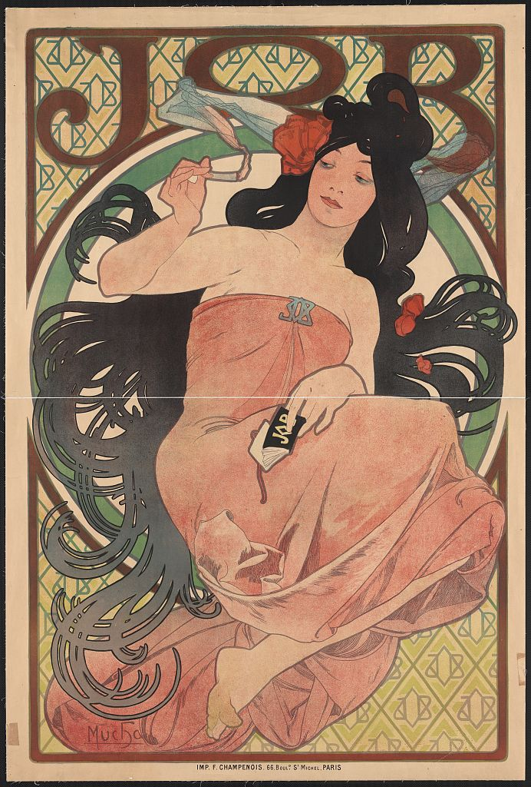
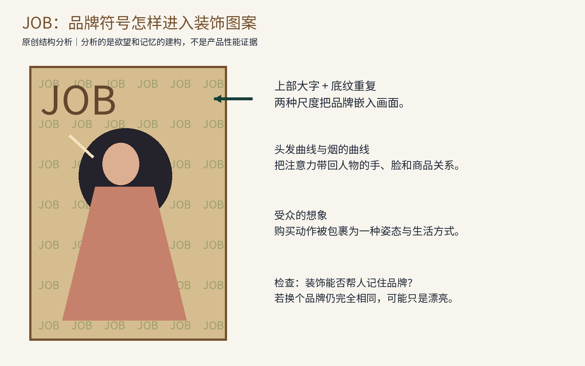
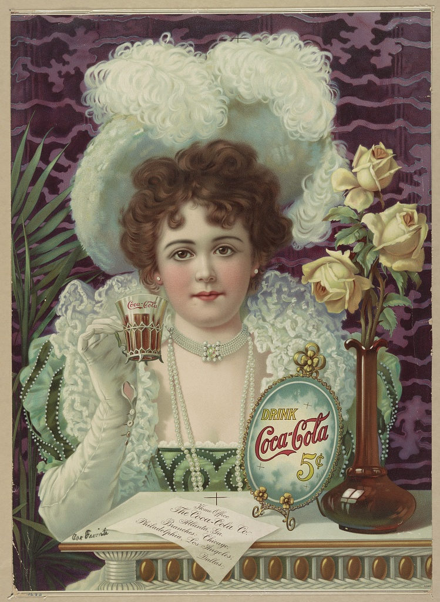
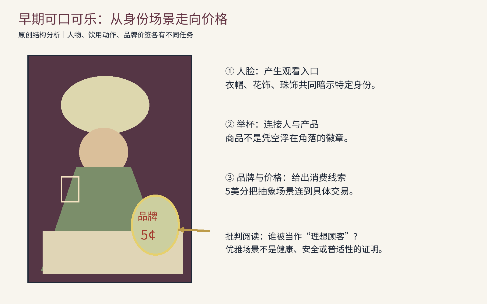
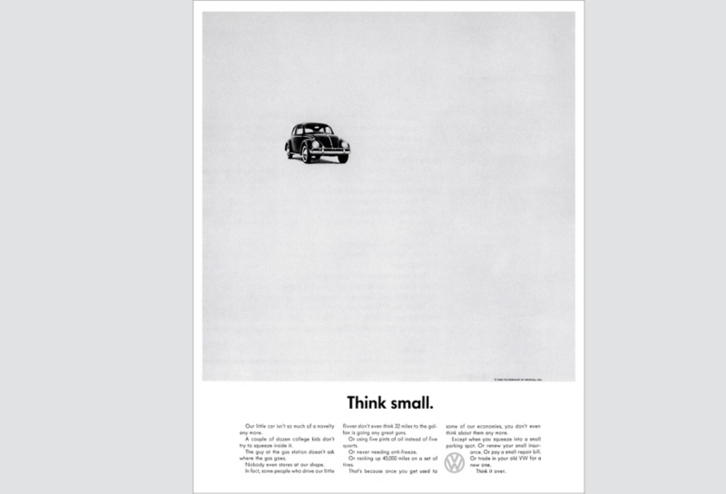
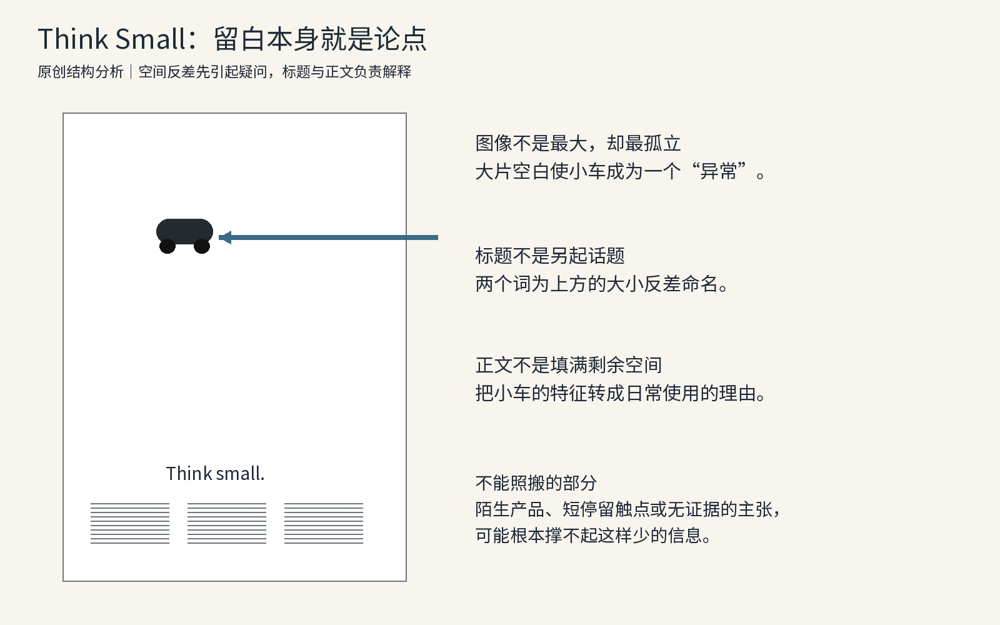
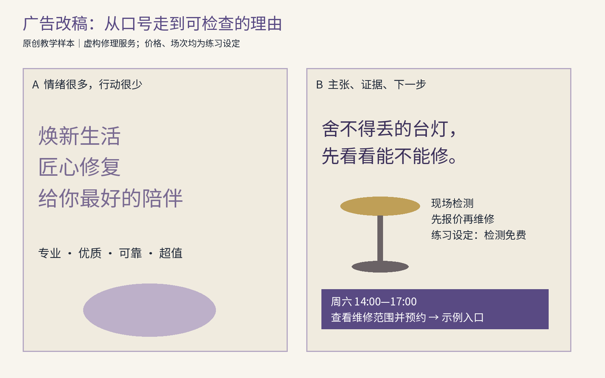
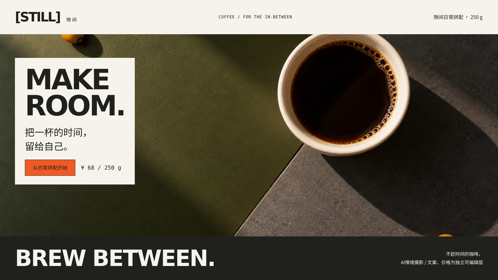

# 第26章 商业广告：让图像、主张与行动形成一套论证

商业广告需要让读者辨认商品或服务、理解承诺的依据，并找到下一步行动。广告系列还要让不同内容保持联系：稳定的识别便于记忆，具体主张说明与受众的关系，证据和行动入口支持选择。颜色与字体只是其中一部分。

本章用三件真实作品，分别观察装饰如何塑造欲望、消费场景如何组织身份与价格、极简布局怎样把产品的限制改写为理由。真实广告的历史信息依据来源；读图、反事实和虚构改稿均为本书原创分析。讨论画面可能产生的作用，不把销售结果归因于某一个视觉细节。

## 26.1 先写论证，再画版式

为“把一盏旧台灯送来检修”做广告，主张可以是“舍不得丢的台灯，先看看能不能修”。证据可能是维修前后照片、检测流程、明确的报价方式；行动则是查看维修范围并预约。如果只写“匠心品质、焕新生活”，读者既不知道能修什么，也无法判断服务是否可信。

这里有五种功能，应该在草图前写清楚。主张说明与读者有什么关系；证据支持主张；标题决定第一句怎么说；品牌识别让读者知道谁在说；行动提示说明接下来如何选择。五项功能在版面中不必占据同等面积。某些品牌广告把长期记忆放在首位，行动较弱；直接促销广告则必须交代价格、期限与入口。没有明显购买按钮，不代表不是广告；有按钮，也不代表论证已经成立。

| 功能 | 可检查的问题 | 常见失败 |
| --- | --- | --- |
| 主张 | 这件事对谁、在何种情境下有价值？ | 谁都适用，因而没有具体意义 |
| 证据 | 哪个事实支持哪个承诺？ | 用漂亮场景代替性能依据 |
| 图文关系 | 图片补充了什么，而非重复了什么？ | 标题谈耐用，图片只展示颜色 |
| 行动提示 | 想继续的人应该做什么？ | 地址、适用范围和步骤都不见了 |
| 系列规则 | 换一则内容后，仍像同一家在说话吗？ | 每张模板一样，论点也一样 |

广告策略还取决于受众的品类知识、阅读意愿、对价格或效果的顾虑，以及对幽默等表达方式的理解。应先确定这些条件，再选择视觉风格。

## 26.2 JOB：把品牌放进一种被想象的生活

图26-1｜阿尔丰斯·穆夏，《JOB》，美国国会图书馆记年为[1898]，巴黎F. Champenois印制，用于卷烟纸宣传。采用原件数字扫描LC-DIG-ppmsca-10089；LOC权利提示为“No known restrictions on publication”，不等同于图书馆授予所有用途许可。[原件记录](https://www.loc.gov/item/95504874/)

这张广告的商品并不以一个巨大的包装盒占据中心。画面上部，JOB的字形巨大而清楚；在背景与细部，字母又以较小尺度反复出现。品牌因此同时拥有两个角色：大尺度的读词入口，与小尺度的装饰纹样。大字负责被认出，小字负责在停留观看中累积熟悉感。如果把所有小字都换成普通几何纹理，画面可能仍然华丽，却会削弱装饰与品牌的联系。

人物的面部、手势、长发与烟构成了另一组连续关系。头发没有被当作每根发丝都需要交代的写实对象，而被组织成粗细相间、回旋盘绕的大面积曲线。靠近头部与手的细线，让观看者有机会注意到商品的使用情境；向外展开的发形，又把人物放到整个画面的装饰网络里。盘绕曲线同时组织长发、烟与装饰，将人物的线条语言接到商品使用情境。

衣服的大色块与背景细纹存在密度差。若把衣服也画成同等密集的复杂花纹，人物可能碎成图案；若把背景全部拿走，则会损失品牌重复与装饰世界的包围感。两者的关系值得用黑白草图验证：先画人物的大轮廓，再划分细节密集区与较完整的色块区。眼睛、手和商品关系不需要都成为同样强的高光。

但这种图像提供的是生活想象，而不是产品性能说明。它没有在画面上证明卷烟纸的任何物理特性；人物姿态与装饰让商品进入某种感官化的文化情境。把它说成“用美女证明品质”，既误读了证据，也忽视女性形象怎样被商业化使用。分析历史广告时，可以欣赏线条与版式，同时识别它在塑造谁的欲望、谁的角色以及哪种生活值得向往。对烟草相关广告尤其不应把美术吸引力写成健康或消费建议。

今天若把这一原则用于茶具广告，可以保留“让品牌符号自然进入材料与图案”的方法，却不必复制人物姿势。比如让壶盖纹样、包装压纹与标题的笔画节奏互相联系，再用真实容量、适用热源和清洗方式支持产品主张。这样既吸收装饰的组织能力，又补上现代购买情境需要的信息。反过来，如果把JOB字母换成任何品牌都不影响画面意义，那只是借用了一个装饰模板，还没有建立自己的广告系统。

图26-2｜原创结构分析：上方品牌、小尺度重复、人物与使用动作分别承担不同任务。画面结构不构成产品性能证据；图中的简化形体不是原作摹本。

## 26.3 早期可口可乐：价格嵌在一个身份场景里

图26-3｜《Drink Coca-Cola 5 cents》，作者未在所用LOC记录中明确署名，馆方年代标为[189-]，即1890年代，不能擅自写成精确的1890、1895或1900年。彩色石印，原件扫描LC-DIG-pga-04657。LOC权利提示为“No known restrictions on publication”。[原件与年代记录](https://www.loc.gov/item/2004671509/)

这一张的观看入口很可能是人物的脸与巨大浅色帽饰。它们位于上半部中间，与周围较深的背景区分开。衣饰、珍珠、花束和桌面物件，把人物安放在经过经营的消费场景中。具体看其层次：浅色的面部与衣物制造一条亮区，较深背景将主体围住，右侧玫瑰与下方台面又使场景显得可进入、可想象。

人物举起杯子的动作，把面部吸引力接到实际饮用行为。杯子并不大，仍因为与手臂和身体相连而获得意义。将杯子删掉，人物可以成为服装或香水的广告；保留杯子却把品牌价签删掉，读者知道有人在饮用，却未必记住品牌。这个简单的删除实验能帮助我们分清“让人看见画面”“说明使用关系”“把关系归到特定商品”三项任务。

右下附近的椭圆形品牌价签，与人物和桌面处在同一个场景里。它没有被画成毫无来由的数字角标；它像一件真实展示物，将商标、饮用提示与5美分的价格放到一起。上半部引发关于人物与场景的兴趣，下半部则让观看者得到一个交易线索。价格与优雅场景并存，提示设计师不必总在“形象广告”和“价格信息”之间二选一：可以用视觉层次把两者安排为不同阅读阶段。

左下台面上的纸张还带着公司地点等信息。LOC对画面物件的说明可以用于核对这些内容，但不必把全部小字逐一抄进教材；阅读时应注意的是，它把更长的组织信息放在走近才读的物件上。今天的服务广告也可能需要这种层次：先交代一次真实使用情境，再提供费用和范围，最后给想进一步了解的人一个完整入口。不同层的信息可以同处一页，但不该都抢到人脸旁边。

这张广告也体现了特定的受众假设。它把某种衣着、举止和消费环境当作值得向往的日常，把女性形象用作商品魅力的载体。读者应识别这种商业叙事，而不是把图中的“优雅”解释成所有时代、阶层和文化共享的标准。画面也没有证明饮料安全、健康或适合所有人。美术分析可以承认绘制技巧与层次，却不替历史广告补上它未提供的证据。

迁移到今天，可以做一张真实维修服务的场景广告：拍下灯被检测、工具摆放和修理者操作的过程，而不是放一个与服务无关的漂亮人物。把检测价格或收费原则放在用户实际会关心的位置，再让服务名称稳定出现。场景负责让人理解服务发生在哪里、如何进行；价格负责降低对交易的不确定；资质、案例和流程才支持信任。将这些任务分开，便能避免“一张精致照片包办全部说服”的误区。[作品身份、年代及物件核对依据LOC；本段迁移方法为原创分析](https://www.loc.gov/item/2004671509/)

图26-4｜原创结构分析。用人物亮区、举杯位置、品牌价签和桌面区说明信息关系；不是对观看路径的实验性测量。

## 26.4 Think Small：图像和标题合起来才成为主张

图26-5｜Volkswagen“Think Small”广告，1959年启动的美国广告活动；代理Doyle Dane Bernbach，艺术指导Helmut Krone，文案Julian Koenig。图像取自Volkswagen官方2019年回顾文章，展示了该广告版式；具体版次未在该图片旁独立说明，因此不将这份数字图称为已鉴定的1959年初版印件。版权未标开放许可。[Volkswagen官方回顾](https://www.vw.com/en/newsroom/lifestyle-and-heritage/70-years-of-vw-in-the-u-s.html)；[Volkswagen集团历史与创作人员记录](https://www.volkswagen-group.com/en/volkswagen-chronicle-17351/1950-to-1960-internationalisation-and-mass-production-in-the-era-of-germanys-economic-miracle-17356)

小车与大片空白形成反常的比例关系。对习惯把“大”视为汽车优点的受众，这种呈现可能引起注意。标题随后用两个词解释了这一比例选择。图像不是标题的插图，标题也不是独立口号；两者组合才把“小”变成一个可以重新评价的特征。

你可以做两个替换。第一，把车放大到占满上部，保留原来的短标题。标题仍然读得懂，但与画面的关系变弱；第二，保留小车与空白，把标题换成“引领未来”。版式仍然简洁，却不再解释为什么车要小。这两次替换说明，留白在此承担了论证功能，需要与“小”这一具体主张配合。

接着看下方正文。三栏较密的小字明显属于愿意继续读的人；标题不是最大的那种叫喊式宣传，底部标识也没有盖过汽车。它对读者作出一种假设：当比例反差引起兴趣后，有人愿意读一段关于使用理由的说明。现代设计师常只学到“车小、空白多”，却删掉正文；如果被删去的部分原本承担理由，那么复制出来的只是一个悬念。对高认知成本或新技术产品，缺乏解释可能比杂乱更糟。

资料也需要分清。Volkswagen的美国官方回顾把这项著名广告活动的起点写为1959年；集团编年史列出了DDB、Helmut Krone、Julian Koenig等人员，并将“Think Small”与“Lemon”并提。不同重刊和后续广告可能沿用版式而更换文案，因此我们讨论系列方法时，不能把网上所有相似图片都称作同一张初版。专业协会The One Club的名人堂资料也确认Krone与Koenig在这项广告中的合作。[创作归属核对](https://creativehalloffame.org/inductees/julian-koenig/)

它的系列化价值在于保留一种说话方式：承认一个容易被当作劣势的特征，提出出人意料但与使用相关的解释，再以事实支持。系列不必把每张图像尺寸锁死，也不必让每条标题都只有两个词。若后续广告只保留黑白色与底部三栏，却不再有产品相关的观察，内容与形式的联系就会减弱。视觉重复帮助辨认，内容上的连续推理才帮助建立品牌性格。

这种策略也有边界。它需要受众能够理解汽车品类，愿意接受某种自嘲，并能在适当触点阅读正文。对紧急服务、陌生医疗产品或必须立即交代操作的信息，这样的悬念未必合适。更不能据此推导“黑白广告比彩色广告可信”这种普遍定律。可信度来自可核查的承诺与履约，视觉语气只能帮助表达。运用这一图文协同方法时，仍需核查产品承诺及其依据。

图26-6｜原创结构分析。上方比例异常、下方短标题与密度更高的理由区互相支持；图中的汽车为原创概括形，不是原广告照片。

## 26.5 改一张新广告，并把它扩成系列

仍使用虚构台灯维修服务。A版写“焕新生活、匠心修复、最好的陪伴”，配一块好看的紫色形状；B版先让读者知道“舍不得丢的台灯，先看看能不能修”，再放检测方式与预约时段。B版的对象、流程与入口较明确，便于进一步测试读者能否理解和使用。

图26-7｜原创改稿样本。所有服务条件、时段与入口均是练习设定；“检测免费”不是对实际服务的事实声明。左版主张模糊，右版让对象、承诺、流程和行动互相连接。

第一轮只改内容：列出可修范围、不可修范围、怎样报价、怎样预约。删掉无法证明的“最好”“百分之百”。第二轮只改层次：让标题与具体对象靠近，把先报价再维修放在主要证据区，把日期入口放在最后。第三轮才改图像：在真的服务中，应拍真实检查过程；本书画的台灯只用于讲解信息组织，不能冒充维修成果。

接着做三则系列：台灯、电风扇、小型音响。固定服务名称位置、证据栏样式、照片尺度范围与预约区，变化的是物件、故障问题和与之相应的理由。台灯广告可以讲照明与线路检查，音响广告可以讲接口与接触问题；不能把同一句万能口号复制三次。系列的共同性来自“以旧物具体问题开场、给出清楚流程、让人知道能否继续”的方法。

最后用三类人检查：没听过你的人能否说出你提供什么；想使用的人能否找到范围、费用与入口；对广告持怀疑的人能否区分事实、承诺和示意。根据试读结果，分别修订识别、表述、证据或流程；按钮大小只能解决其中一部分问题。

本章图片与权利记录：LOC95504874、LOC2004671509、Volkswagen官方2019回顾及集团编年史；详细下载与分析图清单见 `references/revision-posters-ads-images.json`。延伸练习：保存同一品牌三张真实广告，分别圈出不变的识别、每张新增的理由、读者可能采取的行动。除共同颜色外，还应比较它们提出理由、提供证据和引导行动的方式。

## 原创应用：让主张和图像一起工作

隙间广告实际混合AI材质摄影与可编辑版式。俯拍白杯、几何表面与日光提供场景，横向展示字建立主张，文案不再重复描述杯子的颜色。行动、规格和价格回应下一步选择。这是可检查的传播安排，不等于已证明真实转化率。第三十一章继续把这套关系用于包装和订阅原型。

图26-C｜本书原创咖啡品牌广告。图像是实际AI素材，主张、说明、行动与价格都是独立文字层；品牌和金额为教学虚构。

## 当代对照：Decathlon让动作进入传播

旧广告帮助我们辨认主张与证据的关系；2024年Decathlon的新识别，则可以用来观察今天的运动品牌怎样协调摄影、字形与身份。先看下图的身体与运动环境，再找品牌出现的位置：身份既要被认出，也不能遮住人物正在做的事情。第三十二章把这套关系放到字体、服装和其他传播图里逐项对照，来源为[Wolff Olins项目档案](https://wolffolins.com/work/decathlon)。

图26-N｜真实当代作品：Decathlon 2024品牌更新案例中的传播图像，© Decathlon、Wolff Olins及相关创作者。图中动作与场景是原作品内容，不因本书引用而证明广告效果。 [原始出处](https://www.wolffolins.com/work/decathlon)。
