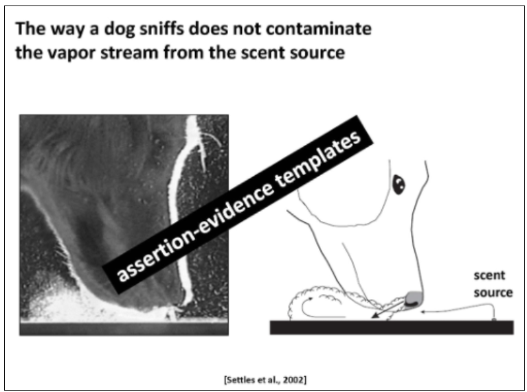
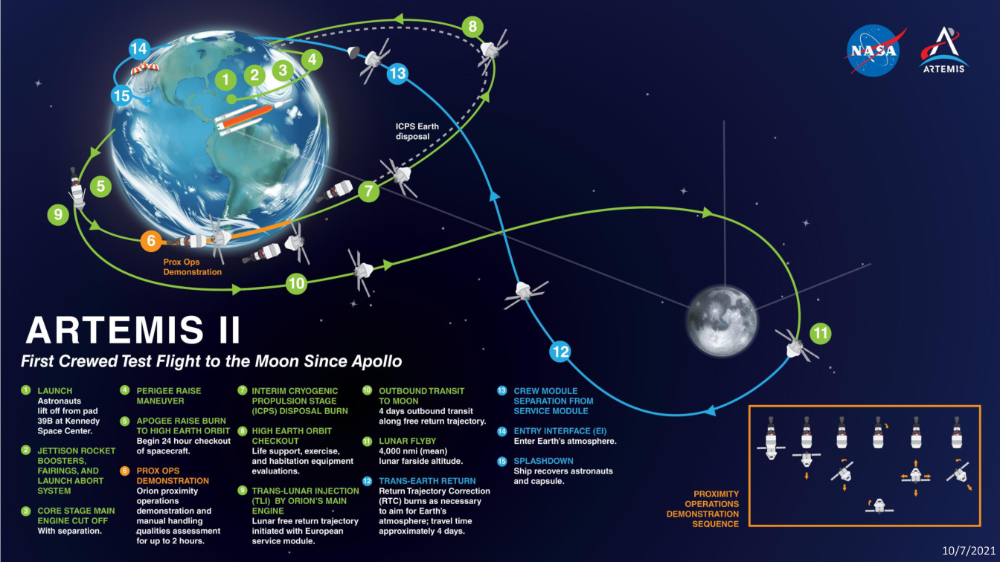
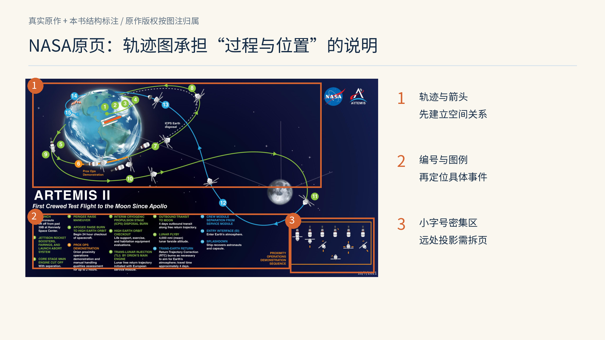
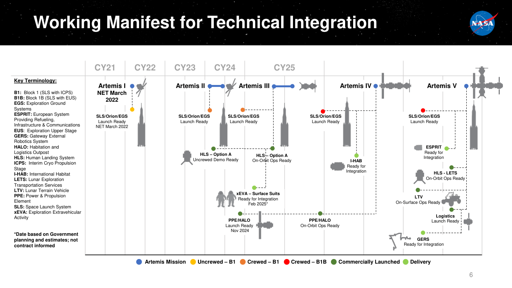
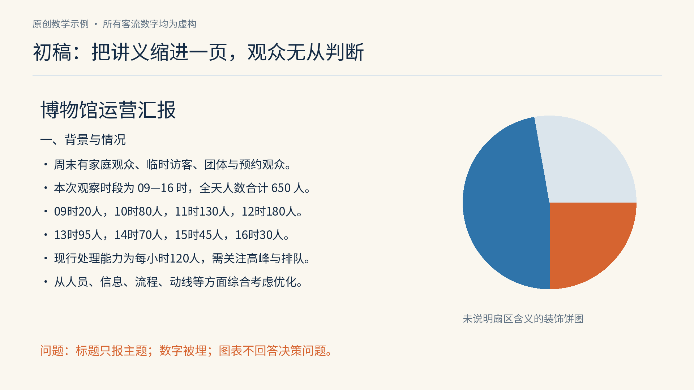
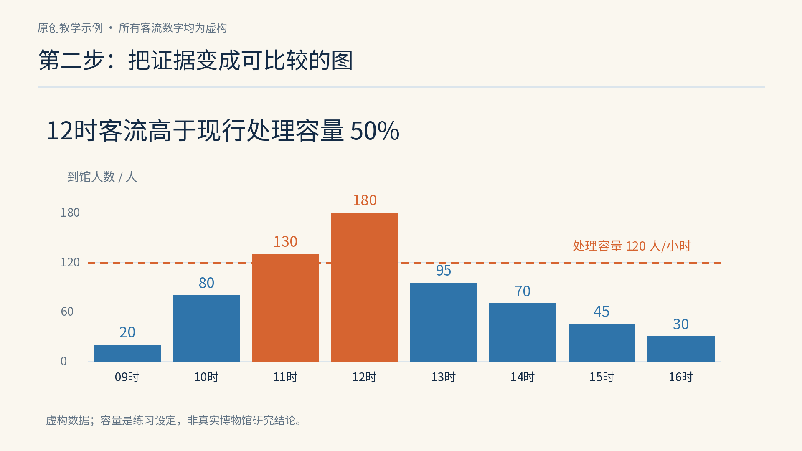
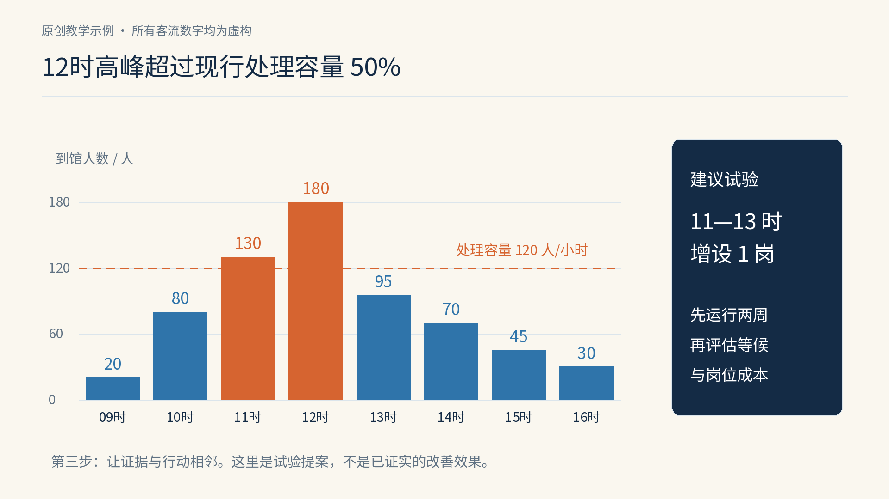
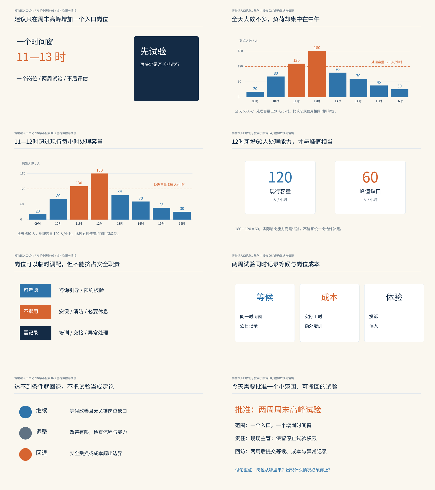

# 第27章｜PPT与演示设计：把一段判断交给现场

## 演示页不是缩小的报告

你向一间会议室解释博物馆为什么排队。写在报告里的背景、口径、数据、限制和建议都没有错，但把它们同时塞进投影屏幕，听众可能只记住“好多字”。演示设计还需考虑观看距离、讲述者的声音、前后页关系，以及听众需要做出的判断。

一份设计系统可以帮助整套幻灯片共享字体、色彩和图表语法，却不能替你决定每一页讲什么。把“背景介绍”改成漂亮的大字，仍然只是一个栏目名。把它改成“周末客流集中在中午，全天总量掩盖了高峰”，才把主题推进为一个可讨论的判断。标题旁应提供相应证据，便于听众核对判断。

这里需要区分三种文件：演讲页用于与你一起被观看；讲稿用于你说话时组织语言；讲义用于听众离场后复核细节。同一个项目可以共享一组数据和视觉资产，但不必使用同一种信息密度。把讲稿全部写到屏幕上，等于让观众同时听一遍、读一遍，注意力反而可能分散；把所有限制都从讲义删掉，则会使原本有限的结论显得过于确定。

## 真实案例一：一句完整的话，配一份可看的证据

图27-1｜真实教程例页。Michael Alley团队的Assertion–Evidence教程，现刊于[The Craft of Scientific Communication](https://www.craftscicom.org/ae_tutorial.html)。页面内实验图标注为Settles et al., 2002；该实验图及整页权利仍归相应作者。图中“assertion-evidence templates”斜带来自公开原图，本书未添加或移除。引用用于分析演示结构，不表示取得开放再许可。

看这页的标题：它不是“Dog Sniffing”，而是一个关于嗅闻是否干扰气流的完整判断。下面左侧是可观察的实验图像，右侧是说明方向关系的简图。标题告诉你需要检验哪一点，图像提供核对该判断的依据。作者站把主张与视觉证据的组合称为assertion–evidence；它是一种组织演示的方法，并非规定所有页面只能有一张图。[作者教程](https://www.craftscicom.org/ae_tutorial.html)

本书对这张图的观察是：左图与右图各有工作。实验影像提供现象，简图降低方向理解的门槛。把二者都改成项目符号，文字可能仍然完整，却失去了能够直接观察的关系。反过来，只有一张漂亮实验照片、没有清楚问题，也会让观众不知道应该看气流、动物姿态还是装置。

学习这套方法时，不必强迫每页都用同样长的句子。开场页可以提出问题，过渡页可以只有一个关键词，结尾页可以给行动清单。每页应有明确任务。排版前，先写下希望观众据此获得或修正的认识，再选择支持它的内容。

## 真实案例二：复杂流程图何时适合留在一页

图27-2｜NASA Advisory Council，N. Wayne Hale, Jr.署名的Human Exploration and Operations Committee报告，2022年8月10日，PDF第11页。该页为Artemis II任务轨迹示意，内页日期10/7/2021。[NASA原始PDF](https://www.nasa.gov/wp-content/uploads/2022/08/nac_human_exploration_and_operations_heo_committee_report_august_2022.pdf)。这是历史演示材料；本书不以其任务日期或轨迹规划代表当前计划。图示不按真实天体距离比例绘制，NASA及页内相关标志不纳入本书原创内容许可。

图27-3｜基于图27-2添加编号和框线的教学标注。原页保持原样；编号、中文侧注和框线为本书添加，表示可见版面关系，非NASA原始规范。

先沿图中的轨迹走一圈，再读下方小字。你会发现，它把空间位置、飞行过程和编号说明放在同一张总览里。对于已经熟悉任务、需要往返查阅的观众，这种总览很有价值。但如果在远处投影，从未接触任务的人未必能同时辨认编号、颜色和所有说明。信息密度应按观众背景和观看条件调整。

本书的改稿建议是保留这张总览作为导航页，再为现场讲述切出几个阶段：先交代起点与目标，再讲去程，接着讲绕月和返程，最后回到总览。每次只突出正在讲的路径，其余部分降为辅助背景。讲义则继续保留完整原页，方便回看。这样，演讲页与参考页共享一个空间模型，却不承担完全一样的任务。

图27-4｜同一NASA原始报告PDF第6页，Working Manifest for Technical Integration。它同时包含年度、任务与缩写说明，适合用于讨论“总览与细读”的不同需求。此处展示历史原页，不核验或更新当年的任务排期。[原始PDF](https://www.nasa.gov/wp-content/uploads/2022/08/nac_human_exploration_and_operations_heo_committee_report_august_2022.pdf)

把图27-4与轨迹页对照：前者偏向时间上的多条并行关系，后者偏向空间中的连续过程。两类页面需要不同的证据组织方式。演示系统需要允许关系图、时间线、实验图、比较图和决策页有不同版型。统一的应当是阅读入口与标注语法，而不是强迫每一种证据都进入同一张左右分栏模板。

## 原创改稿：从一页坏稿，到可以讨论的证据页

下面改一页虚构博物馆的入口运营汇报。练习数据为09—16时每小时到馆人数20、80、130、180、95、70、45、30，总计650人；现行处理容量设为120人/小时。这些数字只为展示设计推导，没有实测机构、观察日期或研究结论。不能拿它们证明增加岗位一定有效。

图27-5｜原创坏稿。全部客流数字、博物馆与运营条件均为虚构；装饰饼图没有定义扇区含义，故意作为反例。它不能被当成有效数据可视化。

初稿有三种失败。第一，标题只说“运营汇报”，没有判断。第二，连续文字藏住了时段差异，听众需要在脑中重新排列数字。第三，旁边的饼图只是装饰，不能回答“什么时候超出处理能力”。这个饼图没有对应数据，不能补充证据。

第一步先不画图。把结论写成一句可核对的话：“12时客流高于现行处理容量50%。”这里50%的分母是120，而不是180；计算为（180−120）÷120。再把决策问题写在下面：“是否在11—13时增加一个临时入口岗位？”前一句是数据关系，后一句是待讨论行动，不应混成“增岗能减少50%排队”这样的无依据推断。

图27-6｜原创改稿第一步。先确定主张、分母与决策问题；还没有用图表替代证据。

第二步再选择图表。我们关心按时间变化的负荷，同时需要比较固定容量，所以用按小时排列的柱形图，并添加120人/小时的参考线。保留从零开始的数量轴，避免通过截短坐标夸大差距。超出参考线的11时和12时使用强调色，其余时段降低对比；数字、单位、时间范围和虚构声明一起保留。

图27-7｜原创改稿第二步。图中柱高严格对应练习数据，参考线为120人/小时。11时130人、12时180人超过设定容量；颜色只强化这一关系，不替代数值与标签。

第三步把证据和行动安排为相邻区域。左侧保留图，右侧写“建议试验：11—13时增设1岗，先运行两周，再评估等候与岗位成本”。它没有声称一岗必然补足60人的峰值缺口，因为实际增岗能力还未知；它只是把需要批准的试验范围说清楚。现场会议据此可以讨论试验时段、期限和评估范围。

图27-8｜原创改稿第三步。行动区独立成组，但不压住图表；具体效果仍需试验验证。图中全部数字与情境为虚构。

最后把页面缩小到屏幕宽度的四分之一看一遍。即使小字暂时读不清，标题、峰值和建议也应先出现。再恢复正常尺寸，逐项检查单位、容量线和限制说明。缩略测试检查主次，正常尺寸检查完整，投影测试检查距离，三者不互相替代。字号需要结合显示条件检查：同样32pt，在近处电脑屏幕和大会议室后排的结果不同。

## 一页改好以后，还要把八页接起来

图27-9｜原创八页小报告，所有页面均已实际绘制，并分别保存为revision-presentations-report-01.png至08.png。图表数据、机构、岗位条件与试验均为虚构。缩略图展示叙事关系，细节可打开各页PNG阅读。

这八页没有采用“背景、现状、分析、方案、总结”这样的通用目录，而是让每页标题推进一个判断。第一页提出小范围增岗试验。第二页说明全天总量掩盖了时段集中。第三页把时段与处理容量放在一起比较。第四页核对峰值缺口：180−120等于60人/小时，并明确实际岗位增量能力未知。第五页提醒调配不能挤占安保等必要职责。第六页规定同时记录等候、成本与体验。第七页写继续、调整、回退的条件。第八页收束到今天需要批准什么。

同一条数据可以在第二、第三页再次出现，但任务应变化。第二页帮助观众看见分布，第三页帮助他们理解分布与容量的冲突。如果两页只是换颜色重复同一句话，重复便没有教学作用。每一页之间可以用一句口头转场连接：“现在知道什么时候挤，再看挤到什么程度。”先写出转场，常能发现缺失的推理步骤。

图27-10｜原创小报告第4页：数量关系与限制在同一页出现。60人/小时是峰值与容量的差，不是已测得的新增岗位产能。

一套演示系统可以把这些关系整理成少数几类版型：判断加证据、对照、过程、时间线、方案取舍、决策请求。版型规定标题入口、主要证据区、单位、出处和页码的角色，但允许图形比例变化。若某张地图必须放大，不应为了模板边框把它缩得无法辨认；若内容属于机密或细节太多，也不能只靠缩字号解决。

这套练习的讲稿不应照着标题读一遍。第四页可以说：“这个差值提醒我们需要补能力，但并没有告诉我们一位同事能补多少，所以接下来是试验，而不是承诺。”讲义则应该补上每小时原始表、观察口径、容量如何估计、异常日如何排除等信息。这里没有真实观察，讲义必须继续声明虚构，并把待验证的条件单独列出。

## 把规则落实为一份可继续使用的模板

真正可复用的演示模板，至少要区分标题、证据、图注与来源这几个角色。先在任意幻灯片工具中设定一致画幅，画出四周不放关键信息的安全区，再做三张空白版型：一张全宽证据，一张证据加行动，一张并列对照。只保留与任务有关的区域，不要把日期、标志、装饰页角和口号不断叠在每页上。

接着放入真实长度的内容测试。短标题不能证明模板好用；至少测试一条接近两行的判断、一张横向关系图、一张竖向照片和一张有必要单位的图表。出现拥挤时，先检查论点是否太多，再决定拆页或改变版型。单纯缩小文字会降低后排可读性。记录字号之间的层级关系，比只记录某个绝对数字更有价值：标题需要先被看见，主要标签需要无需猜测，来源则在近看时仍可追查。

图表应保留可编辑的数据或矢量对象，避免把整页截图当成唯一母版。数字变化时，柱高、轴值、标题里的比例和讲稿都要一起更新。这个练习的09时表示09:00—10:00时间窗，依次类推；纵向数值是该时间窗的到馆人数，不是已完成入馆的人数，更不是场馆内同时停留人数。口径一旦改变，原来的比较便需要重新检查。

交付前另做一份静态版本：检查动画叠放有没有遮住文字，链接有没有指向临时文件，外部字体换到另一台电脑后有没有替代。邀请同事复制一张版型，换入最长的标题和最大的一组数；如果他们需要手动移动所有对象，说明版型的尺寸、对齐或内容伸缩规则仍需补充。记录使用中暴露的例外，作为下次修订版型的依据。

## 把可读性变成检查动作

先检查一句话能否被证据支持。标题如果说“增加入口提高体验”，图却只给人数，就缺少体验测量；标题如果说“中午人数最多”，图确实显示12时最高，关系才相称。标题的确定程度应与证据相称，避免把未测量的因果关系写成事实。

再检查图形是否在帮助同一个问题。比较数量通常需要共同基线；展示空间需要地图或示意；解释过程需要状态与方向。圆环、渐变和三维柱并非天然错误，但若它们增加读数成本、遮住差异，就需要给出使用理由。给图表选择规则，比给所有图表换同一种品牌色更接近设计系统。

还要检查动画是不是有任务。逐步显示可以控制信息进入的顺序；必须同时比较的两条曲线，却不应一闪而过。若演示文件会导出PDF，关键结论不能只存在于最后一个动画状态里。视频要有静态备份，现场断网后仍应讲得清楚。对于动作敏感的观众，尽量避免无意义循环与快速闪动；视觉强调也可用位置、明暗、线型和文字完成。

最后做一次五分钟排练：请一位没看过材料的人，在每页结束时复述“这页想让我知道什么”。若他说的总是图中最鲜艳的东西，却不是你的判断，优先调整证据层级；若他能复述结论，却不知道你如何得到它，补足推理；若他知道依据，却不知道下一步要做什么，明确行动与责任。记录这些反馈，分别检查结论、推理和行动是否传达完整。

制作下一套演示时，可先写出各页相互接续的主张，为每页选择证据，再安排版型。把适用的标题、图表、来源和决策页规则保留下来，后续项目便可复用。

## 原创应用：让系统长出提案页

折光先以一张完整AI海报确定中文、纸面和有色光的关系，再用去字素材与真实字体重建原生画板。三页提案从这一方向中提取颜色角色、字级与裁切规则，分别推进命题、观看顺序、跨媒介三个判断。下面这一页并置同一光场的不同取景，用蓝色棱面、亮线与暖色边界的局部对照，支持提案中的观看顺序判断。提案、无字底图、原生重建和系统各自的关系见第三十一章。

图27-C｜本书原创提案第二页，可编辑Canvas画板。用去字光场的不同裁切组织观看，文字在原生层另建；这些取景不是多个真实相机视角，工程未冒称交付PPTX。

本章来源：[Michael Alley团队，Assertion–Evidence教程](https://www.craftscicom.org/ae_tutorial.html)；[Penn State，Slide Research](https://www.writing.engr.psu.edu/research.html)；[Harvard Catalyst，Slides](https://catalyst.harvard.edu/writing-communication-center/visualize-science/slides/)；[NASA，HEO Committee Report，2022-08-10](https://www.nasa.gov/wp-content/uploads/2022/08/nac_human_exploration_and_operations_heo_committee_report_august_2022.pdf)。改稿流程、博物馆数据、八页报告与读图判断为本书原创教学材料；原图及其中第三方图像仍归相应权利人。
