# 第17章｜画报与杂志：把图片变成连续的阅读

书籍章节侧重长文、条目与检索，本章转向以图片推动阅读的刊物。岸线的节目册可用于查时间地点；若另做活动画报，则需要确定选题、图片顺序、图注与事实来源，两者可共享身份和字级，编辑任务仍需分别安排。

## 一张好图，不等于一本好杂志

你翻开一本画报，先被封面吸引，接着在一张跨页照片前停下来，再读到人物、地图和小字。这个过程不像看一张海报，也不像按顺序听一段演讲：读者可能先翻到中间，跳过一篇长文，再回看目录。编辑设计要为这些不完全受控的动作留下入口。

“画报”强调图像在传播中的分量，却不意味着文字可以随意填进剩下的空隙。照片提供可见的瞬间，图注交代瞬间之外的事实；标题决定从哪个问题进入；顺序则把单张图连接成故事。一本杂志的系统同时包含版面规则与编辑判断。前者告诉你图注放在哪里，后者告诉你这张图是否值得出现、能否支持这段报道。

本章分析两份历史刊物，再用虚构社区杂志练习改稿。历史原作与原创例图分别标注；市集插图仅用于说明版面关系，不构成新闻记录。

## 真实案例一：《Ver Sacrum》让文字也参与构成

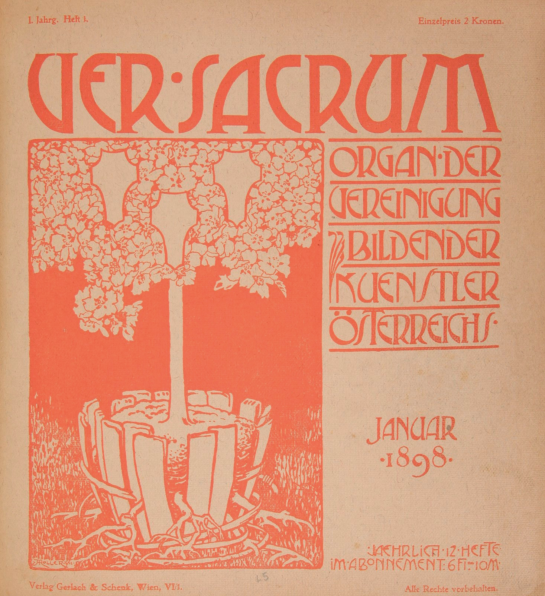

图17-1｜Alfred Roller，《Ver Sacrum》第1年、第1期封面，1898年1月。真实历史封面摄影复制，图像经[Wikimedia Commons文件页](https://commons.wikimedia.org/wiki/File:Ver_Sacrum,_Issue_1,_January_1898.jpg)取得；该文件明确标原始来源Ader Paris，并标为公开领域艺术作品的忠实复制。此图并非本书生成，也并非从海德堡馆藏下载。刊物史可旁读[Leopold Museum馆藏说明](https://onlinecollection.leopoldmuseum.org/en/object/7726-ver-sacrum-magazine-of-the-union-of-austrian-artists-founders-issue-september-1898-1st-year-no-9/)。

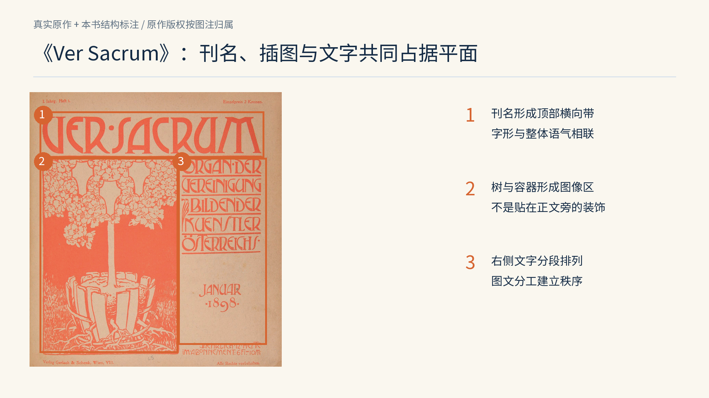

图17-2｜原封面加本书教学标线。1为刊名横带，2为树与容器组成的插图区，3为右侧说明与日期区；标注用于读图，不声称这些边界是作者原始网格尺寸。原图归属同图17-1。

先看版面的图文分工。刊名横向铺在上部，左下树木的枝叶与容器构成大片图像，右侧文字分成可辨认的块。几乎相同的红色贯穿字与图，纸色则从两者之间显现。字形本身也有强烈形态，所以阅读与观看并没有被完全切开。这些关系可以直接从该封面核对，不代表同时代刊物都采用同样的组织方式。

Leopold Museum将《Ver Sacrum》介绍为维也纳分离派的艺术与文学刊物，1898年开始出版、延续至1903年；馆方也说明，其近方形版式与轮换的艺术家、作者团队是重要特征。[馆方记录](https://onlinecollection.leopoldmuseum.org/en/object/7726-ver-sacrum-magazine-of-the-union-of-austrian-artists-founders-issue-september-1898-1st-year-no-9/)

轮换的创作团队使刊物可以持续尝试不同的视觉语言。换到今天，独立杂志可以让每一期由不同作者探索视觉语言，但仍需要固定的识别入口、出版信息和阅读线索。这些稳定入口方便读者在不同期次中查找内容。

若要把这份封面转译到一份当代植物杂志，值得借用的是“文字与图像共同组成整体平面”的思路，而不是照抄红色、树木和字形。比如先决定一个占版面较大的植物结构，再为刊名和专题名选择相应的文字密度；长篇说明可以退到目录，不必挤满封面。保留哪种关系，要由当代读者的查找任务决定。

## 真实案例二：LIFE在封面与内页安排不同的观看

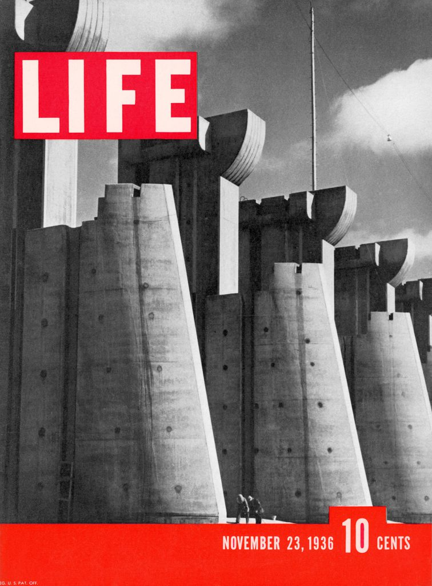

图17-3｜LIFE，1936年11月23日创刊号封面；摄影Margaret Bourke-White，Fort Peck Dam。来自[LIFE官方摄影家页](https://www.life.com/photographer/margaret-bourke-white/)与[原刊专题重刊](https://www.life.com/history/lifes-first-ever-cover-story-building-the-fort-peck-dam-1936/)。© Margaret Bourke-White / The LIFE Picture Collection及相应权利人，官方页保留版权；本书引用用于具体版面评论，未将原图纳入本书原创许可。

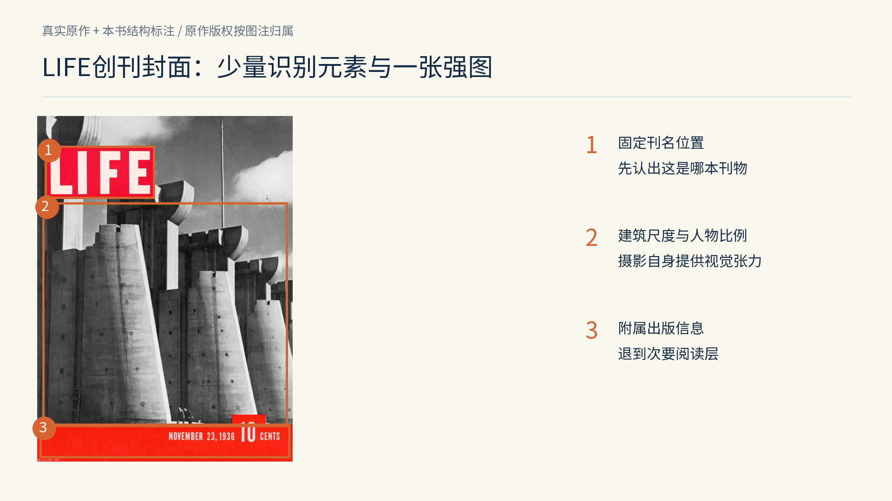

图17-4｜原封面加本书结构标注。1圈出左上LIFE刊名，2指向照片主体，3圈出底部日期与价格区。原作未重绘，标线与中文侧注为本书添加；图像权利归属同图17-3。

把它与《Ver Sacrum》并置，会看到另一种分工。这里的刊名是明确的色块入口，摄影占据主要空间，底部出版信息构成另一条带。照片中的巨大结构与下方小人物产生尺度差，重复的建筑体量又形成纵深。封面并没有靠五六个同等响亮的专题标题制造热闹，而是让一张图承担主要注意力。

同一期第9页的摄影对象从建筑转向人的生活，版面也随之改变。下图由LIFE官方专题重刊，页码与日期仍在扫描图中可见。[LIFE官方重刊](https://www.life.com/history/lifes-first-ever-cover-story-building-the-fort-peck-dam-1936/)

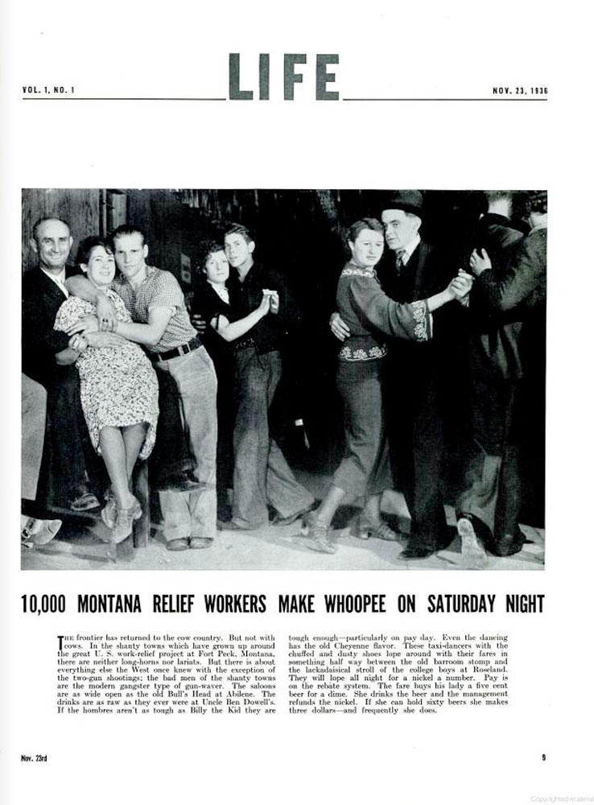

图17-5｜LIFE，1936年11月23日，第9页单页版面，摄影Margaret Bourke-White；内容为Fort Peck周边生活报道。这里是一张完整单页，不能误称跨页。图像由LIFE官方原刊专题提供，权利仍归相应权利人。[来源](https://www.life.com/history/lifes-first-ever-cover-story-building-the-fort-peck-dam-1936/)

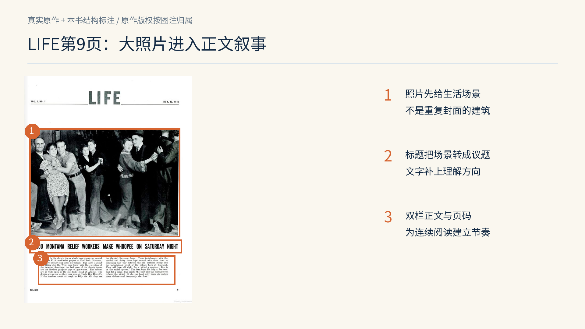

图17-6｜图17-5的教学标注。1为主要照片，2为照片下方标题，3为双栏正文；原版中三者顺序可直接核对。中文侧注及框线为本书添加，不改写原新闻事实。

这页先让你看见人群与舞蹈，再由标题把图像接到一个报道问题，最后进入双栏文字。封面照片建立工程规模，内页照片转向周边生活，正文补充照片无法直接交代的报道内容。两页通过不同信息推进专题。

这种推导也有边界。我们从版面可以观察图像尺寸、文字位置与次序，却不能只凭排版判断照片拍摄时的全部情境，也不能从一张旧照片推出整个时代。历史新闻的标题和用语可能包含当时的偏见，现代编辑不能因为版面经典，就自动继承它的叙事立场。学习结构与核对事实应同时进行。

## 原创改稿：给“桥边”早市专题一个清楚入口

现在设想制作一本八页社区小杂志，刊名“桥边”，本期题目“城市醒来之前”。它要让读者看见早市的环境、人物与劳动细节，并在最后留下可走访的路线。题材、刊物和人物均为虚构；本节所有市集图为程序插图，只示范图像角色与版面关系，不构成真实采访。

先做一份内容清单，而不是先找模板：封面负责识别与邀请；目录负责选择；开场跨页交代地点和本期问题；中间跨页进入人物与细节；广告必须独立标识；封底留给下期线索。此时就能发现，八页很紧，不能同时承诺完整地方史、摊主群像、食物百科和旅游地图。应根据八页容量缩小选题范围，再安排版面。

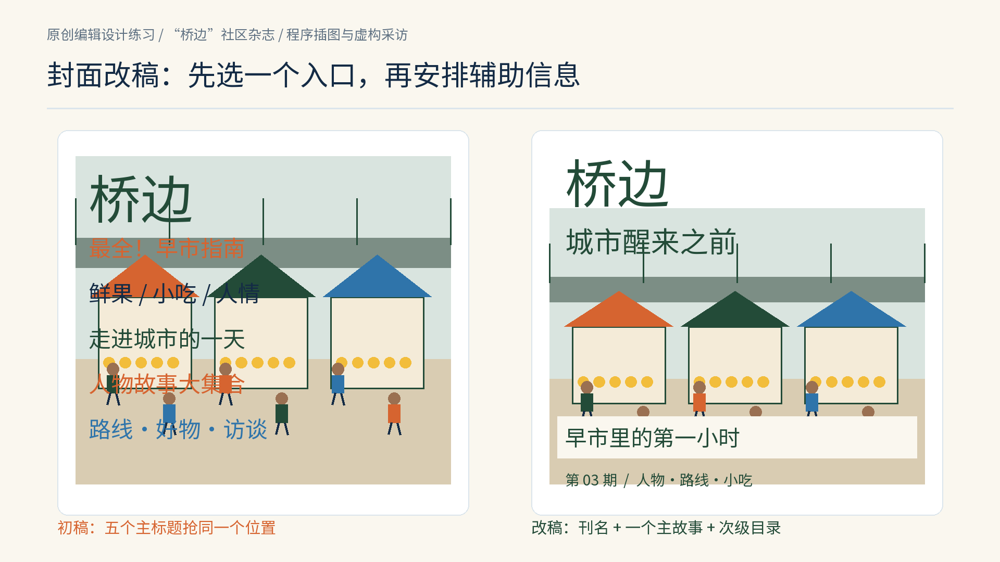

图17-7｜原创封面改稿。左侧多个同等级标题竞争，右侧保留刊名、一个主故事和次级目录；市集、人物与文字均为虚构，图像为程序插图。

初稿把“最全指南”“城市的一天”“人物故事”等都放在醒目位置。每一句单独看都有吸引力，放在一起却没有主次。改稿先保留一个主要邀请：“城市醒来之前”；“早市里的第一小时”说明它具体讲什么；刊名与期号保持稳定。读者不必先读完所有文字，便能知道这是什么刊物、这一期有什么故事。

封面还要看图与文字是否互相遮挡。如果标题压在同样明亮的天空上，白字即使很大也可能读不清；移动文字、换成深色，或为文字留一块低细节背景，都比增加投影和描边更直接。这里的改稿使用深色标题与浅色副标题带，牺牲少量连续图像换取可读性。文字位置与背景密度的取舍，应以实际可读性为依据。

## 跨页改稿：不要让四张图说四次同一句话

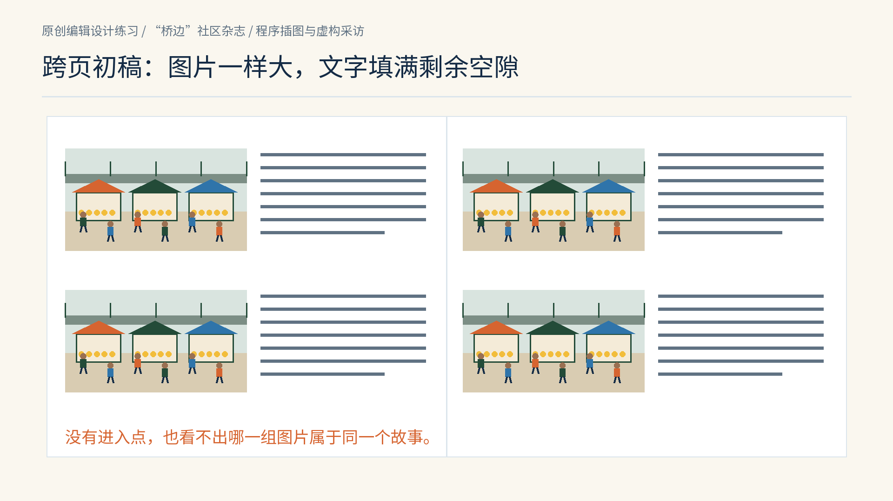

图17-8｜原创跨页坏稿。四张同等大小的环境插图重复说明“这里有市集”，正文用灰线表示结构占位。该图用于观察层级，灰线不是实际可阅读的采访文字。

这份跨页的问题在于：四张图大小相等、观看距离接近，读者无法判断哪张是入口，也不知道它们之间有什么关系。改稿时先分派图像任务：环境图交代地点，人物图介绍参与者，细节图呈现动作与过程。如果没有相应素材，就应补拍、补画或删去承诺，不能靠裁切同一张图假装完成采访。

第一步为开场选一张能够建立空间的图，让它占据跨页的一侧。另一侧安排题目、简短导语与阅读方向。图像进入点变大，正文也不必急着解释所有细节。环境图放大是为了交代场所关系，并不表示建筑比人物重要。

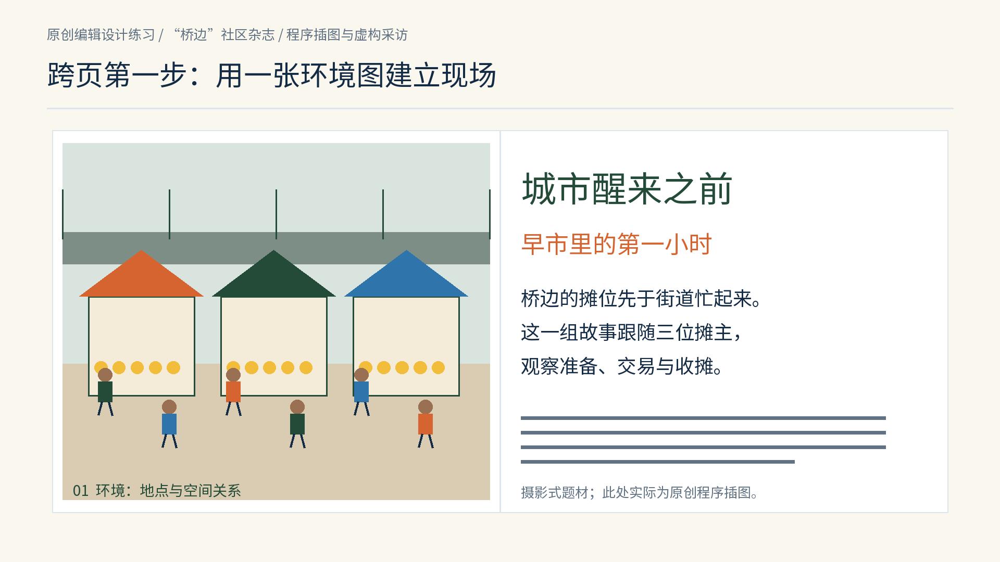

图17-9｜原创跨页第一步：左侧环境图，右侧标题与导语。此处是虚构选题及程序插图；导语为版面练习文本，不是事实报道。导语下方灰线只显示后续文字块的容量。

第二步把后续跨页改成远景、人物和细节的组合。不同尺寸告诉读者如何分配停留时间。人物图不再只是人群中的一个点，手部与食物细节也不再被环境淹没。三张图之间要有可解释的关系：如果人物不是同一个场所的摊主，图注就不能通过相邻摆放暗示它是。

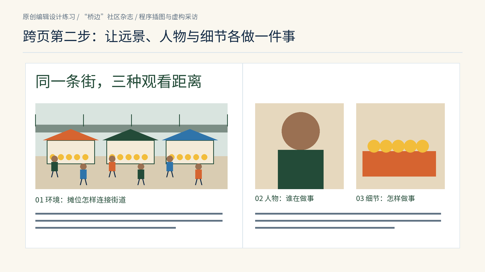

图17-10｜原创跨页第二步。环境、人物与细节采用不同尺度，分别承担空间、身份与动作的说明；为程序插图与虚构情境。灰线是文字区示意，非完整采访稿。

第三步补图注。照片下面只写“热闹的早市”，读者几乎没有得到新信息。一条有用图注会补人物身份、时间、具体地点，必要时说明画面之外的背景，并保留摄影或插画署名。若报道用了合成图、摆拍或重演，也应向读者说明。图像的真实性说明是编辑系统的一部分，不能等到发布后才临时补救。

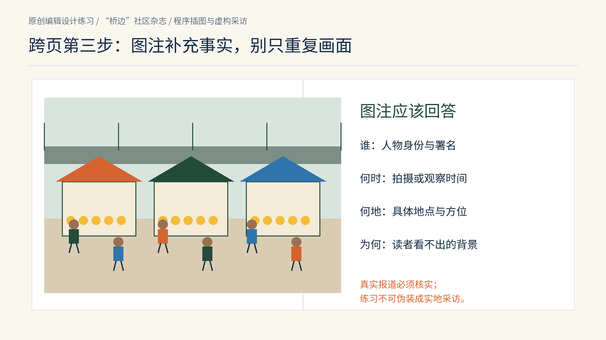

图17-11｜原创跨页第三步：图注核对谁、何时、何地及必要背景。它是一份图注检查结构；不把虚构市集填成似真的新闻事实。

## 一本杂志如何有变化，又不失去连续感

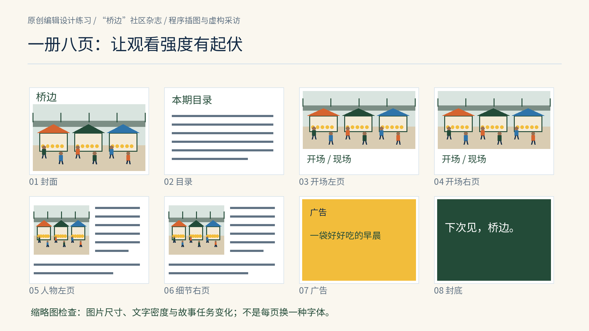

图17-12｜原创八页编辑顺序图：封面、目录、开场左右页、人物与细节左右页、广告、封底。所有页均有实际布局；缩略图中的灰线表示文字容量，不能代替真实文章。它是设计教学样张，不是已完成采访的出版物。

把八页缩成一排小图，先不读字，只看明暗与密度。如果每一页都是一张等大的图配两栏文字，阅读可能变得机械；如果每一页都更换字体、色彩和方向，读者又不断被迫重新寻找入口。节奏来自任务变化：开场让人停一下，人物页让人靠近，细节页让人辨认，广告可以改变气氛，但必须保持身份清楚。

跨页还要考虑装订。书脊附近的图像可能被吞入订口，不能把眼睛、手部动作、地图的关键节点或文字正好压在中缝。左右页在屏幕上无缝相接，不代表纸本展开时也如此。正式印刷还需要与印厂确认出血、裁切、纸张和装订方式；这些值依工艺而变，不宜从某个网页模板照搬。

照片系统也不等于给所有图套同一种滤镜。报道可能同时需要阴天街景、室内肖像和食物细节，它们可以保留各自的光线，但统一黑白点、肤色可信度、裁切原则与署名规则。对照型图片尽量固定拍摄条件；叙事型图片允许观看距离变化。先说明比较还是讲述，再决定哪些变量固定。

正文可以有稳定字号与行距，却不能把所有内容硬挤进相同字数。长人名、解释较多的图片、必须完整呈现的引语，都可能需要备用版型。好的系统会写清楚：何时标题允许加一行，何时图片跨栏，何时导语移到下一页。它帮助真实内容进入版面，而非要求内容长成模板喜欢的样子。

## 广告插页为什么不能伪装成报道

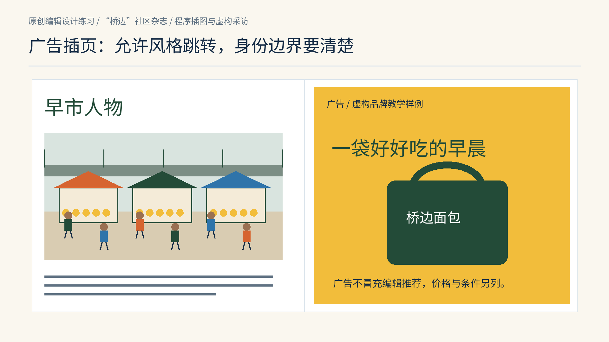

图17-13｜原创广告边界练习。左为编辑专题，右为虚构品牌“桥边面包”的广告；广告标题、品牌与产品均为教学设定。右页明确标“广告”，不冒充编辑推荐。程序图不是实际广告委托。

杂志中的广告可以比正文更鲜艳、更直接，也可以使用完全不同的摄影或字体。统一整本杂志不意味着把广告也染成编辑页的同一种颜色，更不意味着把广告藏得像采访。读者应该有机会知道此处正在由谁说话。合作内容、赞助专题和品牌广告之间的边界，应通过栏目名、标识和编辑政策说清楚。

从系统角度，广告页还需要预先约定尺寸、出血、安全区、图像分辨率与交付时间；编辑侧需要知道它插在哪里，是否打断一篇报道，以及目录要不要标识。两个系统在此相遇：一个是广告的说服目标，一个是杂志对读者的承诺。两类内容的署名、来源核对和标识责任仍应分别明确。

做一次实际练习：找一份允许你翻阅的杂志，选连续八页，画出每页的主图、标题、正文、图注与广告位置。不要只抄网格，逐页写一句“这一页让读者做什么”。再把其中一张主图缩小、一张细节图放大，观察故事是否改变。如果某一页删去后完全不影响理解，它可能重复了工作；如果删去后人物身份或时间顺序突然断裂，那一页就有不可替代的任务。

完成版面后，应能说明各图的位置、尺度及相邻文字的作用，并列出出版前尚需核实的事实。除模板外，保留选题、图像来源、图注核对与修订记录，供下一期继续使用。

## 原创应用：实际制作植物画报

野序的AI植物摄影风格图像、刊名、引题、正文和图注分别制作成可编辑层。图像位于中部，左右两侧的窄文章栏各有小节，英文衬线展示题与中文正文字型分工。与本章LIFE报道页面相比，野序希望延长观看；作者、年代和用途不同，不能看作同一个模板。文字不跨中缝，图像保留花头与长叶的连续关系；纸质装订还需打样检查中缝损失，制作过程见第29章。

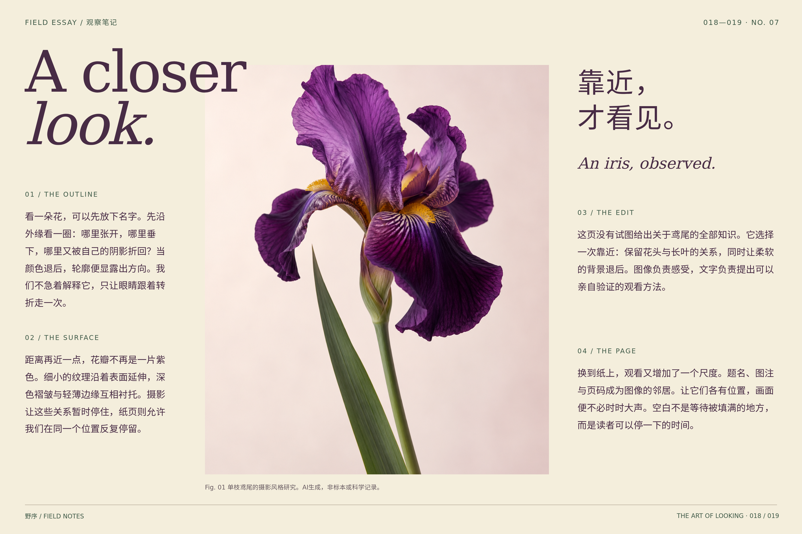

图17-C｜本书原创植物画报跨页。摄影风格素材由AI生成，非真实摄影记录或植物标本；实际正文、图注与页脚各自留位，原生工程可放大和修改。

本章来源：[Leopold Museum，《Ver Sacrum》馆藏说明](https://onlinecollection.leopoldmuseum.org/en/object/7726-ver-sacrum-magazine-of-the-union-of-austrian-artists-founders-issue-september-1898-1st-year-no-9/)；[Alfred Roller1898年封面图像与来源记录](https://commons.wikimedia.org/wiki/File:Ver_Sacrum,_Issue_1,_January_1898.jpg)；[LIFE，Margaret Bourke-White摄影家页](https://www.life.com/photographer/margaret-bourke-white/)；[LIFE，Fort Peck Dam创刊专题原刊重刊](https://www.life.com/history/lifes-first-ever-cover-story-building-the-fort-peck-dam-1936/)。版面结构观察、桥边练习、插图与改稿规则为本书原创；LIFE原图及其他第三方作品保留各自权利，不适用本书原创图的许可。
