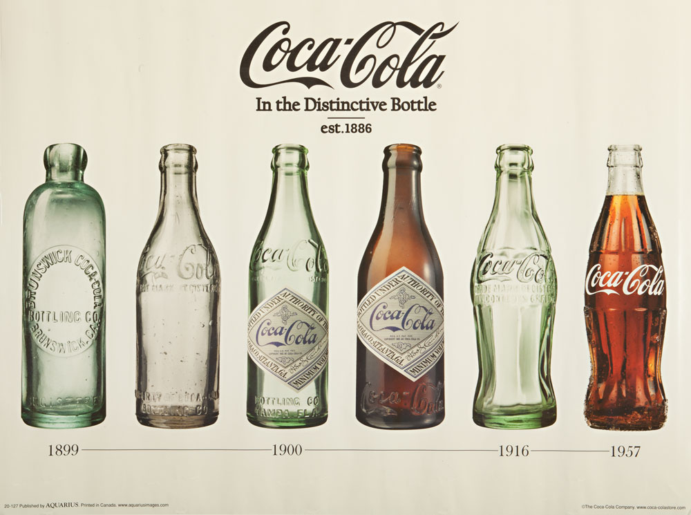
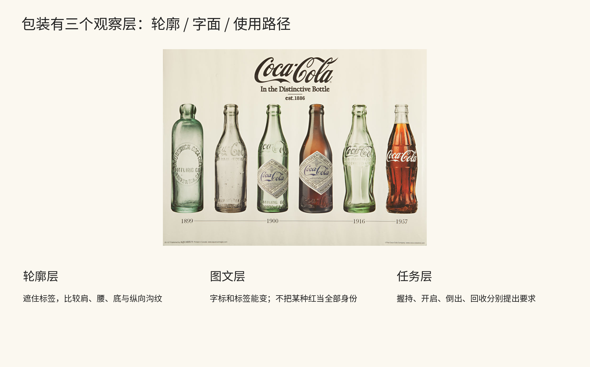
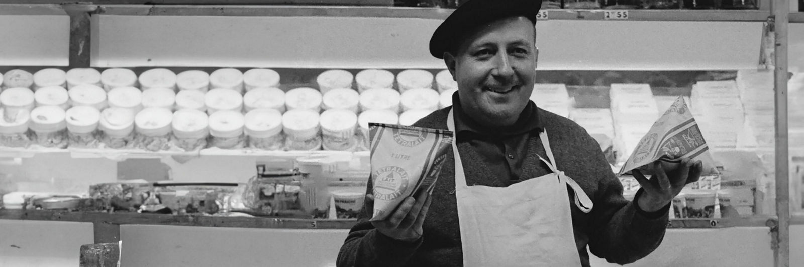
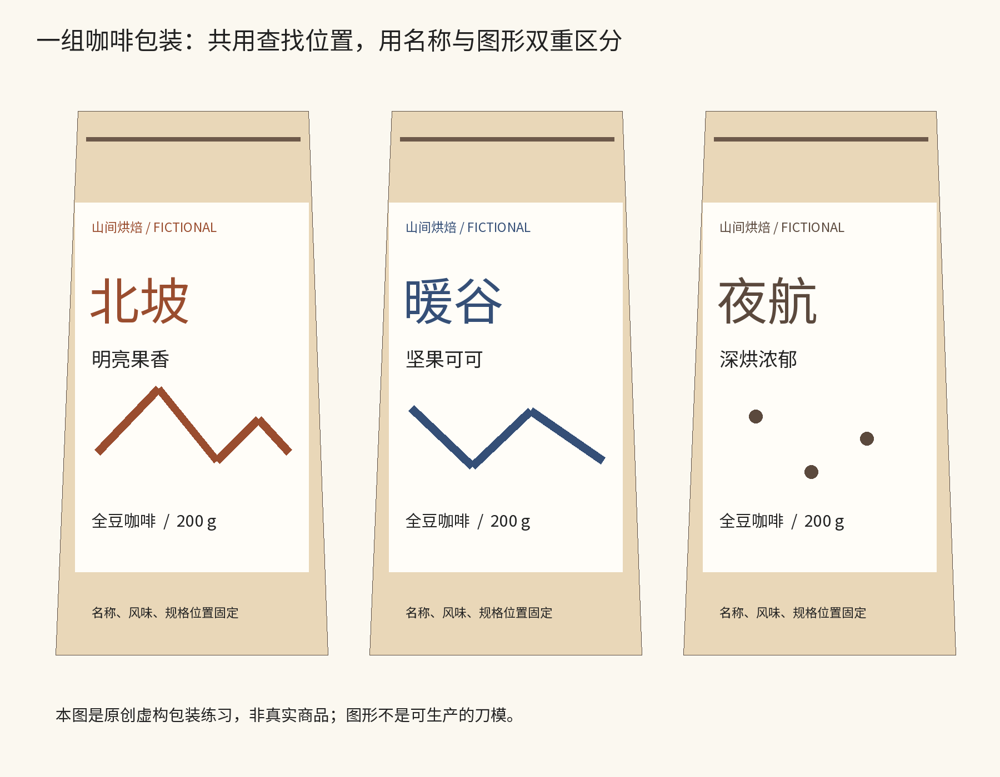
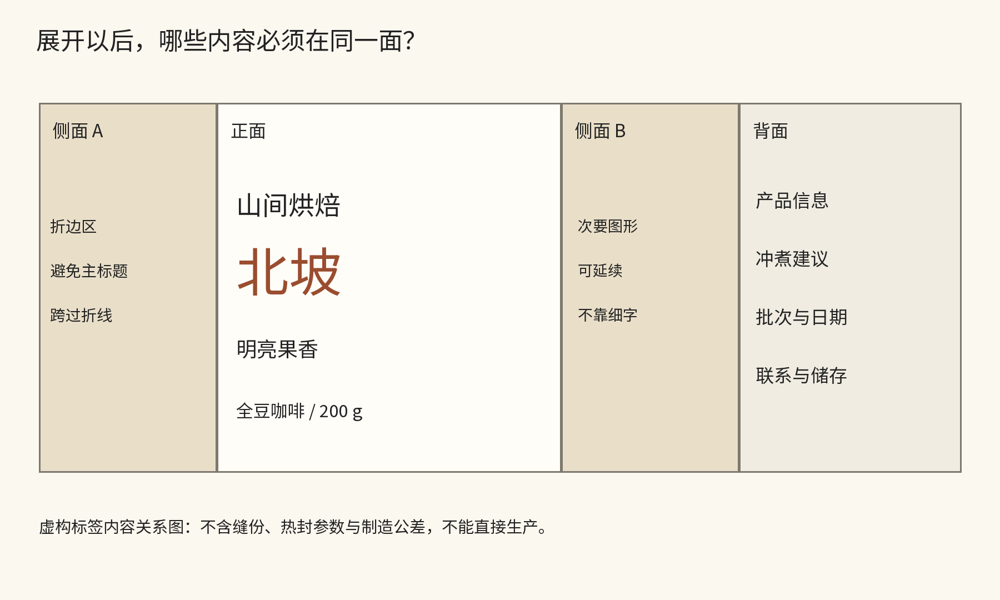

# 第29章｜包装：在货架、手里和展开图之间设计

包装经常同时面对三秒钟的辨认和数分钟的阅读。远处先看到轮廓、体量与大色块；拿到手里才读名称、类别和规格；翻到背面才查具体说明；开启以后又涉及保存与处理。包装需按这些使用阶段分配信息和操作位置。

本章分析两类真实包装，再为一组虚构咖啡做完整的信息分工。包装结构的制造参数与食品标签要求需依据实际项目另行确认；这里学习的是视觉、物件与动作怎样相连。

## 案例一：可口可乐的身份怎样从字标走到轮廓

可口可乐公司的历史资料记载，Root Glass Company在1915年为新瓶型取得专利，随后的商业瓶型在1916年进入采用阶段。要区分专利概念、原型与实际投入使用的版本，不能把所有照片都标成“1915年的瓶子”。[The Coca-Cola Company，瓶型历史](https://www.coca-colacompany.com/about-us/history/the-history-of-the-coca-cola-contour-bottle)；[Smithsonian National Museum of American History，Contour Bottle](https://americanhistory.si.edu/collections/object/nmah_1461961)

图29-A｜真实品牌历史图：The Coca-Cola Company，瓶型演变，图中分别标有1899、1900、1916、1957等时期。图像由品牌官网展示，底部保留原图出版及版权署名；它不是1915年的同日实物合照。[官方出处](https://www.coca-colacompany.com/about-us/history/the-history-of-the-coca-cola-contour-bottle)

先沿六只瓶子的肩部和腰部看过去。较早的直身瓶，主要区别集中在浮雕字、标签与玻璃颜色；右侧两只曲线瓶，即使标签面积较少，仍能由收腰、肩部和纵向沟纹提供辨认线索。这些线索在尚未读清英文时也可辨认。包装可以把品牌记忆分散到触觉、轮廓与图文几个通道，而不是让标志独自承担全部工作。

再遮住字标，比较哪几只仍有家族关系。你会注意到透明度、颜色和内容物会改变外观，但某些大轮廓较稳定。反过来，完全相同的字标放进不同肩宽、瓶高与标签边界，也会产生不一样的体量感。平面设计与工业设计在同一物件中相遇：标签不能独自决定瓶子，瓶子也不能代替标签说明品类与容量。

为新包装设计识别时，也可分层检查轮廓、图形和文字。列出三种观看条件：从远处看、标签部分被手遮住、只看黑白照片。每种条件还剩哪条线索？如果答案始终只有一个颜色，就要检查图形、字面与轮廓有没有第二条可用的辨认路径。分别记录各条线索在哪种条件下仍然有效。

图29-B｜本书原创分析板，保留图29-A并分出轮廓、图文与任务三个观察层。新增说明不是品牌官方规范，不对瓶子制造、握持表现或消费者行为作实测结论。[原图出处](https://www.coca-colacompany.com/about-us/history/the-history-of-the-coca-cola-contour-bottle)

还要理解这个案例的边界。识别力不会自动证明产品更健康、包装更环保或每个人都更容易打开；这些需要完全不同的证据。评价时应将品牌识别、材料表现和使用便利性分别核实。

## 案例二：四面体包装把印刷表面变成三维问题

Tetra Pak的早期四面体包装是观察平面与立体关系的好入口。其现行Tetra Classic介绍明确将形态历史联系到20世纪50年代，但今天的产品、材料与开口并不等于最初版本。下面使用品牌历史照片，观察早期实例，而非把现代商品照片倒标为1952年。[Tetra Pak，Tetra Classic Aseptic](https://www.tetrapak.com/solutions/packaging/packages/aseptic-packages/tetra-classic-aseptic)

图29-C｜真实历史照片：Tetra Pak官方Heritage页面，男子手持四面体包装；官方图像资产名标记1953—1956，具体拍摄日期与摄影者未在所用页面确认。图中的体量、握持与表面关系可观察，不能把模糊小字当成已核实的标签内容。[官方档案页面](https://www.tetrapak.com/about-tetra-pak/who-we-are/heritage)

先比较左右手里的两个包。图形落在倾斜的面上，边缘转向，又与握持动作相遇。一张正视标签的矩形画板，在这里不再足以解释整体。印刷设计需检查名称所在面的可见程度、侧转后的识别线索，以及封边和尖端对文字的遮断。这些关系在正视效果图里不易察觉，需要转动物件检查。

再看文字和形状之间的关系。一个字号很大的名称，如果跨过急转折的边，仍可能只有半个词朝向观者；一个重复的小识别，如果在不同面上都有合理位置，可能更有机会被看到。字号需与阅读方向、表面折转及可见面积配合。多个观看方向都应纳入设计。

这个案例适合与上一个相对照。玻璃瓶把一部分身份交给连续轮廓与沟纹；四面体纸包装把平面图文带入折转的表面。两类包装都需要先理解三维形态，再安排图文在各表面的分布。

把观察变成纸上练习：找一个空纸盒或纸袋，不必拆坏它。分别拍正面、侧面、背面与拿在手里的照片，画出最常出现与最容易被遮住的区域。将主要名称、规格和次要说明分别放到候选位置，再旋转观看。记录三处在平面图里看不见的问题。没有实物时，可以用简单纸模型先检查视向，暂不声称完成制作验证。

## 实作：给三款咖啡建立可查找的家族

以下是完全虚构的“山间烘焙”咖啡系列：北坡、暖谷、夜航，分别以明亮果香、坚果可可、深烘浓郁作教学中的风味描述。它们不是实售产品，名称和信息仅用于设计练习。

第一步列出共同字段：品牌、产品名、类别、风味描述、规格，以及背面的使用与批次信息。第二步区分远看与近读：品牌和产品名优先帮助辨认，风味与规格帮助比较，详细说明放到翻看时能找到的区域。第三步才决定颜色和图形：三款不只用颜色区别，还分别保留不同名称与山线、谷线、星点图形，让黑白打印或不易分色时仍有线索。

图29-D｜本书原创虚构样张。三款采用共同字段位置与纸袋体量，分别通过名称、色彩和图形区分。样张不作为真实商品的标签合规、材料性能或生产刀模。[重绘代码](../scripts/render_revision_root.py)

图中统一的字段位置建立了查找顺序：名称在相近位置，风味跟随名称，规格在相同层级。这样，读者比较三款时不必每一款都重新寻找字段。图形可以有不同节奏，颜色也可以不同，只要它们没有吞掉产品信息。若把每款都做成完全不同风格的海报，可能个性很强，货架比较却会更费力。

加入长名称“雨季高地特别拼配”检验伸缩规则。比较缩小字号与允许两行两种方案，按可读性和内容优先级调整下方图形区。再去掉风味描述，看品牌、产品名和类别是否仍能读出基本任务；如果图案一拿掉就失去全部区分，说明系列仍过分依赖单一表面。

图29-E｜原创信息展开示意：正面承担名称与类别，背面承担深读，侧面给折边与辅助图形。它不是制造展开图；图中没有实际缝份、热封与公差参数，读者不能据此直接生产。

最后把平面样张打印成实际观看尺寸，折到现有空袋上。先检查标题有没有跨折线，再检查背面小字是否可读，最后从货架距离看三款区别。一次只改变一项，记录变化原因。检查记录应分别说明包装对识别、比较、深读和使用的支持，而不只记录配色。

本章事实来源：The Coca-Cola Company瓶型历史；Smithsonian Contour Bottle；Tetra Pak Heritage与Tetra Classic页面。正文的观察、两案例比较与咖啡系列为本书原创教学分析，均已在对应位置给出核对链接。

## 原创应用：做出能扩展的包装系列

隙间将字标、编号、品名、风味和净含量排成可编辑平面。共同位置维持家族感，数字、名称与条纹/等高线/轨道图形识别类别，颜色辅助判断。下方信息面为日期和批次留位。新增第四款时应先检查它能否进入共同骨架；第三十一章还把同一风味与名称带到商品组件。

图29-F｜本书原创三款包装正面与信息面，原生Canvas实际导出。为二维教学学习稿，不冒充3D实拍、刀模或可投产文件。

## 当代对照：Pepsi怎样同时保留家族与口味

2023年发布的新Pepsi识别，把大写字标收进圆形中心；官方系列图让我们看见这种关系怎样进入不同罐身。共同位置、白色横带与圆形维持家族感，底色、图像和辅助文字容纳口味差异。这套分工同时支持品牌识别与口味比较。第三十二章继续看它如何进入服装与空间。[PepsiCo官方案例](https://www.pepsico.com/en/innovation/case-studies/2023/pepsi-global-redesign)。

图29-N｜真实当代包装：PepsiCo展示的新识别罐装系列。系统2023年公布、2024年全球铺开；单图拍摄日期未注明。© PepsiCo及相关创作者。 [原始出处](https://www.pepsico.com/en/innovation/case-studies/2023/pepsi-global-redesign)。
