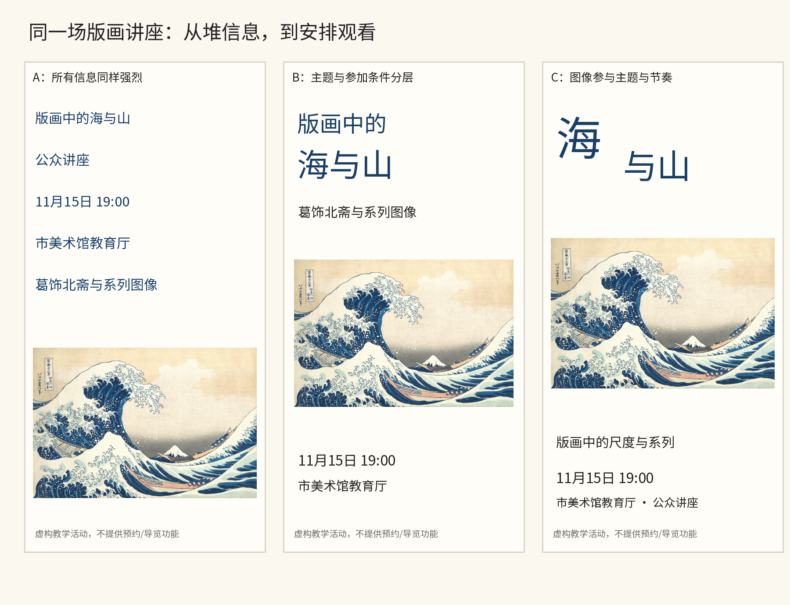
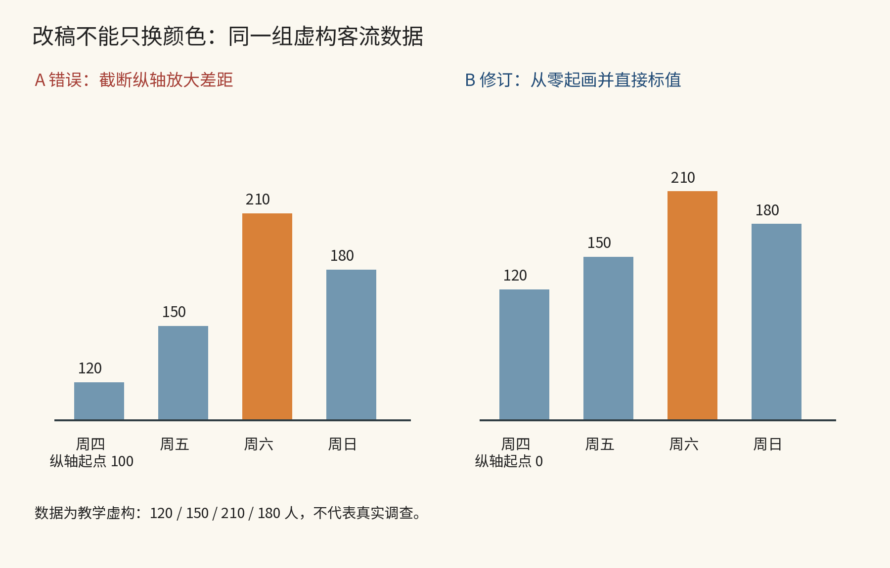

# 第30章｜从看懂到会改：四个有判断依据的练习

本章用四个练习检验前面的观察方法。修改意见应落在具体关系上，例如“日期被图案遮住”“标题与证据没有关系”“三款产品的规格无法对齐比较”。每项练习附参考推导和检查方法；其他方案也可根据同样的条件比较。

## 练习一：把一张讲座海报从信息堆改成阅读路径

任务是一场虚构的“版画中的海与山”公众讲座。材料包括主标题、副题“葛饰北斋与系列图像”、时间“11月15日19:00”、地点“市美术馆教育厅”，以及本书已核实的《神奈川冲浪里》开放图像。所有内容必须保留，但不要求一样大。

先自己排一个版本，限制15分钟。随后看下图的三步，而不是立即抄右侧成品。

图30-A｜原创虚构讲座海报：A把所有字段等强呈现；B建立主题与参加条件的分区；C让图像、标题与空白产生更明确的节奏。三版均使用Met开放藏本，讲座日期和地点为虚构，不能据此报名。[北斋原图](https://www.metmuseum.org/art/collection/search/45434)

A版的问题不是居中本身，而是每条信息都试图成为入口。五行同样强烈的文字，让主题、活动类型、日期与说明争抢注意。读者可以最终读完，却缺少先后。修改之前，应先写出阅读顺序：知道讲什么，判断何时何地，最后补充内容范围。

B版先解决结构。标题变成明确的主题块，日期与地点靠近，图像保留完整观看区域。此时不要急着加装饰。把版面缩小，看能否区分这三个角色；再遮住图片，看信息是否仍成立。若失败，说明结构还需要调整。

C版探索表达。标题中的“海”和“山”形成尺度差，图像与文字之间的空隙成为节奏，参加条件保持完整。它可以更适合某种文化活动的语气，却不自动比B版更好：若活动面向需要快速查阅的人，B版更直接的结构也可能更合适。比较应从用途出发，而不把“最有创意”当唯一目标。

参考检查：五秒后能否说出主题？从预想距离能否找到时间地点？图片有没有被裁到失去所讲的尺度关系？换成长标题以后，日期是否仍然完整？将这些结果写入修订记录，作为调整字体、图像与位置的依据。

## 练习二：让图表的修改对应数据含义

使用一组明确虚构的博物馆日客流：周四120人、周五150人、周六210人、周日180人。图表用于排班讨论，需呈现各日忙闲和人数差距，并指出仍缺少哪些数据。

图30-B｜原创教学数据与图表。A把纵轴起点截到100，柱高对比容易夸大差距；B从零开始绘制长度，并直接标数。120、150、210、180人不代表真实调查，也不支持现实排班决策。

A中的120与210，柱高会表现为20与110，观看者可能得到远大于原数据比例的印象。B用相同的零起点和长度编码，让柱高关系与数值关系一致。直接标值降低读者反复估算的成本，强调周六则帮助定位。强调仍需节制：只有周六使用暖色，其他天保持同类色，不必给四根柱各配一个鲜艳颜色。

这也不是说任何纵轴都必须从零开始。折线图观察微小波动、需要说明基线的分析，可能有不同选择；必须把图形编码与任务连起来。这个例子使用柱长表达数量，零点会直接影响长度意义，因此不能无解释截断。

接着把图放进PPT。页标题不要只写“客流统计”，可以写“周六客流较高，排班仍需看小时分布”。前半句来自这组数据，后半句指出它还没有回答什么。给图注明“教学虚构”，不要因为页面像正式汇报就把它变成真实研究。可结合第二十七章，继续检查页标题的主张是否与图表证据相称。

## 练习三：选择一本书的连续四页，而非只做一个封面

选一个你熟悉的小主题，例如街区修车铺、阳台植物或一条河。准备四个真实内容单元：一段导言、一张整体照片、一张细节照片、一段解释或访谈。若照片不是自己拍的，先记录来源与使用条件。

先画八个小缩略图，再选其中四页成连续阅读。至少有一页负责进入，一页负责细看，一页负责比较，一页负责收束。按各页任务调整标题与图像尺度，同时保留字体等识别线索，兼顾阅读节奏与刊物连续性。

参考推导：导入页可以以整体照片建立空间，细节页把标签与所指对象靠近，对照页使图片处在相近尺度和方向，收束页让一句经过内容支持的观察获得停留。你可以设计完全不同的四页，但应解释每页的责任和翻页后的预期。第二十八章的真实刊物与“桥边市集”小样，提供了可以对照的例子。

判断时遮住所有照片，只看文字块与空隙，阅读顺序是否仍大致可辨？再只看照片，连续四页有没有提供新信息，还是同一张图反复换裁切？最后请另一人说出他读到了什么，不只问喜欢哪一页。记录对方复述的内容，检查重点信息是否传达完整。

## 练习四：给一个系列写出能被别人使用的规则

从前面三项选择一项，整理一页交接说明。写清目的、角色、允许变化、难例和验证方式；同时保留一个正常样本、一个长内容样本、一个失败样本。不要只交最终图片。

以咖啡包装为例，说明可以写成“产品名和类别相邻，三款的规格位置相同，颜色之外同时保留名称与不同图形，长产品名可两行，图形区向下让位”。这比“保持统一风格”更可执行。以PPT为例，可以写“每页标题写出本页主张，证据图紧随标题，数据来源与不确定性可查，超出一页的问题拆成论证步骤”。规则必须与实际样本相互核对。

让一个没有看过你的设计过程的人据此做下一张。先不解释，观察他在哪句停下、在哪个例外里自创规则。根据这些停顿和例外补充说明，分清必须固定的关系与可以调整的做法。

## 怎样判断这次是否学到了东西

用下面的清单看结果，不把它变成机械总分。

| 能力 | 可以看到的证据 | 还不够的证据 |
| --- | --- | --- |
| 观察 | 能指出图中具体位置与关系 | 只说高级、舒服、有氛围 |
| 解释 | 将形式选择连接到任务与观看条件 | 为每个形状编象征意义 |
| 修改 | 一次改变一项并比较前后 | 同时换字体、颜色、图片，无法解释差异 |
| 迁移 | 换题材和内容后仍能应用方法 | 只能复刻同一张经典海报 |
| 交接 | 另一人能够依据说明继续 | 只能靠原作者现场修图 |
| 边界 | 知道哪些结论仍需数据或实物验证 | 把漂亮效果图当实际表现证明 |

完成练习后，保留初稿、修改版与理由，核对每次变化是否改善了对应问题。后续遇到相近任务时，可用这些记录检验方法能否迁移。

本章为原创实践与参考推导。北斋图像的作者、年代、馆藏与处理方式见第二章；客流数字明确为教学虚构；刊物与PPT案例分别见第二十八、二十七章。
