# 第29章｜创作工坊：让设计系统真的长出作品

岸线完整练习之后，本章换用三个独立任务检验方法能否迁移。折光、野序与隙间分别承担展览传播、植物画报与咖啡品牌的工作；它们有各自的内容和视觉语言，不作为岸线设计周的现成应用。比较时沿用任务、图像、规则、适配和验证这条工作线。

本章以折光、野序与隙间三个原创项目，演示从任务、视觉方向、图像素材到可编辑画布的制作过程，并通过更换内容检验设计规则。三个项目及其活动、刊号、商品、价格与时间均为教学虚构，源文件随书保留，可继续修改。

制作中使用三类产物：AI生成的完整视觉提案与无字图像均为位图，用于判断构图和气氛；Canvas将标题、照片、图形与布局拆为可修改对象；设计系统集中管理颜色角色、字级、间距、组件和使用条件。三者共同支持后续改字、换尺寸和制作系列作品。

工程位于 `examples/creative-lab/`。视觉图像由imagegen生成，六个原生项目通过 `npx --yes tingly-design@0.26.1021 new` 创建；可编辑画板、组件预览、检查与导出均已完成。所用版本的文件规范随工程保留，命令入口参见[Tingly Design命令指南](https://github.com/tingly-dev/tingly-design/blob/main/docs/en/cli.md)。折光采用“先生成完整视觉提案，再重建原生画板”的流程；野序与隙间沿用已有素材和工程。

## 29.1 先看见整张作品，再分配制作职责

| 原创项目 | 首要任务 | AI图像负责 | 画布与系统负责 |
| --- | --- | --- | --- |
| 折光 | 识别一次光与感知的展览 | 整张视觉提案、纸面质感与蓝青金红光场 | 重建中文展名、英文、信息层级与跨媒介关系 |
| 野序 | 让人进入植物艺术画报 | 单枝鸢尾、微距纹理与浅粉背景 | 刊名、专题、正文、裁切与编辑节奏 |
| 隙间 | 让咖啡可辨认、可选择 | 俯拍白杯、咖啡与几何日光 | 主张、风味、规格、品类与行动状态 |

三个项目的任务不同：折光需要在远处建立展览识别，野序需要支持连续阅读，隙间需要帮助读者辨别商品和选择计划。这些任务决定图片、文字与空白的分工，也决定系统要保存哪些共同规则。

折光先生成一整张海报。提示词包含中文展名、英文辅助、纸白表面、宋体感字形、蓝青与金红光场，以及活动信息的位置。此时先检查整体构图：标题能否形成入口，光场与空白如何分配，日期是否容易找到；确认这些关系后再拆分组件。


图29-A｜本轮实际生成的完整AI海报提案。展名、英文、光场、日期与场地一起出现在同一张位图内，此时文字不是原生可编辑图层。活动与场地为教学虚构。本图确定视觉方向；后文Main是原生重建版，二者不宣称逐像素完全一致。

提案以“折光”的宋体感笔画作为主要识别，细衬线英文为辅助。斜向暗部、蓝青棱面与暖色亮边共同组织纸白区域，标题、图像与留白的位置因此可以一起推敲。

下一步保留提案的光场构图，另行生成去字底图，将标题、日期和场地交给可编辑排版层。生成后并排核对折面位置、明暗走向与蓝暖交界，确认底图与原提案之间的构图差异。

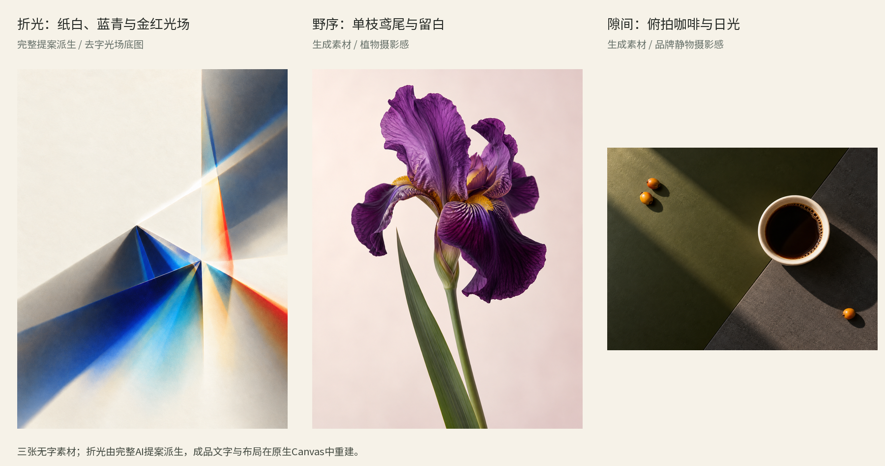

图29-1｜本书实际使用的无字图像联系表，仅缩放并列。左为由完整折光提案派生的去字光场底图，中为野序植物摄影风格图，右为隙间品牌静物摄影风格图。提示说明、生成记录与校验值在工程中保留。

野序使用单枝紫鸢尾与长叶，隙间使用几何日光中的俯拍白杯。折光则沿“完整提案→去字素材→原生重建→跨媒介”的路径继续。排版时需要检查各图的明暗分布：深色花瓣、蓝色暗部和硬阴影会改变小字的阅读条件，应据此安排文字位置与观看顺序。

## 29.2 折光：把视觉提案重建成可以继续工作的系统

### 从整张方向中找出关系

折光保留纸白、墨黑与有方向的光场，并延续中文主识别、英文辅助和活动信息之间的分工。纸白以 `#F2EDDF` 作为共同基准，蓝青承担较冷的展开面，金红形成较集中的暖边。图像内部的明暗与纸纹仍属于位图，不能把每一个像素颜色都当成要进入系统的Token。

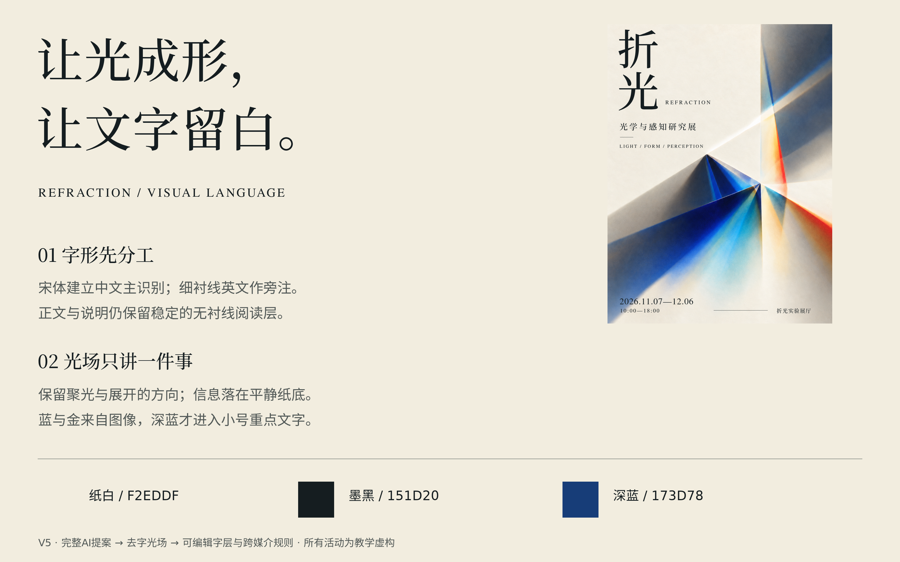

图29-2｜原创规则板：把完整提案中可复用的颜色、文字层级、间距和图像关系整理成原生可编辑画布。原生系统另保存对应规则与组件，不把整张提案位图当成一个不可拆的组件。

中文宋体负责展名的骨架，英文细衬线提供次一级语气；信息字级要能在实际尺寸下阅读。组件记录中英文字的相邻关系、日期地点的聚合方式，以及不同画框的图像取景方式。跨媒介应用由这些关系与颜色角色共同维系。

### 海报：从位图字形到真实文字


图29-3｜原创海报原生重建版，1080×1440。以去字光场为图像层，展名、英文、说明、日期与地点另建为可编辑文字；活动与展厅为教学虚构。重建承接完整AI提案的视觉关系，字形、字距与局部位置经过重新校准，不宣称逐像素复刻。

把提案里的中文变成真实字体，笔画宽度、字面大小与重心会发生变化；英文换成可编辑衬线字后，总宽度和字距也要重新判断。因此，重建时先确认中文标题的位置和尺度，再依次安排英文、展览说明与到场信息。光场的亮线与棱面要保留观看空间，小字则需要稳定的纸底或足够清楚的明暗关系。

检查分两遍进行：缩小画面，观察中文标题、光场与留白的比例；放大画面，核对日期、地点和说明，再换入较长日期，检查文字与光线的间距。这样既检查整体构图，也检查源文件对内容变化的适应能力。

### 邀请：身份保留，信息重新排序


图29-4｜原创横版邀请，1600×900。承接纸白、宋体中文与蓝暖光场，把开幕与到场信息重新组织为横版关系，没有拉伸竖海报或直接把整张AI提案当作邀请成品。

海报优先建立展览识别，邀请优先提供时间与地点。横向版面因此重新处理光场取景与文字聚合，保留中英文字的主次关系，同时调整它们的位置。蓝色暗部可以承担观看的重块，较小的日期地点仍要有稳定的阅读区。换媒介以后，内容优先级可以变，身份需要继续可辨认。

### 三页提案：每页推进一个判断


图29-5｜原创提案01：用一个命题建立展览方向。中文、衬线英文与光场共同说明观看语气，避免把海报的全部活动细节搬进提案首页。

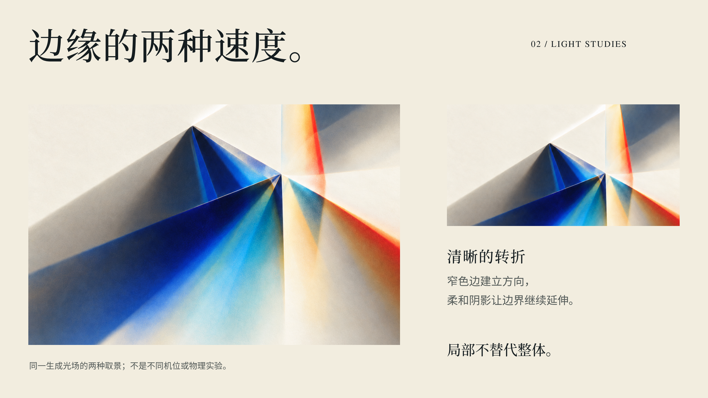

图29-6｜原创提案02：用同一去字素材的不同尺度裁切，讨论蓝色棱面、亮线与暖色边界。它们是AI图像内部的观看线索，不是多个相机视角或真实光学实验的证据。


图29-7｜原创提案03：让同一语言进入海报与邀请，保留各载体真实比例。三页均为可编辑Canvas画板，工程未冒称交付PPTX。

第一页提出命题，第二页让读者观察图像如何引导视线，第三页检查身份怎样进入不同媒介。三页共享字体、色彩角色和边界处理，图文比例则随各页论点调整；后续页面也可据此安排内容。

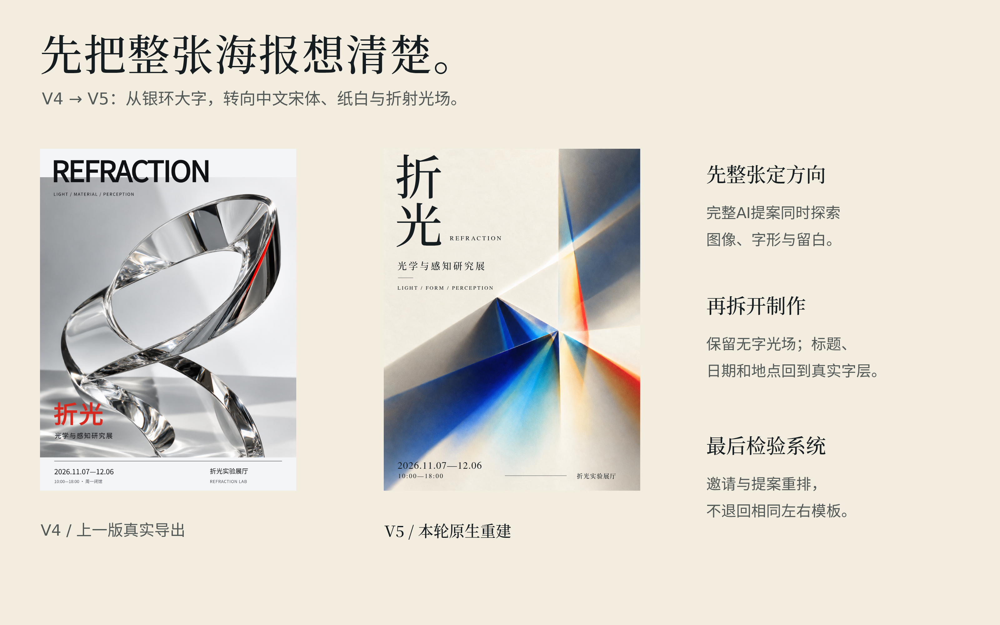

图29-8｜原创V4→V5真实方向修订对照。上一版为银色玻璃环与大英文主识别，本轮转为纸白光场与中文宋体主识别；主视觉、字型角色和布局共同改变，不是同素材的单变量实验。

旧方向把冷白、玻璃体量与大英文放在前景，新方向把中文笔画、纸面与有色光的关系放在前景。比较时可以分别观察标题入口、图像占位、英文层级，以及日期地点的阅读区域；由于主视觉、字体和布局同时变化，无法把整体差异归因于单个字号。

这次修订采用先确认完整AI提案、再生成无字底图、最后以真实字体和组件重建的顺序。下一张邀请或提案可以沿用已确认的文字层级与图像关系，再针对新内容调整。

## 29.3 野序：让单枝影像成为编辑节奏

### 为复杂图像留出稳定的阅读区

奶油纸承载长文，深梅紫负责刊名和正文，苔绿负责图注、日期和页码，温粉只作少量点缀。颜色来自植物影像的关系，却不把每一种花瓣紫都扩成文字颜色。Noto Sans SC负责中文身份与正文，Nimbus Roman的真实常规、斜体负责英文编辑语气；两者在角色上对照。斜体不是把直立字机械倾斜，工程保存了相应字体文件。

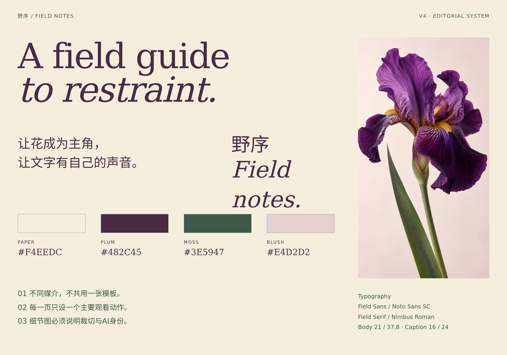

图29-9｜原创编辑规则板，1600×1120。原生系统保存颜色角色、三份离线字体、文字样式与间距，以及刊头、图注、活动信息组件。

密集花瓣容易干扰文字轮廓，因此规定正文留在稳定纸底，展示字只跨过浅色图像边缘。这样的规则明确了叠字范围，也为后续裁切与留白提供依据。

### 封面：让名字、图像和选题各有位置

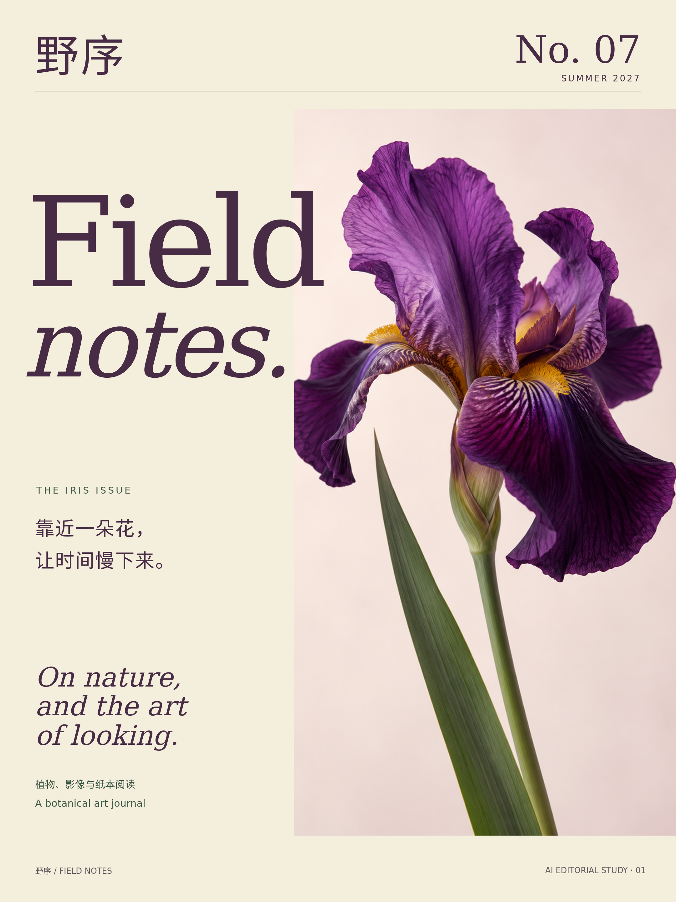

图29-10｜原创画报封面，1080×1440。刊名、英文、期号、专题和页脚均为原生文字；换刊号不需要重新生图。刊物与期号为虚构。

中文刊名与期号固定在顶部，较大的英文Field notes建立本期阅读语气；右侧长摄影让花头与长叶相连，左侧专题文字在纸底展开。Field略跨入浅色图像边缘，notes一行收回纸底，末尾不与深紫花瓣撞色。叠字范围由文字的连续可读性决定。

这里没有加入采集地、真实摄影者或植物标本编号，因为素材是AI生成的摄影风格图像。它可以帮助讨论轮廓、纹理和编辑尺度，不能冒充一次真实植物调查。

### 跨页：图像放大，文字展开


图29-11｜原创双页，1800×1200。中部为跨中缝的AI摄影风格图像，两侧是实际完整文章；正文、图注和页脚分别留位，原生工程可放大阅读和逐段修改。

跨页将图像移到中部，连接左右两边文章；英文展示题、中文题与四个短节各有层级。阅读先沿左边两节向下，再进入右边两节，正文不跨中缝。图片跨缝会在纸质装订中损失一部分细节，因此实际付印还要按纸张和装订方式打样，不能把屏幕上连续的画面当作制造保证。

两边文章有不同列宽，不用强行把每栏字数填到一样多。小节之间留出可见停顿，图注紧邻图像，页码放到外侧页脚。这样，空白既分开内容，也让人知道哪一段已经读完。排版时必须放入实际文章，再看末行与页脚，不能用几行灰条代替阅读。


图29-12｜原创花展广告，1080×1440。窄日历信息脊与近乎全高的花朵影像并置；活动、日期与场地为教学虚构。

广告沿左侧窄栏组织日期、时间与地点，右侧以近乎全高的花朵作为主要观看对象。刊物字型、颜色和边界处理得以延续，信息结构则围绕到场任务重新安排。

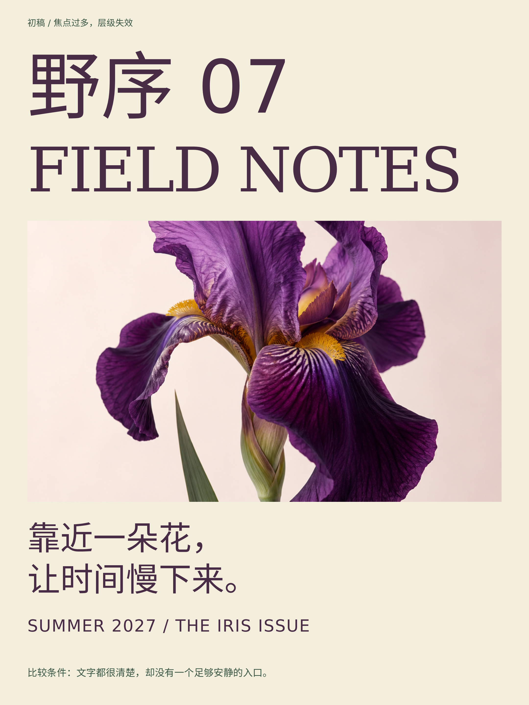

图29-13｜原创受控反例：各部分仍可读，但刊名、英文、花朵与口号都争当焦点。它是本轮教学比较版，不冒充V3成品或真实编辑草稿。

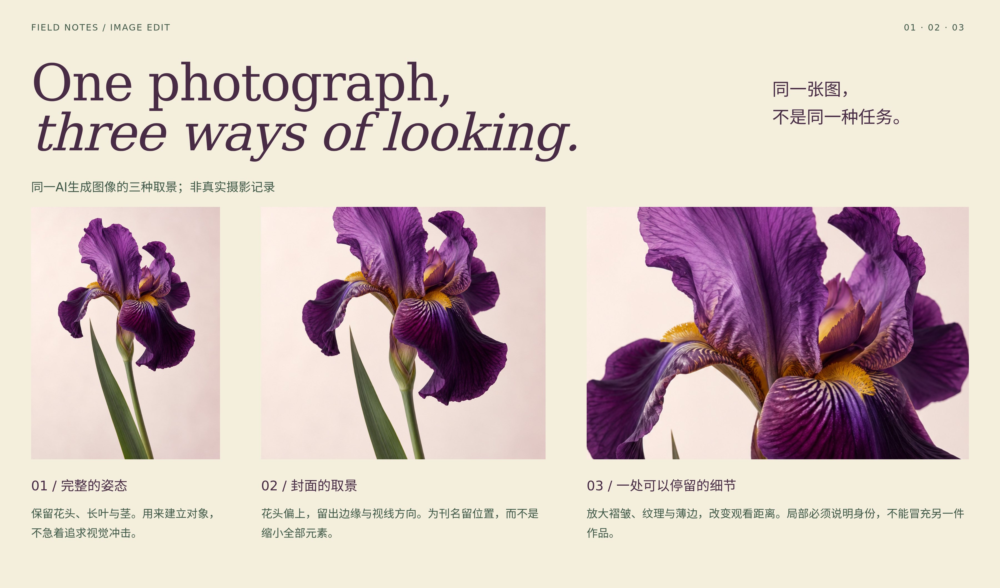

图29-14｜原创裁切推演：通过不等宽画框对照全枝、封面取景与花瓣细节。三处图片均来自同一实际生成素材。

反例中的文字虽然没有遮挡、对比也足够，刊名、英文、花朵与口号的权重却过于接近。裁切研究进一步把取舍具体化：全枝保留生长方向，封面裁切让标题与花头相邻，细节裁切让纹理成为内容。它们来自同一AI图像，改变的是观看尺度，并非三个独立摄影作品。

## 29.4 隙间：把材料气质接到包装与选择

### 按阅读与行动分配色彩

纸白为表面，石墨色负责阅读，橄榄绿连接摄影与品类，鲜橙只承担少量强调。新方向把“间隙”作为记忆点：字标、留白与成对边界让内容之间出现可见停顿。根据阅读、比较与行动的位置分配各色的面积和强度。

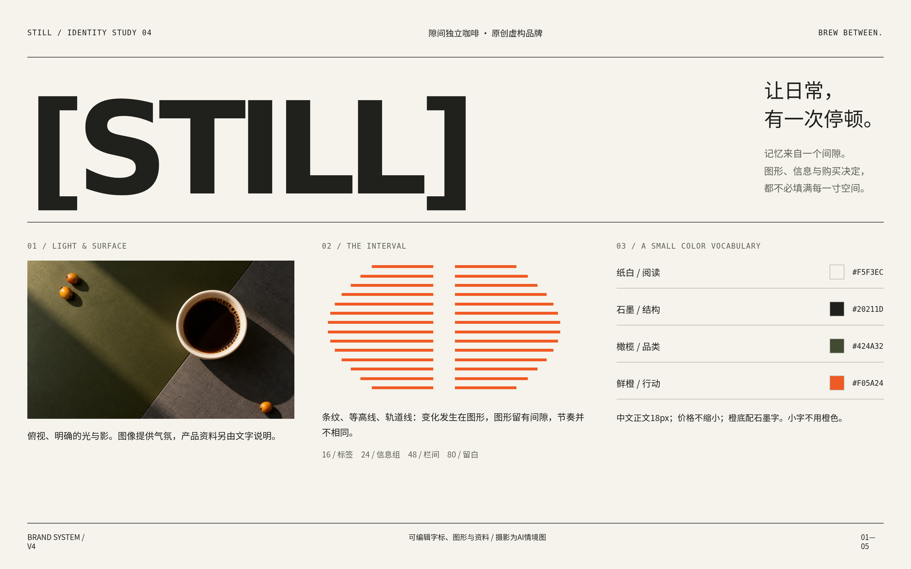

图29-15｜原创品牌规则总览，1600×1000。摄影、字标、颜色、字级与风味语汇一起出现；它是规则板，后面是广告、包装与商业页面成品。

系统保存十个颜色Token和日间、夜间两主题，以及文字、间距、边角和三个组件。夜间不是照片反相：表面变深，正文和行动成对变亮。照片仍保持材料颜色，按钮仍有清楚的优先级。

### 广告：让一句主张与质感互相解释


图29-16｜原创广告，1600×900。AI俯拍素材与横向展示字构成传播画面，主张、说明、规格、价格与行动均可编辑；品牌和金额为教学虚构。

俯拍白杯、几何色面与硬日光让咖啡有明确的形与方向。较强的横向展示字提供主张，细节与行动退到相应位置。与上一版“左文右图”的分栏相比，新稿让图像占据更大范围；价格等小字避开明暗交界，保留稳定对比。

图里的黄色小果实只是造型与色彩情境，没有作为咖啡品种、产地或生产事实的证据。包装板将文字、编号与图形放在可编辑层，以便单独修改产品信息。

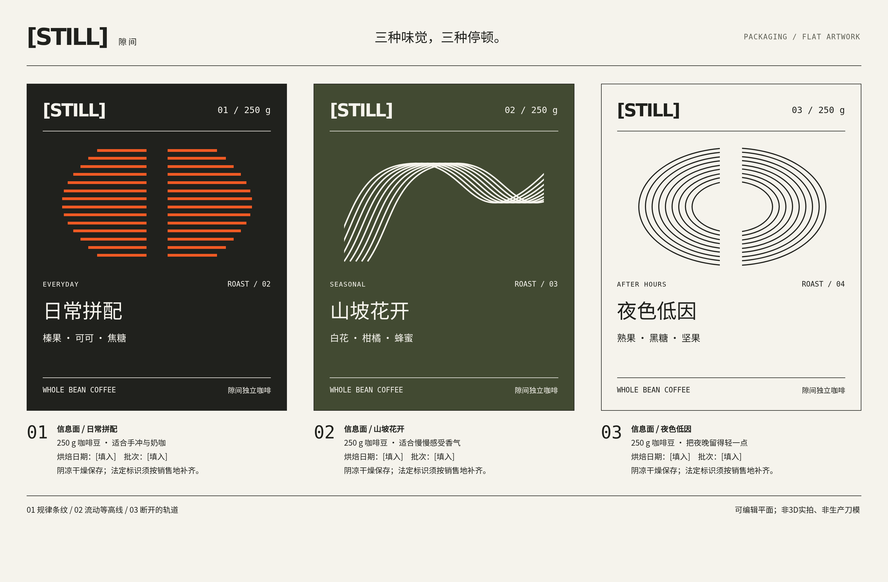

图29-17｜原创包装正面与信息面，1600×1050。为可编辑二维学习稿，未冒称3D实拍、刀模或可投产文件。

三款共享字标、编号、名称、风味与净含量的骨架，却给条纹、等高线与轨道三种图形各自的节奏。远处可通过图形密度与方向区分三款，近处再读名称与规格。新增第四款前，先决定它在系列里如何被识别，再让它进入共同信息结构。下方信息面为日期和批次留位；实际生产还需要确定尺寸、材质、刀模并完成打样。

### 电商：选择、价格与反馈同步变化

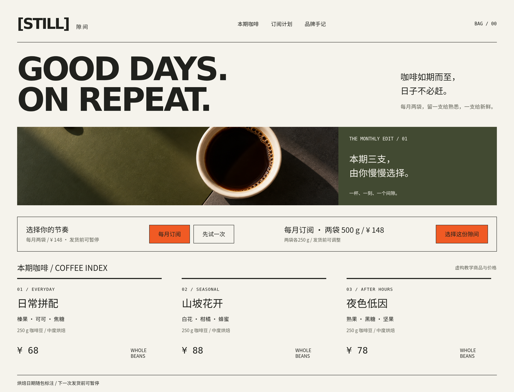

图29-18｜原创可交互Canvas，1440×1100。Play模式可切换月订阅与单次购买，说明、总价和本地反馈同步变化。PDF显示静态状态，不执行购买。

页面让品牌抬头、订阅选择与商品信息分工。包装中的名称、风味和图形继续进入商品区域，主要行动有清楚优先级。切换计划时不只换按钮色，价格和说明也改变：月订阅148元，一次购买156元，确认产生本地教学反馈。工程没有真实订单或扣款。

调整字标和商品排列后，在Play模式切换两种计划，再回到初始状态，核对计划名称、金额说明与本地反馈是否对应。商品照片旁保留明确名称，以支持识别和选择。

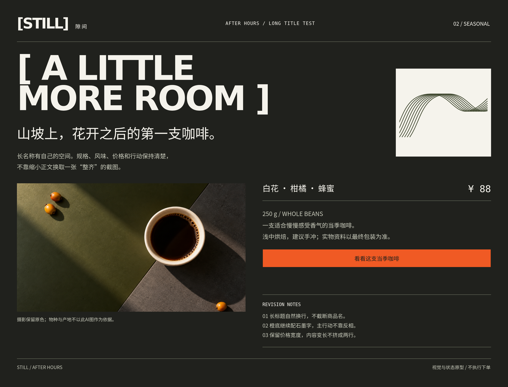

图29-19｜原创压力测试：夜间表面、长商品名、风味和价格共同出现。照片不反相，正文与行动配对变化，长标题允许自然换行。

长标题通过增高内容区、保留信息组间距来容纳。夜间主题调整表面、正文与行动的配色，保留照片色彩以及图形和品类的对应关系。修订时同步检查视觉风格、阅读条件和交互状态。

## 29.5 将系统安装到画布

三套原生系统都包含 `design-system.json`、`tokens.json`、字体、组件实现与可运行预览，README说明图像、语气及使用边界。折光的展名、野序的刊头与图注、隙间的商品卡均已实现，九个主要组件的预览已完成调用检查。

安装到画布后，Token与字体保存为本地快照，索引记录来源与版本。上游改颜色，不等于既有内联数值自动重写：应重新安装或运行明确的同步步骤，再检查画板。快照提供共同词汇，实时绑定是另一项实现选择。

文字和形状保持可选对象，图片承载复杂材质与摄影风格影像。隙间的Canvas商品卡用可编辑模板承接信息结构，让名称、价格和风味可以继续修改。工具检查与导出也不一定重编上游CSS；工程保留通过原生Token写入触发官方编译器的步骤，使基础数据到预览的路径完整。

## 29.6 打开工程，做一次自己的修改

进入独立创作包中的 `creative-lab`，执行：

```bash
npx --yes tingly-design@0.26.1021 --projects .
```

也可只打开一套：

```bash
npx --yes tingly-design@0.26.1021 open ./field-canvas
```

版本固定让书中格式与软件对齐。首次取得软件需要联网，字体和图片已经本地保存；查看和手工修改不要求另一个AI模型账号。提示词、生成素材与原生文件一同保存在工程中，便于追溯制作与修改过程。

| 检验 | 修改动作 | 观察结果 |
| --- | --- | --- |
| 内容 | 折光两字展名改六字 | 层级保留，时间地点完整 |
| 图像 | 野序换一幅更浅的植物影像 | 裁切有理由，文字不压复杂背景 |
| 系列 | 隙间增加第四款 | 名称、规格和风味进入共同骨架 |
| 媒介 | 海报改横邀请、封面改广告 | 信息顺序响应任务，身份线索保留 |
| 主题 | 日间改夜间 | 表面、正文和行动配对改变 |

检验分为三个层次：文件能否正确打开，当前画面是否存在裁字、缺图和重叠，更换标题、图片与状态后规则是否仍适用。保留每次修改的输入和结果，便能逐步确认系统适用的范围，并找到需要补充的规则。

这些原生文件提供了继续修改的起点。下一章把真实品牌放回各自任务中对读，比较哪些关系值得借鉴、哪些依赖具体的内容与媒介；再进入贡献、版本与交接的维护工作。
