# 第32章｜当代现场：六个真实品牌怎样让规则继续生长

历史案例让我们看见系统从哪里来，当代案例则让我们检查：同一套关系怎样进入手机、商品、字体、社群与活动现场。本章选取2023—2025年的六项更新，不把“新”当作质量证明。每节都从实际作品出发，说明共同线索、媒介差异和可迁移的方法；未公开的内部规范、效果数据与实施细节不靠猜测补齐。

| 案例 | 核心问题 | 对照的实际应用 |
| --- | --- | --- |
| Pepsi 2023—2024 | 如何更新已有记忆 | 罐身、服装、品牌空间 |
| Reddit 2023 | 产品行为如何长成语言 | 角色与字标、社区织章、手机壳 |
| Wise 2023 | 表达浓度如何随任务变化 | 卡片、户外、手机与视觉总览 |
| Spotify Mix 2024 | 字体如何连接情绪与阅读 | 字形、歌单、产品界面 |
| Config 2025 | 图形如何跨过屏幕与空间 | 贴纸、导视、装置、海报墙 |
| Decathlon 2024 | 识别怎样承接不同运动 | 影像、字体、服装与户外传播 |

这些是品牌方或原设计团队公开展示的材料，可能包含照片、效果展示与界面合成，图注逐项说明。本书的观察不是它们的官方规范，也不把静态图当作交互或传播效果的实测。

## 32.1 Pepsi：把一个圆变成会扩张的身份

**项目档案｜2023年发布新识别，2024年启动全球铺开；PepsiCo内部设计团队。** 这个案例适合纠正一种误解：品牌更新不必抹掉记忆。新系统把大写字标放回红白蓝圆形的中心，加入电光蓝与黑色，并用围绕圆形扩张的“脉冲”组织传播。可核对[PepsiCo设计案例](https://www.pepsico.com/en/innovation/case-studies/2023/pepsi-global-redesign)与[2023发布说明](https://www.pepsico.com/newsroom/press-releases/2023/pepsi-unveils-a-new-logo-and-visual-identity-marking-the-iconic-brands-next-era)。

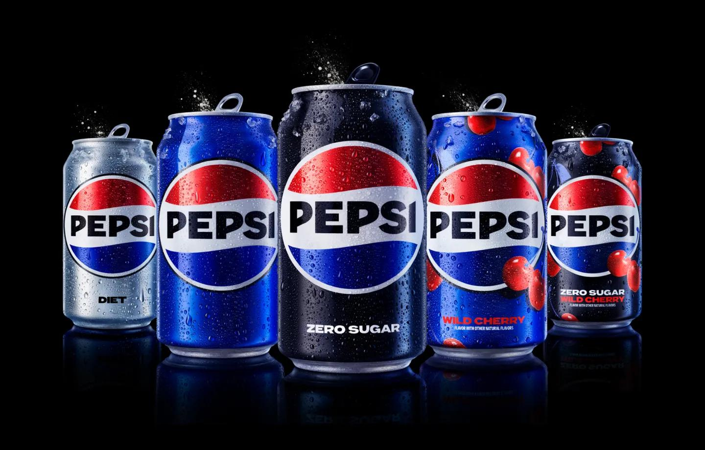

图32-1｜真实品牌应用：PepsiCo官方案例中的罐装系列。新识别2023年公布；本图具体拍摄日期未注明。© PepsiCo及相关创作者，教学评论引用。 [原始出处](https://www.pepsico.com/en/innovation/case-studies/2023/pepsi-global-redesign)。

先看五只罐。共同的圆形识别、居中大写字标与白色横带，让它们在不同底色和口味图像上仍是一组；零糖产品增加的黑色没有另起一套图形语法。圆形可放大到接近罐身宽度，让白带与字标在远处形成一个整体，而不是在复杂摄影上放一个很小的logo。

这对包装有两个启发。第一，家族关系靠稳定的相对位置和比例建立，不能只靠每款出现相同颜色。第二，口味差异要有自己的空间。红色樱桃、深色表面与辅助文字支持区分，同时不挤走主识别。若把所有罐统一成同一蓝色，又让每种口味只剩一行很小的字，整齐可能增加，选择却会变难。

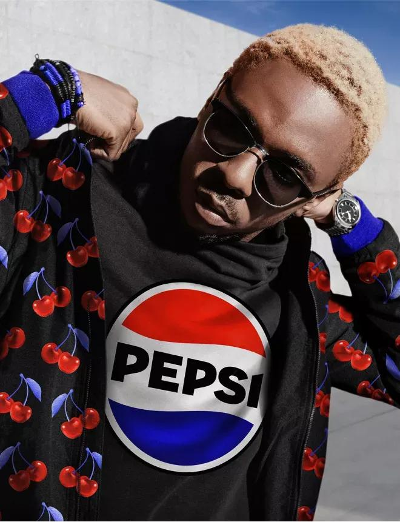

图32-2｜真实品牌应用：官方案例中的服装造型与大尺度胸前识别。图片是品牌传播画面，不代表本书评价其商品质量或传播效果。来源同上。 [原始出处](https://www.pepsico.com/en/innovation/case-studies/2023/pepsi-global-redesign)。

换到衣服上，包装上的营养、容量和口味层级消失，圆形反而获得完整的大面积。衣服不是把罐身信息原样印一遍。这里保留的是最有识别力的形态，把适合当前媒介的身份放到前景。旁边的樱桃图案与人物姿态增加节奏；它们不是识别系统每次都必须带上的附件。

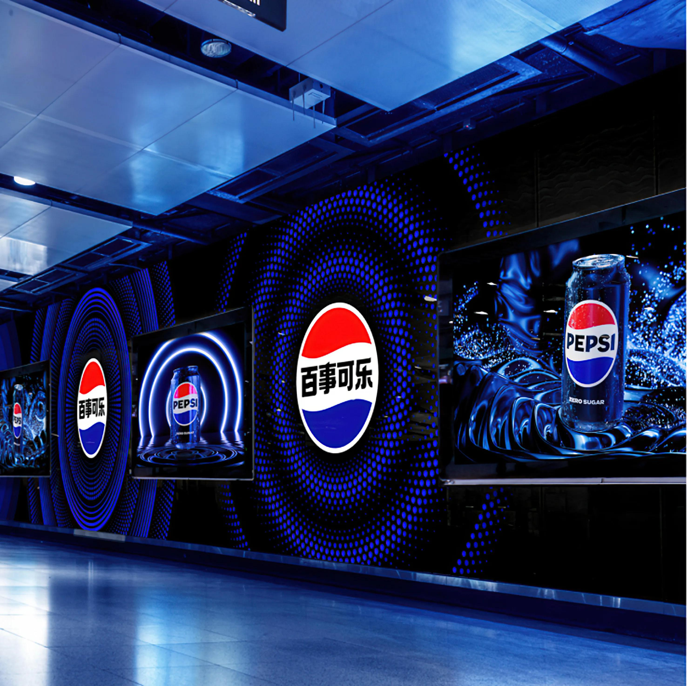

图32-3｜真实品牌应用：官方案例展示的沉浸式品牌空间。蓝黑光点环绕圆形主识别；本页为静态照片，不以此证明现场动态的速度、时序或观众感受。来源同上。 [原始出处](https://www.pepsico.com/en/innovation/case-studies/2023/pepsi-global-redesign)。

到了空间，圆形周围的蓝黑点阵变成了主要内容。脉冲让logo之外的墙面也能说同一种话：中心、扩张、强对比与反复的圆周。静态图片可看出这种构成，实际运动则需回到原案例中的动态材料。系统有了运动倾向，不等于设计者可以任意加旋转、粒子和闪烁。

**带走的规则。** 先选能在小包装和大空间都成立的识别核心，再决定它如何扩张。练习时可以给一个虚构饮料画圆形识别、罐身、竖屏广告与空间入口；先遮住字标，检查其余图形是否仍相关。不要借用Pepsi标志做自己的商标，也不要把这种高对比节奏直接套进需要安静阅读的长篇页面。

## 32.2 Reddit：让产品里的“对话”长成品牌语言

**项目档案｜2023年；Reddit与Pentagram，合伙人Natasha Jen及团队。** 项目整理了吉祥物Snoo、对话气泡、字体、颜色与运动行为。这里特别值得看的是：品牌的生成规则来自产品的活动——人们发表、回应和延展一段对话，而不只是选一个流行的3D风格。事实与作者见[Pentagram项目档案](https://www.pentagram.com/work/reddit)和[Reddit官方更新说明](https://redditinc.com/news/evolving-the-reddit-brand-a-more-accessible-bespoke-typography-new-conversation-bubbles-and-colors-and-a-new-snoo-logo-now-with-opposable-thumbs)。

图32-4｜真实品牌作品：Pentagram展示的Reddit识别与立体Snoo。系统为2023年更新，图片权利归Reddit及相关创作者；本书未重绘吉祥物。 [原始出处](https://www.pentagram.com/work/reddit)。

橙红底上的白色字标没有依靠复杂材质，Snoo则带有圆润体积与高光，两者有意分工。字标让名字迅速被读出，角色负责表情与陪伴。并不是系统里每个元素都要同样立体。若字标也做得像软塑料，照片、角色、标题可能一起争夺注意力。

对话气泡还进入了字形内部的空白与外部承载内容的形状。字体、图形容器和动态之间因此有了共同来源。它提示我们寻找一种“可以继续变化的动词”：容纳、回应、展开、堆叠。动词比“年轻、活泼、数字化”更容易转成下一张版面的具体动作。

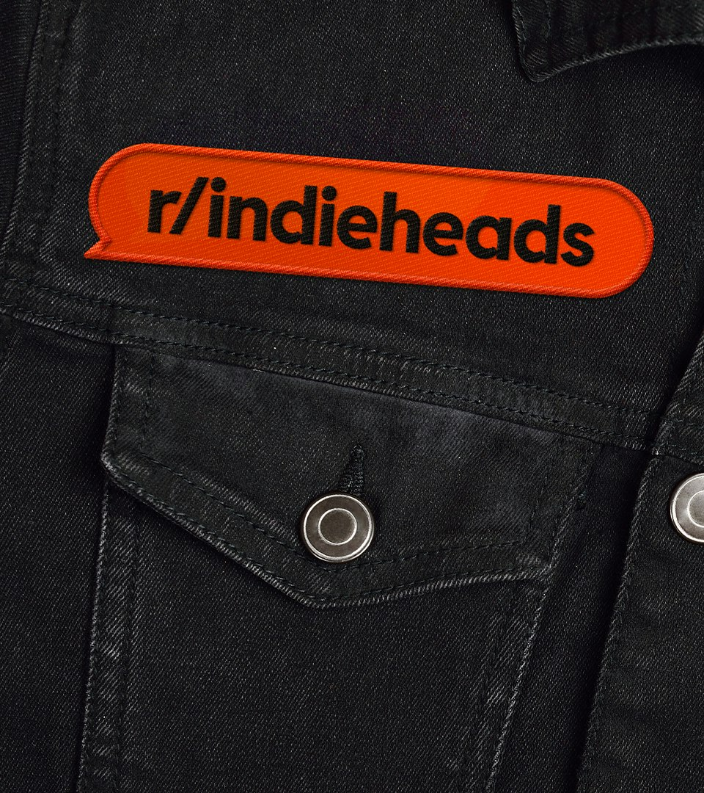

图32-5｜真实应用展示：印有r/indieheads的对话形织章。由Pentagram案例提供；属于品牌应用展示，不以照片推定具体生产批次或销售情况。 [原始出处](https://www.pentagram.com/work/reddit)。

织章把平台里的社区名称带进衣服。橙色容器足够简单，长一些的名称仍可占据内部；外轮廓和尾部让它有“发声”的含义。细看时还会发现，社区文本并未统一变成公司的大字标。中央身份和社区表达可以共存，这比把所有名称都换成同一个固定logo更适合这种产品。

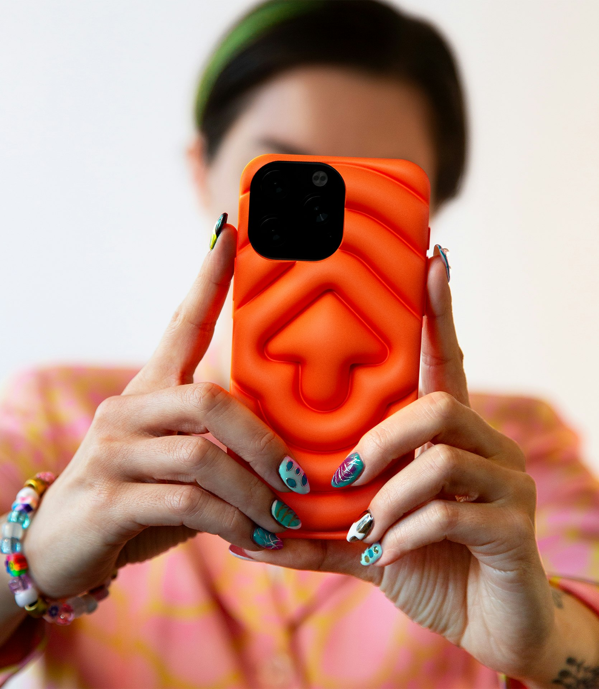

图32-6｜真实应用展示：Pentagram案例中的手机壳，把向上投票的箭头做成具有厚度的触感图形。它是品牌应用照片，不是软件界面截图。 [原始出处](https://www.pentagram.com/work/reddit)。

手机壳把另一项产品行为——向上投票——转译为实体表面。箭头尺度很大，即使手遮住一部分也仍能辨认；橙色与圆角延续整体语气。它没有复制完整讨论串，这正是媒介转换的关键：选择与当前物件适配的线索，而不是把所有产品元素都塞进去。

**带走的规则。** 先列出一个产品最有意义的行为，再为其中一个行为找可变的图形规则。做一次对话卡、活动贴纸和短动画分镜，检查图形是否能容纳不同长度。品牌气泡不能代替界面里的真实按钮、焦点与阅读顺序；装饰做得统一，并不能证明交互可用。

## 32.3 Wise：同一品牌可以同时大胆与克制

**项目档案｜2023年发布；Wise与Ragged Edge。** 鲜绿、粗壮标题、来自不同地方的符号与织毯式图像，是这一轮更新的明显线索。资料见[Wise发布文章](https://wise.com/gb/blog/a-brand-for-everywhere-wise-unveils-bold-new-look)与[Ragged Edge项目说明](https://raggededge.com/partnerships/wise)。要学习的是它们怎样在广告与操作界面之间分配浓度，而非记住某个绿色色值。

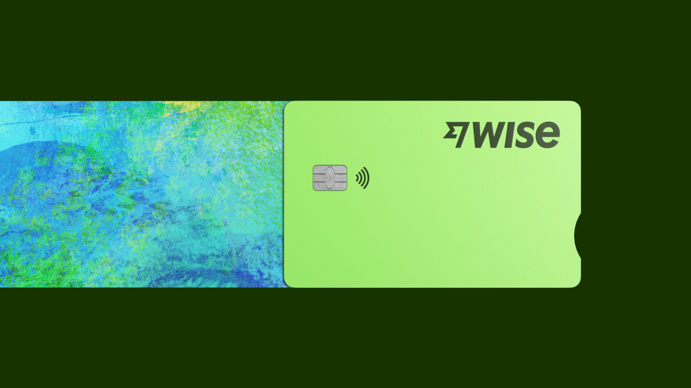

图32-7｜真实品牌发布图：鲜绿卡片与织毯式图像并置。来自Wise于2023年3月发布的文章；原文后续更新，因此不将网页现状误称未经改变的发布档案。© Wise及相关创作者。 [原始出处](https://wise.com/gb/blog/a-brand-for-everywhere-wise-unveils-bold-new-look)。

这幅图把两种不同密度的表面放在一起。左边色彩、颗粒与纹理丰富，右边卡片留出大片单色，只保留必需的识别与卡片元素。纹理带来地方、旅行与人的联想，空白则保证实体卡仍可识别。如果把复杂纹理铺到所有小字背后，“丰富”很容易变成无法稳定阅读。

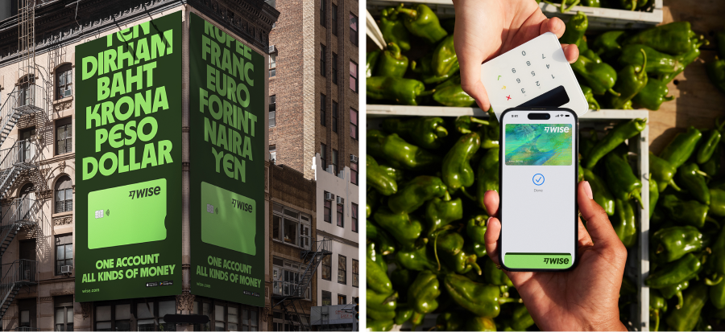

图32-8｜真实品牌应用：Wise官方文章将户外广告与手机使用场景并列。左侧为大标题传播，右侧为产品使用照片；无法从静态图验证具体交互。来源同上。 [原始出处](https://wise.com/gb/blog/a-brand-for-everywhere-wise-unveils-bold-new-look)。

广告上的货币名称垂直叠起，几乎把整块牌面变成语言的节奏。单词很多，却不按长文章的方式阅读；路过的人先感受绿色与字块，再捕捉几个熟悉名称。手机屏幕的任务不同：余额、金额、字段和行动需要明确次序，品牌浓度退回图标、重点色与局部表面。二者共享身份，信息密度与对比节奏却不能相同。

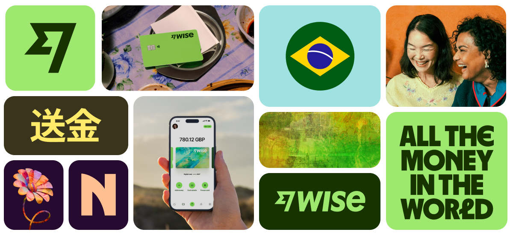

图32-9｜真实品牌总览：Wise发布文章中的字形、符号、人物、手机与纹理组合。它展示视觉语言的范围，不表示所有元素必须同时出现在每一页。来源同上。 [原始出处](https://wise.com/gb/blog/a-brand-for-everywhere-wise-unveils-bold-new-look)。

拼图里有中文字样、国别相关符号、人物与不同质地。多样性如果只有“多收集一些图”就很难维护；这里让绿色、深色文字和强烈的字形比例反复出现，为差异提供共同底层。图像可丰富，读字的条件要稳定。这种关系比整套作品永远只有一种背景更有延展性。

**带走的规则。** 为同一个虚构服务做三档表达：户外广告最浓、品牌介绍页居中、金额确认页最克制。写明哪里可以放纹理、哪里必须有稳定底色、金额和状态如何表达。金融产品还必须清楚区分费用、金额和操作结果；本书的视觉分析并未验证其合规、可访问性或商业效果。

## 32.4 Spotify Mix：同一套字，不把所有音乐变成同一种表情

Spotify于2024年5月22日介绍定制可变字体Spotify Mix，合作方为柏林字体工作室Dinamo；这次发布涉及品牌表达与产品界面，而非只换一个孤立字标。以上为官方发布信息；下文主要分析实际应用中可见的关系。[CT-SP1]

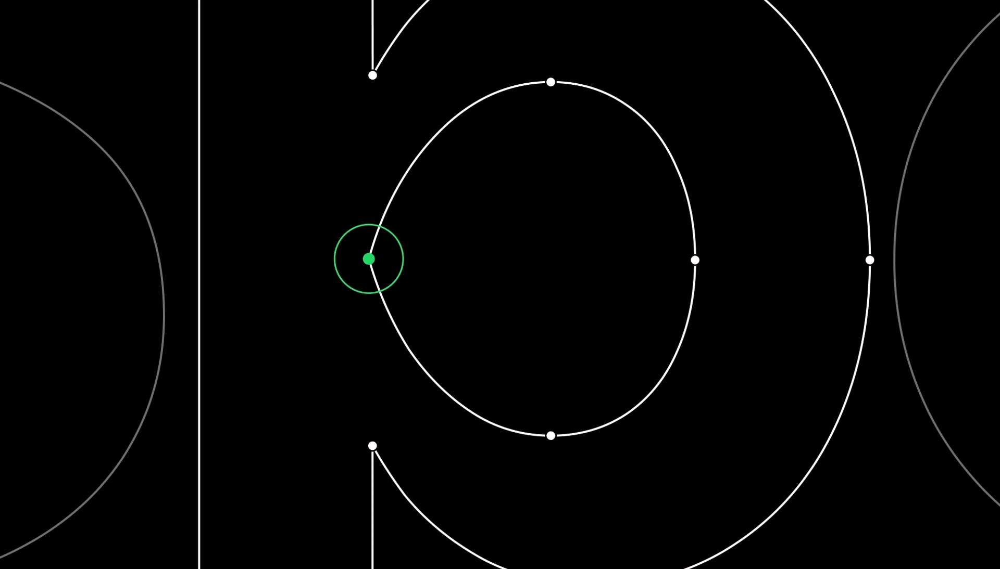

图32-10｜真实案例：Spotify官方发布动画第35帧（零起），1920×1094；静态取帧，未重画曲线。字体与品牌设计归Spotify及Dinamo等相应权利人。此图呈现字形轮廓与节点的视觉表达，不是可编辑字体工程截图。[CT-SP1] [原始出处](https://newsroom.spotify.com/2024-05-22/introducing-spotify-mix-our-new-and-exclusive-font/)。

先看这张轮廓图：字被放大到超出边界，曲线的转折、曲直相接的位置和少量绿色提示成为主角。它让平时被读者当成透明工具的“字”，暂时变成值得观看的形状。这个展示方式强调塑造过程，却不能证明某条动画曲线就是字体文件中的真实控制点；也不能据一个静态帧猜测可变轴范围。本书保留这一限制，是为了让学习者分清品牌发布的表达与制作工程的证据。

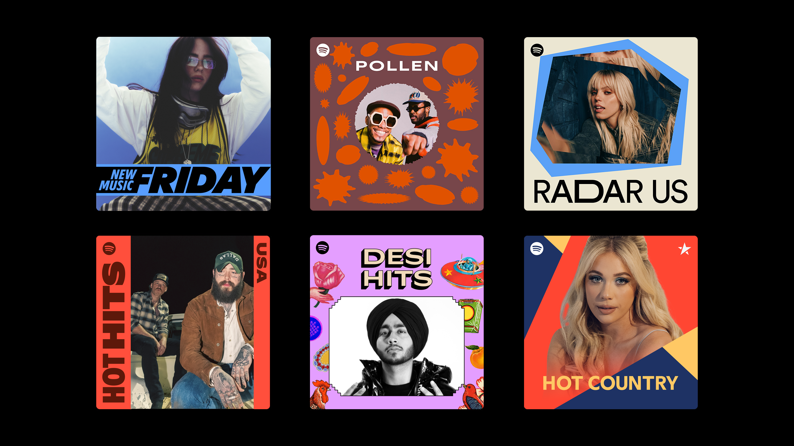

图32-11｜真实案例：官方发布页并置的六张歌单封面应用，2500×1406；不是本书重新排版的示意。©Spotify及各封面、艺人影像的相应权利人，仅随本书分析引用。[CT-SP1] [原始出处](https://newsroom.spotify.com/2024-05-22/introducing-spotify-mix-our-new-and-exclusive-font/)。

把注意力转到六张封面。左上蓝黑文字的倾斜，与人物身体共同制造方向；右上的黑色短标题则采用更平稳的横向排列，让照片与浅色背景成为主要辨认线索。橘色封面的装饰和居中肖像比较密，右下的文字却更像贴在人物下部的短标签。若只记住“字很有性格”，会错过真正可迁移的方法：标题的角度、大小和放置位置，需要与每张照片留下的空间一起决定。

同时不要把图读得过满。发布页将新字体与这些应用并置，不代表每张封面的每个轮廓都必然只由一个字体参数自动生成；成品也可能包含专门改字或其他图形处理。我们可以确认各封面使用了不同的图文主次，却不能仅凭成品反推出完整制作流程。这种克制比神化一个“万能可变字体”更有用。

<!-- figure-height: 150 -->

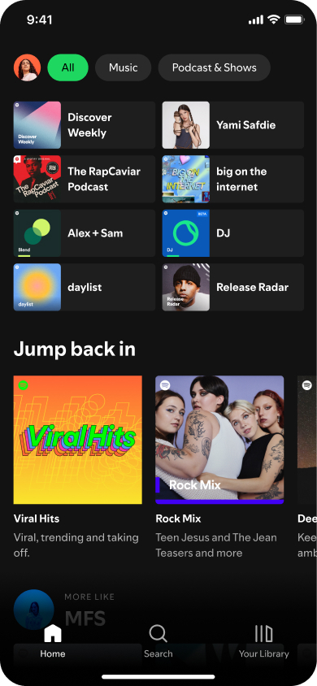

图32-12｜真实案例：同次官方发布中的手机首页，原始素材390×844；保留完整截图。这里看标题、封面与导航的分工，不将小字放大后补绘为假高清。©Spotify及相应内容权利人。[CT-SP1] [原始出处](https://newsroom.spotify.com/2024-05-22/introducing-spotify-mix-our-new-and-exclusive-font/)。

界面里的要求变了。跳转入口需要被找到，列表需要连续浏览，歌单封面则在小矩形中保留自己的性格。主标题的粗细和位置相对稳定，封面上的夸张文字没有扩散到每一个导航标签。两种语气共存：音乐内容可以各有表情，承载内容的产品框架保持可预测。字体系统的价值因此不只在于制造变化，也在于限制变化出现的地方。

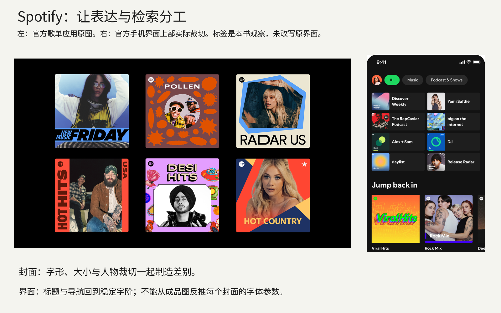

图32-13｜本书分析：左为官方歌单图，右为实际首页上部裁切；中文标签为本书观察。没有灰条替代、生成补字或重画界面；原图权利沿用上述归属。[CT-SP1] [原始出处](https://newsroom.spotify.com/2024-05-22/introducing-spotify-mix-our-new-and-exclusive-font/)。

可以为自己的小型影展做一次迁移：用两张自有照片做两张宣传封面，再做一页日期与场次列表。封面允许改变标题角度和尺度，列表只保留稳定字阶。把三张作品同时缩小，先问能否分辨不同场次，再问能否找到日期。若所有字都在表演，信息就没有可靠的落点；若全部文字完全同形同大，内容又可能失去区别。

取舍同样清楚：富有表达力的字体需要更细致的组合、字符覆盖与小尺寸检查，不能因为“定制”就假定它适合所有语言和任务。发布图展示的是可用的视觉方向，不是用户偏好、无障碍表现或商业增长的证明。值得学习的是表达与检索的分工，而不是追逐最新的字体名字。

本节来源：

- [CT-SP1] Spotify Newsroom，Introducing Spotify Mix, Our New and Exclusive Font，2024-05-22：[官方发布与全部原图](https://newsroom.spotify.com/2024-05-22/introducing-spotify-mix-our-new-and-exclusive-font/)。官方访谈对象为Rasmus Wängelin；字体合作方Dinamo Typefaces。图像未声明开放许可。

## 32.5 Config 2025：让图形走进空间，也让导视保持好读

Figma于2025年7月3日发布Config 2025视觉身份回顾，文章作者Matt Alagiah。项目由Figma Brand Studio完成，Leandro Castelao担任创意主导；官方说明其图形以基础形状构成，并使用Figma Sans的紧缩版本。本节将这些机构事实与实际照片的观察分开。[CT-FG1]

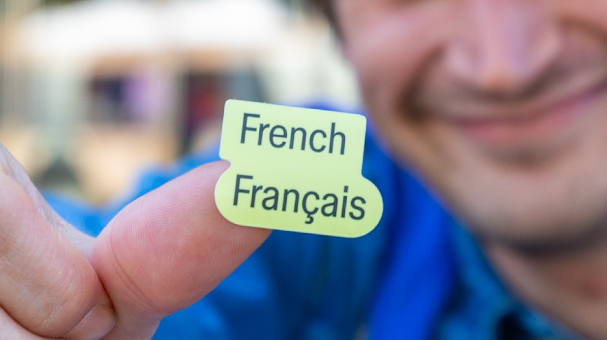

图32-14｜真实案例：Config 2025语言贴纸的实际照片，1884×1058。视觉身份归Figma Brand Studio；摄影依官方文章总署名，详本节来源及图像档案。图中两行文字、贴纸外形与手指均为原照片内容。[CT-FG1] [原始出处](https://www.figma.com/blog/how-we-shaped-the-visual-identity-for-config-2025/)。

这张贴纸很小，却不是缩小的大会主舞台。两行词组保持清楚间隔，紧凑字形让较长的单词仍能作为完整单位出现，外轮廓则跟着文字形成局部转折。手指和人物脸部提供了真实尺度参照：品牌表达必须在手里、衣服上、交谈距离中成立，不能只在大屏幕的理想空间里好看。

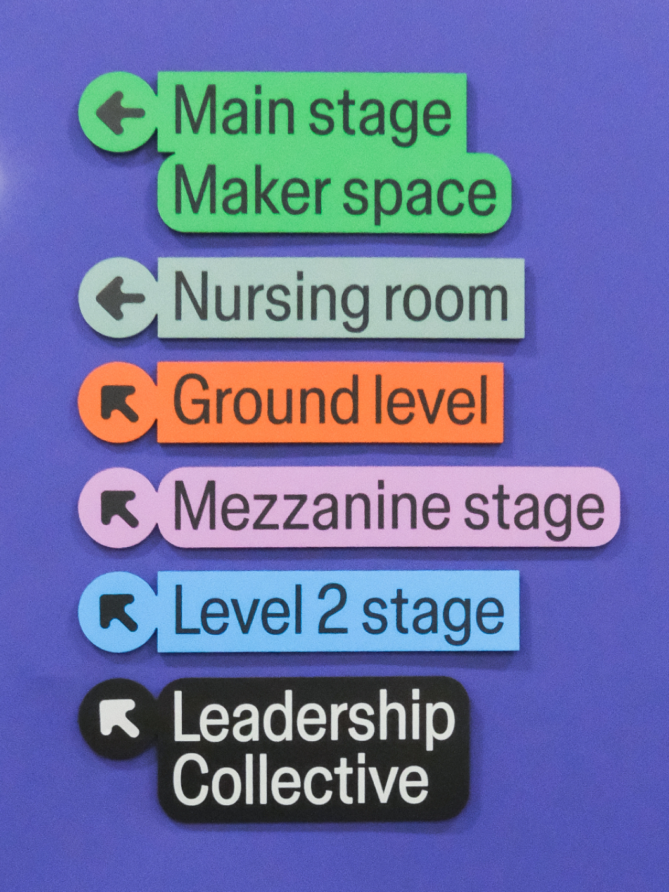

图32-15｜真实案例：Config 2025现场导视，1056×1408；不同目的地与箭头共享一块竖向载体。不是本书设计的指示牌。©Figma及相应设计、摄影权利人，未声明开放许可。[CT-FG1] [原始出处](https://www.figma.com/blog/how-we-shaped-the-visual-identity-for-config-2025/)。

导视把这个问题再推进一步。箭头在左，地点名跟随其后；不同长度的词组仍保持相似的起读方式。彩色底帮助分组，但文字内容并未被大图形打断。最下面较长的名称用了两行，保持词组完整，没有为了让每条牌子同样高就把字无限压小。这些是本书从照片中可见的组织关系，并非官方发布的精确间距公式。

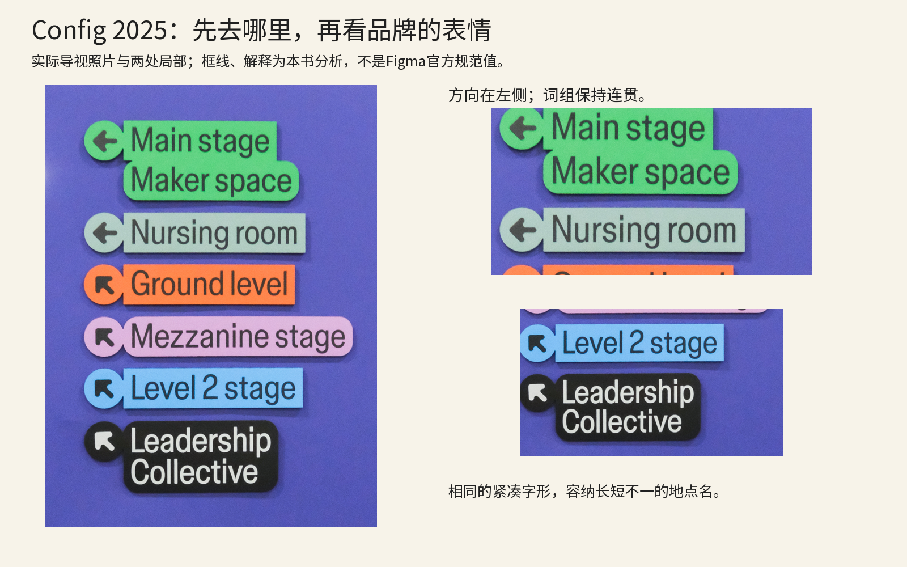

图32-16｜本书分析：实际导视全图与两处原图裁切；中文解释为本书添加，不把观察线索冒充Figma官方规范。未生成替代图形，原照片权利沿用官方归属。[CT-FG1] [原始出处](https://www.figma.com/blog/how-we-shaped-the-visual-identity-for-config-2025/)。

紧缩字体在这里有一个可讨论的收益：有限宽度可以容纳更完整的地点名。但窄并不天然等于易读，还需要检查距离、照明、字间和读者。图上的鲜明颜色也不能单独承担方向意义；人仍可通过箭头和文字理解目的地。这是把表达性放在可检索结构上，而不是让导视成为又一张需要猜谜的海报。

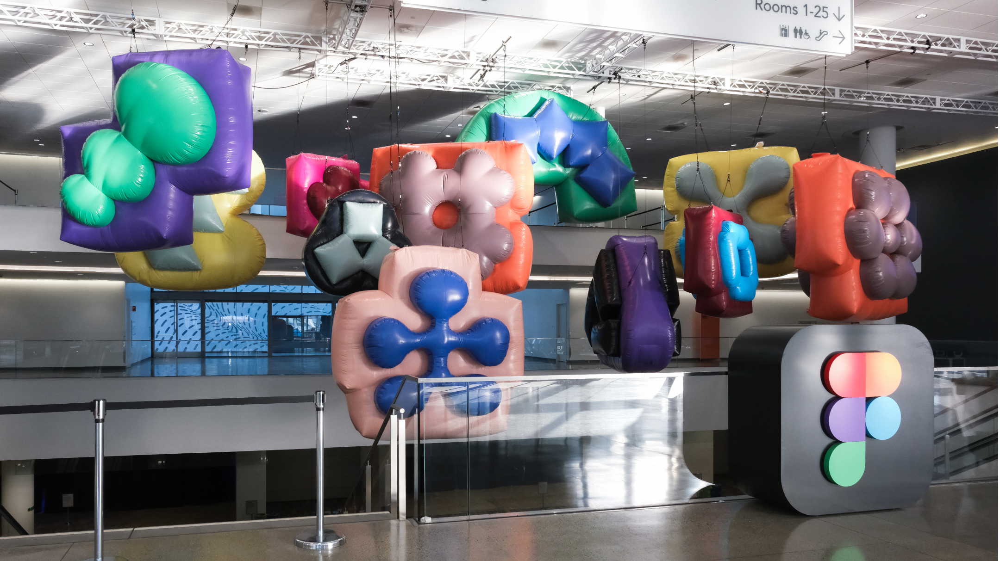

图32-17｜真实案例：Moscone Center内的Config 2025充气图形与空间，2160×1213。Figma Brand Studio空间团队与VTProDesign等合作；本图不作为结构或消防布置图使用。[CT-FG1] [原始出处](https://www.figma.com/blog/how-we-shaped-the-visual-identity-for-config-2025/)。

到了空间，图形的工作再次改变。高处的彩色体量需要先作为远处可见的形体存在，人再走近观看它们的内外关系。弧面上的高光和局部下垂，使它们与屏幕上的平整符号产生差别。规则没有要求把空气、材料和重力藏起来；实体通过新的材质表情继续保留形体关系。这里能学到的是跨媒介转译，而不是将平面图案按比例放大就算完成空间设计。

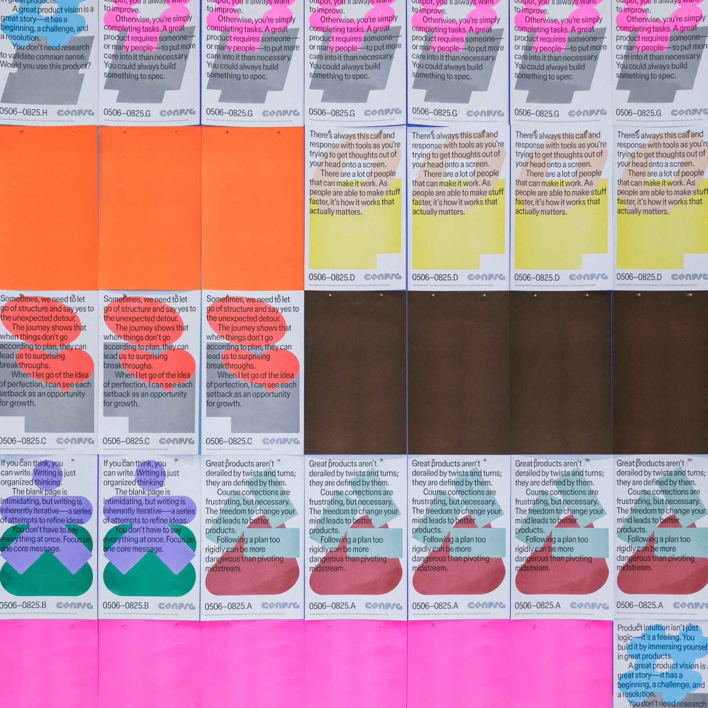

图32-18｜真实案例：Config 2025海报群的实际照片，1608×1608。纸张、墨色和重复排布构成另一种观看节奏；本节不要求读者辨认照片里所有小字。[CT-FG1] [原始出处](https://www.figma.com/blog/how-we-shaped-the-visual-identity-for-config-2025/)。

海报群又把表达转回纸面。强烈色块与密集文字交替，同一尺寸的纸张建立连续边界，局部套色和图形则制造差别。它与充气装置显然不是同一种表面效果，却可以属于同一次活动。若误把一致性理解为每种载体都长得完全相同，就会同时损失纸张的印刷特性和充气物的体积感。

可做的练习是为一个自拟活动设计三个载体：一张远看的欢迎牌、一张近看的身份贴纸、一页可查找的日程。共享一组形状与文字角色，分别控制图形密度。请旁人先找房间，再读身份，最后查时间；若三个任务都要解释，先减去装饰再测。图形的丰富程度可以随任务调整，品牌不必靠每处都塞满图案来证明自己。

本节来源：

- [CT-FG1] Figma Blog，Matt Alagiah，How we shaped the visual identity for Config 2025，2025-07-03：[官方项目回顾与全部原图](https://www.figma.com/blog/how-we-shaped-the-visual-identity-for-config-2025/)。官方摄影总署名为Desmond Studio、VTProDesign、STMNT Studios及Maria Chimishkyan，文章未逐图指派，本书不擅自分配单图作者；保留相应权利，未声明开放许可。

## 32.6 Decathlon 2024：同一个识别，怎样进入身体、文字和摄影

Decathlon在2024年发布新视觉身份，品牌官方发布页说明3月12日对外介绍。Wolff Olins项目页列出策略与视觉身份工作，并将定制字体Decathlon Sans归于Grilli Type。Orbit是这次更新的重要符号，但只看符号对照还不足以理解系统；以下观察实际产品、文字与摄影应用。[CT-DC1][CT-DC2]

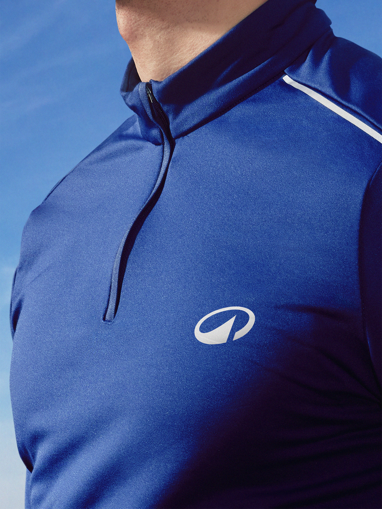

图32-19｜真实案例：Wolff Olins官方案例中的球衣应用，1500×2000；属于2024改版项目展示，官网未逐图标注拍摄日。©Decathlon、Wolff Olins及相应摄影权利人，未声明开放许可。[CT-DC1] [原始出处](https://www.wolffolins.com/work/decathlon)。

先看胸前标记怎样存在。它是一块很简短的反白形，与大片蓝色面料形成对比，但没有试图占据所有表面。拉链、领口和身体轮廓仍然是衣服的主要结构。这个尺度提醒我们，品牌系统面对的不只是理想的矩形画板：图形会接触折痕、弧面、穿着者的动作和不同观看距离。照片能展示一次具体效果，却不能证明运动中、远处或磨损后仍有同样的识别表现。

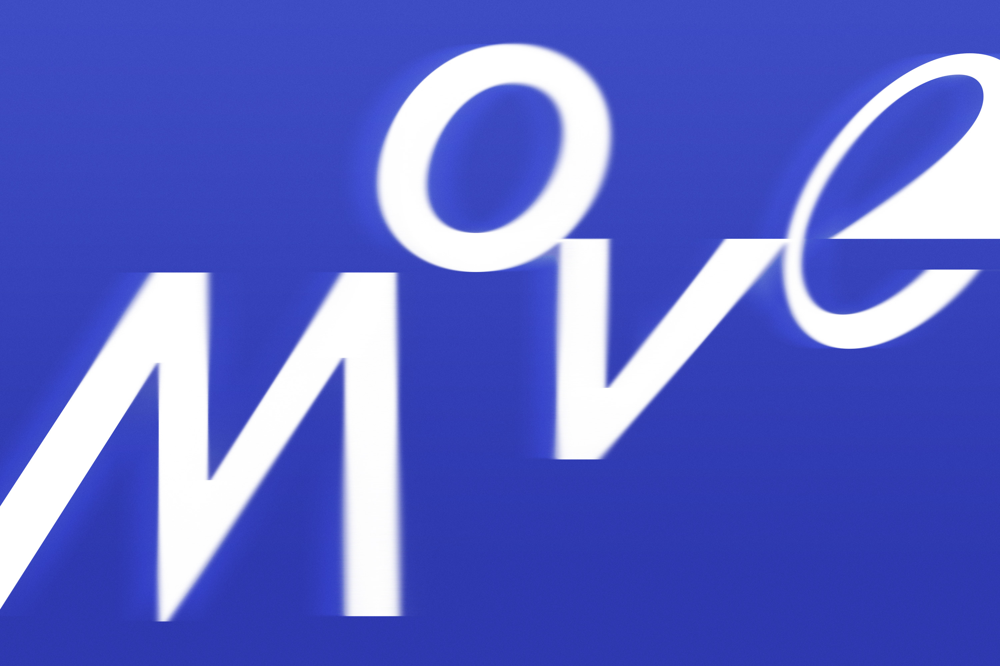

图32-20｜真实案例：Wolff Olins案例中的文字构成，3000×2000；Decathlon Sans字体设计由Grilli Type署名。图中文字的角度与裁切是原作内容，不是本书加上的效果。[CT-DC1] [原始出处](https://www.wolffolins.com/work/decathlon)。

把它与文字图比较，大字承担的角色更激进。字母被分开摆放，笔画的斜向与不同轮廓制造运动感；画框裁切又使部分形态继续向外延伸。球衣标记需要紧凑，文字展示却允许字本身成为场景。两者共享品牌关系，不必共享相同密度。这里讨论可见的字形、角度和占位，并不从一张静态图推断字体的可变轴、替代字形触发规则或动画参数。

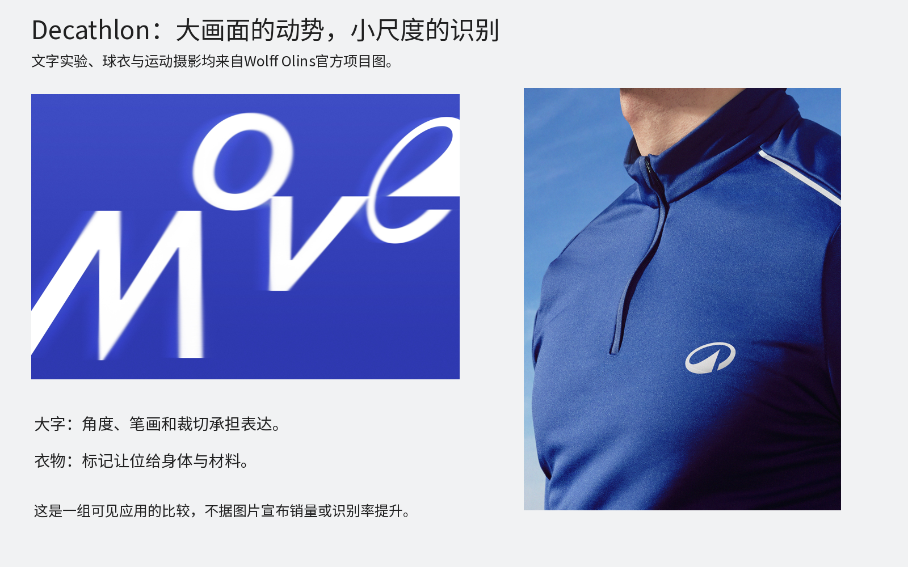

图32-21｜本书分析：两张官方原图仅缩放并列，中文标签为本书添加；没有重画Orbit，也没有用生成图冒充实际应用。原图权利沿用案例页归属。[CT-DC1] [原始出处](https://www.wolffolins.com/work/decathlon)。

这个差别尤其适合设计初学者借鉴：把需要“被记住”的符号压缩得清楚，把需要“被感受”的展示文字放开。但不要把这条观察固化成万能规则。产品参数、尺码与使用说明仍需要稳定字形和清楚层级；如果照搬展示图的拆字与大幅裁切，很容易损害查找。系统真正需要说明的是哪些位置容许夸张，而不只是给出一套看起来很有速度的字。

图32-22｜真实案例：官方案例中的户外行走主视觉，3000×2000。摄影与艺术指导为实际项目展示；具体摄影师按案例页总署名，未将总署名擅自分配给单张。[CT-DC1] [原始出处](https://www.wolffolins.com/work/decathlon)。

摄影提供第三种关系。靠近镜头的人物占据明显位置，另一些参与者从两侧进入，背景仍能辨认出开阔地形。它没有用一座奖杯或一个孤立产品包办画面，运动首先被表现为身体与环境的关系。这可以解释一种更接近日常参与的观看感受，却不能据此证明所有人都会感到被包容，更不能把照片当成经营成功的证据。

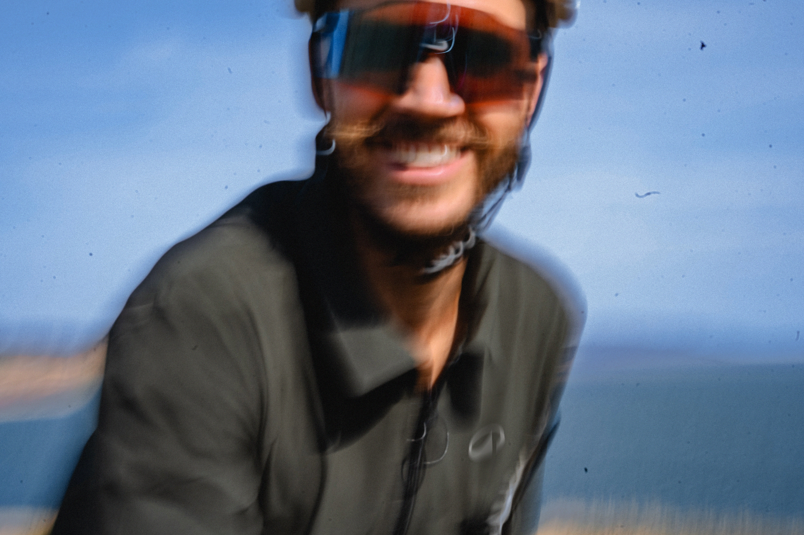

图32-23｜真实案例：同一项目的骑行摄影应用，3000×2000。原图带有近距离与运动中的模糊，本书保留它，不把模糊区域生成补清。[CT-DC1] [原始出处](https://www.wolffolins.com/work/decathlon)。

骑行图更靠近身体，景物被压到外围，眼镜与笑容先被注意到。两张照片没有机械复制人物位置，却都让观者接近参与者，而非只远观完成姿态。它们的共同点更适合写成摄影选择：观看距离、人物与环境的比例、哪些瞬间值得保留。把这些选择讲清楚，往往比规定所有照片都叠同样大小的蓝色图形更有价值。

迁移练习：用自有照片为社区运动日做一张招贴、一枚志愿者标记和一页活动说明。招贴可强调身体与环境，标记应在小尺度可辨，说明页优先保证日期与项目清楚。试着移除全部品牌蓝色，看三个任务是否仍成立；如果只能靠颜色勉强连接，补足形体与信息角色。新的视觉并不自动更好，值得保留的是它在不同使用条件下有依据的取舍。

本节来源：

- [CT-DC1] Wolff Olins，Decathlon：[官方项目案例与全部原图](https://www.wolffolins.com/work/decathlon)。案例总署名包括FourOneNine与Jamie Mourn摄影、Studio PIC三维、Grilli Type字体等；不能将总名单直接分配给每一张图。
- [CT-DC2] Decathlon，Building Decathlon’s next frontier：[品牌官方新身份发布](https://www.decathlon-united.media/decathlon-new-identity)。本书不把视觉的统一误写为所有专门运动品牌被取消，也不以品牌的效果宣言代替独立评估。

## 32.7 把六个案例放在同一张工作桌上

它们的共同点并非颜色大胆、字体很大或总能动画，而是各自找到了一种可继续使用的关系。Pepsi以圆形和脉冲向外扩展；Reddit从对话与投票提取动作；Wise按任务调节表达强度；Spotify把个性留在字形、把秩序留给阅读；Config在空间与印刷中改变形态；Decathlon让身份为运动影像留出位置。

请选其中一种关系，为自己虚构的项目做三种媒介。先写“不变什么”和“必须改变什么”，再制作；最后检查真实内容。若你只得到六张不同颜色的临摹，就回到任务，问一遍：它使人更容易识别、理解或行动了吗？这个问题会把下一章的个人学习路线和上一章的原创工坊接起来。
